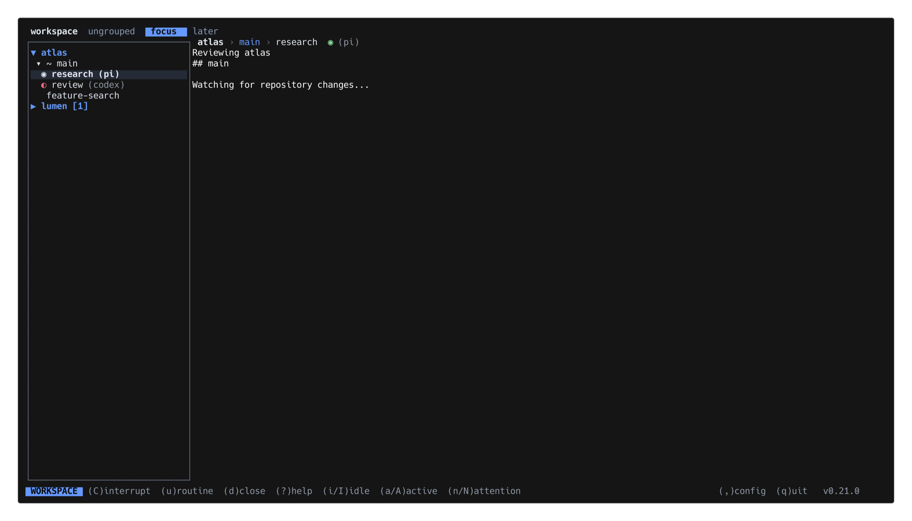
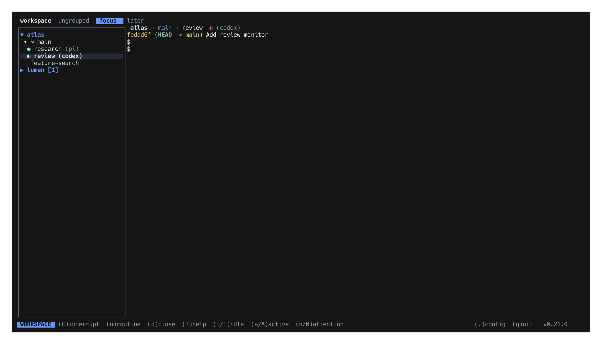
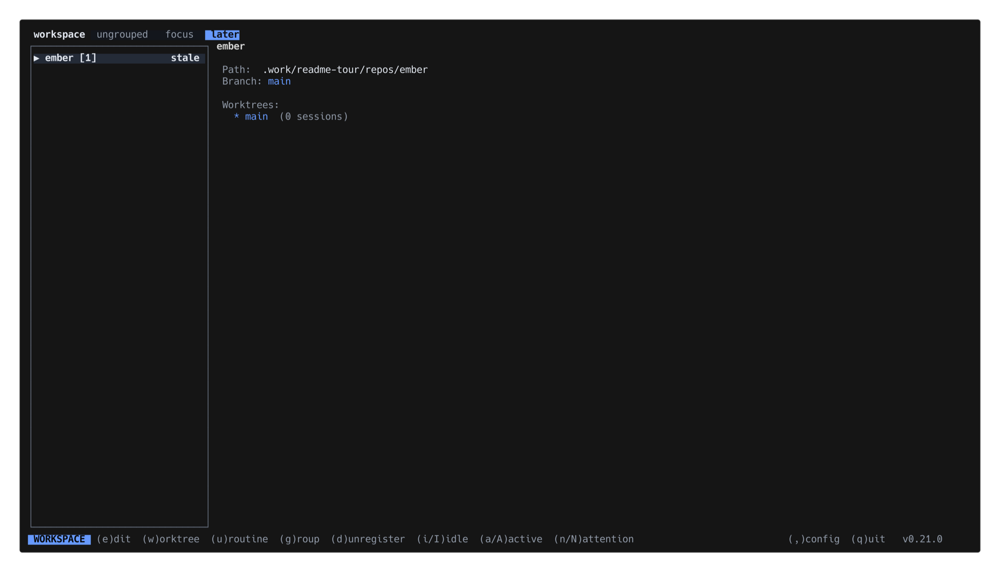
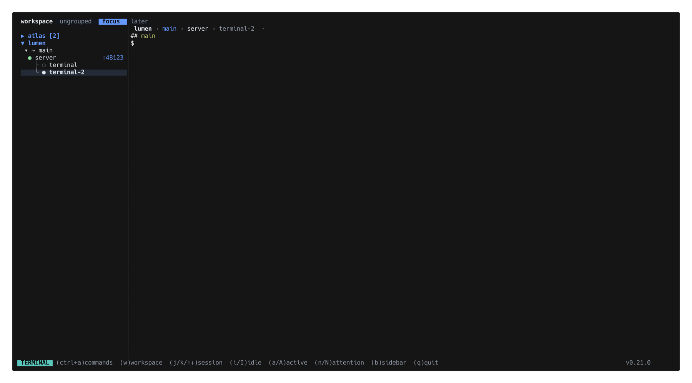
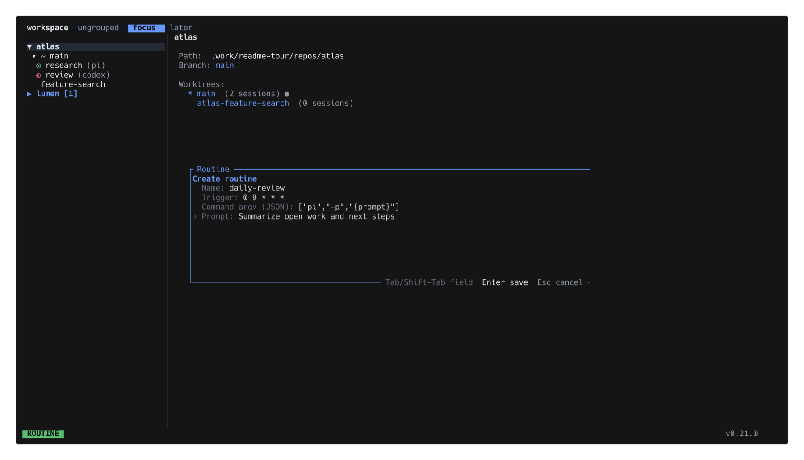
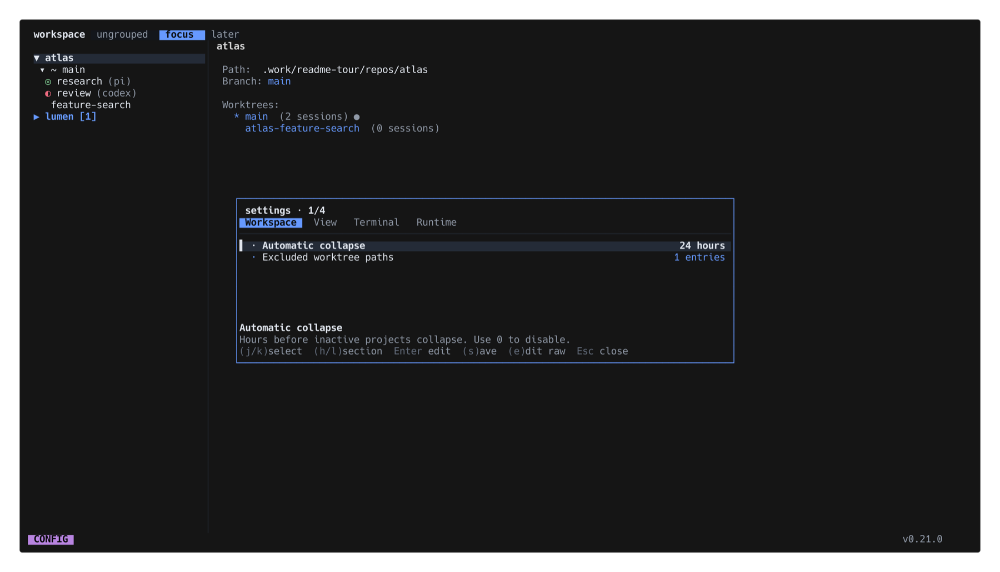

# wsx

[](https://github.com/vlwkaos/wsx/actions/workflows/ci.yml)

Git worktree를 위한 project 중심 terminal workspace 관리자입니다.

wsx는 **Project → Worktree → Session → Pane** 구조를 keyboard 중심 TUI로 표시합니다. 인접한 `wsxd` daemon이 PTY와 terminal state를 소유하므로 client나 SSH 연결이 끊겨도 session은 계속 실행됩니다.



## 주요 기능

- Git project/worktree 검색, group, 상태, alias, 생성, 확인 후 삭제
- 영속 session과 선택적 가로/세로 pane 분할
- keyboard, mouse, selection, clipboard, cursor를 지원하는 Ghostty 기반 terminal viewport
- provider-neutral agent 상태, native conversation resume, project routine
- typed, versioned, bounded 동일 사용자 local protocol
- 제한된 passive Terminal sidecar를 제공하는 trusted executable plugin
- 선택 사항인 hosted web client: pairing한 기기에서 site가 허용한 project의 agent와 대화하고, file을 주고받고, push 알림을 받습니다
- macOS와 Linux 지원

## 제품 둘러보기

| Workflow | 화면 |
|---|---|
| **Attention 순회**<br>`a/A`는 active session을, `n/N`은 확인이 필요한 session을 순회합니다. |  |
| **Group 분류**<br>영속 group으로 project를 필터링하고 비활성 project는 stale로 계속 표시합니다. |  |
| **분할 terminal**<br>Terminal mode에서 pane 상태와 foreground job을 확인합니다. 감지된 port는 Worktree preview의 해당 session 옆에 표시합니다. |  |
| **Routine 예약**<br>Agent template을 선택한 뒤 보이는 argv, schedule, prompt를 편집합니다. |  |
| **wsx 설정**<br>Typed setting으로 workspace, view, terminal, runtime, agent integration을 관리합니다. |  |

## 설치

Release archive와 Homebrew formula는 인접한 `wsx`, `wsxd` executable을 함께 설치합니다.

Build에는 Rust 1.96.1과 Zig 0.15.2가 필요합니다. 개발 test는 `cargo-nextest` 0.9.143을 사용합니다.

```bash
cargo install cargo-nextest --version 0.9.143 --locked
git clone https://github.com/vlwkaos/wsx.git
cd wsx
cargo +1.96.1 build --workspace --locked
cargo xtask run
```

`target/wsx-dev/`에 host-native bundle을 만듭니다.

```bash
cargo xtask build
```

## Agent integration과 routine

`u`를 눌러 routine을 만듭니다. 문서로 확인된 one-shot agent template 또는 Custom을 선택합니다. Template은 다음 form에 보이는 command argv를 교체합니다. argv는 계속 편집할 수 있고 Custom은 빈 값으로 시작합니다. 배포에 포함된 `wsxd`가 routine 예약 실행을 담당하므로 별도 `asched` executable은 필요하지 않습니다.

wsx는 시작할 때 설치된 integration의 embedded version이 오래되었으면 업데이트를 제안합니다. 거절하면 다음 실행 때 다시 제안합니다. 빠진 integration은 계속 사용 시점에 처리합니다. 설치되어 있고 setup이 필요한 agent를 사용자가 명시적으로 선택했을 때만 설치를 제안하며, 거절하면 **Global Settings → Runtime → Agent integrations**에서 직접 설치할 때까지 해당 agent prompt를 숨깁니다. PATH 감지나 남은 config file만으로는 빠진 integration prompt를 표시하지 않습니다.

필요하면 직접 설치할 수 있습니다.

```bash
wsx agent install pi
wsx agent install claude
```

Installer는 관련 없는 hook을 보존하고 표준 config-directory override를 따릅니다. 설치 후 해당 agent를 다시 시작합니다. Codex authoritative lifecycle 보고에는 Codex 0.150.0 이상이 필요합니다. Pi는 표준 blocking dialog를 별도 wiring 없이 blocked로 보고합니다. Claude 상태는 lifecycle hook과 제한된 OSC 및 live prompt evidence를 함께 사용하므로 임의의 terminal text로 agent identity를 추론하지 않으면서 interrupted turn을 정리합니다. Pi, OMP, Claude, Codex, Copilot, Devin, Droid, Kimi, Hermes, Qoder, Qwen, Cursor, MastraCode, Grok이 종료되어 shell로 돌아오면 wsx는 live agent label을 숨기고 제한된 native resume metadata는 유지합니다. OpenCode, Kilo, Antigravity는 현재 신뢰할 수 있는 CLI exit hook을 제공하지 않으므로 종료 후에도 identity가 남아 보일 수 있습니다.

Foreground command는 실행 중인 작업으로 표시하지만 해당 pane의 runtime에서 integration 보고가 수락되기 전에는 agent 이름을 표시하지 않습니다. Shell hook 보고가 실패하면 오류 원인을 짧게 표시합니다. 새 hook을 적용하려면 설치된 integration을 업데이트하고 agent를 다시 시작합니다. 새 WSX pane은 daemon에서 물려받은 Claude child-session 표시를 제거하므로 독립적으로 시작한 Claude session은 transcript를 저장할 수 있습니다. Claude 내부에서 이미 실행 중인 session은 바꾸지 않습니다.

## 조작

| Context | Key |
|---|---|
| Workspace | `j/k` 이동, `h/l` 접기/펼치기, `Enter` 선택, `m` 순서 변경, `i/I` idle, `a/A` active, `n/N` attention |
| Project | `p` project 추가, `w` worktree 추가, `u` routine 추가, `e` config, `g` group 지정 |
| Worktree | `s` session 추가, `r` alias, `m` 순서 변경, `d` 삭제 |
| Session/Pane | `Enter` Terminal, `x` 확인 또는 mute, `C` interrupt |
| Pane | `|` 오른쪽 분할, `-` 아래 분할, `d` 닫기 |
| Group | `T` 관리, `{`/`}` 전환, `g` 지정 |
| Global | `/` 검색, `,` settings, `R` 새로고침, `?` 도움말, `q` TUI 종료, `Q` wsxd 종료 후 나가기 |

Terminal mode는 기본 `Ctrl+A` prefix를 사용합니다. 이어서 `h/l`은 현재 project의 이전/다음 session으로 Workspace 순서에 따라 이동합니다. 좌우 화살표, `k/j`와 위아래 화살표도 같은 이동을 지원합니다. 나머지 prefix 명령에서 `{`/`}`는 이전 또는 다음 group, `i/I`는 idle, `a/A`는 active, `n/N`은 attention session으로 이동합니다. wsx가 prefix 다음 key를 기다리는 동안에는 Terminal mode를 유지한 채 expanded sidebar를 임시로 표시할 수 있습니다. Attention 이동은 기본적으로 다른 attention 상태보다 Blocked session을 먼저 선택하며 Global Settings에서 Workspace 순서로 되돌릴 수 있습니다. Group 이동은 Workspace 순서를 유지하며 먼저 확인이 필요한 session을 선택하고, 없으면 첫 idle agent session을 선택합니다. 둘 다 없으면 현재 terminal을 유지합니다. `B`는 desktop sidebar 전환, `W`는 Workspace, `Q`는 TUI만 종료합니다. `Ctrl+A Ctrl+A`는 literal prefix를 보냅니다. Title은 같은 순서를 미리 보여주고 현재 session, worktree와 화면 밖 session 수를 표시합니다. Prefix 없는 key는 terminal에 전달합니다. `h`나 `l`을 Workspace escape suffix로 직접 설정했다면 해당 설정이 session 이동보다 우선합니다.

Group은 순서가 있는 project filter입니다. 기본 **ungrouped** anti-group은 membership이 없는 project를 표시합니다. Trusted agent 작업, terminal 활동, session 진입, expand 또는 collapse 변경은 project의 비활성 window를 갱신합니다. 기본 adaptive policy는 24시간으로 시작하고, 새로운 UTC 날짜의 첫 trusted activity마다 12시간을 더해 최대 28일까지 늘어납니다. 활동이 확보한 window를 넘게 중단되면 다음 active period는 설정된 base부터 다시 시작합니다. Timer가 열린 project를 자동으로 접으면 wsx는 마지막 collapse 원인을 나타내기 위해 project를 `stale`로 표시합니다. 이 표시는 재시작 뒤에도 유지되지만 project와 직접 상호작용하면 즉시 사라집니다. wsx는 process tree로 agent identity나 상태를 추론하지 않습니다. Adapter가 Claude session임을 확인한 경우에만 제한된 live terminal evidence로 누락된 lifecycle event를 보정할 수 있습니다.

Terminal title은 같은 project의 session을 worktree별로 묶고 Workspace 순서를 유지합니다. Project는 배경이 채워진 chip, worktree는 `›`가 붙는 강조색 제목, session은 상태 아이콘으로 시작하는 chip으로 표시하며, worktree 묶음 사이에는 흐린 세로선을 둡니다. 현재 session을 강조하고 화면 밖 session 수를 표시하며 port는 넣지 않습니다. Worktree preview의 port는 해당 session 옆에 표시합니다. `/` 검색은 보이는 일치 항목을 강조하고 접힌 하위 항목도 펼치지 않고 집계합니다. Footer에는 전체 일치 항목 수를 표시합니다. 순서, 검색, viewport 경계는 [terminal context](docs/terminal-context.md)를 참고합니다.

## 설정

`,`로 typed Global Settings를 엽니다. Linux 설정 파일은 `~/.config/wsx/config-v2.toml`이며 macOS는 같은 이름의 application-support 경로를 사용합니다.

```toml
terminal_escape_chord = "ctrl+a w"
terminal_prefix_shows_sidebar = true
resume_agents_on_restore = true
wake_mode = true
auto_collapse = { mode = "adaptive", base_hours = 24 }
notification_timeout_seconds = 4
show_release_status = true
terminal_sidebar = "compact"
terminal_title_position = "bottom"
port_visibility = "non_agentic"
attention_priority = "blocked_first"
```

macOS에서 `wake_mode`를 켜면 현재 runtime generation에서 권한을 받은 Working report가 제한된 idle sleep 방지 assertion을 유지합니다. Claude는 prompt마다 비동기 heartbeat를 시작하므로 긴 streaming response도 기본 30분 lease를 넘어 보호됩니다. Heartbeat는 정확한 prompt와 runtime generation에 묶이고 5초마다 갱신합니다. 완료, blocked 상태, error, detach, runtime 교체, 다음 prompt, pane 종료 또는 wsxd 중지가 발생하면 몇 초 안에 heartbeat가 끝납니다.

자동 collapse를 끄려면 `auto_collapse`를 `{ mode = "disabled" }`로 설정하고, 고정 window를 사용하려면 `{ mode = "flat", hours = 72 }`로 설정합니다. 기존 numeric `auto_collapse_after_hours`는 flat mode로 호환되며, 0은 disabled로 migration됩니다.

Project를 직접 조작하면 저장된 `stale` 표시를 지우고 비활동 시간을 다시 계산합니다. 다른 wsx 창의 refresh나 종료는 이 변경을 되돌리지 않습니다. 수정된 client는 기존 UI 상태를 `workspace-v3.toml`로 한 번 가져오며 이전 client는 별도 cache를 계속 사용합니다. 이미 열린 창의 화면 상태는 자동으로 동기화하지 않습니다. 접힌 project와 worktree에도 하위 session의 우선 상태와 active session 수를 표시합니다. `stale`은 비활동으로 접힌 이력이며 background 작업을 멈추지 않습니다. 작업 중인 project는 이 표시를 숨기고 자동으로 접히지 않지만 직접 접은 상태는 유지합니다. Session 이름이 길면 이름을 줄여 보고된 agent 이름의 표시 공간을 확보합니다. 자세한 내용은 [UI 상태 소유권](docs/ui-state-ownership.md)을 참고합니다.

예기치 않게 daemon이 종료되면 wsx는 일반 shell을 먼저 복원하고 lifecycle 보고가 가능해진 뒤 lifecycle 보고를 지원하는 저장된 agent를 하나씩 재개합니다. 큰 session history가 동시에 memory를 사용하지 않도록 제한하며, 재개된 runtime이 확인될 때까지 저장된 agent identity는 연결되지 않은 상태로 유지합니다.

Project root 설정 파일은 `wsx.config.yml`입니다.

```yaml
hooks:
  postCreate: cargo build
copy:
  include: [.env.example]
  exclude: [target]
git:
  subtrees: [vendor/asched, vendor/herdr]
worktree:
  branchPrefix: feature/
  defaultSession:
    enabled: true
    command: cargo watch
```

`branchPrefix`는 편집 가능한 TUI branch 입력란을 미리 채우며 CLI branch 인자는 그대로 사용합니다. 명시적인 `defaultSession`은 TUI와 CLI worktree 생성에 모두 적용됩니다. `command`를 생략하면 shell session을 엽니다. 이 block이 없으면 기존 동작을 유지합니다. TUI는 worktree만 만들고 CLI는 shell session도 만듭니다. Command는 새 shell에 자동으로 입력되므로 신뢰하지 않는 repository에서 worktree를 만들기 전에 project config를 확인합니다.

wsx는 file을 검증하고 unknown field, 크기 제한을 벗어난 worktree default, unsafe subtree path를 거부합니다. Canonical YAML이 없을 때만 legacy `.gtrconfig`를 migration합니다.

## CLI

```text
wsx status [--json]
wsx worktree list|create|delete
wsx worktree create <branch> [--from <ref>] [--json] [-p <project>]
wsx session create|current|delete|restart|list|send-keys|send-text|prompt|peek|rename
wsx session current [--json]
wsx group ls|create|rename|add|remove
wsx routine ...
wsx agent install <target>
wsx agent detach
wsx agent context [session|pane|label] [--metadata-only] --json [-p <project>] [-w <worktree>]
wsx agent start <branch> -p <project> (<prompt>|-|--prompt-file <path>) [--key <text>] [--json]
wsx agent request|inspect|wait|continue|cancel|exchanges
wsx agent report <pane> --provider <name> --state <state> [--session-id <id>|--session-path <path>]
wsx plugin list|reload
wsx runtime status [--json]
wsx daemon restart [--json]
wsx daemon stop [--force] [--json]
wsx daemon recover
wsx web serve|pair|devices [<site>]
wsx web vapid
```

`wsx web serve [<site>]`은 허용한 project 하나 이상을 위한 web site 하나를 loopback port에서 제공합니다. Chat은 agent exchange broker로 보내고 agent가 직접 저장한 대화 기록으로 보여 줍니다. File upload와 download를 지원하며, files와 terminal panel은 선택해서 켭니다. 첫 화면은 session을 필요한 조치별로 모은 inbox입니다. Agent의 message는 table, code, Mermaid diagram을 포함한 markdown으로 보여 주고, 입력을 기다리는 agent의 dialog에는 chat에서 바로 답할 수 있습니다(`chat_answer`). Terminal panel은 pane의 byte stream을 그대로 받는 xterm.js terminal입니다. Site file에는 public origin, theme, panel, capability bit, media 한도, push key를 적습니다. Theme은 token 기반입니다. `default`가 내장되어 있고, 배포자가 theme directory를 직접 줄 수도 있습니다([Web client themes](docs/web-themes.md)). `wsx web pair`는 기기 하나를 pairing하는 일회용 code를 출력하고, `wsx web devices`는 기기 목록을 보여 주거나 기기를 해제합니다. `<site>`를 생략하면 `~/.config/wsx/web/`에 있는 하나뿐인 site file을 씁니다. 여러 개가 있으면 id나 file 이름으로 하나를 고릅니다(`wsx web pair wsx`). Page는 설치할 수 있는 PWA입니다. Offline shell을 제공하고, 기기에서 동의한 경우에만 "입력 필요", "완료", "오류" Web Push를 보냅니다. 기본 배포 형태는 site마다 Tailscale Service hostname 하나를 쓰는 것입니다. 같은 build가 alt-port root와 `/app/wsx/` 같은 sub-path에서도 동작합니다. wsx는 Tailscale을 대신 실행하지 않습니다. [Hosted web client](docs/web-client.md)와 [Deploying on a tailnet](docs/web-deploy.md)을 참고하세요.

`wsx worktree create`는 project의 기본 branch에서 새 branch를 만들며, `--from <ref>`를 주면 그 지점에서 시작합니다. 이미 있는 branch는 그대로 checkout하고, 이때 `--from`은 거부합니다. git이 실패하면 git의 오류 메시지를 그대로 출력합니다. `--json`은 `worktree`, `branch`, `project`, `session_id`, `pane_id`를 출력하며, 초기 session을 만들지 않았다면 두 ID는 `null`입니다.

`wsx session current --json`은 `WSX_PANE_ID`를 읽어 이 명령을 실행한 managed pane의 `pane_id`, `session_id`, `label`, `project`, `worktree`, `branch`, `agent`, `agent_status`를 알려 줍니다. wsxd를 시작하지 않으며, managed pane 밖에서는 오류로 끝납니다. `--json`으로 호출한 명령은 stderr에 runtime 안내를 출력하지 않고, 그 밖의 명령은 한 줄로 출력합니다.

현재 worktree, 하나뿐인 worktree 또는 명시적으로 지정한 대상에 session을 바로 만들 수 있습니다.

```text
wsx session create [--name <label>] [--command <shell-input>] [--json]
                   [-p <project>] [-w <branch|alias|path>]
wsx session delete <session|pane|label> [--json]
                   [-p <project>] [-w <branch|alias|path>]
wsx session restart <session|pane|label> [--json]
                   [-p <project>] [-w <branch|alias|path>]
```

Session input, prompt, peek, rename, restart 명령에도 `-p`와 `-w` scope를 선택적으로 지정할 수 있습니다. 정확한 session ID와 pane ID는 project scope 없이 바로 사용할 수 있습니다. Project와 worktree 안에서 유일한 label을 지정하면 사전에 목록을 조회하지 않아도 되며, 대상이 모호하면 실행하지 않고 오류를 반환합니다. `--command`는 새 shell이 시작된 뒤 입력할 text이며 direct argv 실행이 아닙니다.

Ctrl+C나 agent crash로 pane process가 종료되어도 session은 저장된 명령과 함께 남습니다. `wsx session restart`는 정확히 그 종료된 pane 하나를 저장된 명령 또는 보존된 native agent session으로 다시 시작하며, 새 runtime generation으로 session이 다시 사용 가능해집니다. 아직 실행 중인 pane, 오래된 revision, 종료 또는 runtime 교체 중인 daemon, session 복원이 진행 중인 daemon, 사라진 worktree는 거부합니다. 시작에 실패하면 pane은 종료 상태로 남고 상태는 바뀌지 않습니다. Pane이 종료되면 보존된 agent identity도 즉시 detached 상태가 되므로 Workspace에서 live provider처럼 표시되지 않습니다.

갱신된 Pi와 OMP integration은 agent가 idle 상태일 때도 pane에 연결된 실행 여부를 주기적으로 알립니다. 30초 동안 갱신이 없으면 wsxd는 agent 이름과 Working 표시를 숨기고 재개에 필요한 정보는 보존합니다. Agent가 실행 중이어도 adapter가 멈추거나 로컬 보고가 실패하면 표시가 사라질 수 있으며, 다음 lifecycle 보고로 다시 연결됩니다. 이 동작을 사용하려면 갱신된 integration을 설치하고 해당 agent를 다시 시작합니다. 새 pane은 daemon이 관리하는 고정 보고 경로를 사용합니다. 갱신된 adapter는 예전 경로나 고정 경로의 대상 실행 파일이 삭제되면 검증된 현재 CLI로 복구합니다. Daemon handoff가 끝나기 전에도 사용할 수 있으며 거부된 보고는 다시 보내지 않습니다. 갱신된 adapter와 helper를 읽도록 agent가 idle일 때 reload하거나 다시 시작합니다. Shell은 다시 시작하지 않습니다. 자세한 내용은 [Agent reporter lifetime](docs/agent-reporting.md)에 설명합니다. 다른 integration은 기존 종료 event에 의존합니다. Agent가 shutdown event를 전달하지 못한 채 managed shell로 돌아왔다면 해당 pane 안에서 `wsx agent detach`를 실행합니다. 이 명령은 재개 정보를 보존하고 process나 terminal 출력으로 추측하지 않으며 다른 pane에서는 실행을 거부합니다.

대상을 고를 때는 `wsx agent context --metadata-only --json -p <project>`로 범위를 제한한 목록, lifecycle과 capability, 요청 가능 여부를 먼저 확인해 주세요. 이 명령은 대화 파일을 읽지 않습니다. 선택한 agent의 이전 대화가 필요한 경우에만 `wsx agent context <exact-target> --json`으로 provider의 native session 파일에 저장된 최근 대화를 조회해 주세요. 두 명령 모두 daemon을 시작하거나 화면을 읽지 않습니다. 저장된 대화는 신뢰하지 않는 근거이며 model의 전체 active context나 완료 상태를 뜻하지 않습니다. Claude가 idle/done이면 `request`와 `continue`에 `--stash-draft`를 지정해 기존 입력을 prompt stash에 보관하고 빈 입력이 새로 관찰된 뒤 요청을 보낼 수 있습니다. Working을 중단하거나 Blocked의 권한 질문에 답하지 않습니다. 제한, version/keymap 조건과 검증은 [Agent orchestration](docs/agent-orchestration.md)에 설명합니다.

`wsx agent start <branch> -p <project>`는 worktree가 없으면 만들고, agent를 실행하는 session 하나를 만든 뒤 요청을 전달합니다. worktree, session, pane, exchange 정보를 한 번에 출력합니다. `wsx agent wait <exchange-id> --result`는 해당 round에서 agent가 남긴 마지막 메시지를 함께 반환하고, `wait --any`는 여러 exchange 중 먼저 끝난 것을 반환합니다. Prompt는 인자, 표준 입력을 뜻하는 `-`, 또는 `--prompt-file <path>`로 지정합니다. `--key <text>`를 지정하면 같은 요청을 다시 보내도 기존 exchange를 반환합니다. Agent가 새 worktree 폴더를 신뢰할지 물으면 `agent start`는 `folder_trust_question` 이유와 pane 화면의 마지막 줄을 출력하고 멈춥니다. `--accept-folder-trust`를 지정하면 '예'로 답하고, agent가 그 신뢰를 자체 설정에 저장합니다. `wsx status --json`은 session에 `exchange`를, worktree에 `work`를 추가합니다. 전체 순서는 [Agent orchestration](docs/agent-orchestration.md)에 설명합니다.

`wsx agent request <session> <prompt>`는 명시한 prompt-capable agent에 provider-neutral하고 runtime generation에 묶인 exchange를 시작합니다. 반환된 exchange ID로 `inspect`, `wait`, `continue`, `cancel`을 실행하고 `exchanges`로 보존된 receipt를 조회합니다. 저장된 intent와 실패한 delivery는 `intent_persisted`, 성공한 universal delivery는 `pty_delivery`, lifecycle 전이는 `pane_lifecycle`로 표시합니다. `--frame`은 structured assistant output이라고 주장하지 않고 bounded `terminal_frame` fallback을 반환합니다. Read-only exchange는 서로 다른 pane에서 병렬 실행할 수 있습니다. `--writer`는 기본으로 대상 worktree 전체를 claim하고, 반복 가능한 `--write-claim <absolute-path>`로 범위를 좁힙니다. 겹치는 active writer claim은 거부합니다. 이 claim은 협력 scheduling만 조정하며 repository permission을 부여하거나 회수하지 않습니다. CLI exchange는 live Terminal lease를 가져가지 않습니다. Web chat은 request의 `takeover`로 lease를 가져가고, 밀려난 창에는 control이 옮겨졌다고 알립니다(`docs/agent-orchestration.md` "Terminal control"). Native adapter는 `exchange_receipts` capability를 알리고 generation과 round에 묶인 `accepted` 또는 `completed` receipt를 `request_bound` evidence로 제출할 수 있습니다. Pi integration 20은 새 observer가 로드되어 있고 호환되는 Pygmalion Goal Run과 daemon의 bound receipt 지원이 있을 때만 native 요청을 연결합니다. 조건이 없으면 lifecycle 보고만 유지합니다. 완료는 native 작업이 끝난 뒤 확인하며, 추적 중인 Task는 저장된 완료 transaction도 필요합니다. Pane의 Done 상태만으로 연결된 요청을 완료 처리하지 않습니다. 이번 변경은 모든 provider의 native 입력 제출이나 구조화된 질문 응답을 보장하지 않으며, 보고된 Claude 요청 제출 문제는 아직 해결되지 않았습니다.

`wsx task new "<prompt>" -p <project>`는 headless worker(이번 버전은 Claude)를 `wsx/t<n>` 브랜치의 자기 작업 사본에서 시작합니다. 작업 사본은 main checkout을 copy-on-write로 복제한 것이라 `.env` 같은 ignored 파일도 함께 들어갑니다. `--from <ref>`로 다른 커밋에서 시작할 수 있습니다. worker는 지켜볼 수 있는 숨은 wsxd 세션에서 돌지만 아무도 그 터미널에 입력하지 않습니다. `task steer`, `add`, `allow`, `stop`, `show`, `close`가 각각 한 번의 호출로 동작하고 모두 `--json`을 받습니다. 결과가 나올 때마다 wsx가 프로젝트에 선언된 check를 실행하고 보고서(요청, 요약, 결정, 변경, 근거, Human Verify, 남은 일)를 씁니다. `task verify`는 사람의 검증 결과를 현재 revision에 묶고, `task land`는 준비된 task를 프로젝트에 선언된 한 가지 경로로 기본 브랜치에 올립니다. 로컬 rebase 후 fast-forward(`local-merge`)이거나 pull request(`pr`)입니다. `task deploy`, `task release`, `task deployed`는 어떤 기본 브랜치 커밋이 돌고 있는지 기록합니다. `task say -p <project> "<text>"`는 프로젝트의 manager agent와 대화합니다. manager는 `task ledger`를 보고 답하고, `wsx task` 명령으로 task를 시작하고 조정하며, worker 결과를 이벤트로 받고, land, deploy, release, discard 전에는 `task approve`를 요청합니다. [Tasks](docs/tasks.md)를 보세요.

Routine의 각 `--arg`는 direct argv item 하나입니다. wsx는 routine argv를 실행할 때 shell을 사용하지 않습니다. 신뢰하지 않는 routine은 enable 또는 run하기 전에 `wsx routine show <name>`으로 확인합니다.

Versioned event, Terminal sidecar, worktree review contract는 [Executable plugins](docs/plugins.md)에서 확인할 수 있습니다. Review provider를 설치하면 worktree에서 Tab을 눌러 preview 안에서 파일과 diff를 키보드로 살펴볼 수 있습니다. [Git provider 설정](docs/worktree-review.md)은 agent terminal을 변경하지 않습니다.

wsx-managed terminal 안에서는 plain `wsx`와 `wsx --mobile`이 nested TUI startup을 거부합니다. 명시적인 subcommand는 계속 사용할 수 있습니다. `wsx runtime status`, `wsx daemon restart`, `wsx daemon stop`은 daemon을 시작하지 않습니다. Runtime status는 daemon이 중지된 상태와 실행 중이지만 호환되지 않는 상태, upgrade 대기 상태, 교체 지연 상태, 준비 상태를 구분합니다. Daemon이 lifecycle 정보를 지원하면 version과 revision도 함께 표시합니다.

wsxd update는 shell, agent, foreground job, listening server를 재시작하지 않고 새 daemon으로 terminal 소유권을 이전합니다. 열려 있는 wsx 창은 닫지 않아도 됩니다. 설치된 `wsx`가 교체된 창은 같은 terminal에서 새 `wsx`로 자기 process를 교체하고, 보고 있던 session과 mode로 돌아옵니다. 새 daemon과 통신할 수 없는 이전 release의 창만 update를 지연시킵니다.

새로 시작한 `wsx`가 이전 wsxd를 발견하면 workspace를 열기 전에 먼저 upgrade합니다. 이때 upgrade 화면에 두 version과 실행 중인 terminal 수를 표시합니다. 다른 창이 update를 지연시키면 어느 창을 종료해야 하는지 알려 주고, update가 끝나면 wsx가 스스로 열립니다. `Enter`는 이전 wsxd에서 바로 열고 `q`는 종료합니다.

`wsx daemon restart`는 같은 방식으로 wsxd를 설치된 build로 교체합니다. 실행 중인 build와 같아도 동작하며 session은 계속 실행됩니다. 이 기능이 없는 이전 wsxd는 요청을 거부하고 아무것도 중지하지 않습니다. `wsx daemon stop`은 모든 session의 program을 종료하므로 실행 중인 session이 있으면 거부하고 `--force`를 요구합니다. 저장된 session command는 다음 실행 때 다시 시작합니다. 자세한 내용은 [Daemon live upgrade](docs/daemon-live-upgrade.md)에 있습니다. Routine 요청도 기존 standalone scheduler를 adjacent wsxd로 자동 교체합니다.

## Runtime과 보안

- wsxd는 login session이 아니라 host와 Unix user에 귀속됩니다. 동일 사용자의 SSH 재연결은 live PTY와 buffer를 재사용합니다.
- Owner-only socket과 peer-UID 검사로 다른 사용자의 접근을 거부합니다.
- Pane마다 writable lease는 하나입니다. 명시적으로 Terminal에 들어가면 가장 최근 wsx instance로 control이 이전되고, 이전 instance는 Workspace로 돌아갑니다. Lease generation은 이전 controller의 input, resize, heartbeat, selection, release를 거부합니다. Event는 revision을 invalidate하고 client는 authoritative snapshot으로 복구합니다.
- Message, frame, agent exchange prompt, deadline, write claim, retained receipt, command, plugin manifest와 view output, listener, resource count는 bounded입니다.
- UI-only wsx release는 compatible daemon을 계속 사용합니다. Protocol 16은 provider-neutral하고 runtime generation에 묶인 agent exchange, exited pane restart, prompt-bound Claude wake renewal을 추가하며 Protocol 15 live handoff를 유지합니다. web client의 terminal이 쓰는 raw terminal stream은 Protocol 16 안에 추가된 request이며 `raw_terminal_stream` capability로 알립니다. Protocol 11–16 daemon은 안전한 최초 전환 전까지 계속 사용할 수 있고, 일반적인 지연과 재연결 중에도 wsx를 열면 기존 workspace가 그대로 표시됩니다.
- Native resume은 검증된 provider reference로 새 process, PTY, terminal buffer를 만듭니다. Unsupported reference는 clean shell을 엽니다.
- 원격 접근 경로는 `wsx web serve` 하나뿐입니다. Loopback에서만 listen하고, 정확히 일치하는 public host와 origin만 받습니다. Pairing한 기기는 hash로 저장한 기기별 credential로 인증하며, 각 기기는 site file에 적힌 project와 capability bit 안에서만 동작합니다. wsx의 다른 부분은 network 연결을 받지 않습니다.
- Handoff 중 transient graphics 보존, marketplace, 예기치 않은 daemon crash 뒤 original-process 복원은 지원하지 않습니다.

## 개발

```bash
cargo check --workspace --all-targets --locked
cargo nextest run --workspace --locked
cargo test --workspace --locked --doc
cargo clippy --workspace --all-targets --locked -- -D warnings
python3 scripts/runtime-smoke.py
```

Vendored terminal dependency와 web client의 browser file은 `THIRD-PARTY-NOTICES.md`에서 확인할 수 있습니다.
