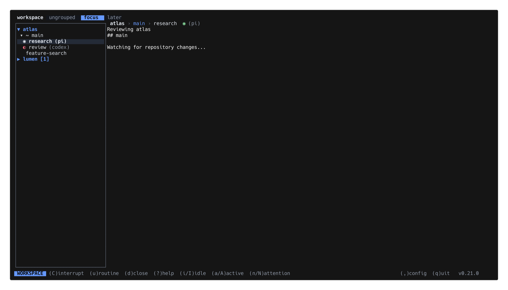
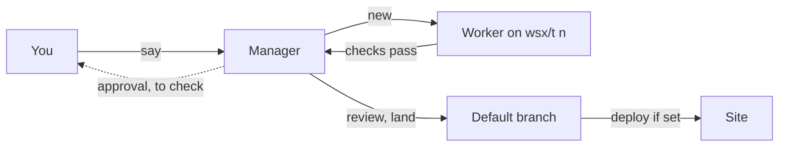
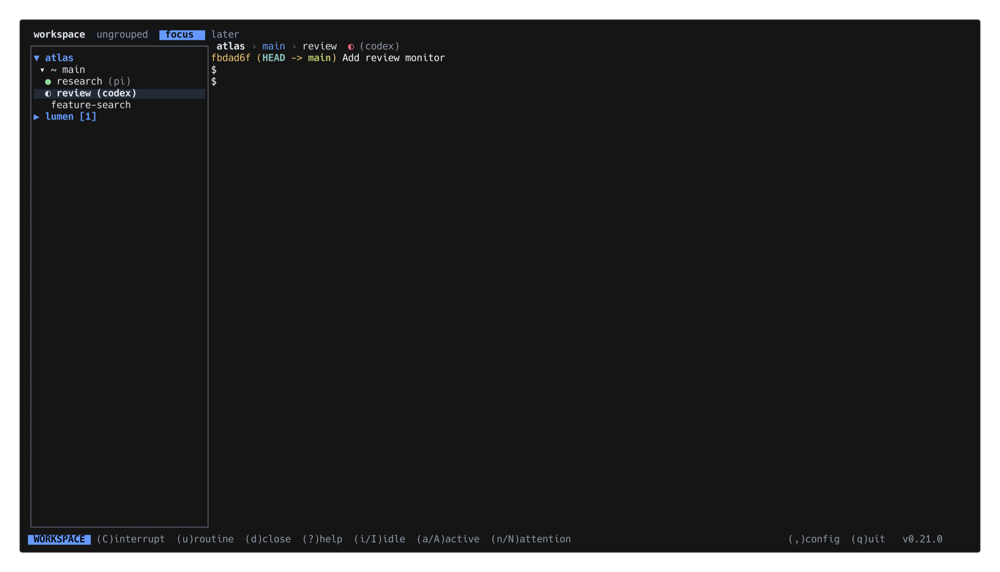
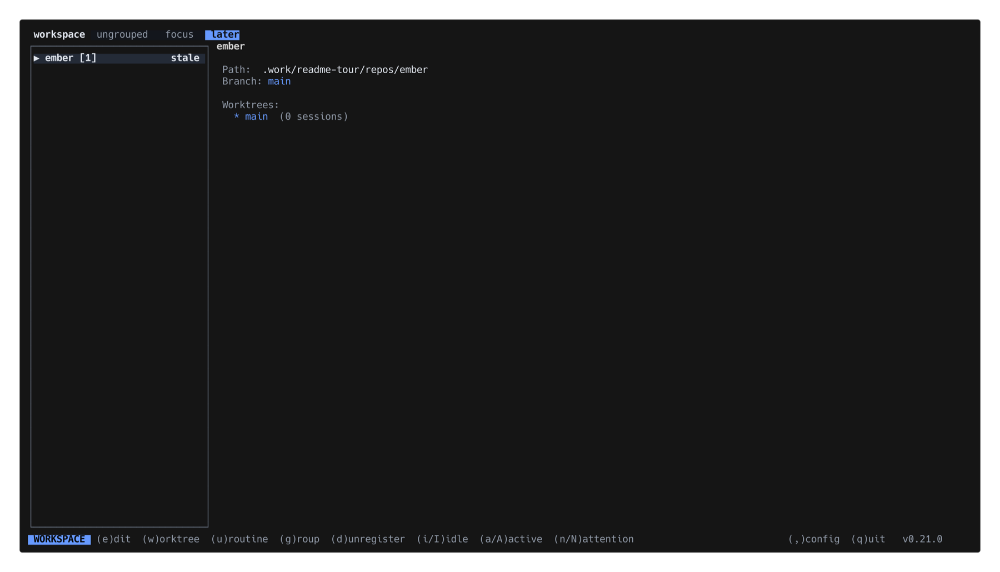
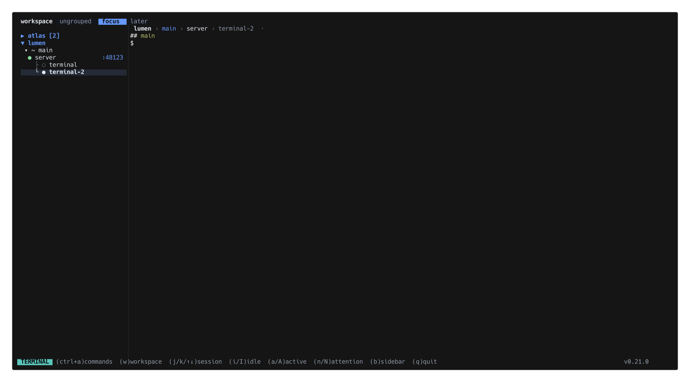
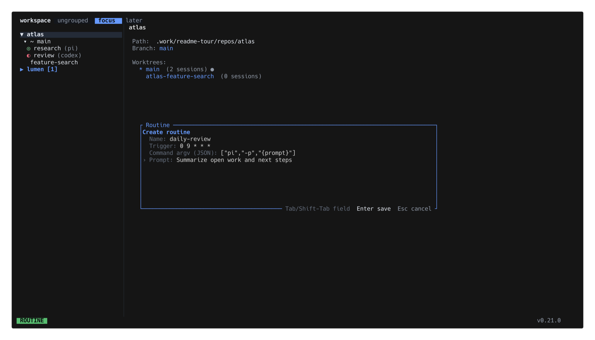
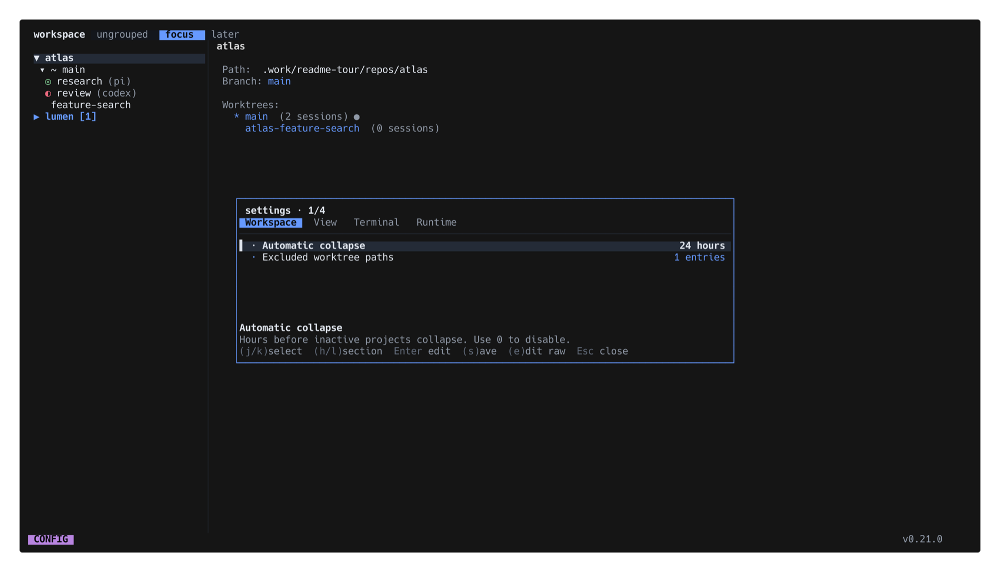

# wsx

[](https://github.com/vlwkaos/wsx/actions/workflows/ci.yml)

Project-first terminal workspace manager for Git worktrees, with a manager that runs coding tasks for you.



## Features

- **Project → Worktree → Session → Pane** in a keyboard-first TUI
- Persistent sessions: the `wsxd` daemon owns PTYs and terminal state, so sessions survive client and SSH disconnects
- Ghostty-based terminal with splits, mouse, selection and clipboard
- Agent states, native resume, routines and a [manager](#manager-flow) per project
- Optional hosted web client: chat, files, push notifications ([docs](docs/web-client.md))
- Executable [plugins](docs/plugins.md); macOS and Linux

## Manager flow



- Talk to a project's manager with `wsx task say`, the web chat, or `t` then `m` in the TUI.
- The manager plans and starts tasks. A task is a headless worker on branch `wsx/t<n>` in its own working copy.
- The host runs the project's checks. The manager reviews the diff and lands the task.
- A deploy follows a land by itself where `tasks.deploy.auto` is set.
- Deploy, release, discard, push and project add wait for you in **Needs you**.
- **To check** holds only what a person must look at or feel.
- A role is a second chat with its own brief and model, for one area of work.
- A manager can run tasks in another registered project. It gets their events and memo back.
- Routines (cron or event) and check-ins wake the manager. `wsx memory` keeps its records.

Details: [tasks](docs/tasks.md), [orchestration](docs/agent-orchestration.md), [memory](docs/memory.md).

## Product tour

| Workflow | Guide |
|---|---|
| **Iterate attention**<br>`a/A` visits active sessions. `n/N` visits sessions that need attention. |  |
| **Group work**<br>Persistent groups filter projects. Inactive projects remain visible as stale. |  |
| **Use split terminals**<br>Terminal mode shows pane state and foreground jobs. Worktree previews show each session's detected ports. |  |
| **Schedule routines**<br>Select an agent template, then edit its visible argv, schedule, and prompt. |  |
| **Configure wsx**<br>Typed settings cover workspace, view, terminal, runtime, and agent integrations. |  |

## Install

Release archives and the Homebrew formula install adjacent `wsx` and `wsxd` executables.

To build, you need Rust 1.96.1 and Zig 0.15.2. Tests use `cargo-nextest` 0.9.143.

```bash
cargo install cargo-nextest --version 0.9.143 --locked
git clone https://github.com/vlwkaos/wsx.git
cd wsx
cargo +1.96.1 build --workspace --locked
cargo xtask run      # or `cargo xtask build` for a bundle in target/wsx-dev/
```

Set up agent hooks with `wsx agent install claude` (or `pi`). See [integrations](docs/agent-reporting.md#integrations).

## Keys

| Context | Keys |
|---|---|
| Workspace | `j/k` move, `h/l` fold, `Enter` select, `m` reorder, `[`/`]` project, `i/I` idle, `a/A` active, `n/N` attention |
| Project | `p` add, `d` unregister (`H` also halts), `w` worktree, `u` routine, `e` config, `g` group, `v` panels, `M` this Mac's panels, `t` tasks |
| Tasks | `m` manager chat, `S` shell, `o` overview, `a` agent, `u` usage; in the chat `i` write, `/` find, `PgUp/PgDn` page, `g/G` oldest or newest, `?` keys |
| Worktree | `s` session, `r` alias, `d` delete |
| Session or pane | `Enter` terminal, `x` acknowledge or mute, `C` interrupt, `\|` split right, `-` split down |
| Routine | `Enter` run history, `r` run now, `Space` on or off, `e` edit, `d` delete |
| Groups and profiles | `T` manage, `{`/`}` switch, `P` next profile |
| Global | `/` search, `,` settings, `R` refresh, `?` help (scrolls), `q` quit TUI, `Q` stop wsxd and quit |

In a terminal, the prefix is `Ctrl+A`. Prefix then `h/l` moves between the project's sessions. More keys: [terminal context](docs/terminal-context.md). The `?` help lists the rest.

## CLI

```text
wsx status | worktree | session | group | routine | memory | plugin | runtime | daemon
wsx agent install|context|start|request|wait|...     # docs/agent-orchestration.md
wsx task new|say|list|show|land|check|...             # docs/tasks.md
wsx web serve|pair|devices                            # docs/web-client.md
```

All commands and their details: [CLI and runtime](docs/cli.md). Settings, profiles and `wsx.config.yml`: [configuration](docs/configuration.md).

## Development

```bash
cargo check --workspace --all-targets --locked
cargo nextest run --workspace --locked
cargo clippy --workspace --all-targets --locked -- -D warnings
python3 scripts/runtime-smoke.py
```

See `THIRD-PARTY-NOTICES.md` for vendored terminal dependencies and the web client's browser files.
