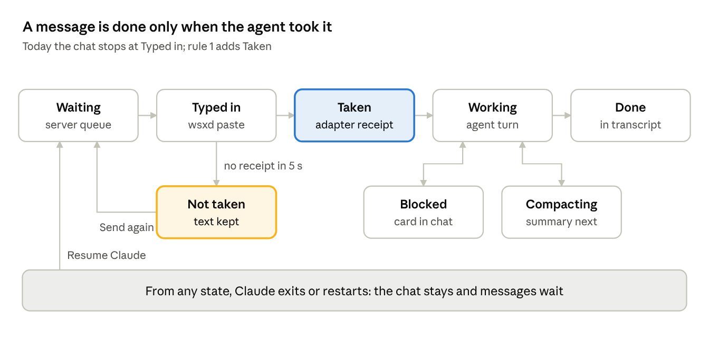

# Chat and terminal bridge

Design, 2026-10-21. The chat must be safe to use without the terminal: every message ends visibly as taken by the agent, sent again, or explained. A restart, a new conversation or a compaction keeps the chat in place and is marked in it. The chat asks nothing; it recovers by itself and shows what it did.

## What breaks today

| Situation | What the chat does now | Evidence |
| --- | --- | --- |
| A paste lands the moment a turn ends | Counts it as delivered. Claude drops it, and the next turn typed in the terminal is tied to that round | Exchange 1816 round 2, delivered 08:33:50 on 10-21, absent from the transcript. Text loss fixed in `25dcd9d` (kept, Copy, Send again); the false delivery is not |
| Claude exits or is restarted in the pane | The pane becomes a shell: the chat tab disappears, the open round ends, waiting messages stop | `session.js`: a shell has no chat. Seen on 10-21 after a Claude restart |
| A new conversation in the same pane (`/clear`, Claude started without resume) | Shows only the new transcript; the earlier one cannot be opened | The chat reads the agent's current transcript only |
| Compaction, by `/compact` or automatically | Shows the summary as one item; the wait reads as plain "working" | `PreCompact` is reported as working |
| The terminal shows something the chat cannot read: an update notice, a login, an unknown dialog | Waits with no reason given | Only the permission and question dialogs become cards |
| A wsx window holds the pane | The chat takes the pane over | Works (`takeover`) |
| Terminal: arrow keys | The input box flickers while Claude redraws it | xterm.js 5.5.0 has no synchronized output; it came in 6.0 |
| Terminal: scrolling | Jumps away from where the person reads; no quick way back to the end | No jump-to-latest control in the terminal view |

## A message's life

The new step is Taken: the agent's own hook names the round it accepted. Everything that can stop a message has a state the chat shows and one way out, taken by the chat itself.

## Five rules

One owner per fact: wsxd knows the agent and the rounds, the transcript says what was said, the screen says what the terminal shows now. The web server joins them into one view per session.

1. **Taken, not typed.** A round counts as delivered only when the agent says it took it. Claude's `UserPromptSubmit` hook reports the round it received to wsxd as accepted. No acceptance within 5 s while the agent is idle: the round is *not taken*, its text stays, and a turn typed in the terminal is never tied to it.
2. **The chat outlives the agent.** A pane that had an agent keeps its chat when it becomes a shell. The chat shows the last conversation, keeps waiting messages, and resumes Claude in that conversation when a message is sent.
3. **Conversations are a chain.** When the conversation in a pane changes, the chat draws a divider and keeps the earlier ones readable.
4. **Say what the agent is doing.** Compacting shows as compacting, from `PreCompact` to the summary. A known dialog is a card. Anything else that holds a round shows the last lines of the terminal screen, with **Open terminal**.
5. **Recover by itself, show it in place.** No question to the person for these cases.

## What the chat shows (owner's decision, 2026-10-21)

"Chat should be clear on whether the current session is being continued or it is a compacted session (new session). Make this more explicit so hiccups are discoverable; otherwise do not ask the user but work seamlessly and show it on the screen."

| Event | What the chat does | Line in the conversation |
| --- | --- | --- |
| Message not taken | Sends it again once, by itself, when Claude's input box is empty | "Sent again: Claude did not take it the first time" |
| Not taken a second time | Keeps the text with Copy and Send again | "Claude did not take this message" |
| Claude exited, a message is sent | Resumes Claude in the same conversation, then delivers | "Claude exited at 08:31 · resumed" |
| Claude restarted and resumed the same conversation | Continues the chat | "Same conversation, continued" |
| Conversation compacted | Summary item, as now | "Compacted · earlier messages are summarized" |
| New conversation in the pane | Divider; the earlier one stays readable above it | "New conversation" |
| Something only the terminal shows | Last screen lines in place | "The terminal shows: …" + Open terminal |

## Terminal fixes

| Problem | Cause | Fix | Check |
| --- | --- | --- | --- |
| Flicker on arrow keys | Claude wraps each redraw in synchronized output (`CSI ? 2026`). wsxd holds frames for it, but the web gets raw bytes, and xterm.js 5.5.0 ignores the mode | wsxd holds the raw stream inside a synchronized update too, up to the 1 s bound it already uses for frames | Browser check: a redraw inside a synchronized update reaches xterm.js in one message |
| No quick way to the end | Missing control | **Jump to latest** while the view is scrolled up | Browser check at 390 px |
| Scroll jumps | Not reproduced yet; xterm.js issue #5801 is a candidate | Reproduce with a real Claude at phone size, then fix | The same reproduction |

## Order of work

1. Taken, not typed, with the dropped-paste case as a scenario test.
2. Terminal: flicker and Jump to latest.
3. The chat outlives the agent, and the conversation chain, tested with a real Claude that exits, resumes and clears.
4. Compacting state and screen lines for unknown holds.
5. Reproduce the scroll jump and fix it.

## Sources

- [xterm.js PR #5453: synchronized output (DEC mode 2026)](https://github.com/xtermjs/xterm.js/pull/5453)
- [xterm.js issue #5801: screen clear inside a synchronized update resets the viewport](https://github.com/xtermjs/xterm.js/issues/5801)
- `docs/agent-orchestration.md` (Deliver without merging a draft, Interrupted turn, Native request-bound receipts), `docs/terminal-synchronized-output.md`, `docs/web-client.md` (Terminal, Queue and Stop)
