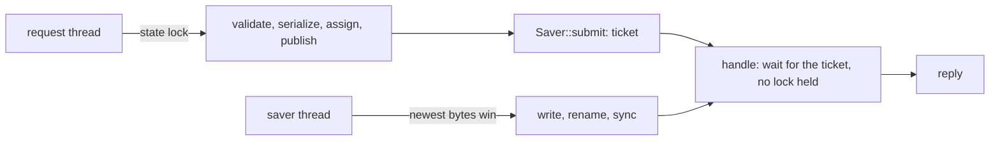

# Daemon state store

`wsxd` keeps its durable state (projects, worktrees, sessions, panes and their recovery recipes, agent identity, exchanges) in `state.json` beside its socket ([daemon-discovery.md](daemon-discovery.md)). The code is `crates/wsx-daemon/src/state_store.rs`.

## A change and its save

1. Under the state lock, a change is validated and serialized (`state_store::encode`), then becomes the in-memory state and its event. An invalid state or one over 8 MiB is refused and changes nothing.
2. The bytes go to the one saver thread. A submission replaces one not yet written, so a burst of changes is one write.
3. `dispatch::handle` waits for the request's ticket after the handler has dropped the state and mutation locks, then replies. A reply means the change is on disk. A `kill -9` after the reply keeps it.
4. If the write fails, the request gets `durability_degraded`: the change is live in memory but not yet saved. The saver writes the newest state again every second, and at once on the next change. A failed save no longer rolls the change back, because other writers (a pane exit, presence expiry) change the state without the mutation lock.

Changes outside a request (pane exit, presence expiry, cold recovery, a resize sent on a terminal stream) submit and do not wait. Cold recovery and shutdown call `Saver::flush` after they drop the lock.

## The write

The file is written as `state.json.tmp.<pid>.<n>` with mode 0600 and `O_NOFOLLOW`, then renamed over the primary. The name must be new: one that a process killed mid-save left behind under a reused pid takes the next `<n>`. The old primary becomes `state.json.backup`. A primary that does not load is never rotated over the backup. `load` reads the backup when the primary is missing or invalid, and moves an invalid primary to `state.json.corrupt.<ms>`.

## Syncs

One full drive flush per save, not three:

| Step | Sync | Why |
|---|---|---|
| temp file | `F_BARRIERFSYNC` (macOS), `fdatasync` elsewhere | The bytes reach the drive ahead of the rename that publishes them. |
| primary to backup rename | none | A crash between the two renames leaves no primary, and `load` reads the backup. |
| directory, at the end | `F_FULLFSYNC` (`File::sync_all`) | Makes the renames, and the file bytes fsync'd before, durable. |

On macOS a plain `fsync` "moves" data to the drive, but "the drive itself may not physically write the data ... for quite some time and it may be written in an out-of-order sequence" ([fsync(2)](https://developer.apple.com/library/archive/documentation/System/Conceptual/ManPages_iPhoneOS/man2/fsync.2.html)). `F_FULLFSYNC` "drains the entire queue of the device ... data that had been fsync'd on the same device before is guaranteed to be persisted when this call returns". `F_BARRIERFSYNC` "does the same thing as fsync(2) then issues a barrier command to the drive" ([fcntl(2)](https://keith.github.io/xcode-man-pages/fcntl.2.html)).

## Live handoff

Before it exports its state, the old daemon holds the saver (`Saver::hold`): the write in progress ends, and later changes are not written. It then writes the newest state on its own thread (`flush_held`). After the commit the successor alone writes `state.json`. A rollback releases the saver, which writes what was held ([daemon-live-upgrade.md](daemon-live-upgrade.md)).
