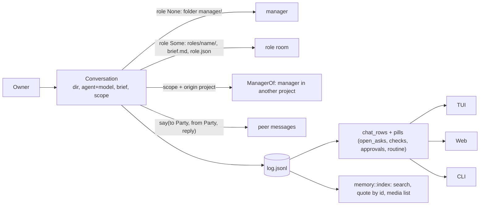

# Chat and roles: lean audit

Read-only audit at `6f8ac74a`; no code changed. Every row below was read in the code (file:line). Line savings are estimates. Items I could not prove are in "Not proven".

## First principles

An owner talks to an agent. That is one **conversation**: a folder with `log.jsonl`, an agent, a brief, and a scope of projects. Everything else is a setting or a view of that log.

| Concept | One idea | Where the code keeps more than one |
|---|---|---|
| Who is the other party | `Party { Manager, Role(n), Project(p) }` | `Actor`, `Author`, `Hearer`, `Speaker::Peer` and a `role:<n>` string (F1, F5) |
| Manager vs role | same host, data differs (brief, model, capabilities) | one host with `if role` forks; manager-only watchers inside (F6, F7) |
| Reading a chat | `read(project, role, window)` | three recipes (F2) |
| Owner actions | core functions | TUI in-process, web spawns `wsx` (F4) |

## Ranked findings

| # | Finding | Evidence | Lines | Risk |
|---|---|---|---|---|
| F1 | Peer key `role:<n>` / `manager` built or parsed by hand at 9 sites, no type | `broker.rs:216,329-331`; `manager.rs:1902`; core `chat.rs:726,748`; core `manager.rs:62,67,91`; `memory/index.rs:551-552`; core `mod.rs:190,202` | 60 | med |
| F2 | Chat read recipe (dir, shown name, `manager_name_in`, `Names`, "approvals only for the manager") written 3 times | web `tasks.rs:681-721`; `task_chat.rs:705-740`; `cmd/chat.rs:134-154` | 70 | low |
| F3 | `wsx task chat` text mode matches raw entries: prints `{from:?}` (Debug of `Author`), literal `manager` in a role room, drops `Sent`; `ManagerDir::open` creates the folder on a read while `store.rs:999` says a reader never does | `cmd/chat.rs:137,163-187` vs core `chat.rs:578 page().rows` (unused by the CLI) | 25 | low |
| F4 | Same owner actions twice: TUI calls `chat::dismiss`/`checks::close` in-process, web spawns `wsx task dismiss/check`; `Status` request sent from 4 places with 3 timeouts | `task_chat.rs:630,638-649` vs web `tasks.rs:1081-1111`; `Status`: `owner.rs:40`, `tasks.rs:121`, `cmd/chat.rs:378`, `task_chat.rs:434` | 55 | med |
| F5 | Host identity from `dir.role` three times, while `policy::Role::of_actor` exists; `ACTOR_ENV` set as the literal `"manager"` | `manager.rs:1630-1634` (`actor()` String), `2805-2808` (policy role), `3508`; `policy.rs:245` | 30 | low |
| F6 | Dead role branch: a role host takes `Tick` at `manager.rs:535`, so `watch_tasks` (538) never runs for it; the `Some(_)` arm of `fold_memo` and `notes::fold_memo` have no other caller | `manager.rs:1103,1209,1297-1299`; `notes.rs:214` | 45 | low |
| F7 | Role = manager host plus 10 `dir.role` tests; manager-only state (stalls, recap, prune, ping, overview) lives in the shared `Manager` struct | `manager.rs:535,1297,1631,1645,2617,2805,2825,3098,3122,3211` | structure | high |
| F8 | Role gets the manager prompt, then a preamble that cancels parts of it; its boundary still has the manager's `overview` write prefix | `manager.rs:293-297,2825`; `instructions.rs:25`; `boundary.rs:98-101`, `manager.rs:2810` | 20 | med |
| F9 | Quote wire format `> message <id>` / `> check <id>` built outside core; two consts named `QUOTE_REF` | `tasks.js:444`; `task_chat.rs:588`; core `manager.rs:332`, `checks.rs:236` | 10 | low |
| F10 | Web server decides by store file layout (`manager`, `roles`) that core keeps private | `wsx-web/src/tasks.rs:1604-1625` | 15 | low |
| F11 | `ManagerDir` open forks on `role` (`open_as`/`existing_as`, `owner.rs:35-38`, `manager.rs:331`); "every chat folder" walk written 4 times; `owner::post/checkin` use creating `open` only for a socket path | `store.rs:977-1005`; `media.rs:132`; `index.rs:481-488`; `roles.rs:64-72`; `owner.rs:101,111` | 45 | low |
| F12 | TUI task list rebuilds from the 16 KB agent ledger: `open_omitted` is set but read nowhere, so rows past the cap vanish; the TUI re-sorts with its own `rank` | `task_list.rs:182,392-403`; `ledger.rs:236-243`; `open_omitted` only at `ledger.rs:131,242` | 45 | med |
| F13 | `by: Actor` on log events `Hold`, `After`, `Hand`, `Handback` and `HostRequest::Hold/After` is written (6 sites), never read (`stall.rs:93`, `manager.rs:312` use `{ .. }`; `history.rs` does not word them) | core `mod.rs:485-510,716-726`; `host.rs:785,914,928,972,1201,1236`; `new.rs:378,384` | 15 | low |
| F14 | Event-name lists repeated in 3 JS places | `api.js:81`; `main.js:222,231` | 15 | low |
| F15 | One-use options and exports: `media::Filter.limit` is `0` at both callers; JS exports used only in their file (`uploadFiles` `chat.js:145`, `inlinePasted` `chat.js:227`, `summaryIsCurrent` `story.js:78`, `doing` `story.js:102`, `usd` `usage.js:8`) | `task_chat.rs:1083`; `http.rs:1191`; `media.rs:118-122` | 15 | low |

## Refactor plan

Each task is independent and ships alone. Proof: the named existing scenario parts pass unchanged; no assert is rewritten. Parts: `test-task.py` `core` (sections up to 22), `worker` (22b-32), `host` (32r, 33, 33r, 33s); `web` `chat`/`tasks`; `smoke`.

| Order | Task | Findings | Files | No-behavior-change proof |
|---|---|---|---|---|
| 1 | Delete dead and write-only code | F6, F13, F15 | `manager.rs`, `notes.rs`, core `mod.rs`, `host.rs`, `new.rs`, `args.rs`, `media.rs`, 3 JS files | `task` parts worker (30, 32: hold) and host (32r roles, 33r memo back); `web` part chat |
| 2 | `Party` type: key, parse, `Author::peer()`; one default-name const | F1, F9 (Rust side) | core `chat.rs`, `manager.rs`, `mod.rs`, `memory/index.rs`; `broker.rs`, `manager.rs`, `cmd/chat.rs` | `task` host 33 (managers talk, reply budget), 33s (search by id), 22b; `memory` |
| 3 | Core `chat::read_for(project, role, window, peer)`; CLI text prints `chat_rows` | F2, F3 | core `chat.rs`, `cmd/chat.rs`, `task_chat.rs`, web `tasks.rs` | `task` core 21, worker 22b (TUI chat), host 32r; `web` part chat; `smoke` |
| 4 | Core `owner::status`, `fail_check`, dismiss, check in-process for web | F4 | core `owner.rs`, `checks.rs`; `cmd/check.rs`; web `tasks.rs`; `task_chat.rs` | `web` part tasks (To check pass/skip/fail, dismiss); `task` 32e; `smoke` |
| 5 | Host identity: `actor()` returns `Actor`, policy role by `of_actor`, `ManagerDir::all()` | F5, F11 | `manager.rs`, `broker.rs`, core `store.rs`, `media.rs`, `index.rs`, `roles.rs`, `owner.rs` | `task` host 32r, `boundary`, `memory` |
| 6 | Server owns quote builder and event routing; web publish by core path-kind | F9 (JS), F10, F14 | `tasks.js`, `main.js`, `api.js`, web `tasks.rs`, core `store.rs` | `web` parts chat and tasks |
| 7 | TUI task list reads typed `view` rows, not the capped ledger | F12 | `task_list.rs`, core `view.rs`, `ledger.rs` | `smoke`; `web` part tasks (same order from `view::attention`) |
| 8 | Role host without the manager's watchers; role prompt from data | F7, F8 | `manager.rs` (split `Watcher`), `instructions.rs`, `boundary.rs`, `roles.rs` | `task` host 32r, 33r in full; `boundary`. Run last; one commit per move |

Order reason: 1 shrinks `manager.rs` for 2, 5 and 8; 2 gives 3 and 5 their type; 8 is the only task that changes structure, not helpers.

## Not proven (dropped from the table)

- `[attached files]` block parsed in 3 places (web `media.rs`, web `chat.rs`, core `media.rs`): seen in a subagent read only.
- "Since you left" rule differs between `tasks.rs:900` and `view.rs:60`; three "news reply" variants in web: not opened.
- `find` matches different text in core, TUI and `find.js`: not opened.
- Search prefilter bytes synced by hand with `history::line` (`index.rs:655`): coupling is real by name; no failing case shown.
- Open-ask rule is single (`chat::open_asks`); not a finding.
- `event_wakes` does not exist; the wake rule is `state_wakes` (core `manager.rs:278`).
