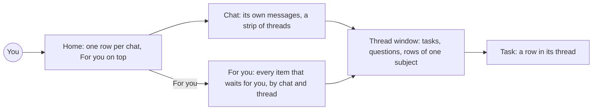
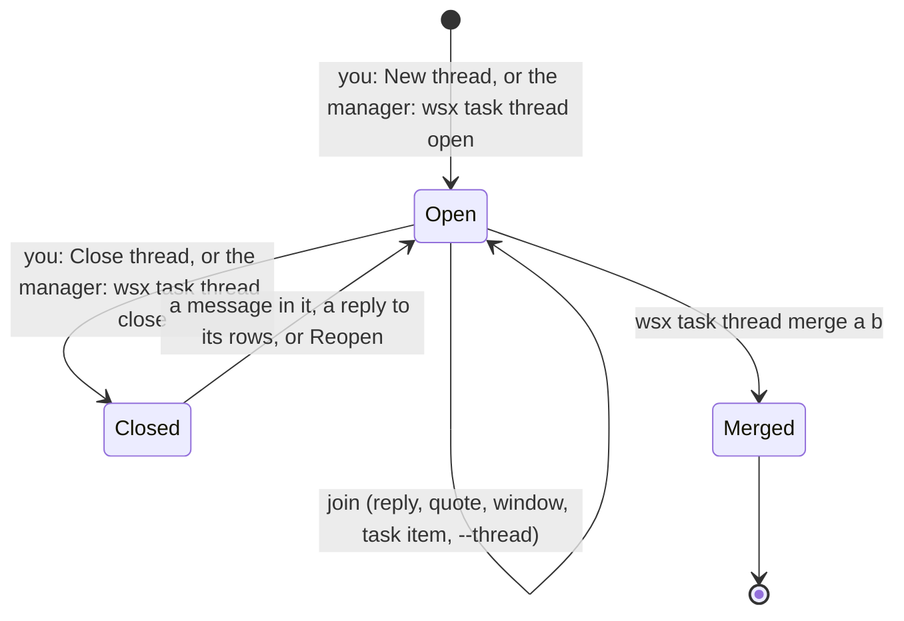

# Chat system: one model for chats, threads and tasks (design)

Superseded by [flat-chats.md](flat-chats.md) (task 539, owner wsx 5670): threads and derived chats are removed. Kept as the record of the design.

Status: design only, 2026-11-18, task #508 (owner wsx 5253: take what has piled up and make one chat system). No product code. Owner answers: 5278 (no cap, no automatic close; threads must not pile up) and 5280 (what waits for you in a thread stays easy to find). Pictures: [chat-system/](chat-system/), made by `build.py` (static pages with the real `app.css`) and `capture.mjs`. Numbers: `python3 -I docs/design/chat-system/measure.py tags|chats|roots|asks 14` (read-only, totals only, this machine's logs, 14 days to 2026-11-18). Cost and recall figures come from [thread-context.md](thread-context.md) and are not rerun.

Assuming: "trunk" (the chat's own messages, owner word in wsx 5082) and the chat names in the pictures are samples. The data in the pictures is made up in the shape of real chats.

## 1. For the owner: one screen

| | What it is to you | Context behind it | Who starts it |
|---|---|---|---|
| **Chat** | A named place where you talk to one manager. One Home row. | Its own conversation, log and notes | You (New chat). wsx makes a home chat for each repo. |
| **Thread** | One subject inside a chat. Its own window, its tasks and its open questions. | The chat's conversation, plus a block of 1,500 tokens about that thread on each turn | You (New thread), or the manager with one command. Never a task. |
| **Task** | One piece of work with a branch. A row in the thread it belongs to. | A worker's own | The manager or you |

A thread is not a smaller chat. Both open as the same window; the only difference is the conversation that answers. **wsx's rule, not the manager's judgement: a new subject is a thread. It is a chat only when you press New chat.** Reason: a second conversation costs a cold start for each subject (§3), and only 2 of 18 chats are not a repo's home chat (§2).

**What waits for you stays easy to find (owner 5280).** An item in a thread that needs you (a question, an approval, a check) is never only inside the thread. Three places show it, as today: the For you pill and Home's For you row, which open the item inside its thread; and the chat's own view, which shows one line when a thread waits on you ("Fee table waits for you · 1 question, 1 check · Open"). In the thread strip a thread that waits for you comes first, with its count, whatever its age. The other threads follow by last activity, so a stale one drifts right and never hides an item for you.

The For you, Tasks and Routines pills stay where they are today: inside the composer row, between the attach button and Send (`.pill-bar`, `tasks.js`). The pictures change only where the threads are. Two options; you pick one.

- **A, strip above the composer.** The thread strip sits directly above the composer and scrolls sideways: the chat first, then the threads that wait for you with their count badge, then the rest by last activity, `+` at the end for a new thread. One tap on a chip switches; all the names show at once.
- **B, one thread button in the composer row.** The row holds one more pill after the For you and Tasks pills: the current thread's name, or "Chat", with a badge when another thread waits for you. It opens a bottom sheet with the same order and a line under each name; New thread is the last row. The strip is gone, so the screen keeps its height; a switch is two taps.

**Chosen (owner 5297): threads above the chat box, option A.** B stays above only as the record. The owner also found the desktop chat box sloppy. Today (1280 and 1440 px) it has no visible box: the field is a loose placeholder between the pills and Send, attach and the pills crowd the left, and Send is a large filled block. Phone composer stays as it is. Two desktop options, both with the thread strip above, on the same column edges as the messages, no full-width bar, and every control from theme tokens (controls `--size-key`, pills and chips `--pill-height`, box `--radius-sheet`, hairline, accent border on focus). Send is the round icon button of the phone.

- **Desktop A, one box, two rows.** The phone's box: the field on its own line, attach, the pills and Send on the row under it. A build deletes `:not([data-wide])` from the phone's rules. The box is 92 px tall and grows with the text.
- **Desktop B, one single-line box.** One 52 px row: attach, the field growing, the pills, Send. It keeps the most height for the messages; a long message grows the row upward.

[Today 1280 dark](chat-system/composer-before-dark-1280.png), [today 1440 light](chat-system/composer-before-light-1440.png), [desktop A 1280 dark](chat-system/composer-a-dark-1280.png), [desktop A 1440 light](chat-system/composer-a-light-1440.png), [desktop B 1280 dark](chat-system/composer-b-dark-1280.png), [desktop B 1440 light](chat-system/composer-b-light-1440.png). All four sizes and schemes exist for today, A and B (`composer-{before,a,b}-{dark,light}-{1280,1440}.png`, from `build.py` and `capture.mjs composer`).

Pictures at 390 px light and dark, and 1280 px dark. Open the dark 390 px ones first. The 1280 px pictures use the wide composer of `app.css` but not the side rail. The chat pictures show the order and the waiting line.

| Screen | 390 dark | 390 light | 1280 |
|---|---|---|---|
| Home | [png](chat-system/home-dark-390.png) | [png](chat-system/home-light-390.png) | [png](chat-system/home-dark-1280.png) |
| A, a chat | [png](chat-system/chat-a-dark-390.png) | [png](chat-system/chat-a-light-390.png) | [png](chat-system/chat-a-dark-1280.png) |
| A, a thread | [png](chat-system/thread-a-dark-390.png) | [png](chat-system/thread-a-light-390.png) | [png](chat-system/thread-a-dark-1280.png) |
| A, a thread, menu open | [png](chat-system/thread-menu-dark-390.png) | [png](chat-system/thread-menu-light-390.png) | [png](chat-system/thread-menu-dark-1280.png) |
| B, a chat | [png](chat-system/chat-b-dark-390.png) | [png](chat-system/chat-b-light-390.png) | [png](chat-system/chat-b-dark-1280.png) |
| B, a thread | [png](chat-system/thread-b-dark-390.png) | [png](chat-system/thread-b-light-390.png) | [png](chat-system/thread-b-dark-1280.png) |
| B, a thread, sheet open | [png](chat-system/thread-b-sheet-dark-390.png) | [png](chat-system/thread-b-sheet-light-390.png) | [png](chat-system/thread-b-sheet-dark-1280.png) |
| For you | [png](chat-system/foryou-dark-390.png) | [png](chat-system/foryou-light-390.png) | [png](chat-system/foryou-dark-1280.png) |
| Tasks list today | [png](chat-system/tasks-before-dark-390.png) | [png](chat-system/tasks-before-light-390.png) | [png](chat-system/tasks-before-dark-1280.png) |
| Tasks list after | [png](chat-system/tasks-after-dark-390.png) | [png](chat-system/tasks-after-light-390.png) | [png](chat-system/tasks-after-dark-1280.png) |

**Answered** (§9): 2 a thread opens by you or by the manager with one command, never by a task. 4 no cap and no automatic close; a thread closes by hand. **Still open for you**: desktop composer A or B (§1); 1 thread by default, chat only on your word. 3 One For you list. 5 `overview.md`.

## 2. Evidence: is a thread the same as a chat?

Both answer "one subject, its own window and context". They differ in what is shared, and the logs show which one you use.

| Claim | Number | Source |
|---|---|---|
| Chats are home chats | 18 chats; 16 are a repo's home chat; 1 was cut out of another chat's message (`from`); owner messages in 14 days: 810, of which web-income 12 | `measure.py chats`, `tags` |
| No chat spans repos yet | 0 of 18 chats have more than one repo | `measure.py chats` |
| Separate conversation per subject is dear | $181 (3 threads) to $234 (8) a week against $136 today, at 1,162 owner turns; a thread block is +$9.0 to +$17.0 (800 to 1,500 tokens) | thread-context.md §1 |
| A cold start is the cost | first call 39.5K tokens, of which 28.5K written, about $0.23 at $8 a million written | manager-context-split.md line 24; price from thread-context.md |
| wsx's tag rules reach few messages | reply or quote or check: 71 of 810 owner messages (8.8%); adding a named `#n`: 88 (10.9%). wsx 12%, studio-app 22%, pr-review 5%, shopfront 4%. Median message 60 characters | `measure.py tags` |
| A task is not a subject | wsx: 299 root tasks in 14 days (21 a day), median life 1.9 h, p90 12.2 h, 14 of 295 over 24 h | `measure.py roots` |
| You rarely return to a finished subject | 18 owner references to a finished task in wsx; 1 came more than 48 h after it finished | inline read of `chats/wsx/log.jsonl` and `wsx-*/<n>/task.json`; not in the script |
| Chats talk much | 347 messages from other chats and 347 `sent` rows; 154 are replies, 41 under 200 characters | `measure.py chats` |
| Items for you | 353 replies with an ask in 14 days (25 a day): wsx 145, pr-review 85, studio-app 41 | `measure.py asks` |

**Answer: two things, one window.** The same need (a subject with its own window) is met by a thread cheaply and by a chat with isolation. wsx decides by one rule, the owner's action, with the thread as the default. A chat is for a different goal, a different set of repos, an agent of another model, or a subject whose talk must not reach the others' context. `chat new --from <chat> <msg>` already cuts a subject out into a chat (web-income, from studio-app 960); no promote command is added.

**Two findings change the queued plan** (deep-refactor.md §5, steps 6 to 9; #507):

1. **Tasks must not open threads.** The rule "`task new` from the trunk opens a thread" would open 21 a day (`measure.py roots`). With no cap and no timer (owner 5278) only a hand closes a thread, so they would pile up. A thread opens only by you or by one explicit manager command. A task made inside a thread joins it. A task made in the trunk stays in the trunk.
2. **The window does the tagging.** Rules 1 and 3 (reply, quote, task item) tag 8.8% of messages. The rest reach a thread only when you write in its window. So the window (step 8) is how most of your messages get a thread; step 6 measures that share.

## 3. What a manager turn reads, the cache and memory

Per owner turn the message goes first through wsx's four rules (reply or quote, thread window, task item, else trunk; deep-refactor.md §5). No model call.

| Turn | Reads, after the cached prefix | Tokens |
|---|---|---|
| Thread turn | header `Thread <slug> "<title>", open since <date>, <n> open asks`; open asks by id (never cut); its tasks and states; its records; last rows; then "`<k>` older rows not shown: `wsx memory search --thread <slug>`" | at most 1,500 |
| Trunk turn | one line for each open thread (slug, title, open asks, age of the last row) | at most 6 lines, about 150 |
| Event turn (49% of manager spend, orchestration-model.md §7) | the event lines; the owning thread's header only. The block is read only when `state_wakes` says the event needs a decision | header only |
| Rotation | the open-thread list and the blocks of threads touched in the last 24 h | at most 3 x 1,500 |
| First turn of a new chat | today's first prompt (notes and handover, at most 10 KiB); with `--from`, the block of the source thread | one block |
| Stand-in (limit hold) | the same thread block, one call, no tools | one block |

**Cache.** The prefix (instructions, notes, handover) is the same for every thread of a chat. The block sits in the turn text after it, so a switch of thread costs no cache write and the cold-turn rate (2% of owner turns today, thread-context.md §1) must not rise. A separate chat pays its own first call (about $0.23) and its own 1 h cache.

**Long-term memory.** No new store. A row, a reply, a task and a record carry `thread: <chat>/<slug>` (written when the row is written; the slug is unique only inside its chat). When a thread closes, wsx writes one record (kind `episode`, as `fold_memo` does for a task, `repo.rs:1337`) with the thread's title, its tasks and decisions. A later search for the subject finds that one record by its words, and `--thread` lists every row by key. Evidence: with the tag on rows and tasks, recall of a thread's facts is 0.67 to 1.00 against 0.00 to 0.60 for a search seeded by the owner's message (4 threads; thread-context.md §2). Limit: 4 threads is a small sample. Retention: thread events are rows of the chat log (its existing bound); the record follows the memory store's rules.

## 4. Lifecycle

No cap and no timer (owner 5278). wsx closes nothing by itself. Two plain rules keep threads from piling up:

1. The manager's instructions say: close a thread when its tasks have landed and nothing waits on you, and write one line in the chat ("Closed the thread Fee table: #96 and #98 landed"). A thread with an open ask is never closed.
2. The thread strip lists open threads by last activity, so stale ones drift right.

Order of the strip, so nothing for you is hidden (owner 5280): first the chat itself; then every thread that waits for you (question, approval or check), each with its count badge, whatever its age; then the other open threads by last activity, newest first. The same items stay in For you as today: the pill and Home's For you row open the item inside its thread. The chat's own view also shows one muted line for each thread that waits for you.

| Step | Rule | Owner of the rule |
|---|---|---|
| Open | You: New thread in the strip (a title, or the first message clipped). The manager: `wsx task thread open "<title>"`, for a request that needs more than one task or none. No cap | `task::thread` in wsx-core |
| Join | A reply or quote of a row takes its thread; writing in the window takes it; an answer to a task item takes the task's thread. `task new` inside a thread joins it; `--into`, `--after`, `--from` and `task add` inherit it | same |
| Count | Step 6 reports the open threads for each chat after a week of use (median, p90, max). A cap, if any, is decided later with that number | step 6 proof |
| Merge | `wsx task thread merge <a> <b>` writes `thread_merged`; readers map a to b; nothing is rewritten | same |
| Close | By hand: Close thread in the thread's ⋯ menu, or the manager with `wsx task thread close <slug>`. Writes `thread_closed` and the record of §3. Refused while an ask is open | same |
| Reopen | Any message in the thread, a reply to its rows, or Reopen in its menu writes `thread_open` again | same |
| Waits for you | A thread with an open question, approval or check shows the count in the strip and one line in the chat. The count comes from the same rule as For you (`needs`), not from a second one | `wsx_core::task::needs` |

**Who talks to whom.** Chats talk only with `say --to <chat>`; it lands in the receiver's trunk and shows as one "Talked to" line (#491). A thread is private to its chat: another chat cannot tag into it. A chat acts in another repo with `-p <repo>` (§5); the task it makes carries `created_by: chat:<id>` and, from inside a thread, that thread. An unowned event goes to the repo's home chat (orchestration-model.md §3.2); an event of a task goes to the chat that made it, and its row to the task's thread.

## 5. Capability: one table

Source of truth: `Role` and `ROLES` in `wsx-core/src/task/policy.rs:150-190`. Checks, the broker and the prompt lines read it. Every chat runs as the manager role (#506: `manager.rs:1765`, the manager caps are `ALL`); a chat is not a lesser manager.

| Can do | Chat (home or not) | Worker | Stand-in | You |
|---|---|---|---|---|
| Read: `list show ledger chat search check` | yes | no | yes | yes |
| `say`, `post`, `digest` | yes | no | no | yes |
| Answer you | yes | no | yes | n/a |
| `after`, `hold` | yes | no | yes | yes |
| Notes, handover | yes | no | notes only | no |
| `new`, `add`, `steer`, `stop`, `preview` | yes | no | no | yes |
| `close`; `close --discard` | yes; never `--discard` in another repo (`broker.rs:339`) | no | no | yes |
| `land`, `deploy`, `release`, `push` | yes; an approved action asks you first | no | no | yes |
| `routine` and `checkin` | yes | no | no | yes |
| `approve`, `deny`, `hand` | in the manager's caps, but the CLI judges them itself (`policy.rs:62`) | no | no | yes |
| `result`, `check-run` | no | yes | no | no |
| `memory search`, `recall` | yes, in the chat's own log | yes | yes | yes |
| `memory add`, `update`, `supersede` | yes, own repo, trusted agent only | yes | no | yes |
| Record a rule (`owner:<id>`) | yes | no | no | yes |
| `thread open`, `close`, `merge` (new) | yes | no | no | yes |
| Act in another repo (`-p`) | yes (§5 verdict) | no | no | yes |
| Lend skills (`--skills`) | when the project lends them | no | no | yes |

Rows above the last three are the existing 18 capabilities folded (`policy.rs:78-97`). The three new facts are rows of the same table, not code in the broker: `thread` (one new capability, in `ALL`, so the manager has it and the worker has not), `reach` and `lend`.

**#506 verdict: it stands as written, with one change and one answer.**

- Stands: `RoleInfo` gains `reach` and `lend`; `MANAGER_REACH` moves into `policy.rs` (`broker.rs:294`); `reach` reads the role, not `is_home` (`broker.rs:328, 336-340`); `run_memory` passes the broker's actor (`broker.rs:200, 258`); `instructions.rs` builds the reach and skills sentences from the table, so every adapter gets the same lines. Cause of refusal 1 is as the manager checked it: actor `""` reads as the owner, so `check_words` opens the home chat's log.
- Fits the model, and is a precondition: a thread tag on `memory add` is read from the calling chat's own log. The actor fix must land before any `--thread` work, or a non-home chat's tag points into the home chat's log.
- Change: do not narrow reach to attached repos later (orchestration-model.md M3). 0 of 18 chats attach more than one repo, and a second rule on the same concern would be the second patch. Reach stays "any repo you have", by role.
- Answer to its open question (may `say` to another project name a chat there with `--to`?): `say --to <chat>` already names a chat without `-p` (`broker.rs:330-331`) and a chat's name is one folder in `tasks/chats/` (orchestration-model.md §3.1). `-p <repo>` stays the short form for that repo's home chat. Nothing to decide. Assuming: names are unique on the machine as that doc says; `chats::name_problem` (`chats.rs:52`) takes only the project's open chats, which the build must check.

## 6. What it deletes, and what stays of each piece

| Piece | Verdict | Callers and what replaces it |
|---|---|---|
| For you band of the Tasks list | goes | `Section::You` (`task_list.rs:99, 713`, `ui/tasks.rs:392`), `BANDS.you` (`task-words.js:46`), the band row (`tasks.js:312`), the server band `you`. One list is named For you: the pill (`trays.js:12`), which already counts needs and checks. The Tasks list shows Moving and Waiting and one row "2 wait for you" that opens For you |
| 48 px number column | goes | `--num-col` and `.row-num` (`app.css:858-870`); the Chain row shares the variable (`app.css:896`). The number follows the title, the second line takes the full width |
| Topics steps 4 and 5 of #491 (`task new --topic`, Topics pill, Home band, `Short.topic`) | goes | Not built: `rg topic` finds only `notes.rs`'s word list. Threads replace them, with `thread` as the one name (5082) |
| "`task new` opens a thread" and the refusal at `task new` (deep-refactor.md §5 "Open or join") | changes | Explicit open (§4). No cap, so no refusal |
| `notes::matching` (`notes.rs:222`, `manager.rs:2117`), `since_then` (`manager.rs:858`) | goes in step 7 | The thread block and the open-thread list |
| Recap request (`repo.rs:41, 502, 539`) | goes in step 7 | The open-thread list and the manager's close rule (no model call). `ask_recap` keeps its quiet timer for `project.idle` |
| `overview.md`, `check_overview` (`manager.rs:2077`, `store.rs:1472`) | goes in step 9, only if Q5 is yes | The open-thread list, on Home and in the chat, from wsx's data |
| `is_home` gate and the second refusal text in `reach` (`broker.rs:328, 336-346`), hand-written reach and skills sentences in `instructions.rs` | goes (#506) | `policy.rs` table lines |
| Attach and union boundary of M3 (orchestration-model.md §3.3, §4) | dropped from the plan | 0 of 18 chats use more than one repo. Nothing was built |
| Web `chat_contacts` row fields (`wsx-web/src/tasks.rs:873`) and the push filter `notice` (`:1491`) | go in deep-refactor step 5 | `chats::rows` and `needs::stage`; unchanged by this design |
| Rename options A, B, C of #496 | go | Your choice (5242): line 1 the chat name, line 2 the projects it involves, line 3 the message ([home](chat-system/home-dark-390.png)); Rename in the ⋯ menu. The chat keeps its id |
| #491 rule, tokens, peer fold, `add --title`, quote rule | stay | Built and measured: bubbles 1,824 to 1,302 in 7 days (transcript.md §2, on branch wsx/t491) |
| Deep-refactor steps 1 to 5 (deletions, one search, one notes writer, one "owner needed" rule) | stay | They do not depend on threads |
| Deep-refactor steps 6 to 9 | change | Order and rules in §7 |

## 7. Build order, each step with its proof

Context = tokens a turn reads; cache = cold-rewrite rate and prefix bytes; memory = recall on fixed queries. "Same" means the step must not change it, and the proof says so. Every UI step has the pictures of this design as its mock and a `web` scenario with captures.

| # | Step | Proof | Context, cache, memory measured |
|---|---|---|---|
| 1 | #491 lands, without topics | `task` and `web` scenarios | bubbles before and after on 7 days (`transcript-measure.py`) |
| 2 | One For you list; number follows the title; Home gets the For you row (needs the owner's answer to Q3) | `web` scenario, captures at 390 and 1280 | none changes |
| 3 | #506: capability table, memory actor, reach, skills lines | `test-task.py`: a non-home chat records `memory add --source msg:<id>` from its own message (fails today); `say -p` reaches the home chat; prompt has no `--skills` where not lent; `boundary` | instruction bytes for the manager do not grow; the first prompt stays near 11,954 B (manager-context-split.md) |
| 4 | #496 as chosen: three-line Home row, Rename in ⋯ | `web` scenario; the row's accessible name | none changes |
| 5 | Deep-refactor steps 1 to 5 | as in deep-refactor.md §6 | memory: one query returns the same first 10 refs before and after |
| 6 | Threads core in wsx-core (#507, with §2's changes): `thread` on rows, tasks and records; open, close, join, merge, no cap; `--thread` on both searches | `test-task.py` section: open by owner and by manager, close by hand and refused with an open ask, merge, inherit by `--into` and `--after`, a task in the trunk opens none | open threads for each chat after a week of use (median, p90, max) for the owner's later cap decision; memory: recall of the 4 threads of thread-context.md §2 with the tag, target at least 0.67; share of owner messages tagged by wsx's rules, measured on live rows |
| 7 | Turns read the block and the list; the manager's instructions get the close rule of §4; recap, `since_then`, `notes::matching` go | fake manager reads the header; recap asserts replaced | context: block tokens a turn, at most 1,500, on replayed logs; cache: the cold rate stays near 2%; cost: +$9 to +$17 a week predicted, read from usage after 2 weeks |
| 8 | Thread window and strip in web and TUI (mocks: §1); strip order by waiting first, then last activity; one waiting line in the chat; the For you pill and Home row open the item inside its thread | `web` both parts, `smoke` for the TUI, captures; assert: a thread with an open ask sorts first whatever its age, and its item is reachable from For you | share of owner messages written inside a window (new number); the 8.8% rules-only share stays the floor |
| 9 | `overview.md` goes (only if Q5 is yes) | scenario: the open-thread list shows with no model call; `check_overview` removed with its callers | context: first prompt bytes fall by the overview's share |
| 10 | Rotation replay with the thread handover, after 2 weeks of use | the same 14 cases as #464, at most 1 of 12 counted lost | context: +4.5K tokens a rotation (thread-context.md §3); about $5 to $11 |

Step 2 and steps 3 to 5 do not depend on threads and can run in any order. Steps 6 to 9 are in order. There is no reminder or close timer step (owner 5278).

## Using threads (step 8, built)

A thread opens in the chat's own window. The pictures of §1 are the spec.

- **Strip.** Directly above the composer, sideways scroll: the chat, the threads that wait for you with their count (always first, whatever their age), the rest by last activity, `+` (New thread) last. One tap switches. The route is `#/c/<chat>/t/<thread>`; a thread that closed or never existed shows the chat. The order and the counts are the server's: `thread::list` over `needs::tally` (the same rule as the For you pill). The JS neither sorts nor counts. `GET /api/tasks/<project>/chat` returns them as `threads`, and takes `thread=<slug>` (rows of that thread), `thread=` (the chat's own rows) or none (every row: old clients, find, the CLI).
- **Rows.** A row is in the thread it carries (a message, a reply) or its task's. A row of a thread that closed or merged away reads as the chat's own, so nothing vanishes. The thread filter runs after the newest 200 entries are read: a thread's rows older than those do not show in its window (find and a quote jump read wider).
- **Writing.** A message written in a thread's window carries it (`say --thread`, `POST say {thread}`); the core's tag order is unchanged (quote, window, To check item's task, trunk).
- **Lists.** In a thread, the For you, Tasks and Routines pills and lists hold that thread's things and its counts (`counts` of the thread); in the chat they hold the whole chat, threads included. Every item names its thread (`thread`), so a For you item can link `#/c/<chat>/t/<thread>`.
- **The line.** The chat shows one line for each thread that waits: "<thread> waits for you · 1 question, 1 check · Open".
- **Thread menu (⋯).** Merge into another open thread, Close thread (by hand, refused while a question of it waits; the core's words show). Rename is not built: the core has no rename event. No cap and no automatic close.
- **TUI.** In the chat view `t` and `T` step through the chat and its threads in the same order; the third top line lists them with their waiting counts. In the Tasks list each chat has its open threads under it (Enter opens the chat at that thread). The TUI's To check, approval and question lists are not filtered by thread.
- **Proof.** `test-task.py` section 42 (order, waits), `test-web-client.py` (write in a thread, scoped read) and the browser block of `web-tasks-check.mjs` (strip, New thread, the line, captures `thread-*`).
- **CLI.** `wsx task thread list` prints the open threads in that order with `last_ms`, `counts` and `waits`.

## 8. What this design does not decide, and limits

- How many real subjects you hold at once: the logs have no thread labels. There is no cap. Step 6 reports the open count for each chat after a week, so a cap, if wanted, is set from a number.
- The For you volume is 25 items a day over all chats (`measure.py asks`), counted as replies with an ask; approvals and checks are not in that figure.
- The cache effect of the block is predicted from thread-context.md, not measured. Step 7 and step 10 measure it.
- Pictures: a static page is not the running client. The thread strip (A) is a plain row that scrolls sideways and the sheet (B) is a fixed panel; the composer, the bar and the swipes are the real `app.css` where the page uses them, but the 1280 px chat column is not shown beside a task sheet. The TUI is not drawn: the TUI has the same rows (a thread list in the chat, a thread list under the chat in the tree), drawn in step 8 after your answer.

## 9. Questions for the owner

| # | Question | Recommendation |
|---|---|---|
| 1 | A new subject is a thread. It is a chat only when you press New chat (or `chat new --from`). OK? | Yes. A second conversation costs about $0.23 a start and an own cache; 2 of 18 chats are not home chats |
| 2 | **Answered (5278).** A thread opens by you (New thread) or by the manager (one explicit command). A task never opens one. | Done. 21 tasks a day would otherwise open 21 threads a day |
| 3 | One list is named For you: the pill. The Tasks list drops its For you band and keeps one row "2 wait for you". Home gets a For you row on top that lists every item of every chat, grouped by chat and thread. OK? | Yes. Same word, two lists today (`trays.js:12`, `task_list.rs:99`). 25 items a day need one place |
| 4 | **Answered (5278, 5280).** No cap and no automatic close. A thread closes by hand: you (Close thread) or the manager (one command, with one line in the chat). The manager closes a thread when its tasks have landed and nothing waits on you. The strip lists by last activity; a thread that waits for you is always first with its count, and its items stay in For you. | Done. Step 6 reports the open count for each chat after a week, so you can set a cap with a number later |
| 5 | Remove `overview.md` once the open-thread list shows (deep-refactor Q3)? | Yes, in step 9: the list is built from wsx's data with no model call |

## Migration

Chats from before threads (owner 5291). Old log rows, `task.json` and records have no `thread` and read as the trunk; no file is rewritten and no old reader stays. Open work is placed once per chat: when a chat's host starts and its folder lacks `threads-placed`, its manager gets one turn with the fixed text of `thread::Unplaced::text` (the same for every adapter), opens a thread per subject (`thread open`) and moves tasks and open questions in (`thread move <slug> <task>... [--ask <reply id>...]`); approvals and To check items follow their task. A chat with nothing open gets no turn. A chat made now has the mark from the start. Closed and landed work with nothing open stays in the trunk; named chats stay chats; a closed chat gets no turn (no host) and its work reads as the home chat's (`chats::owner`).

Proof, on a copy of this machine's state (a one-off script, not kept; `rsync` of `tasks/` without scratch and check logs, the config, `HOME` and `XDG_STATE_HOME` pointed at the copy; 18 chat folders, 16 read; `auwsx` has no registered project and `research` is closed, so both are skipped). The manager is stood in for by a script that opens `Subject <n>` for each open task and each landed task that owns an open item, and moves the open questions into `Open questions` with the real `thread open` and `thread move`; real agents cannot run in the boundary. The copy has no running task host, so 15 task moves were written into `task.json` by the script, which is what the host does (scenario part 43 runs the host path). Chats with nothing open (notevault, dotfiles, projq, mentoring, repetit, projr) are not listed: 0 before, 0 after, no turn.

| chat | open root tasks | open questions | approvals | To check | in trunk after (tasks / questions / approvals / To check) | text bytes |
|---|---|---|---|---|---|---|
| studio-app (home) | 1 | 0 | 0 | 7 | 0/0/0/0 | 1225 |
| ir (home) | 1 | 1 | 0 | 0 | 0/0/0/0 | 683 |
| projk (home) | 1 | 0 | 0 | 1 | 0/0/0/0 | 630 |
| shopfront (home) | 0 | 1 | 0 | 5 | 0/0/0/0 | 994 |
| pr-review (home) | 0 | 1 | 0 | 0 | 0/0/0/0 | 691 |
| projp (home) | 0 | 0 | 0 | 1 | 0/0/0/0 | 597 |
| projy (home) | 0 | 0 | 0 | 9 | 0/0/0/0 | 1112 |
| skiller (home) | 0 | 1 | 0 | 0 | 0/0/0/0 | 610 |
| web-income (named) | 2 | 0 | 0 | 2 | 0/0/0/0 | 808 |
| wsx (home) | 10 | 0 | 0 | 0 | 0/0/0/0 | 1042 |
| **total, 10 chats** | 15 | 4 | 0 | 25 | 0 / 0 / 0 / 0 | 597 to 1,225 |

| Check on the copy, per chat, before and after the placing | Result |
|---|---|
| `wsx task chat --json` and `--after 0` (the rows) | identical in all 16 chats: `thread_open`, `thread_closed`, `thread_merged` and `thread_moved` events are not chat rows |
| open questions (`asks` of `wsx task chat --json`) | same ids, 4 of 4 reachable; each now carries its thread |
| approvals, `wsx task check --json` (To check list) | identical |
| left in the trunk after the stand-in | 0, because every open task, question and item had a subject; a manager that leaves one out leaves it in the trunk, listed by `thread unplaced` |

Not run on the copy: the web client (it reads the same `chat_rows` of wsx-core; the `web` scenario and `test-task.py` section 43 read them through the real web and host). Cost of the one turn, measured from the manager logs: 10 of 16 chats have open work and get a turn; the text is 597 to 1,225 bytes. A manager turn that answers only events cost a median of 127,071 micro-USD over 2,161 replies (usage of each reply in the 16 `log.jsonl` read), and a reply of exactly `-` 32,876 micro-USD over 175 replies. The placing turn also runs one `thread open` and one `thread move` for each subject, so the estimate for the 10 chats is $0.33 (all quiet) to $1.27 (all median), paid once. Not measured with a real agent.
