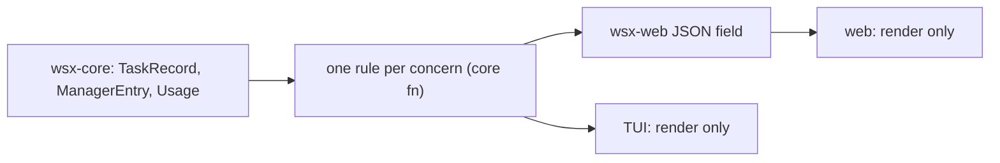

# Client logic audit: web, TUI and core

Status: read-only audit, 2026-11-05. Scope: `crates/wsx-web/web/*.js`, `crates/wsx-web/src/`, `crates/wsx/src/` (TUI, CLI, `task/`) and `crates/wsx-core/src/`. Paths below are relative to `crates/`. Everything comes from reading the source; nothing was run.
Out of scope: the task status wording (#236) and the stall for manager waits (#237). Only the gaps they leave are listed, in "Not covered by #236 or #237". Earlier audits: [tui-parity.md](tui-parity.md) (missing TUI features), [usage-audit.md](usage-audit.md) (cost).

**Answer.** Core already owns the facts: `TaskState`, `tail_asks`, `agent_label`, the usage sums and `stall::stuck`. The duplicates are the rules on top of those facts. Each client ranks, colors, classifies and formats them its own way, and the web also matches Rust reason strings by regex. The fix is to move each rule into one core function, send its result as a wire field, and delete the copies in the clients.

## Findings

| # | Places | What differs, and what the user sees | Proposed owner | Size | Risk |
|---|---|---|---|---|---|
| 1 | `wsx-core/src/task/view.rs:16` `attention`; `wsx-web/src/tasks.rs:82` `stage`, `:171-178` needs rank; `wsx-web/web/home.js:11` `URGENCY`; `wsx/src/task_list.rs:312` `rows` rank | Four rank tables. Core ranks by state only, so a hand or plan wait ranks 0, above failed. The web `stage` moves hand, plan and manager-reviewed ready tasks to "working". The TUI re-sorts a ledger that is already sorted, and puts checking before working. Inside a rank, the server sorts newest first and the ledger sorts by id. The same project lists its tasks in a different order in each client. | core `view::stage(record, land_auto)` and `view::needs_rank`; `attention` derives from them; the wire sends `rank` | M | M: every list order changes |
| 2 | `wsx-web/web/tasks.js:93` `STAGES`, `:181` `KIND_TONE`, `:340` `taskHealth`; `wsx/src/ui/tasks.rs:241` `state_color` | A failed task has the attention tone in the web reservoir dot, the danger tone on the sheet and the Home line, and red in the TUI. A ready task is accent, attention or teal, depending on the screen. | one state-to-tone table in core (`tone` on the wire); the TUI maps that tone to its theme | S | L |
| 3 | `wsx-web/src/tasks.rs:90,171` (needs), `:1229-1245` `notice`; `wsx-web/web/tasks.js:292` `NeedRow`; `wsx-web/web/task.js:176` | Every Waiting that is not Hand or Plan counts as a need. This includes Disk and Limit, which resume by themselves. Push skips Limit but sends Disk. `NeedRow` offers Answer for every waiting need, but the sheet offers it only for `on == owner`. The badge and the Home count show work the owner cannot act on. | the same core needs rule as #1, applied to the count, badge, push and buttons | M | M |
| 4 | `wsx-web/src/tasks.rs:167` `working` count; `wsx-web/web/home.js:207`; `wsx-web/web/tasks.js:117` `awaitsManager` | Home says "N working" and pulses for manager-reviewed ready, plan and hand tasks. The reservoir does not pulse ready or plan tasks (`awaitsManager`), but it does pulse hand tasks. | server sends `running` (Working or Checking only); delete `awaitsManager` | S | L |
| 5 | `wsx-web/src/tasks.rs:563` (sheet only); `wsx-core/src/task/stall.rs:120` | `stuck` reaches only the task sheet. The overview rows, the reservoir, the chips and the TUI keep showing "working" for a task that the sheet calls stuck. | `stuck` flag on the overview row and the ledger row, from `stall::stuck` | S | L |
| 6 | `wsx-core/src/task/session_news.rs:12`; `wsx-web/web/store.js:120`; `wsx-web/src/chat.rs:1206`; `wsx-web/web/inbox.js:35` | Core excludes `task-<n>-hand`. The JS and Rust web copies include it, although their comments say "same rule". The docs say a hand session is not a Home session (`docs/tasks.md:511`). So a blocked hand session raises the badge and the Home count, but the project chat never tells about it. | core `is_task_session` only; `task_session: bool` on the session wire; delete `chat.rs:1206`. Owner decides whether hand sessions are listed | S | L |
| 7 | `wsx-web/web/bubbles.js:26` `shortLine`, `:17`, `:19`; `wsx/src/task_chat.rs:727` `event_line` | The web rewrites `#3 ready r2: title; …` to `#3 ready`, shows `landed` as `done`, and turns approvals into "Approved land #5". The TUI only cuts at `; `. Any change to the event text written in `wsx/src/task/manager.rs` breaks the JS regex without an error. | core `short_event(line)`, or a `short` field written where the event is made | S | M |
| 8 | `wsx-web/web/bubbles.js:40-110` against `wsx/src/task_chat.rs:591-683`; `wsx-core/src/task/manager.rs:325` `chat_window` | The manager log is classified twice and the copies have drifted. The TUI hard-codes "Manager" where the web uses the configured shown name. The TUI drops the rotation reason and its token count. It has no "Recap" tag, no reply-to peer, and shows quiet replies with approvals as a plain line. `chat_window` keeps `Ping` entries, so pings use up the 200-entry window and each client then hides them separately. | core `chat_rows(entries)` (kind, author, tag, quiet, asks, post, text) for the TUI and the wire; filter `Ping` in `chat_window` | L | M |
| 9 | `wsx-web/web/bubbles.js:47,60`; `wsx/src/task_chat.rs:722` `is_post`; `wsx/src/task/manager.rs:665` `post` | The "post" rule is copied (no usage, every `to` is an events message). The web calls it `routine` and reads ", Routine" aloud, also for session news and `wsx task post`. | a `post` flag in the log entry, set in `post()` | S | L |
| 10 | `wsx-web/web/bubbles.js:50,60`; `wsx-web/web/tasks.js:931`; `wsx/src/task_chat.rs:611` | "A reply asks until the owner writes after it" exists three times per message, beside core `tail_asks` (`manager.rs:283`). The clients agree today. | an `asks` value per entry from `chat_rows` (#8) | S | L |
| 11 | `wsx-web/web/tasks.js:180,336,346,349`; `wsx-web/web/story.js:90,102,104`; `wsx-web/web/bubbles.js:19` | The JS selects behavior by matching Rust strings: "stopped by request", `/scenarios slot/`, "the manager reviews it", "could not land: ", "no checks", "#N was closed". If a host reason changes, the web takes the wrong branch without an error. | wire kinds: `waiting.kind` (`stopped`, `scenarios`), `land_reason_kind`, a `closed` flag on a resolution | M | M |
| 12 | `wsx-web/web/lib.js:53,62,71`; `wsx-web/web/panels.js:13` and `wsx/src/ui/panels.rs:14`; `wsx-core/src/task/stall.rs:246` `span`; `wsx/src/task/limit.rs:36`; `wsx/src/ui/task_chat.rs:263`; `wsx/src/task/manager.rs:2886`; `wsx/src/ui/preview.rs:705` | There are six or more duration and clock formats: "3h ago", "3 h 10 min", "3 min ago", "3m 05s". Ages round down, but the limit countdown rounds up (`div_ceil`, `limit.rs:41`). `libc::localtime_r` is wrapped separately in `limit.rs:59`, `ledger.rs:363`, `usage.rs`, `routine/cron.rs` and `preview.rs`. | a core `time` module (`local_tm`, `hhmm`, `date_time`, `duration_words`, `ago_words`) | M | L |
| 13 | `wsx/src/task/limit.rs:36` (`resumes at HH:MM` stored as text); `wsx-web/web/usage.js:74`; `wsx-web/web/routines.js:10` against its `next_run` clock | Day boundaries and schedules use the host's zone. The web shows the limit resume time as host time with no zone, labels usage days in the browser's zone, and shows "daily 06:00" (host) beside a "next 07:00" (browser). A phone in another zone gets the wrong weekday and times that contradict each other. | send unix ms (resume, day start, next run) and a host-zone label; clients only format | M | L |
| 14 | `wsx/src/task/manager.rs:1432`; `wsx/src/task/agent.rs:333`; `wsx-core/src/task/usage.rs:83` `usd` | The recap the manager reads says "3.42 USD". The budget line says "$3.00 of its 3 USD". The TUI and the web say "$3.42". | `usage::usd` everywhere | S | L |
| 15 | `wsx-core/src/task/usage.rs:43` `Usage::line`; `wsx-web/web/usage.js:14` `usageLine`; `wsx/src/ui/tasks.rs:503` | Only the TUI adds "· N pings" to the usage line. The CLI and the web show "14 turns" with the pings inside that count. The wire already sends `pings`. | the ping suffix goes into `Usage::line`; the JS mirror follows it, or the wire sends `line` | S | L |
| 16 | `wsx-core/src/task/view.rs:13,36` against `ledger.rs:20` and `wsx-web/src/chat.rs:1202`; `wsx-web/src/tasks.rs:30` = `ledger.rs:19`; `wsx/src/app.rs:314` = `wsx-web/src/tasks.rs:39` | Constants with the same name have different values: `TITLE_CHARS` is 120 in the view but 80 in the ledger, and `NOTICE_CHARS` is 160 in core but 120 in the web chat. Other values are copied by hand: `SUMMARY_CHARS` 240 and `MANAGER_TAIL_BYTES` 64 KiB. A title is cut at 80 characters in the TUI and the CLI, and at 120 in other views. | one public limits block in `wsx-core/src/task/view.rs`, used by the web and the TUI | S | L |
| 17 | `wsx-core/src/task/store.rs:946`; `wsx-web/web/page.js:36`; `wsx-core/src/task/mod.rs:26` against `wsx-web/src/chat.rs:1331`; `wsx-web/web/chat.js:555` | The JS hard-codes "first 60 lines and 4,000 characters". The message limit is 64 KiB in core and 60 KiB in the web. The answer input has `maxlength` 2000, which the browser counts in UTF-16 units while Rust counts characters. | send limits on the wire (`page.cut`, the site bootstrap) as `max_file_bytes` already is | S | L |
| 18 | `wsx-web/web/reply.js:9,25` against `wsx-core/src/task/manager.rs:224` `quote_of`; `wsx-core/src/task/view.rs:82` `clip` | The quote cut is copied. JS counts UTF-16 units and Rust counts characters, so a quote with an emoji differs and the Quote click match fails. `clip` returns N+1 characters, and `fix_title` hand-writes another cut. | core `quote_of` is the only producer: send `quote` on the entry; give `clip` a documented total length | S | L |
| 19 | `wsx-web/web/routines.js:17` `STATUS`; `wsx/src/task/manager.rs:2779` `routine_result`; `wsx/src/ui/workspace_tree.rs:550` `{:?}` | SpawnFailed reads "did not start" on the web, "could not start" in the event, and `SpawnFailed` (Rust Debug text) in the TUI tree. | `RunStatus::label()` in `wsx-core/src/routine` | S | L |
| 20 | `wsx-web/web/tasks.js:741,764,889`; `wsx-core/src/task/roles.rs:119` `last_active_ms`; `wsx-web/web/home.js:76` `newsOf` | A role chat counts as unread when its last entry of any kind is newer than its "seen" time. That includes a ping or the owner's own message. A role chat never opened counts as unread, but a project chat never opened does not. | the server sends `news` per role, computed as for the project; delete `ROLES_SEEN_KEY` | S | L |
| 21 | `wsx-web/web/home.js:173` `useNow(true)`; `wsx-web/web/story.js:133` | Home renders every second for as long as it is open. The task sheet `Progress` timer also runs for a ready or failed task, whose worker has already ended. | stop the timer when no row shows a live age | S | L |
| 22 | `wsx-core/src/task/view.rs:41` `digest_lines`; `wsx-web/src/tasks.rs:828` `since`; `wsx/src/task/manager.rs:121` `is_event` | There are three lists of task events. The web "Since you left" line has no ready or failed events, and the routine digest has them. | one core event kind list | S | L |

## Fix tasks, in priority order

1. **Needs, rank, tone and running in core (#1-5, #11).** Add `view::stage`, `needs_rank`, `tone` and `running`. Send `rank`, `tone`, `running`, `stuck` and the reason kinds on the overview rows and the ledger rows. Delete `URGENCY`, the TUI re-sort, `awaitsManager` and the string matches. Make Disk need the owner or make it stop counting, but do the same in the push, the badge and the buttons.
   Files: `wsx-core/src/task/view.rs`, `wsx-web/src/tasks.rs`, `wsx-web/web/{tasks,home,story,task}.js`, `wsx/src/task_list.rs`, `wsx/src/ui/tasks.rs`. Proof: `scripts/web-tasks-check.mjs` (order, tone, Answer button per need kind), `scripts/test-web-client.py --browser`, and the TUI Tasks order in `scripts/runtime-smoke.py`.
2. **One task-session rule (#6).** Add `task_session` to the session wire from `session_news::is_task_session`. Delete `chat.rs:1206` and `store.js` `isTaskSession`. The owner decides first whether hand sessions are listed.
   Files: `wsx-core/src/task/session_news.rs`, `wsx-web/src/chat.rs`, `wsx-web/web/{store,inbox}.js`. Proof: a blocked `task-<n>-hand` session in `scripts/test-web-client.py` gives the same badge, Home count and chat post.
3. **Manager chat rows in core (#7-10, #18).** Add `chat_rows` with `short`, `post`, `asks` and `quote`. `chat_window` drops pings. The TUI renders those rows, and `bubbles.js` reads them in place of its regexes.
   Files: `wsx-core/src/task/manager.rs`, `wsx/src/task_chat.rs`, `wsx/src/ui/task_chat.rs`, `wsx-web/src/tasks.rs`, `wsx-web/web/{bubbles,reply}.js`. Proof: `scripts/web-tasks-check.mjs` event and quote rows, a smoke step that compares the TUI chat with the same log.
   Done: `wsx-core/src/task/chat.rs` `chat_rows`; `short` and `post` written by the host; `clip` returns at most N characters. The resolution `CLOSED` text match in `bubbles.js` stays (resolutions are web-only data), as do `data-routine` and its "Routine" label (#236's wording).
4. **Time in one module (#12, #13).** Add `wsx_core::time`. Send unix ms for the limit resume, the usage day and the next run. Merge the two panel `age` functions.
   Files: `wsx/src/task/limit.rs`, `wsx-core/src/task/{usage,ledger,stall}.rs`, `wsx-core/src/routine/cron.rs`, `wsx/src/ui/{preview,panels,task_chat}.rs`, `wsx-web/web/{lib,usage,routines,panels}.js`. Proof: `scripts/test-web-client.py --browser` with a browser time zone different from the host's.
5. **Shared limits and formats (#14-17, #19).** Use `usage::usd` everywhere and put the pings suffix in `Usage::line`. Add a limits block, send the limits on the wire, and add `RunStatus::label`.
   Files: `wsx-core/src/task/{view,ledger,usage,mod,store}.rs`, `wsx-core/src/routine/mod.rs`, `wsx/src/task/{manager,agent}.rs`, `wsx/src/ui/{tasks,workspace_tree}.rs`, `wsx-web/src/{chat,tasks}.rs`, `wsx-web/web/{page,chat,usage,routines}.js`. Proof: `cargo nextest run --workspace`; Settings > Usage and the overview cut note in `scripts/web-tasks-check.mjs`.
6. **Role unread and idle timers (#20-22).** Send `news` per role and delete `ROLES_SEEN_KEY`. Stop the Home and story timers when no row shows a live age. Use one event kind list.
   Files: `wsx-core/src/task/roles.rs`, `wsx-web/src/tasks.rs`, `wsx-web/web/{tasks,home,story}.js`, `wsx-core/src/task/view.rs`. Proof: `scripts/web-tasks-check.mjs`: a role with only a ping since the last read is not unread.

## Not covered by #236 or #237

- #236 (wording): `story.js:80` `nextWords` has no `plan` case, so a plan wait reads "The worker waits for your answer". The TUI `waits()` (`task_list.rs:345`) prints the raw `on: reason`, with "try first:" where the server says "try it first:". The TUI chat says "Manager paused" and "Manager stopped" without the shown name. The run-status words (#19) and "USD" (#14) are not task states, so #236 does not reach them.
- #237 (stall): `stall::find` (`stall.rs:34`) looks only at Working, Checking, and Waiting on Disk or Limit. A Plan wait and a manager-reviewed Ready task never enter `needs`, never push and are never swept. Check that #237 covers both. The host's tree mapping (`wsx/src/task/host.rs:3028`) makes every non-owner wait Idle, so the TUI `n` key never visits a ready-to-land task, and the web counts that task as a need.

## Checked and found fine

- The project `asks` flag: both clients use `tail_asks`, and both use the accent color.
- Open and closed: Rust uses `TaskState::is_open`, and the JS `stage` in done or closed matches it.
- The To check count (`checks::open_items`), the approvals source (`pending_approvals`) and the badge sum (`events.rs`) are the same in both clients.
- `agent_label` (`view.rs:349`) and `agentWords` (`tasks.js`) give the same text, and each names the other.
- `tokens` in core and JS agree at the 1,000 and 1,000,000 limits. The cache hit rate uses the same formula and rounding in the TUI and the web.
- Usage sums per day, per project and for all projects, and the local-midnight days, are computed only in `usage.rs`. Both clients read that JSON.
- `GRACE`, the limit timing constants and `MAX_TITLE_CHARS`/`MAX_FILES` are only in Rust. The web receives only the results.
- `split_quote`/`splitQuote`, the approval event grammar, the `says_nothing` rule and the `files/` and `session/<id>` link set match. Edge differences: the web rejects any `..` in a link, and the TUI accepts `+5` as a session id.
