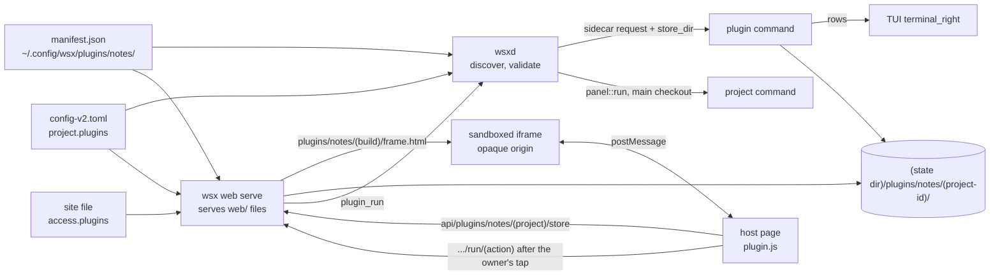

# Client plugins: design

Status: design, 2026-11-03; actions (§4) added 2026-11-20. No code yet. Extends the executable plugins of [plugins.md](../plugins.md). It does not add a second plugin system. Mockups: [client-plugins/](client-plugins/).

**Recommendation.** A plugin keeps its one manifest in `~/.config/wsx/plugins/`. A new optional `client` block declares three things: a web view, which runs in a sandboxed iframe that the page gives a narrow message API, a per-project store, and actions: fixed project commands that the frame may ask for by name (§4). The owner enables a plugin per project in `config-v2.toml`. A site grants it in its site file. wsx moves the plugin's opaque bytes and enforces bounds and grants; it never reads what the plugin stores. The TUI shows the same plugin through the `terminal_right` sidecar it already has.

## 1. What the views use today

| Area | Web routes (`crates/wsx-web/src/http.rs`) | Gate | TUI reads |
|---|---|---|---|
| Workspace | `api/events` (`workspace`, `history`, `exchange`, `daemon`, `resync`), `api/session` | paired device | daemon snapshot: projects, worktrees, sessions, agent state |
| Chat | `api/chat/<session>/{timeline,send,commands,cancel,answer,queue}` | `chat_send`, `chat_answer`, `agent_write` | the terminal; no chat |
| Sessions | `POST api/sessions`, `DELETE api/sessions/<id>` | `session_start` | daemon session commands |
| Files | `api/files`, `api/file`, `api/file/page` with `view/<token>/` (main checkout, `O_NOFOLLOW`) | `files_read`, `files_write` | none |
| Terminal | `api/terminal/<session>/ws` (raw stream) | `terminal_view`, `terminal_input` | the pane itself |
| Tasks | `api/tasks/...` ([web-client-tasks.md](../web-client-tasks.md)) | `task_view`, `task_act` | `wsx task` CLI |
| Media, push | `api/media`, `media/<file>`, `api/push` | `media_*`, `push` | none |
| Plugins | none | none | `PluginRender` gives a sidecar `PluginSidecarView`; `wsx plugin list/reload` |

**Stable surface a plugin may call.** All of the above is the view layers' API. None of it is offered to a plugin. A plugin gets five calls, all scoped to one project that the client has already granted:

1. `context`: the project's wsx id and name, the theme's color tokens, whether the view is narrow and whether this device may run actions (`run`). No path, session or worktree.
2. `store.get(key)` and `store.list()`: read its own keys.
3. `store.put(key, bytes, revision)` and `store.delete(key, revision)`: write with a revision check, so that two devices cannot overwrite each other without notice.
4. `changed`: an event when another client changes a key.
5. `run(action, slots)`: run one project command that the manifest declares, and get its state back (§4). The frame never sends a command line.

Later versions may add calls that pass through the existing capability bits, for example `files_read`. Each added call needs a real plugin that uses it.

## 2. Established approaches

| Approach | Where it is used | Fits wsx? |
|---|---|---|
| Same-origin ES module that the page imports | many PWAs; Obsidian (desktop) | Fits `script-src 'self'` as it is, but the module runs with the device cookie and can call every route the device may call, including `terminal_input`. The grant would be only cooperative. |
| Sandboxed iframe (`allow-scripts`, no `allow-same-origin`) plus `postMessage` | the UI half of a Figma plugin; Observable | The frame has an opaque origin: no cookie, no storage, no parent DOM. Its requests carry `Origin: null`, which the server refuses already. The host must validate every message ([macwright](https://macwright.com/2024/03/29/figma-plugins)). |
| Same origin plus `allow-same-origin` | none | Refused: with both flags the frame can remove its own sandbox. |
| TUI: WASM with requested permissions | Zellij ([permissions](https://zellij.dev/documentation/plugin-api-permissions)) | Adds a runtime and a rendering API. The architecture note keeps plugins as external executables, not loaded code. |
| TUI: external process, rows over JSON | wsx `terminal_right` sidecar | Exists. wsx owns layout, input and color; the plugin only returns rows. |

## 3. Design



| Concern | Options | Choice and why |
|---|---|---|
| On disk | separate client folder; one manifest | One manifest. `client.web` names a folder next to it (`"web/"`). The folder is read with the same no-symlink rule as `command` and is bounded (64 files, 2 MiB, extensions `.html .js .css .svg .png .woff2`). |
| Enabled per project | repository file; `config-v2.toml` | `plugins = ["notes"]` on the project entry (`ProjectEntry` in `config/global.rs`). The owner's config decides, so a cloned repository cannot turn a plugin on. |
| Granted per site | every plugin; a list | `[access] plugins = ["notes"]`. If the list is absent, the site grants no plugin. A call is served only when four conditions hold: the plugin is valid, the project is in the site's grant, the project enables the plugin and the site lists it. Otherwise the answer is 404. `run` adds the rules of §4. |
| Storage | task store; files in the project; its own folder | `<wsx state dir>/plugins/<id>/<project-id>/`, mode 700. One file per key, named `[a-z0-9][a-z0-9._-]{0,63}` (so `notes.md` is valid and no key starts with a dot), at most 256 KiB, 64 keys and 4 MiB per project. Each write goes to a temporary file and is renamed, with a revision. Writes past a bound get 413. A temporary file left by a crash is removed at the next write. When wsx removes a project, it removes that project's plugin folders. A small module in `wsx-core` resolves and bounds this folder. It has two users: `wsx-web` and wsxd, which passes `store_dir` to the sidecar. |
| Web UI slot | Home tab; project sheet; session panel | One slot: `project_sheet`. An item in the project's ⋯ menu (§4, "Where it opens") opens `#/p/<project>/x/<plugin>` as a sheet, like Usage and To check. |
| TUI UI slot | new pane; sidecar | The existing `terminal_right` sidecar, read only. The plugin command reads `store_dir` from `WSX_PLUGIN_VIEW_JSON`. |

### What the web plugin's own code may do

- **It runs only in its frame.** The page adds `<iframe sandbox="allow-scripts" src="plugins/<id>/<build>/frame.html">`. The frame never gets `allow-same-origin`, `allow-forms`, `allow-popups` or `allow-top-navigation`. `<build>` is the digest of the plugin's files, so a cached old file never mixes with a new one.
- **The frame's CSP** is `default-src 'none'; script-src 'self'; style-src 'self'; img-src 'self' data:; font-src 'self'; connect-src 'none'; form-action 'none'; sandbox allow-scripts`. The plugin cannot fetch, open a socket or submit a form. Its only way out is `parent.postMessage`. It may draw any DOM it wants inside its frame. It may load its own scripts and styles from its folder, and the site's theme file for the look.
- **The page CSP changes in one place:** `frame-src 'self'`. Everything else stays: no inline script or style, and no outside origin.
- **The host page side** is `web/plugin.js`. It accepts a message only when `event.source` is that frame's window. It checks the call against the five calls of §1 and their size limits, adds the project from the route (never from the message) and calls `api/plugins/<id>/<project>/store`. A plugin cannot name another project or another plugin.
- **The server side** checks the four conditions and the bounds. It treats values as bytes; it never parses them as JSON. A change sends `plugin {id, project, key}` on the existing event stream, and the host passes it to the frame as `changed`.
- **Spike before build.** Two browser details are not settled by sources: whether `'self'` in a sandboxed frame's CSP matches the server's origin for scripts in Chrome, Safari and Firefox (a Firefox bug suggests that it does not: [bug 2019949](https://bugzilla.mozilla.org/show_bug.cgi?id=2019949)), and whether module scripts load from an opaque origin without CORS headers. The fallback is classic scripts and a frame CSP that names the exact origin. The spike is one frame page in `scripts/web-browser-check.mjs` on the three engines.

## 4. Actions: a plugin runs a project command

**Need.** studio-app's channel sheet runs `publish channel new`, `publish authorize <id>` and `publish health`, shows a result and has one handle field. The frame cannot run anything (`connect-src 'none'`) and must not send a command line. **Reuse.** A panel already runs a declared argv in the main checkout (`panel::run`, [panels.md](../panels.md)). An action is that run with typed slots filled in, a tap before it and the result sent back. No new runner.

```json
"client": {"web": "web/", "actions": {
  "list":      {"argv": ["services/publishing/bin/publish.cjs", "channel", "list", "--json"], "read": true, "output": "frame"},
  "health":    {"argv": ["services/publishing/bin/publish.cjs", "health"], "read": true, "output": "owner"},
  "authorize": {"argv": ["services/publishing/bin/publish.cjs", "authorize", "{channel_id}"],
                "slots": {"channel_id": "^[a-z0-9-]{1,40}$"}, "effect": "Opens Chrome on the host Mac", "output": "none", "timeout": 300}}}
```

| Question | Choice | Why |
|---|---|---|
| Declared where | The manifest's `client.actions`: a name (`[a-z][a-z0-9_]{0,31}`, 16 at most) with `argv` (16 parts, 256 B each, no shell), `slots`, `read` (default false), `output` (`none`, `owner`, `frame`; default `none`), `effect` (80 chars, shown in the tap), `timeout` (1..=300 s, default 30). A slot is a whole argv part `{name}` with an anchored pattern; a slot with no part, a part with no slot or a bad pattern makes the plugin invalid. | The owner's file decides, as for enabling. A repository cannot add an action. The frame names an action and gives slot values; the server builds the argv. A value is at most 200 B, must match its pattern and may not start with `-`, so it is never read as an option; a plugin that needs a flag declares it in `argv`. |
| Who may run | The device needs `terminal_input` (and the terminal panel), as for panels, besides the four conditions of §3. `context.run` says so; without it the frame hides its buttons and the server answers 403. | `terminal_input` already lets a device run any command in the checkout; a declared action is narrower. `task_act` means acting on tasks. A `plugin_run` bit would always travel with `terminal_input`: add it only for a site that wants actions without a terminal. |
| The tap | `read: false`: the host page (`confirmDialog`, outside the frame, modal so the frame is inert) shows the action's command line with the slots filled and its `effect`, else "Runs on the host". The run starts on *Run*. `read: true` runs on the frame's call with no tap. | The tap stops a frame from running a command alone. It is not a server rule: a device that holds the cookie can call the API, and `terminal_input` already trusts it. wsx cannot check that `read` is true; it is the owner's claim in a file only the owner writes. Each run still shows in the result card. |
| Where it runs | wsxd, new request `plugin_run`, calls `panel::run` with the slots filled: the project's main checkout, wsxd's env plus `NO_COLOR=1` and `TERM=dumb`, stdin closed, its own process group, `timeout` then a group kill. One run per action and project at a time, kept like a panel's last result (`wsx-daemon/src/panel.rs`): closing the sheet does not stop a run, and a reopen reads the result (a wsxd restart clears it). A `read` action runs at most once per 2 s; a call inside that time gets the last result, so a frame cannot start commands in a loop. Web: `POST api/plugins/<id>/<project>/run/<action>` with `{slots}` gives 202; `GET` of the same path gives the last result. | One runner for panels and actions. A command that asks a question gets end of input, so a plugin passes the answer as a slot (the handle) in `argv`. |
| The result | State: `running`, `ok`, `failed` (exit code), `timed_out`, `not_started`. Text: stdout, and on a failure stderr after it, ANSI codes and control characters stripped, the last 16 KiB (as panels). `output: none` gives no text, even on failure. `owner` shows the text in the host's result card only. `frame` (only with `read: true`) also gives stdout to the frame, so a plugin can draw data from `list`. | The frame gets state, exit code and, on `frame`, stdout. Never env, a path, argv or stderr. The frame has no network, so what it receives stays on that screen. |
| Secrets | wsx has no redaction: `plain_text` in `panel.rs` strips ANSI codes only, and `secrets` in `task/policy.rs` are denied paths, not output. None is added: a pattern scrubber promises what it cannot keep. Rules instead: a command that touches a credential (`authorize`) is `output: none`; the manifest is the owner's; no output is logged. | "Never a secret on screen" is then a contract of the project's command, which the owner declares and reads, and a shape wsx can check: `none` shows nothing. |
| The TUI | Not yet. | The sidecar returns rows and has no input; an action needs a tap and typed slots, the input contract of open choice 3. The sidecar shows store rows; the command runs in the terminal. |
| Where it opens | The project's ⋯ menu in the manager chat header (`More` in `tasks.js`): one item per enabled, granted plugin, named by `name`, after Files. It opens the sheet `#/p/<id>/x/<plugin>` (`SHEETS` in `tasks.js`). Needs `task_view`, as every sheet. | No plugin, no change to the menu. Not Home, which lists chats. Not an icon in the bar, which holds Files, Panels and Shell and would grow with each plugin. |

**Frame message.** The frame sends `{id, call: "run", action, slots}`. The host checks the slots, asks for the tap when `read` is false and answers `{id, state, exit, text?}` when the run ends, or `{id, state: "cancelled"}` when the owner declines. At most one tap dialog is open per frame, and a run of an action that already runs answers `running`.

**Result card.** The host draws it under the frame, outside it: the command line, the state word, the age, the text in a code block (12 lines, then it scrolls) and *Close*. A failed run stays until closed or the next run. The frame cannot read or write it.

**Proof (when built).** `scripts/test-web-client.py` plugins part, with a fixture command, not `publish`: an undeclared action 404; no `terminal_input` 403; a bad slot or a value that starts with `-` 400; the argv is the manifest's with the slots (the fixture echoes it); a timeout kills the group; `none` returns no text on a failure; a frame message for a `read: false` action opens the dialog and runs nothing before *Run*; stdout reaches the frame only for `frame`.

## 5. Plugins

### Per-project notes and todo

- Folder `docs/examples/plugins/notes/` holds `manifest.json`, `web/frame.html`, `web/notes.js`, `web/notes.css` and a small `notes-sidecar` script.
- Keys: `notes.md` (free text) and `todo.json` (`[{id, text, done}]`, the plugin's own format).
- Web: the sheet shows the notes text area, saved 1 s after typing stops, and the todo list with add, done and delete. A 409 on a stale revision reloads the key and shows "Changed on another device".
- TUI: shares the store, read only. The sidecar lists open todos (tone `normal`) and done todos (`muted`). Edits stay on the web in v1, because the sidecar owns no input.
- Proof: `scripts/test-web-client.py` adds a plugins part. It checks the grant matrix (each of the four conditions off gives 404), the bounds (413), the revision conflict (409), that a frame `fetch` fails, that a forged message for another project is ignored, and the sidecar rows read from the same folder through the smoke scenario.

### studio-app channels (the first actions)

- The channel list comes from the `list` action (`output: frame`), the new-channel form runs `publish channel new ...` with typed slots, *Open its profile* runs `authorize` (tap, `output: none`), *Run health* runs `health` (`output: owner`). The handle field is a slot. The store holds the checklist ticks only.
- Mockups in [client-plugins/](client-plugins/), `<name>-<dark|light>-<390|1280>.png`, made by `build.py` and `capture.mjs`: `a-menu` (the ⋯ menu), `b-list` and `b-detail` (the sheet), `c-tap` (the owner's tap), `c-result` (an ok result), `d-failed` (failed, with text), `d-silent` (failed, `output: none`). Source of the content: studio-app `console/accounts/mockups/b-plugin.png`.
- The owner copies the plugin folder to `~/.config/wsx/plugins/channels/` and lists it in the project's entry and the site file. A repository-shipped install is not built.

## 6. Not in scope

- Plugin-to-agent calls, plugin-owned routes and plugin code running on the server. A declared action is the project's own command, run by wsxd as a panel is.
- A plugin store or marketplace, or automatic install.
- A second UI slot.

## Owner's open choices

1. Isolation: a sandboxed iframe (recommended: the grant is enforced) or a same-origin module (simpler, but every plugin can do whatever the device can do).
2. Where enabling lives: `config-v2.toml` per project (recommended) or a file in the repository.
3. The TUI in v1: read-only sidecar rows (recommended) or editing, which needs a new input contract.
4. The web slot: a project sheet only (recommended), or also a Home tab.
5. A removed project: delete its plugin data (recommended) or keep it until `wsx plugin prune`.
6. Shared libraries: each plugin ships its own (recommended) or the frame may load the vendored Preact.
7. The right to run an action: `terminal_input` (recommended) or a new `plugin_run` bit.
8. The tap: every action but `read: true` ones (recommended), or every action.
9. Stdout to the frame (`output: frame`, `read` actions only; recommended), or the owner's result card only. Without it a plugin cannot draw a command's data, such as the channel list.
