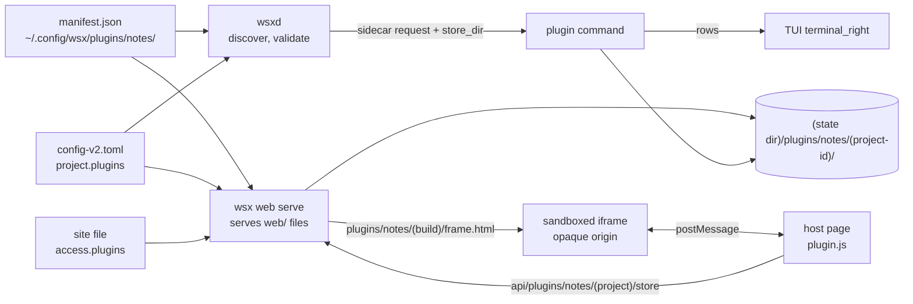

# Client plugins: design

Status: design, 2026-11-03. No code yet. Extends the executable plugins of [plugins.md](../plugins.md). It does not add a second plugin system.

**Recommendation.** A plugin keeps its one manifest in `~/.config/wsx/plugins/`. A new optional `client` block declares two things: a web view, which runs in a sandboxed iframe that the page gives a narrow message API, and a per-project store. The owner enables a plugin per project in `config-v2.toml`. A site grants it in its site file. wsx moves the plugin's opaque bytes and enforces bounds and grants; it never reads what the plugin stores. The TUI shows the same plugin through the `terminal_right` sidecar it already has.

## 1. What the views use today

| Area | Web routes (`crates/wsx-web/src/http.rs`) | Gate | TUI reads |
|---|---|---|---|
| Workspace | `api/events` (`workspace`, `history`, `exchange`, `daemon`, `resync`), `api/session` | paired device | daemon snapshot: projects, worktrees, sessions, agent state |
| Chat | `api/chat/<session>/{timeline,send,commands,cancel,answer,queue}` | `chat_send`, `chat_answer`, `agent_write` | the terminal; no chat |
| Sessions | `POST api/sessions`, `DELETE api/sessions/<id>` | `session_start` | daemon session commands |
| Files | `api/files`, `api/file`, `api/file/page` with `view/<token>/` (main checkout, `O_NOFOLLOW`) | `files_read`, `files_write` | none |
| Terminal | `api/terminal/<session>/ws` (raw stream) | `terminal_view`, `terminal_input` | the pane itself |
| Tasks | `api/tasks/...` ([web-client-tasks.md](../web-client-tasks.md)) | `task_view`, `task_act` | `wsx task` CLI |
| Media, push | `api/media`, `media/<file>`, `api/push` | `media_*`, `push` | none |
| Plugins | none | none | `PluginRender` gives a sidecar `PluginSidecarView`; `wsx plugin list/reload` |

**Stable surface a plugin may call.** All of the above is the view layers' API. None of it is offered to a plugin. A plugin gets four calls, all scoped to one project that the client has already granted:

1. `context`: the project's wsx id and name, the theme's color tokens and whether the view is narrow. No path, session or worktree.
2. `store.get(key)` and `store.list()`: read its own keys.
3. `store.put(key, bytes, revision)` and `store.delete(key, revision)`: write with a revision check, so that two devices cannot overwrite each other without notice.
4. `changed`: an event when another client changes a key.

Later versions may add calls that pass through the existing capability bits, for example `files_read`. Each added call needs a real plugin that uses it.

## 2. Established approaches

| Approach | Where it is used | Fits wsx? |
|---|---|---|
| Same-origin ES module that the page imports | many PWAs; Obsidian (desktop) | Fits `script-src 'self'` as it is, but the module runs with the device cookie and can call every route the device may call, including `terminal_input`. The grant would be only cooperative. |
| Sandboxed iframe (`allow-scripts`, no `allow-same-origin`) plus `postMessage` | the UI half of a Figma plugin; Observable | The frame has an opaque origin: no cookie, no storage, no parent DOM. Its requests carry `Origin: null`, which the server refuses already. The host must validate every message ([macwright](https://macwright.com/2024/03/29/figma-plugins)). |
| Same origin plus `allow-same-origin` | none | Refused: with both flags the frame can remove its own sandbox. |
| TUI: WASM with requested permissions | Zellij ([permissions](https://zellij.dev/documentation/plugin-api-permissions)) | Adds a runtime and a rendering API. The architecture note keeps plugins as external executables, not loaded code. |
| TUI: external process, rows over JSON | wsx `terminal_right` sidecar | Exists. wsx owns layout, input and color; the plugin only returns rows. |

## 3. Design

| Concern | Options | Choice and why |
|---|---|---|
| On disk | separate client folder; one manifest | One manifest. `client.web` names a folder next to it (`"web/"`). The folder is read with the same no-symlink rule as `command` and is bounded (64 files, 2 MiB, extensions `.html .js .css .svg .png .woff2`). |
| Enabled per project | repository file; `config-v2.toml` | `plugins = ["notes"]` on the project entry (`ProjectEntry` in `config/global.rs`). The owner's config decides, so a cloned repository cannot turn a plugin on. |
| Granted per site | every plugin; a list | `[access] plugins = ["notes"]`. If the list is absent, the site grants no plugin. A call is served only when four conditions hold: the plugin is valid, the project is in the site's grant, the project enables the plugin and the site lists it. Otherwise the answer is 404. |
| Storage | task store; files in the project; its own folder | `<wsx state dir>/plugins/<id>/<project-id>/`, mode 700. One file per key, named `[a-z0-9][a-z0-9._-]{0,63}` (so `notes.md` is valid and no key starts with a dot), at most 256 KiB, 64 keys and 4 MiB per project. Each write goes to a temporary file and is renamed, with a revision. Writes past a bound get 413. A temporary file left by a crash is removed at the next write. When wsx removes a project, it removes that project's plugin folders. A small module in `wsx-core` resolves and bounds this folder. It has two users: `wsx-web` and wsxd, which passes `store_dir` to the sidecar. |
| Web UI slot | Home tab; project sheet; session panel | One slot: `project_sheet`. A button on the project screen opens `#/p/<project>/x/<plugin>` as a sheet, like the project page and To check. |
| TUI UI slot | new pane; sidecar | The existing `terminal_right` sidecar, read only. The plugin command reads `store_dir` from `WSX_PLUGIN_VIEW_JSON`. |

### What the web plugin's own code may do

- **It runs only in its frame.** The page adds `<iframe sandbox="allow-scripts" src="plugins/<id>/<build>/frame.html">`. The frame never gets `allow-same-origin`, `allow-forms`, `allow-popups` or `allow-top-navigation`. `<build>` is the digest of the plugin's files, so a cached old file never mixes with a new one.
- **The frame's CSP** is `default-src 'none'; script-src 'self'; style-src 'self'; img-src 'self' data:; font-src 'self'; connect-src 'none'; form-action 'none'; sandbox allow-scripts`. The plugin cannot fetch, open a socket or submit a form. Its only way out is `parent.postMessage`. It may draw any DOM it wants inside its frame. It may load its own scripts and styles from its folder, and the site's theme file for the look.
- **The page CSP changes in one place:** `frame-src 'self'`. Everything else stays: no inline script or style, and no outside origin.
- **The host page side** is `web/plugin.js`. It accepts a message only when `event.source` is that frame's window. It checks the call against the four calls of §1 and their size limits, adds the project from the route (never from the message) and calls `api/plugins/<id>/<project>/store`. A plugin cannot name another project or another plugin.
- **The server side** checks the four conditions and the bounds. It treats values as bytes; it never parses them as JSON. A change sends `plugin {id, project, key}` on the existing event stream, and the host passes it to the frame as `changed`.
- **Spike before build.** Two browser details are not settled by sources: whether `'self'` in a sandboxed frame's CSP matches the server's origin for scripts in Chrome, Safari and Firefox (a Firefox bug suggests that it does not: [bug 2019949](https://bugzilla.mozilla.org/show_bug.cgi?id=2019949)), and whether module scripts load from an opaque origin without CORS headers. The fallback is classic scripts and a frame CSP that names the exact origin. The spike is one frame page in `scripts/web-browser-check.mjs` on the three engines.

## 4. First plugin: per-project notes and todo

- Folder `docs/examples/plugins/notes/` holds `manifest.json`, `web/frame.html`, `web/notes.js`, `web/notes.css` and a small `notes-sidecar` script.
- Keys: `notes.md` (free text) and `todo.json` (`[{id, text, done}]`, the plugin's own format).
- Web: the sheet shows the notes text area, saved 1 s after typing stops, and the todo list with add, done and delete. A 409 on a stale revision reloads the key and shows "Changed on another device".
- TUI: shares the store, read only. The sidecar lists open todos (tone `normal`) and done todos (`muted`). Edits stay on the web in v1, because the sidecar owns no input.
- Proof: `scripts/test-web-client.py` adds a plugins part. It checks the grant matrix (each of the four conditions off gives 404), the bounds (413), the revision conflict (409), that a frame `fetch` fails, that a forged message for another project is ignored, and the sidecar rows read from the same folder through the smoke scenario.

## 5. Not in scope

- Plugin-to-agent calls, plugin-owned routes and plugin code running on the server.
- A plugin store or marketplace, or automatic install.
- A second UI slot.

## Owner's open choices

1. Isolation: a sandboxed iframe (recommended: the grant is enforced) or a same-origin module (simpler, but every plugin can do whatever the device can do).
2. Where enabling lives: `config-v2.toml` per project (recommended) or a file in the repository.
3. The TUI in v1: read-only sidecar rows (recommended) or editing, which needs a new input contract.
4. The web slot: a project sheet only (recommended), or also a Home tab.
5. A removed project: delete its plugin data (recommended) or keep it until `wsx plugin prune`.
6. Shared libraries: each plugin ships its own (recommended) or the frame may load the vendored Preact.
