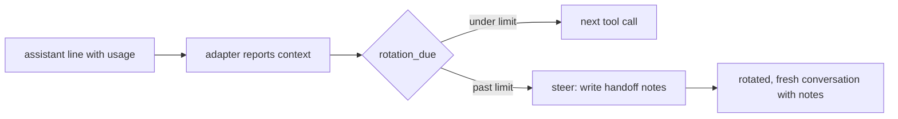

# Context budget: why every call carries so much, and the smallest set of bounds

Measured 2026-11-13 from the Claude Code transcripts on the owner's machine (`~/.claude/projects`): 114 worker
sessions of the last 79 wsx tasks and 98 manager sessions, with `scripts/context-measure.py` (its output is the
source of every number here; rerun it to refresh them). Design and measurement only; the builds follow as tasks.

```sh
python3 -B scripts/context-measure.py --manager-log ~/.local/state/wsx/tasks/<project>/manager/log.jsonl --task 438
```

Assuming: every model priced at memory-eval.py's Opus 5.5 table (Fable's rate is not on this machine); the weight
of a cache read in Anthropic's 5-hour window is unknown, so both volumes count. Pi: `~/.pi/agent/sessions/wsx` is
empty, so no Pi call was measured; a Pi conversation grows by the same tool outputs minus the Claude Code prefix.

## Root cause

The bound exists but is checked at the wrong moment with a stale size. `rotation_due` (`crates/wsx/src/task/host.rs`)
runs only when a turn starts, on `context_tokens` the host learns from a result (`:1589`, `:1678`). A turn is a
step or a message with every tool call in it, and inside one turn nothing bounds the growth:

| what | worker | manager |
|---|---|---|
| fresh start (first call) | median 34.5k (p10 33k, p90 41k) | 39.5k transcript median, 52.7k log median after a rotation |
| peak context of a session | median 146k, p90 249k, max 453k; 33 of 114 past the 200k default | median 143k, p90 235k, max 384k |
| growth per call | median 2.5k | 1.5k |
| growth per host turn | median 8k, p90 72k, max 302k (calls per turn median 4, p90 22) | median 3.6k, p90 12k, max 53k (calls median 3, p90 7) |
| cold cache rewrites (a write over 20k after the first call) | 40 = 4.6M tokens, 23% of all cache writes, median 94k | 35 = 3.1M, 20% |

Task 438 shows both: one turn of 77 calls grew from 38k to 353k; the usage limit hit inside that turn, so the
idle rule (cache gone after 1 hour) saw the size of the last result and the resume rewrote 316k tokens in one call,
then went on at 353k. The manager log's "50+ tool calls a turn" is not there: calls per reply median 2, p90 6, max 27.

## What fills a call

A fresh worker start (35k tokens) is prefix: system prompt 14.6k chars (Claude Code's plus `worker_instructions`),
14 tool schemas 31.6k chars (Workflow 5.5k, Agent 5.4k, ScheduleWakeup 4.8k, ReportFindings 2.3k are never a
worker's), the CLAUDE.md attachment 29k chars (`~/.claude/CLAUDE.md` 9.8k, the project's 2.2k, and the owner's
auto-memory index `MEMORY.md` 16.8k, 107 lines, one more per task), the skill listing 13.4k chars (`skillsOnly`;
the manager's full listing is 31.7k), then the task prompt 3.4k chars. The cache keeps it 1 hour (`ephemeral_1h`).

Growth after the start, over all sessions (tokens the next calls re-read):

| source | worker | manager | note |
|---|---|---|---|
| own output | 36% (thinking 15%) | 27% (thinking 8%) | thinking stays in context for the rest of the turn |
| file reads through bash (`cat`, `sed`, `rg`, `git show`) | 30% | 31% | the manager reads logs and transcripts this way |
| check and build output | 12% | 3% | |
| command output (other bash) | 3% | 17% | `wsx task` answers, `gh`, `ls` |
| host messages (prompt, steps, check answers, chat) | 7% | 6% | already lean: 450 tokens a manager turn |
| Claude Code reminders per call | 5% | 12% | the harness's, not ours |
| Read tool: whole file 4%, ranged 2% | 6% | 3% | 94% of Read bytes are whole files despite the instruction |

Cost of a task by part (79 tasks, median $3.98, sum $387): the start 30%, own output 26%, bash file reads 21%,
check output 8%, host messages 5%, Read 5%. The start is the largest part because every one of a session's calls
re-reads it and every cold rewrite writes it again.

## Replay of each bound on the real sessions

Each session replayed call by call under one rule; the metric is cache-read tokens (what every call re-reads) and
cache writes (what a fresh start or a cold resume costs; at the table's prices a write is 40 reads).

| bound | worker reads | worker writes | manager reads | manager writes |
|---|---|---|---|---|
| actual | 643M | 20.3M | 807M | 15.6M |
| 1. live size, handoff mid-turn at 150k | 68% | +3% | 79% | +16% |
| 2. prefix smaller by 10k (tools, MEMORY.md, listing) | 92% | −1% | 91% | −1% |
| 3. tool output cap at 2k tokens | 87% | −6% | 81% | −6% |
| 4. `rotateTokens` 100k, checked at turn start as now | 69% | +8% | 63% | +37% |
| 5. fresh conversation at every step or message | 62% | +83% | 48% | +590% |
| 6. thinking dropped inside a turn | 95% | 0 | 100% | 0 |
| 1 + 2 + 3 | 60% | −4% | 62% | −5% |

## The changes, ranked by saving per effort

1. **Live size, one rule.** The adapter already parses every assistant line's usage; it reports the context after
   each line, the host keeps `context_tokens` live, and `rotation_due` (still the one owner, same thresholds)
   runs after each line too. Past the limit the host sends the existing handoff request as a steered message, so
   the worker writes `rotate-notes.md` at the next tool boundary and the fresh conversation opens as today. The
   idle rule then fires with the true size after a limit: 438 would have paid one 316k call, not that plus 40
   more at 353k. Replaces nothing but the moment of the check; no new mechanism. Worker 32% of reads. Risk: a
   handoff in the middle of a step; the notes file and the step text already carry it. Proof: `scripts/
   fake-claude-stream.py` grows past the limit inside one turn; `scripts/test-task.py` asserts `rotated` inside
   the step and the next call's context at most start plus notes. Build first.
2. **Smaller prefix.** `--disallowedTools` for the schemas a worker never uses (to prove that it removes them from
   the request: one `claude -p` call and its `api-request-shape`), the manager on `skillsOnly` like workers
   (8k tokens), and the auto-memory index kept out of agent launches (`MEMORY.md` is the owner's own notes;
   `--bare` would do it but drops plugins, so the setting is to find). Worker 8%, manager 9%, every cold write
   smaller. Launch arguments only. Risk: none for tools; skills still load on demand.
3. **Tool output caps in code, not instructions.** Bash through `BASH_MAX_OUTPUT_LENGTH` in the agent's
   environment (Claude Code clips the result); Read through a `PreToolUse` hook in the `--settings` wsx already
   passes, refusing a whole-file read of a file over N lines with the message to read a range. Worker 13%,
   manager 19%. Risk: an agent re-reads in pieces; the cap is per result, so the second read is a range.
4. **Lower `rotateTokens` default** (100k): a config default, 31% of worker reads, but it does not bound a turn
   and the manager pays 37% more writes; superseded by 1 for workers, refused for the manager.
5. **Fresh conversation per step**: more writes than reads saved (worker +83%, manager +590%); not built.
6. **Thinking**: Claude Code's `context_management`, not ours; 5%.
7. **Manager rotation**: unchanged. memory-eval.md measured that a cut conversation fails quality (`cut150` 0.69 of
   2); its lever is 2 and 3, and no cut is silent (owner rule).



## Open

- The 5-hour window's weight of cache reads against writes: not in any transcript. On 2026-11-13 13:40-14:10 the
  worker and manager sessions read 11.4M cached tokens and wrote 366k; the owner saw the window move 15% in 11 min.
- Fable's price; a setting that disables auto-memory for `claude -p`; whether `--disallowedTools` drops schemas.
