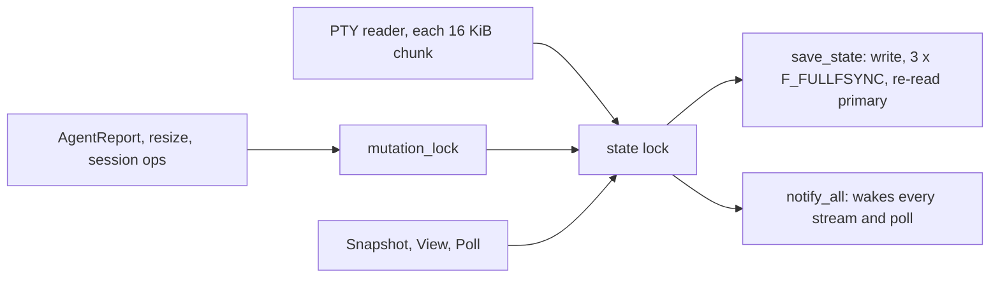

# Daemon health audit: wsxd and the terminal runtime

Status: read-only audit, 2026-11-05. Scope: `crates/wsx-daemon/` and `crates/wsx-terminal/`. Paths below are relative to `crates/`. The findings come from the source. The timings come from a copy of the save sequence and a read-only `stat` of the live `state.json`. Inside a task boundary, the `wsx` CLI runs only `wsx task`, so live request latency was not timed.
The client audits ([client-logic-audit.md](client-logic-audit.md), #235, #236, #240-#243) do not touch the daemon, so all findings here are new.

**Answer.** Most stalls come from one shared state lock, `Daemon.state` (`wsx-daemon/src/lib.rs:423`), and one global `mutation_lock`. Every mutation writes the whole `state.json` with three full syncs while it holds the state lock. Every PTY chunk also takes that lock. Terminal input and plugin subprocesses run under `mutation_lock`. Under disk load these waits add up. The 9.46 s snapshot recorded in the t148 report is most likely three queued saves. This is not reproduced yet.

## Findings

| # | Place | Problem | User-visible effect | Evidence | Proposed fix | Size | Risk |
|---|---|---|---|---|---|---|---|
| 1 | `wsx-daemon/src/state_store.rs:80-153`; `changes.rs:5-12`; `lib.rs:340`; callers `agent_report.rs:227,379`, `lease.rs:208`, `sessions.rs`, `exchange.rs`, `server.rs:409` | Each mutation runs these steps while it holds the state lock: clone the whole state, validate it (`.iter().any` loops, O(n²)), pretty-print it, write it, `sync_all`, re-read and re-validate the old primary, then rename twice, each with a directory `sync_all`. On macOS each `sync_all` is an F_FULLFSYNC. Each AgentReport saves, even when only `last_agent_active_unix_ms` changed. | Under disk load, every client call waits, including snapshots, which take no `mutation_lock`. Calls fail at the 5 s client limit. | One save of the 83,648-byte state costs 11.0 ms median and 18.1 ms max on an idle disk. One F_FULLFSYNC costs 3.4 ms. The live daemon saved 7 times in 30 s at load 15.5. t148 recorded a 9.46 s snapshot against a 1.03 s full sync at load 10.2. At 3 syncs per save, about 3 queued saves explain that time. | Move the write to one writer thread. The lock is held only to clone, and the writer saves the latest clone. Sync the directory once. Drop the re-read and skip a save when nothing persisted changed. Owner choice: keep "durable before the reply" for session create and close only. | M | M |
| 2 | `wsx-daemon/src/dispatch.rs:15-34`, `:170-183`, `:459-464`, `:480-535`, `:559`; `wsx-terminal/src/lib.rs:48` | All requests outside a short exempt list hold `mutation_lock` from start to end. The non-exempt list includes TerminalInput, Key, Paste, Mouse and Resize, PluginReview (a subprocess), PluginRender (3 s timeout) and PluginReload (a directory scan, also under the state lock). PluginReviewCancel waits for the review it should cancel. | A pane that stops reading its input costs 1 s per keystroke, and all other mutations wait behind it. Those include TerminalHeartbeat, whose lease lasts only 3 s (`lib.rs:83`). Leases can expire, and an attached client then loses its pane. | Exempt list at `dispatch.rs:15-34`. `INPUT_WRITE_LIMIT = 1 s` at `wsx-terminal/src/lib.rs:48`. | Terminal I/O takes only the per-pane operation lock (`lease.rs:226`). Plugin calls clone their input under the lock and run without it. `discover()` runs before the lock is taken. | M | M |
| 3 | `wsx-daemon/src/sessions.rs:739-763`; `wsx-terminal/src/lib.rs:596,640-647`; `wsx-daemon/src/agent_report.rs:690-720`, `lib.rs:88` | Every 16 KiB PTY read takes the state lock, bumps the global revision and calls `changed.notify_all()`. That wakes every stream thread and every `Poll` for every pane. The Claude reconciler locks the state every 100 ms and re-extracts terminal text for each Claude pane whose revision changed, which means about 10 times a second for a busy pane. | One pane with heavy output slows the streams of all other panes and adds load to the lock in #1. The daemon's CPU grows with panes × streams. | Code at the lines cited. Not profiled. | A per-pane change signal and revision. Join notifies into the 4 ms presentation cadence. Run the reconciler from the runtime revision callback, or back it off. | M | M |
| 4 | `wsx-terminal/src/lib.rs:37,524`; `vendor/libghostty-vt/src/terminal/Screen.zig:282`; `.../c/terminal.zig:345` | wsx passes `MAX_SCROLLBACK_ROWS = 10_000` as `max_scrollback`. The C header calls this value lines, but `Screen.init` reads it as bytes, rounded up to a page. The C wrapper passes it through unchanged. | Scrollback is probably the active area plus about one page, not 10,000 rows. Users lose history after a long output. | Source at the lines cited. No test writes more than 10k lines (`wsx-terminal/src/tests.rs:573` writes 9). | A scenario that writes 20k lines and reads the total row count, then sets the limit in bytes, for example rows × cols × cell size. | S | L |
| 5 | `wsx-terminal/src/ghostty/mod.rs:305,474` | Each OSC 7 (a working-directory report) pushes onto `pwd_changes`, and nothing ever reads that list. | Memory grows for the life of a pane whose shell reports its directory at every prompt. | `rg pwd_changes` finds only the field and the push. | Delete the field, or keep only the last entry. | S | L |
| 6 | `wsx-terminal/src/handoff.rs:107-137`; callers `presentation.rs:418`, `handoff.rs:187` | `bounded_handoff_ansi` first serializes the whole scrollback. If that is over 512 KiB, it binary-searches by re-serializing suffixes, so up to about 14 times. All of this runs under the emulator mutex, which the PTY reader also needs. | Raw attach, resync, resize and deploy handoff freeze the pane's output while this runs. | Code at the lines cited. | Estimate bytes per row from the first pass and serialize once more at most. Or cache the replay per revision. | S | L |
| 7 | `wsx-daemon/src/live_handoff.rs:112-202`; `handoff.rs:21,171-202` | When `request_publish` or `wait_owned` fails, the error returns before the successor is killed and reaped. The `h-<epoch>.sock` file is removed only on success. Five 30 s step timeouts run one after another, with PTY readers paused. The manifest is one JSON blob of up to 64 MiB, held in about 3 copies. | A failed deploy can leave a zombie and a socket file. Panes can freeze for up to about 150 s. With many large panes the manifest goes over its cap and the handoff fails. | Code at the lines cited. | A drop guard that kills and waits the child and removes the socket on every error path. One overall deadline. History sent per pane. | M | M |
| 8 | `wsx-terminal/src/lib.rs:586-668,673-713,796` | Three problems: (a) A pane taken over by handoff has no waiter thread. `mark_exited` does not clear `process_group`, so a later `terminate()` signals a group number that may have been reused. (b) SIGTERM and SIGKILL go out back to back. (c) The reader thread ignores `terminating`, so a grandchild that keeps the PTY slave open keeps the reader, the terminal and the 1 MiB raw ring alive. | (a) A kill can hit an unrelated process group. (b) Agents cannot save their state when a pane closes. (c) Memory leaks after a pane closes. | Code at the lines cited. | Clear the group in `mark_exited`. Give SIGTERM a grace period of about 500 ms. Have the reader check `terminating` after a wake. | S | M |
| 9 | `wsx-daemon/src/routine.rs:842-846`, `:373-389`, `:369,408,656-671`, `:363,600`, `:396-398` | Five problems: (a) A run has no timeout, and the prompt is written to stdin with a blocking write. (b) Cron minutes missed during sleep or downtime are lost, and a clock step back skips runs. (c) The `owned` mutex is held across file I/O and the terminate sleeps, up to about 4 s. (d) Logs of removed projects are never pruned. (e) A failing `at` trigger retries every minute and skips the project's remaining routines. | (a) A hung routine never runs again until someone cancels it. (b) Scheduled work silently does not happen. (c) Routine requests freeze. | Logs are 344K for 3 projects today, so (d) is small. Code at the lines cited. | A timeout per routine, then terminate the group. Owner decision: the catch-up policy. Collect orphaned log directories. Narrow the lock. | M | M |
| 10 | `wsx-daemon/src/panel.rs:38,62-76`; `plugins.rs:58,290-320` | Four problems: (a) A panel thread that panics leaves `running = true` for good. (b) Panels have no global thread cap. (c) The config is re-read on every `Get`. (d) `emit` runs plugins one at a time with a 3 s timeout each, and on timeout it kills only the child. One vanished manifest file aborts all discovery. | (a) A panel stops refreshing until the daemon restarts. (d) Plugin events lag, and grandchildren leak. | Code at the lines cited. | A drop guard that resets `running`. Run plugins in their own process groups, concurrently. `continue` on a scan error. | S | L |
| 11 | `wsx-daemon/src/recovery.rs:85-107`; `lib.rs:100` | Cold recovery waits up to 30 s per resumable pane, one pane after another, and handoff stays blocked the whole time. | After a crash, N hung agents delay recovery by N × 30 s. | Code at the lines cited. | Start all panes, then wait on them together. | S | L |

## Fix tasks, in priority order

1. **Save off the state lock (#1).** Files: `wsx-daemon/src/state_store.rs`, `changes.rs`, `lib.rs`, `agent_report.rs`, `server.rs`. Proof: in `python3 -B scripts/test-web-client.py --browser` on a loaded host, the existing stall watch shows the longest snapshot at or below the longest full sync. Today it is 9.46 s against 1.03 s. `scripts/runtime-smoke.py` must still pass the restart and handoff steps.
2. **Terminal I/O and plugin calls off the global lock (#2).** Files: `wsx-daemon/src/dispatch.rs`, `lease.rs`, `plugins.rs`. Proof: a runtime-smoke step in which one pane's program stops reading stdin and the test keeps writing to it. Another pane must then take input in under 100 ms and keep its lease for 10 s.
3. **Per-pane change signals (#3).** Files: `wsx-daemon/src/sessions.rs`, `stream.rs`, `agent_report.rs`, `lib.rs`. Proof: a runtime-smoke step with a `yes` flood in one pane. The stream delay of a second pane must stay under 50 ms, and the CPU of `wsxd` is recorded before and after the change.
4. **Terminal memory and process lifecycle (#4-#8).** Files: `wsx-terminal/src/lib.rs`, `ghostty/mod.rs`, `handoff.rs`, `wsx-daemon/src/live_handoff.rs`, `handoff.rs`. Proof: four runtime-smoke steps:
   - Write 20k lines, then check the row count of the scrollback.
   - Loop OSC 7 and check that the RSS of `wsxd` stays flat.
   - Fail a handoff on purpose and check that no zombie and no socket file remain.
   - Close a pane whose agent traps SIGTERM and check that the trap ran.
5. **Routine robustness (#9, #10).** Files: `wsx-daemon/src/routine.rs`, `panel.rs`. Proof: a real routine with `sleep 600` and a timeout ends as failed and runs at its next slot. A routine whose project folder is removed has its logs gone after the next tick. Owner choices first: catch-up after sleep (run once or skip), and a default timeout.

## Checked and fine

- **Socket input.** Requests are read with a bounded line read (`server.rs:653`). A JSON error becomes an error response. No `unwrap` acts on client, file or PTY input. The `expect` calls check values found under the same lock.
- **Client writes.** No client or stream socket write happens under the state lock (`server.rs:620`, `stream.rs:164-238`). Each connection has 5 s read and write timeouts, and there are at most 64 clients.
- **Exchange delivery.** Delivery drops both locks before its PTY write (`exchange.rs:605-640`).
- **Growth limits.** The event ring holds 1024 entries, plugin events 256 and exchanges 256. Per-pane maps are pruned when a pane closes (`lib.rs:352-375`).
- **Raw stream.** A reader that falls behind gets a replay instead of a growing queue. Query replies use a bounded channel.
- **State file.** Writes are atomic with mode 0600 and O_NOFOLLOW. Reads are capped at 8 MiB. A bad primary falls back to `.backup`.
- **Handoff transfer.** The SCM_RIGHTS transfer checks the descriptor count, the peer uid and a token, and failures roll back.
- **Ghostty FFI.** The FFI checks null pointers and result codes. The clipboard callback is in `catch_unwind` and is bounded.
- **Small services.** `wake.rs` bounds and renews `caffeinate`. `lifetime.rs`, `reporter.rs` (staging and permission checks) and `plugins/review.rs` (deadline, killpg, output caps) are also fine.
- **Routine supervisor.** Children are reaped, a process start time guards against pid reuse, output is capped (head plus a 128 KiB tail) and `routines.lock` is a flock.

## Top 3

1. Every save does three full syncs while it holds the one state lock, and AgentReports and resizes save. On a busy disk, every client waits seconds. This is the likely cause of the 9.46 s stall.
2. The global `mutation_lock` puts terminal input (1 s limit) and plugin subprocesses in front of heartbeats whose lease lasts 3 s. One pane that stops reading can drop leases everywhere.
3. Each PTY chunk wakes every stream through one condition variable under the state lock. Also, scrollback is probably about one page, not 10,000 rows, because Ghostty reads the limit as bytes.
