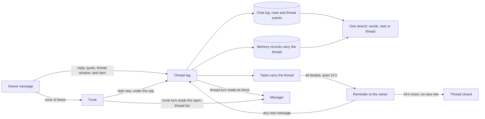

# Deep refactor: one owner per concern, threads by key (#501)

Status: plan only, 2026-11-17. This file is the plan; the code is unchanged. The build steps become child tasks (`--into 501`) after the owner approves.
Numbers: `python3 -I docs/design/deep-refactor-measure.py commands|stores|rows|threads 14`. It reads this machine's transcripts and stores, prints totals only and makes no model call.
Owner words: studio-app 1049, relayed in wsx 5194.

## 1. For the owner: one screen

| # | Step (child task) | Lines out | Lines in |
|---|---|---|---|
| 1 | Old store moves and imports go | about 950 | about 10 |
| 2 | Dead aliases and old row shapes go | about 250 | about 20 |
| 3 | One search: one result type, one ranker | about 400 | about 120 |
| 4 | Notes files built from records in one place | about 450 | about 150 |
| 5 | One rule for "the owner is needed" and one chat list row | about 80 | about 20 |
| 6 | Threads in wsx-core: tag, open or join, cap, merge | 0 | about 700 |
| 7 | Manager turns read the thread; the recap request goes | about 250 | about 200 |
| 8 | Close after quiet, with a reminder first | 0 | about 200 |
| 9 | Thread window in the web and the TUI (a picture first) | to be measured | about 600 |
| | Total | about 2,380 | about 2,020 |

These are estimates from the line counts of the functions named in section 4. Steps 1 to 5 delete more than they add and do not depend on threads. The thread steps add code, because threads are a new feature. Cost: a thread turn reads about 700 to 1,500 more tokens, which is +$9 to +$17 a week (thread-context.md section 1). The recap turns go: 33 in 14 days (`rows`).

## 2. What the owner needs

1. The owner talks to managers from a phone, async, about many subjects at the same time.
2. Each subject is one thread, with its own window and its own context. Threads do not multiply.
3. Tasks do the work. A thread shows its tasks and their states.
4. The owner sees what needs them, and nothing else is pushed.
5. Nothing is lost. Each fact has one store, and a thread can be read again by its key.
6. Low cost: no model call where a rule is enough. Each step reports its cost.
7. Short, plain replies with no coined terms. No UI is built before the owner sees a picture of it.

## 3. Inventory and measured use (14 days to 2026-11-17)

Calls are Bash tool calls that agents made (`commands`). "Chat" is a manager or chat agent, and "worker" is a task copy. Worker `wsx memory` calls are mostly tests of the memory feature.

| Concern | Owner modules (LOC) | Store on disk (size, writes in 14 d) | Commands (chat / worker calls) |
|---|---|---|---|
| Record store | `memory/store.rs` 822, `record.rs` 165 | `
/memory/records.jsonl` 1.2 MiB, 936 rows; now 1,032 records, 271 of them superseded rules | `memory add` 222/19, `supersede` 18/1, `update` 3/4, `get` 1/11, `list` 2/2, `status` 0/15 |
| Transcript search (digest) | `memory/index.rs` 792 | `
/search.jsonl` 11.6 MiB, 11,102 rows; `history` is 11,000 of 17,267 rows | `task search` 175/87 (`--all` 94/17, `--task` 27/18) |
| Memory search | `memory/backend.rs` 429, `cli/memory.rs` 434 | records plus the digest | `memory search` 29/51, `recall` 5/23 |
| Notes files | `memory/manage.rs` 849, `task/notes.rs` 303 | `chats/<c>/notes/decisions*.md`, `context*.md`, `views.json` | none; read into the manager's first message (at most 10 KiB, `notes.rs:13`) |
| Start block | `memory/start.rs` 180 | none (area briefs from config) | `memory start` 9/41 (hidden) |
| Memo capture | `manage.rs:753`, `repo.rs:1337` | episodes: 244 records | `memory capture` 1/8 (hidden) |
| Imports and store moves | `manage.rs:431-640`, `chats_move.rs` 316, `chats.rs:494-780`, `store.rs:1487` | `.pre-memory` copies 121 KiB in 24 files | `memory import` 0/16 (hidden) |
| Chat transcript | `task/chat.rs` 1157, `task/manager.rs` 865 | `chats/<c>/log.jsonl` 9.2 MiB, 20,440 rows: 827 owner, 2,435 replies, 2,139 events | `say` 396/83, `chat` 103/106 |
| Manager turn | `wsx/task/manager.rs` 2394 | `state.json`, `turn.json` | `ledger` 370/45, `checkin` 144/31 |
| Repo service | `wsx/task/repo.rs` 1906 | `repo.json` | recap 33 turns, check-ins |
| Tasks | `wsx/task/host.rs` 4892, `core/task/*` | `
/<n>/log.jsonl` 50 MiB, 61,972 rows; check logs 55 MiB | `new` 640/100, `add` 655/51, `show` 767/32, `land` 517/22, `check-run` 258/1487 |
| Overview | `store.rs:1514`, `manager.rs:2065` | `
/overview.md` 16 KiB in 15 files | manager writes it; web `/page`, TUI `o` |
| Chat folders | no writer in product code (`rg '"scratch"\|scratch/' crates` finds only the test `land_index_lock.rs:130`) | `chats/<c>/scratch/*` 244 MiB, 5,528 files | none |

Rules that have two owners today. Each entry is checked at the cited line.

| Rule | Owner A | Owner B (and more) |
|---|---|---|
| Search entry point | `index::search` (`memory/index.rs:154`) for `task search` | `Builtin::search` (`memory/backend.rs:107`) for `memory search`; both call `gather` |
| Search result and kind | `Hit` `index.rs:112`, `Kind` `index.rs:41` | `Hit` `backend.rs:31`, `Kind` `record.rs:15`, kind list again `backend.rs:58` |
| Word ranker | `each_token` with BM25 (`index.rs:354`) | `notes::matching` with its own stems and `STOP_WORDS` (`notes.rs:222`, `:28`); `record.rs:132` `words` |
| Notes text | `manage::render` writes the files (`manage.rs:297`) | `notes::preamble` parses the same files again to cut them to budget (`notes.rs:147`) |
| Find words in a chat | `chat::find_from` substring scan (`chat.rs:294`) | the digest over the same logs (`index.rs:484`) |
| The owner is needed | `needs::stage` (`needs.rs:35`) | web push filter `notice` (`wsx-web/src/tasks.rs:1455`), built again from raw `waits_on` flags |
| Chat list row | `chats::rows` (`chats.rs:463`) | web `chat_contacts` (`wsx-web/src/tasks.rs:834`), with its own goal line and last message |
| Task state, many times in one turn | event line (`repo.rs:1293`) | `ledger_summary` (`manager.rs:1511`), `since_then` (`manager.rs:858`), `digest_lines` (`view.rs:58`) |
| Quiet project | recap timer `ask_recap` (`repo.rs:502`) | `project.idle` routine event (same function), and thread closing after this plan |

Two-owner rules that open tasks own already (not repeated here): the state word and the bands (#482), the chat rows (#491), and the view model (#444, landed).

## 4. Verdicts

Each "goes" names its callers and what replaces it. The greps are run in this copy.

| Item | Verdict | Evidence | Callers, and what replaces them |
|---|---|---|---|
| Store moves `chats_move.rs` (316 lines), `migrate_once` and `migrate_roles` (`chats.rs:494-780`), `migrate_page` (`store.rs:1487`) | goes | `ls tasks/*/manager`, `chats/*/role.json`, `*/page.md`: none on this machine. `migrate_once` runs on every `project_dir` call (`store.rs:149`) | `store.rs:149`, `:1516`. Nothing replaces them. A store that was not moved is refused with the release that still moves it |
| `memory import`, `old_records`, `backfill_once`, `ensure_imported` (`manage.rs:431-640`), the `.pre-memory` files | goes | 11 of 11 stores have `paths-backfilled`. `import` has 0 chat calls | `cli/memory.rs:193`, `manage.rs:717,835,846`. Nothing replaces them |
| `agents[].roles` key (`global.rs:374`, field `_roles`) | goes | `rg _roles crates` finds only `global.rs:374,399` | none. serde ignores the unknown key |
| `task handback` (`task/args.rs:157`), `runtime` (`cli/args.rs:73`), `session send-keys` (`cli/args.rs:828`) | goes | handback 0/8 calls, all by workers; send-keys 0 | `task hand --back`, `daemon status`, `session send-text` |
| `manager-host` (`task/args.rs:345`, `run_old`) | stays | `~/.local/state/wsx/state.json` holds 2 saved sessions that run `task manager-host` (skiller, mentoring) | wsxd restores them. It goes after those sessions run `chat-host` |
| `ManagerEvent::Ping` (`core/task/manager.rs:192`), author prefixes `manager:`, `manager-reply:` (`manager.rs:100-101`), `Party` with one variant (`manager.rs:35`) | merge into one reader of old rows | No writer (`rg 'ManagerEvent::Ping'` finds only readers at `chat.rs:174`, `usage.rs:294`). Old rows exist up to 11-16 (`rows`) | `Party` becomes the chat name; old prefixes map in one table that stays. `Ping` goes once usage stops reading rows older than 11-16 |
| `task search` vs `memory search` vs the ir index | merge into one `memory::search` | Two entry points, two `Hit` types, two `Kind`s (section 3). The ir index is the digest `search.jsonl`, and no other index file exists (`stores`) | `wsx memory search` takes `--task`, `--thread` and `--all`. `wsx task search` stays as a hidden alias for one release (cli-lean.md "hide first"), because it had 175 chat calls |
| `notes::matching` (5 lines per owner message, `manager.rs:2105`) | goes | It is a third ranker, with no CJK pairs (`notes.rs:222`) | `manager.rs:822`. The thread block of step 7 replaces it, and trunk turns get none |
| Notes files: `drift`, `views.json`, `check_views`, `copy_once` | goes | The prompt forbids hand edits (`instructions.rs:94`); `drift` exists only to catch them (`manage.rs:285`, `manager.rs:2088`) | `manager.rs:2092`, `cli/memory.rs:82,142,153,185`. The files stay as output only, written by the same function that builds the preamble |
| `notes::preamble` file parsing (`notes.rs:99-147`) | merges into `memory::manage` | It cuts a file that `render` wrote from the same records | `manager.rs:2143`. One function builds the cut text from the records |
| `memory::start` and `memory start` (`start.rs:84`) | merges into `task_context` | Only the area briefs are left (`start.rs:84-107`; memory-eval.md: records give no gain). Its caller is `host.rs:2515` | `task_context` reads `memory.areas`. `stale` (`start.rs:57`) moves into the search |
| `memory capture` (hidden) and `fold_memo` | stays | 138 task episodes plus 106 episodes from notes; search returns them | `repo.rs:1337` |
| `history` rows in the digest | stays | The owner decided on one search over chats and task logs (11-07). `task search --task` reads `history.rs` directly | `index.rs:648` |
| Recap request: `RECAP_REQUEST`, `changed_since`, `cost_since`, `recap_ms` (`repo.rs:41,502-545`) | goes | 33 recap turns in 14 days. A second owner of "what happened while it was quiet" | `ask_recap` keeps its quiet timer, because `project.idle` and the idle task use it (docs/tasks.md:291); `recapMinutes` keeps that meaning. The thread reminder replaces the recap text: written by wsx, with no model call |
| `since_then` (`manager.rs:858`) | merges into the thread block | It states the task states again, after the events and the ledger summary | `manager.rs` turn assembly |
| Overview `overview.md`, `check_overview` (`manager.rs:2065`) | owner question 3 | Owner-facing page, written by the manager. Its open-task part repeats the thread list | web `/page`, TUI `o`, instructions |
| Check-ins (`repo.rs:482`) | stays | Routines are cron or event only (`routine/mod.rs:15`), and a one-shot timer is not a routine (owner 10-31). 144 chat calls | |
| `task digest` (hidden) | stays | One routine in the routine store runs it, and it costs no turn | `cmd/routine.rs:134` |
| Web push filter `notice` | merges into `needs::stage` | Section 3 | `wsx-web/src/tasks.rs:1455`. Push fires when a task's stage becomes `NeedsYou` |
| Web `chat_contacts` row fields | merges into `chats::rows` | Section 3 | `wsx-web/src/tasks.rs:834` adds only `counts`, `last_reply` and `news` |
| Task folders `brief.json`/`brief.md` (11 old tasks) | data, no code | `rg brief.json crates` finds nothing | owner question 5 |

## 5. Target model: one owner for each concern

| Concern | One owner | Store |
|---|---|---|
| Conversation | `task::chat` (rows), `task::manager` (log types) | `chats/<c>/log.jsonl` |
| Thread | new `task::thread`: policy, state, block | thread events in the same chat log, plus a `thread` tag on rows |
| Task | `task::status` (states), `task::needs` (owner needed) | `
/<n>/`; `TaskRecord.thread` |
| Memory | `memory::store` (write), `memory::manage` (records to text) | `
/memory/records.jsonl`; `Record.thread` |
| Search | `memory::index` (one ranker, one `Hit`) | `
/search.jsonl` (rebuilt from the logs) |
| Timers | repo service: check-ins, thread reminders; routines for cron or events | `repo.json`, routine store |

**Thread store.** The chat log has three thread events: `thread_open {thread, title, task}`, `thread_closed {thread, why}` and `thread_merged {thread, into}`. A thread's state comes from reading those events. Messages, replies, tasks and records carry `thread: <slug>`, written when the row is written. The name is `thread` in code too (owner 11-17: no coined terms). A memory record is not used for this: a thread is the state of work, not knowledge.

**Where an owner message lands** (wsx decides, no model call; thread-context.md section 4):
1. A reply to a row, or a quote of a row: that row's thread.
2. Written in a thread window: that thread.
3. An answer to a task item (To check, approval): the task's thread.
4. Anything else: the trunk.

**Open or join (app rule, in `task::thread`):**
- Only `wsx task new` and the owner's "New thread" open a thread. A reply never opens one.
- `task new` from a row in a thread joins that thread. `--into`, `--after`, `--from` and `task add` inherit the thread.
- `task new` from the trunk opens a thread with the task's title, unless `--thread <slug>` joins an open one.
- Cap: 6 open threads in a chat. At the cap, `task new` without `--thread` is refused with the list of open threads: "join one with --thread, or merge two". Measured: root tasks open at once in chat wsx, median 4, p90 11, max 18; studio-app 1 / 1 / 4 (`threads`).
- Merge: `wsx task thread merge <a> <b>` writes `thread_merged`. Readers map `a` to `b`. Nothing is rewritten.

**Close:**
- A thread is quiet when all of its tasks are landed or closed, it has no open owner ask, and no row was tagged for 24 h.
- The repo service then posts a muted line to the chat and sends one push: "<title> closes tomorrow. Write in it to keep it open." The push uses the owner-reminder channel (#474).
- After 24 h more with no new row, the repo service writes `thread_closed`. Any new message in the thread or a reply to its rows writes `thread_open` again.

**What a turn reads:**
- A thread turn gets a header: `Thread <slug> "<title>", open since <date>, <n> open asks`. Then the thread block, at most 1,500 tokens: open owner asks (never cut), the thread's tasks and states, its records, and the last rows. The cut is named with its `--thread` search.
- A trunk turn gets one line for each open thread (at most 6, about 150 tokens). This replaces `notes_matching` and `since_then`.
- A rotation hands over the open-thread list plus the blocks of threads touched in the last 24 h.

## 6. Steps (child tasks)

Order: steps 1 to 5 first, each on its own. Then 6, 7, 8 and 9 in order. Each step changes its own docs and scenario asserts, and each deletion can be reverted alone.

| # | Files | Data migration | Proof |
|---|---|---|---|
| 1 | `core/task/chats_move.rs` (delete), `chats.rs:494-780`, `store.rs:149,1487-1516`, `memory/manage.rs:431-640`, `cli/memory.rs:191`, `cli/args.rs:990`, `config/global.rs:374`, docs/memory.md "import", docs/tasks.md | none. The step first runs a check that no store has the old layout (the `ls` of section 4), and refuses to land if one does | nextest; `test-memory.py` import section (lines 304-317) removed; `test-task.py` role.json asserts (4) removed; `memory` scenario |
| 2 | `task/args.rs:157`, `cli/args.rs:73,828`, `mod.rs:101`, `core/task/manager.rs:35,100,192`, `chat.rs:174`, `usage.rs:294`, docs/cli.md (its hidden list at `cli.md:32` is wrong) | none | `test-task.py` handback asserts (5), `test-web-client.py` (2); `boundary`, `smoke` |
| 3 | `memory/index.rs`, `backend.rs`, `record.rs:132`, `task/notes.rs:200-303`, `cmd/chat.rs:175`, `cli/memory.rs`, `task/args.rs:275` | `search.jsonl` is rebuilt (`--reindex`) | `test-task.py` search asserts (3) and 33s; `test-memory.py` search; one query returns the same first 10 refs before and after |
| 4 | `memory/manage.rs:161-360`, `task/notes.rs`, `manager.rs:2086-2160`, `cli/memory.rs:82-185` | `views.json` and `*.drift` deleted once | `test-memory.py` 363-369 (drift) removed; `test-task.py` decisions.md and context.md asserts (14 and 40); the preamble bytes match before and after on this machine's notes |
| 5 | `wsx-web/src/tasks.rs:834-870,1455-1475`, `needs.rs` | none | `web` scenario tasks part (push and Home rows) |
| 6 | new `core/task/thread.rs`; `manager.rs` events and tags; `TaskRecord.thread`; `Record.thread`; `task new --thread`; `task thread merge|close`; search `--thread` | none; old rows have no thread (trunk) | new `test-task.py` section: open, join, cap refusal, merge, inherit by `--into` and `--after` |
| 7 | `wsx/task/manager.rs` (turn text, `since_then`, handover), `repo.rs:41,502-545`, `instructions.rs` (+1 sentence, -1 recap sentence), docs/tasks.md "Recap" | none; `recapMinutes` stays the quiet period of `project.idle` and the idle task | `test-task.py` 21 and 33 recap asserts (20) replaced by block and list asserts; fake manager reads the header |
| 8 | `repo.rs` (quiet rule, reminder), `task::thread` | none | `test-task.py`: a landed thread gets the reminder line and one push, closes 24 h later (test clock), and reopens on a new message |
| 9 | picture first: web captures at 375, 390 and 1280 px, light and dark, plus a TUI capture, for the owner. Then `tasks.js`, `bubbles.js`, the task detail page, TUI `task_chat.rs` | none | `web` scenario both parts; `smoke`; captures in the owner's check |

## 7. Risks, and what this plan does not touch

| Risk | Guard |
|---|---|
| An old wsx (a running host, or a saved session) reads a store after a migration is deleted | Step 1 refuses to land while an old layout exists. `manager-host` stays |
| The thread cap blocks real work | The refusal names the open threads, and merge is one command. Question 1 sets the number |
| A wrong thread tag hides a fact from the block | The trunk keeps every row. Search without `--thread` still finds it. The block names what it cut |
| Close loses an open subject | The close needs no open owner ask, gives a reminder first, and reopens on any message |
| Search ranking changes | Step 3 proves the same first 10 refs on fixed queries |

Not touched: wsx-terminal, wsx-daemon and sessions. That pass found 2 functions with no reference (`ghostty/mod.rs:1068` `track_row`, `:1812` `wrap_state`) and legacy handoff for protocol 15 (`handoff.rs:19`); they are left for their own task. Also not touched: the work of open tasks #482, #491, #496, #498, #499 and #500, the agent adapters, the boundary and the release flow.

## 8. Questions for the owner

| # | Question | Recommendation |
|---|---|---|
| 1 | Cap of open threads in one chat? | 6. That fits one phone screen and sits between the median (4) and p90 (11) of root tasks open at once in chat wsx |
| 2 | Quiet time before the reminder, and the wait after it? | 24 h quiet, then 24 h more. A thread with an open ask never closes |
| 3 | `overview.md` (written by the manager) once wsx shows the thread list? | Remove it. The open-thread list replaces its open-task part with no model call, and its size check and recap go too |
| 4 | Thread-context questions 1 and 2 (block budget 1,500 tokens; one message may touch several threads, and the reply carries them)? | Yes, as written there |
| 5 | Files with no retention rule: check logs (55 MiB), chat folders `scratch` (244 MiB), old `brief.json` files. Delete them 30 days after the task or chat closes? | Yes for check logs and `brief.*`. Keep captures and records. `scratch` only after we find its writer |
