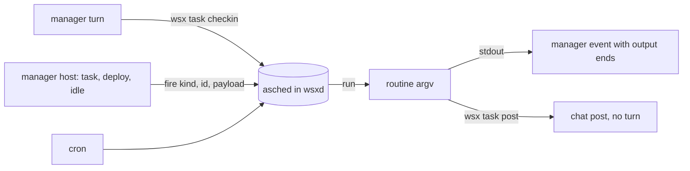

# Dynamic routines, and the retrospect as one routine

Status: built for owner msgs 2085 and 2091, 2026-11-04. Contracts: docs/tasks.md "Routines"; vendor/asched/PLAN-event-triggers.md.

Msg 2091: wsx builds nothing retrospect-specific. The product work is the general routine system. The retrospect is one routine entry in the repo, and it is the example that proves the features.

## What a routine can do now

| Need | Feature | Why this shape |
|---|---|---|
| Not only fixed times | `--at` one-shot trigger (`Trigger::At` in asched) | a third trigger kind in the one scheduler (owner decision 2026-10-31), no second structure |
| React to the project | wsx fires `task.<state>`, `deploy.*`, `release.*`, `project.idle` through asched's existing `fire` | "after N" and filters stay in the routine's command; asched keeps no filter language |
| The manager plans its next look | `wsx task checkin --in 40m --why ...` | wsx fixes the argv (`printf` of the why), so no `--owner-said`; one per project |
| Tell the manager something | a run with stdout is an event with its output ends, also on success | before, a success said only "succeeded" |
| Tell the owner, no turn | `wsx task post` (stdin to the chat, as the digest posts) | a routine pipes or calls it and prints nothing |
| Run an agent with a prompt | already there: `--prompt` and `{prompt}` in the argv (asched), as the TUI's agent templates use | nothing new |
| Jitter | not built | `--at` lets the manager pick any minute; random times make runs and tests nondeterministic |



## The retrospect, one routine

The owner renamed routine `usage` to `retrospect` (msg 2095; same cron `0 6 * * *`). Its argv becomes `scripts/retrospect.py <state dir> -p <project>`, in place of the earlier `usage-report.py --days 7`. It and only reports: the owner rejected daily audit tasks.

| Part | Code or model |
|---|---|
| Spend since the last retrospect, 3 costliest tasks | code (reuses `usage-report.py`'s log readers) |
| Owner messages asking the same again: word 3-gram Jaccard >= 0.4, groups of 3 or more, paths, links and code removed | code |
| Phrases the manager repeated: word 8-grams in 5 or more replies, merged per set of replies | code |
| Reply + the owner's next message within 30 min (at most 40 pairs) | code |
| Which of those the owner turned down (also implicitly), and up to 3 product changes | one `claude -p --model sonnet --effort high --json-schema` call, prompt `scripts/retrospect-prompt.md` |

Repeats count over 7 days and are news when one is new. The script posts with `wsx task post --title retrospect`, writes the whole report to `<state dir>/retrospect/<unix ms>.md` (the newest 14 stay) and prints nothing. `--no-model` counts only.

First real run on wsx's log (2026-11-04): 18 pairs, 4 turned down, $0.08. The changes it named included "a manager tool that quotes a worker's transcript lines for a claim".

What the owner sees:

```text
Since 11-03 07:35: spend $10.90 (manager $10.90)
You turned down 4 of 18 replies you answered: r2065 (wanted ...); r2074 (wanted ...); r2076 (wanted ...)
Change 1: Usage report splits each turn's cost by what started it ... (2074, 2076)
Change 2: A manager tool that quotes a worker's transcript lines for a claim ... (2076, 2078)
Judged by sonnet (high): $0.08
Detail: <state dir>/retrospect/1793745316931.md
```

## How a routine result is stored, shown and remembered (msg 2095)

| Result | Stored | Shown to the owner | In the manager's context |
|---|---|---|---|
| Run end | asched run record and stdout file; `post` in the routine | the chat by default (result, output end, file links), the ledger, the routine preview | a failure, or the output of a `--no-post` routine, as an event line; a posted run as `Posted:` in the handover, and every run by `handover_routines` |
| `wsx task post` (and the digest) | `manager/log.jsonl`: `message{from: events, text: <title>}` and a reply with no usage | the chat, with no turn | built: the handover lists it as `Posted: <text>`, not as the manager's `You:`. Not built: delivery at the next turn |

Next-turn delivery, the design: the manager host keeps the posts since the last turn (title and the first 300 characters each, the newest 3, held in `state.json` so a restart keeps them). The next turn that runs anyway opens with `Shown to the owner since your last turn: <title>: <text>` and clears them. A post starts no turn, so it costs no turn; it costs only those input tokens. The handover covers a rotation, since it reads the log.

## Proof

| Scenario | Where |
|---|---|
| `At` runs once at or after its minute, then has no next run | asched `daemon.rs` contract test |
| `checkin --in 0m` and `--in 8d` are refused; `--in 1m` runs within 2 minutes; the event carries the why; then no next run | `scripts/test-task.py` |
| A `--event task.closed` routine runs on a close and its `wsx task post` reaches the chat with no turn and no event | `scripts/test-task.py` |
| The retrospect as a routine with `--no-model` posts the 3 repeated owner asks and its detail file, no event | `scripts/test-task.py` |
| The model pass | one real run on a copy of wsx's log |
