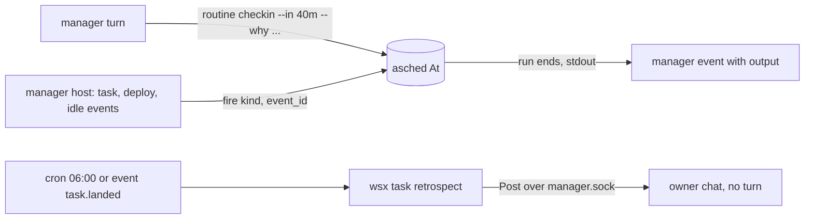

# Dynamic routines and the retrospect

Status: design for owner msg 2085, 2026-11-04. Nothing built yet. Contracts: docs/tasks.md "Routines", "Manager", "Recap"; vendor/asched/PLAN-event-triggers.md.

Assuming: Claude Code takes `--effort high` (not verified; `claude.rs` passes no effort today).

## Recommended set

| Choice | Pick | Why not more |
|---|---|---|
| Manager's own check-in | (a) one-shot `Trigger::At{epoch_minute}` in asched | it is a third trigger kind inside the one scheduler, not a second structure |
| Project events | (b) wsx fires the existing asched `fire` with kinds wsx already sees | "after N", "only if" go in the routine's command; asched keeps no filter language (its v1 non-goal) |
| Jitter | no | (a) lets the manager pick any minute already; random start times make runs and tests nondeterministic and add nothing the owner sees |
| Retrospect | `wsx task retrospect`, replaces the daily `usage` routine | general for every project, posts without a manager turn |



## (a) One-shot check-in

- asched: `Trigger::At { epoch_minute }`. The minute tick runs it when `now >= at`, claims it like cron (`store.claim`), then sets `enabled: false`. A missed time (machine asleep) runs at the next tick. `list` shows it as `next_run`.
- wsx: `wsx task routine checkin -p P (--in <30m|2h> | --at <HH:MM|RFC3339>) --why "<text>"`. It writes the one routine `checkin` (a new one replaces the old) with argv `printf %s <why>`. Bounds: 1 min (the tick) to 7 days.
- No `--owner-said`: its argv is fixed by wsx and runs no command of the manager's choosing. `add` with any other argv keeps the rule.
- Event: a successful run with stdout gets its output ends, like a failure does today (`routine_line`, manager.rs:2340): `routine checkin succeeded after 0 s; its output ends:\n    check whether #181's deploy fixed the login`. Today that text is dropped, so this change also helps every routine that prints.
- The manager instructions get one line: when you wait for something with no event (an outside review, a time of day), set a check-in.

## (b) Event kinds wsx fires

The manager host already makes each of these lines. It also calls `RoutineClient::fire` once, payload in `ASCHED_EVENT_PAYLOAD`:

| Kind | event_id | Payload |
|---|---|---|
| `task.landed`, `task.failed`, `task.ready` | `<n>-r<rev>` | `{task, title, revision, landed_total}` |
| `deploy.succeeded`, `deploy.failed`, `release.*` | `<kind>-<unix_ms>` | `{commit, exit}` |
| `project.idle` | `idle-<idle_ms>` | `{quiet_minutes}`, at the recap look (no recap needed) |

`NoMatch` costs one socket call. A busy routine drops the event (asched rule), so a command counts from the logs, never from event counts. Example: "after 5 lands" is `--event task.landed` plus `wsx task retrospect --every-lands 5`, which prints and posts nothing until 5 lands passed since its last post.

## Retrospect

`wsx task retrospect -p P [--since <unix s>]`, Rust in `crates/wsx/src/task/`, beside `digest`. It reads `manager/log.jsonl` (+`log.1`) and `usage.rs`. It starts at the last retrospect post, else 24 h back.

| Part | Code or model | Rule |
|---|---|---|
| Cost | code | today and 7 days, workers and manager, 3 costliest tasks (`usage.rs` days) |
| Owner asked again | code | owner messages with paths, URLs and code blocks removed; Unicode word 5-gram Jaccard >= 0.4 clusters of >= 3 messages |
| Manager repeats | code | 8-word shingles in >= 5 replies of the window; top 3 with reply ids |
| Rejection candidates | code | each (reply, next owner message within 30 min) pair; marks an explicit correction word, a repeat of the earlier ask, or a "do X instead" |
| Implicit rejection, product changes | model, one call | sonnet, effort high, only the candidate pairs (each side cut to 600 chars, at most 40 pairs) plus the code counts; JSON schema answer `{pairs:[{id, rejected, what_owner_wanted}], changes:[<=3 {change, evidence_ids}]}` |

Measured on wsx's own log (940 replies, 339 owner messages): 114 shingles occur in 5 or more replies, the top one ("bring back the old rule 2, go on the reply to message plan") in 15. A correction-word regex finds only 6 owner messages, so implicit rejection needs the model.

What the owner sees, one Post (a reply with no usage, like the digest):

```text
Retrospect, 24 h: $18.40 (manager $3.10); costliest #181 $4.2, #179 $3.0, #183 $2.1
You asked 3 times: "status of the web deploy" (m2011, m2040, m2079)
I repeated 15 times: "bring back the old rule 2, go on the reply to message plan"
You turned down 4 replies: r2031 (wanted a table, got prose), r2050 ...
Product changes: 1. the manager quotes an earlier reply by id instead of retyping it (r1990 x15)
2. a deploy status line in the overview answers "status of the deploy" (m2011 ...)
Retrospect call: sonnet, $0.21
```

Full detail goes to `tasks/<id>/retrospect/<day>.md`; the post ends with that path. With no candidates it skips the model; with nothing to say it posts nothing. The daily `usage` routine becomes `--cron "0 6 * * *"` running `wsx task retrospect -p <project>`. `scripts/usage-report.py` stays the deeper audit tool.

## Proof (real processes, no mocks)

| Scenario | Script | Shows |
|---|---|---|
| `routine checkin --in 1m` on an isolated wsxd + asched | `scripts/test-task.py` | the run starts within the next minute, disables itself, the manager event carries the `--why` text |
| check-in bounds and argv rule | same | `--in 0m` and `--in 8d` refused; `add` with another argv still needs `--owner-said` |
| a land fires `task.landed` | same | a routine `--event task.landed` runs once per land; the same revision twice is `Deduplicated` |
| retrospect on a staged `manager/log.jsonl` with known repeats and corrections | same, `--no-model` | the counts, ids and the posted lines match; no reply carries usage; a second run posts nothing |
| model pass | one real run on wsx's own log (build step, here) | report file and the logged call usage; the owner judges whether the rejections ring true |

asched gets its own contract tests for `At` (claim once, disable, missed time, config round trip).
