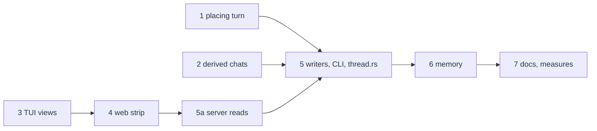

# Flat chats: audit and plan (task 539)

Status: audit and plan only, 2026-11-19, no product edit. Owner wsx 5670: go simple, remove derived and sub-chat things and everything thread-like, truly flat. A new purpose gets its own chat. `wsx` and `wsx-ui` run as two chats and talk by `say --to`. Owner 5668 kept one thing: manager-to-manager talk is already muted; nothing new is built for it. This replaces the Slack-style design (dropped, nothing of it is kept). Counts: `python3 -I docs/design/flat-chats-count.py` (read-only, totals only, this machine) and a read-only scan of the code at `ef9ec899`; the file:line starts were checked against the code with `rg` (they begin at the item's doc comment, within 4 lines). Every step re-counts with `rg -c thread` before it deletes.

## 1. For the owner: one screen

| | Today | After |
|---|---|---|
| A chat | its rows, minus rows inside an open thread (`Scope::Trunk`) | every row of the chat, in time order |
| Thread | strip, `#/c/<chat>/t/<slug>`, `wsx task thread`, `--thread`, a placing turn, thread counts | gone |
| Derived chat | `chat.json` `from`, row "Opened from chat X" | gone; `chat new` stays, it only records no origin |
| For you, needs, chat rows, `say --to` | work | work, unchanged |

Size: about 3,000 lines out, about 30 in (a fixture of an old log). **No migration**: old rows show as they are, the `thread` field is ignored on read and never written (§3). 7 steps, each one deletion, reverted alone (§4). Order: server and docs first, web and TUI after #534 and #510 land.

One question: the chat `wsx-core` (made from wsx 5664, 1 row, listed on Home) is not one of your two chats. Close it with `wsx task chat close wsx-core` at your word? That is a runtime action, not a code step.

## 2. Inventory (only for threads or derived chats)

| Part | Where (file:line) | Lines |
|---|---|---|
| Thread module | `wsx-core/src/task/thread.rs` whole file: fold 22-143, keys 144-190, open/close/merge/join 192-268, tag/reply_threads/of_task 269-339, list 340-408, Scope/scope_rows 409-461, Filter 462-515, Unplaced/place/placing_* 516-740 | 740 |
| Log rows and events | `task/manager.rs` Message.thread 142-144, Reply.threads 151-153, ThreadOpen/Closed/Merged/Moved 220-241, Queued 894-897; `task/chat.rs` 176-179, 273-274, 299-308, 329-331, 372, ChatRow.thread 531-533, 582-584, scope 631/660 | ~45 |
| Task and memory fields | `TaskRecord.thread` `task/mod.rs:348-351`, `HostRequest::Thread` 785-788, `host.rs` 968, 1112-1117; memory `Record.thread` (record.rs:101-104), store.rs 134-135, 354-358, `Query.thread`/`thread_ok`/`in_thread` (backend.rs 81-83, 144-159, 319-338, 472), `Doc.thread` and index.rs (~12 spots), manage.rs 526-532 | ~110 |
| Needs, ledger, owner | `needs.rs` `thread_counts` 204-218, `tally` thread parts 233-290; `ledger.rs:151-154`; `owner.rs:137-157`; `policy.rs:77-78,101` `Capability::Thread` | ~60 |
| CLI | `cmd/thread.rs` whole file 136; `args.rs` `TaskCmd::Thread` 248-251, `say --thread` 267-269, `search --thread` 302-304, `new --thread` 396-399, `ThreadCmd` 493-521, needs 602-605; `cmd/new.rs` `task_thread` 105-132, inheritance 356-371, 463; `cmd/chat.rs` 24, 47, 96, 184-228; `cli/args.rs` 899-902, 937-939; `cli/memory.rs` 32-50; `instructions.rs:85-86` | ~290 |
| Manager | `task/manager.rs` accept 449-450, 517-524, 683-696, 730-743; reply 1419-1423, 2005-2009; `place_open_work` 2072-2096 (called 289); `thread_of`/`reply_threads` 2098-2138; `store.rs:1215-1217` `placing_done` | ~130 |
| Web server | `wsx-web/src/http.rs` 106, 1192-1216, 1355-1377, 1479-1481, 1536; `tasks.rs` 31, 184-188, 245, 299, 655-682, 772-809, 853-868, 964-990 (`thread_act`), 1219, 1385-1405; `assets.rs:35` | ~110 |
| Web client | `web/threads.js` whole file 119; `tasks.js` ~30 lines (396-399, 458, 740-758, 865-889, 933-945, 1016-1070); `store.js` 175, 195; `main.js:121`; `app.css` 910, 925-942; `design-lint-keep.json` 17-22 | ~190 |
| TUI | `task_chat.rs` ~41 (289-300, 450-481, 557-569, 742-799, keys `t`/`T` 882-883, `step_thread` 923-933); `task_list.rs` ~26 (77-78, 258-261, 306-329, 763-781); `ui/task_chat.rs` 298-299, 387-420; `ui/tasks.rs:397-398`; `ui/mod.rs:806` | ~110 |
| Derived chats | `chats.rs` `ChatFrom` 272-277, `ChatFile.from` 279-288, dead `from()` 437-440, `create` 491-518; `cmd/chat.rs` 316-345 ("Opened from"), `lifecycle` 436-466, 394; callers `task_new_chat.rs:150`, `wsx-web/src/tasks.rs:950`; `docs/tasks.md` 3, 21, 624 | ~90 |
| Scenarios | `test-task.py` section 42 (8576-8683, 108) and 43 (8684-8727, 44), 33c `from` asserts 8243-8270 (~10), `fake-claude-stream.py:398-409` placing stub (12); `web-tasks-check.mjs` "Threads" block 4716-~4775 (~60) and layout lines 1230-1236, 1636, 1639, 3110; `test-web-client.py` 3807-3808, 4395-4410 | ~260 |
| Docs and measures | `docs/tasks.md` "Threads" 599-609, 526, 662, 232; `web-client-tasks.md` 8, 23; `memory.md:21`; `design/thread-context.md` 96; `scripts/thread-context-measure.py` 456; `deep-refactor-measure.py` `threads`; `design/chat-system.md` 258 (thread parts) and its thread mock pages and `build.py`/`mock.css` thread rules | ~900 |

Not found (already gone): role rooms, `role.json`, `ManagerOf`, `Hearer`, `_roles`, a "return to parent chat" path. Neither web nor TUI reads `from`; it is written and dead. Leftovers of old layouts, not threads, stay (a release rule guards them): `refuse_old_layout` (`store.rs:158-190`), the `manager-host` old argv shim (`manager.rs:220-258`). A variable `room` in `tasks.js` (396-399, 740-790) is a name only: renamed in step 4.

## 3. Data on this machine, and how old rows read

| Project | Rows tagged (msg/reply) | Thread events | Tasks with `thread` | Memory records | `search.jsonl` lines |
|---|---|---|---|---|---|
| wsx | 17 / 16 of 5,677 | 8 | 11 of 541 | 8 | 238 |
| studio-app (and web-income's 3) | 0 | 5 (web-income 4) | 10 of 120 | 2 | 0 |
| shopfront | 0 | 4 | 4 of 59 | 1 | 7 |
| pr-review | 0 | 4 | 1 of 12 | 1 | 7 |
| ir | 0 | 1 | 1 of 24 | 0 | 51 |
| projk | 0 | 1 | 1 of 6 | 0 | 0 |
| the other 11 chats | 0 | 0 | 0 | 0 | 0 |

Derived chats: `web-income` (from studio-app 960), `wsx-core` and `wsx-ui` (from wsx 5664). 9 of 20 chats hold a `threads-placed` mark file.

How old data reads after the removal (each verified by a fixture in step 5, from the code read):
- **Log lines.** `ManagerEntry::read` (`manager.rs:528`) drops a line it cannot parse. The four `thread_*` lines become unknown kinds and are skipped. They draw no row today either. `thread` and `threads` on a message or reply are unknown fields and are ignored (no `deny_unknown_fields` on `ManagerEvent`). So the 33 tagged rows of `wsx` show in Chat in time order; today they are hidden from the trunk.
- **Task records.** `thread` on 28 task records is ignored; no `deny_unknown_fields` on `TaskRecord`. Its rows show where its events are.
- **Memory records.** `Record` keeps unknown fields (`flatten`, "kept on every rewrite"), so the 12 records keep `thread` on disk, unread. `search.jsonl` is a digest; its `thread` is ignored on read.
- **`threads-placed` marks** and `chat.json` `from`: unread, left in place.
- **Migration: none.** Nothing is lost, since no row is rewritten and no thread data held a fact that is not also in a row or a task.

## 4. Steps (child tasks)

| # | One deletion | Proof | Out / in |
|---|---|---|---|
| 1 | Placing turn: `Unplaced`/`place`/`placing_*` (thread.rs 516-740), `place_open_work` (manager.rs 2072-2096), `thread unplaced`/`move`, `HostRequest::Thread`, `set_thread`, `store.rs:1215`, fake stub, test 43 | `test-task.py` passes; a chat with no `threads-placed` mark gets no placing turn (fixture, turn count) | 330 / 0 |
| 2 | Derived chats: `ChatFrom`, `from`, "Opened from", `lifecycle` origin, 33c asserts | `test-task.py` 33c: `chat new --owner-said` still opens a chat, writes no `from`, no origin row; a `chat.json` with `from` still loads | 90 / 0 |
| 3 | TUI thread views (`t`/`T`, tree thread rows, `threads_line`, `selected_thread`) | `cargo nextest`, `runtime-smoke.py` (a TUI screen has no `(t/T)thread` hint); after #510 | 140 / 0 |
| 4 | Web strip: `threads.js`, `tasks.js` thread parts, route `/t/<slug>`, css, lint keep, checks; rename `room` | `scenario.py web`; `rg -c thread crates/wsx-web/web` shows no named-thread hit; captures of the chat at 390/1280, dark and light; after #534 | 330 / 0 |
| 5 | Server and core: `Scope`, `scope_rows`, `read_for` param, chat `thread` query, `ChatRow.thread`, `thread` on overview tasks and items, `needs` thread counts, `Listed`; then writers: `--thread` on new/say/search, `wsx task thread`, `tag`, `reply_threads`, `thread_of`, `Message.thread`, `Reply.threads`, the four events, `TaskRecord.thread`, `Capability::Thread`, `thread.rs` | `nextest`, `scenario.py task` and `web`; JSON of the overview and needs before and after on one fixture differ only by the `thread` keys; fixture log with `thread_*` lines and tagged rows: `wsx task chat` and GET chat show every row; `new --thread` refused as an unknown flag. Split in two child tasks (5a reads, 5b writes) if one is too big to review | 1,150 / 30 |
| 6 | Memory: `Record.thread`, `Query.thread`, `Doc.thread`, `memo`/`search --thread`, `docs/memory.md:21` | `test-memory.py`; a record with `thread` on disk survives a rewrite; `search.jsonl` with `thread` loads | 100 / 0 |
| 7 | Docs and measures: "Threads" in `docs/tasks.md`, `thread-context.md`, `thread-context-measure.py`, thread rules of `chat-system.md` (status line: superseded by this file), `deep-refactor-measure.py` `threads` | `rg -c "thread"` over docs lists no named-thread hit; links resolve | 900 / 5 |

In-flight work (checked with `git diff main...wsx/tNNN`, 2026-11-19):

| Task | Thread lines it touches | What it keeps or drops |
|---|---|---|
| #534 chat window, sheet routes | 29 in `tasks.js`, 26 in `web-tasks-check.mjs`, 12 `app.css`, 7 `store.js`, 4 `main.js` | Keep the sheet routes and the window. Drop every strip change now, stop reshaping the thread route; step 4 starts after it lands |
| #510 For you list | 1 `task-words.js`, 1 `tasks.js`, 2 `task_list.rs`, 2 `docs/tasks.md` | Keep the list and `needs`. Add no use of `item.thread`; steps 3 and 5 remove the field after it lands |
| #533 sheet header | 15 in `design/task-sheet/before.css` (no code) | No conflict; no change |

Steps 1, 2, 6 and 7 touch none of their files and can start now.

## 5. What stays (shared, not thread code)

- For you and `needs` (`needs::for_you`, `ChatCounts`, per-chat counts, approvals, To check items): they work on chats and tasks. Only the per-thread tally inside `tally` and `thread_counts` goes; the chat-level counts stay.
- The chat's own rows, `chat_rows`, `Window::Around`, quotes (`quote`, `check`), the To check reply, search over transcripts.
- `say --to`, `--from-chat`, `--reply`, `Party::Chat`, muted manager-to-manager rows; the home chat per project; plain `chat new`, `close`, `rename`; `--owner-said` (also used by `land`, `deploy`, `check`).
- Parent tasks and `--after`: they are task links, not chats.
- A chat's `repos` list (a single repo in practice; `repos[0]` is load-bearing): not asked, not touched. Keep or reduce to one repo is a later question.
