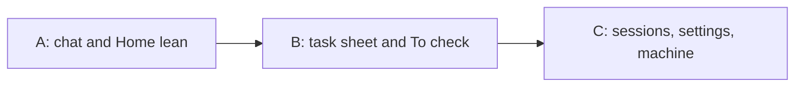

# GUI polish audit (web client)

Read-only audit of `crates/wsx-web` for the owner's phone. Model: `claude-fable-5-1` (task 426, 2026-11-13).
Every screen was captured at 375, 390 and 1280 px, dark and light, with the design lint on each
(`.work/gui-polish/captures/`, `lint-chat.json`, `lint-tasks.json`; the chat part's own 249 captures in
`.work/gui-polish/scenario-chat/`). Skipped: Home row icons and the New chat sheet (#420).

## How it was measured

- The chat part of `scripts/test-web-client.py --browser` ran here and passed; a stand-in `node` ran
  `.work/gui-polish/capture.mjs` on its site before the real check (`.work/gui-polish/bin/`).
- Workers cannot start in the task boundary (nested `sandbox-exec`), so the task screens come from a
  hand-staged store on the retained fixture (`.work/gui-polish/stage.py`: six tasks in every state, two
  approvals, three To check items, routines, a named manager, a second chat, an overview). CI's own run
  was cancelled twice for lack of a runner (run 43239795220).
- Lint: chat 78 screens, 1 un-kept error; tasks 220 screens, 12 un-kept errors, of which 4 are real
  (rows 1, 4 and 21 below); the rest are a chip glued to its sentence and the chat behind a modal sheet.

## Findings, ranked by how often the owner sees it times how bad it is

| # | Screen | Problem | Evidence (`.work/gui-polish/captures/`) | Fix in one line | Size |
|---|---|---|---|---|---|
| 1 | Project chat | The manager's name heads every bubble group, yet for an unnamed manager it is the project's name, which the top row already shows ("demo" five times on one screen) | `tasks-project-chat-390-dark.png` | Hide the author line for this chat's own manager when it has no name; keep it for named managers, peers and chats | S |
| 2 | Task sheet (phone) | Deny, Approve, Land, Answer and Try are icon-only (×, ✓, ↓, ↩, ▷); × and ✓ mean Fail and Pass two sections down; only Take over, the rarest action, keeps its words | `tasks-task-2-390-light.png` vs `tasks-task-2-1280-dark.png` | Words on the phone too (`.task-next .button` drops the icon-only rule; the row already wraps) | S |
| 3 | Needs you list | A task with a pending approval is listed twice: its own row ("Waiting for your approval", with Answer) and the approval row with the decision | `tasks-list-needs-390-dark.png` | Drop the task's own need while an approval about it is pending (`needs` order in wsx-core, or the web filter) | S |
| 4 | To check list | Each row shows three words of its check and three icon buttons; the text box runs under the buttons (lint `overlap`) | `tasks-list-check-390-dark.png`, `lint-tasks.json` | Let the pill open the To check sheet (its rows already do); or one action per row and the buttons under the text | M |
| 5 | Task sheet | Land shows beside Approve when the pending approval is the land of this task: two buttons, one deed | `tasks-task-2-1280-dark.png` | Hide `land` while a land approval of the task is pending (`owner_actions`) | S |
| 6 | Task sheet | "Stops the worker. You continue in its session." sits under the actions of every open task | `tasks-task-3-390-dark.png` | Move the sentence to Take over's title or its confirm; controls name things, docs explain | XS |
| 7 | Session top row | The model after the state word cuts to "claude-o…" at 390 and the title to "release p…" at 320 | `chat-session-working-390-dark.png`, `scenario-chat/320-chat-end.png` | Show the model only in the wide layout; the phone row keeps title and state | XS |
| 8 | Blocked session | The agent's raw dialog (`.question-screen`) repeats the parsed options under it; both take the screen | `chat-session-blocked-390-light.png` | Fold the raw screen under "What the terminal shows" (as `.held` does) when options were parsed | S |
| 9 | To check facts | The label and value columns (Check, Look at, Passes if) leave dead space under short labels and narrow the value to 70% on a phone, in bubbles, the sheet and the task sheet | `tasks-checks-390-dark.png` | Below 480 px stack the label over its value (`.check-facts` one column) | XS |
| 10 | Media archive | A portrait capture fills a tile as tall as the image; `.check-capture img[style]` (aspect-ratio from `--w`/`--h`) beats the square tile rule | `tasks-media-390-dark.png` | Scope the sized-image rule out of `.media-tile`, or set the tile's aspect on the tile, not the image | XS |
| 11 | Usage (sheet, Settings) | With no spend the chart shows a 7-entry legend of "$0.00 0%" and seven "$0.00" day rows | `tasks-usage-sheet-390-dark.png`, `tasks-settings-usage-390-dark.png` | "No spend in this period." when the total is 0; keep the filters | XS |
| 12 | Inbox / Sessions | Every row's first line repeats "design › main" when all rows share one project | `chat-inbox-390-dark.png` | Leave the project level out when every listed session shares it (the rule a project heading already applies) | S |
| 13 | Session, error state | The chat shows only the sent message; the reason is nowhere but the word "error" in the top row | `chat-session-error-390-dark.png` | A muted line with the exit reason, as the exited state's "Claude exited." | S |
| 14 | Home | The pulse dot floats above "2 working" in the right column | `tasks-home-390-dark.png` | Put the dot inline before the count (one flex row inside `.row-state`) | XS |
| 15 | Home chat row | The project's name repeats as the context line of a chat row indented under that project | `tasks-home-390-dark.png` | Drop the context line; keep the unread line | XS |
| 16 | Settings > UI | Dark/Light and Top/Bottom are two radio rows each; the bar toggles are `role=switch` drawn as checkboxes | `chat-settings-ui-390-light.png` | One control per job: a two-item segmented control for the pairs, a switch look for the toggles | S |
| 17 | Task sheet top row | A done task stacks title, "done" and the model on three lines | `tasks-task-4-390-dark.png` | Keep the row to title + `#n` + stage word; the model is already in the story head | XS |
| 18 | Machine card | The level word "ok" wraps alone under a long disk name at 390 | `tasks-machine-390-dark.png` | `white-space: nowrap` on the value + level group of `.panel-row` | XS |
| 19 | Home (wide rail) | The + sits alone in an empty 44 px row above the list | `tasks-home-1280-light.png` | Put it at the right of the rail's name row | XS |
| 20 | Sessions tab | The "SESSIONS" section label stands directly under the "Sessions" title when it is the only section | `tasks-sessions-390-dark.png` | Hide the label when only that section shows | XS |
| 21 | Running list | The row's text target is 36 px high (lint `target.size`) | `tasks-list-running-390-dark.png` | Make the whole row the target (`min-height: var(--size-control)` on `.row-open`) | XS |
| 22 | Settings > General | Version is four developer facts (Build, Page files, Server started) | `chat-settings-390-dark.png` | One line "wsx 0.43.0 · 6d11af2", the rest behind a fold | XS |
| 23 | Tab bar at 375 | The last inbox row scrolls behind the pill; the lint keep names `.tabbar a` only | `chat-inbox-375-dark.png` | Keep entry for `.row-link` behind the pill; a bottom fade would soften the cut | XS |

Kept on purpose: tables and code blocks inside a bubble (nested cards), the 40% list cap over the composer, the 7
chart hues, the 11 px count badge, the Copy button at the code block's far right.

## Fixes as tasks

| Task | Rows | Proof |
|---|---|---|
| A: chat and Home lean (`tasks.js`, `bubbles.js`, `home.js`, `app.css`) | 1, 3, 12, 14, 15, 19, 21, 23 | `web-tasks-check.mjs`: author count per unnamed manager run, one Needs row per task, home row-state one line; captures `chats-home`, `chat-room`; `check-run web` |
| B: task sheet and To check (`task.js`, `story.js`, `checks.js`, `media.js`, `view::owner_actions`) | 2, 4, 5, 6, 9, 10, 11, 17 | `web-tasks-check.mjs`: `.task-next .button-words` visible at 390, no Land beside a land approval, square media tiles, "No spend"; `test-task.py` on `owner_actions`; `check-run web` |
| C: sessions, settings, machine (`session.js`, `chat.js`, `inbox.js`, `settings.js`, `panels.js`) | 7, 8, 13, 16, 18, 20, 22 | `web-browser-check.mjs`: bar label whole at 320, question screen folded, error line; `web-panels-check.mjs` row wrap; `check-run web` |

## Limits and human verify

- The task screens are a staged store, not a live manager: typing dots, the since line and the question jump
  were not exercised here; CI's `web` scenario covers them.
- Human verify, real iPhone: every sheet capture shows a focus ring on Back (programmatic focus in headless
  Chrome). Pass if Safari shows no ring after a tap opens a sheet; else row 24: focus Back without the ring.
