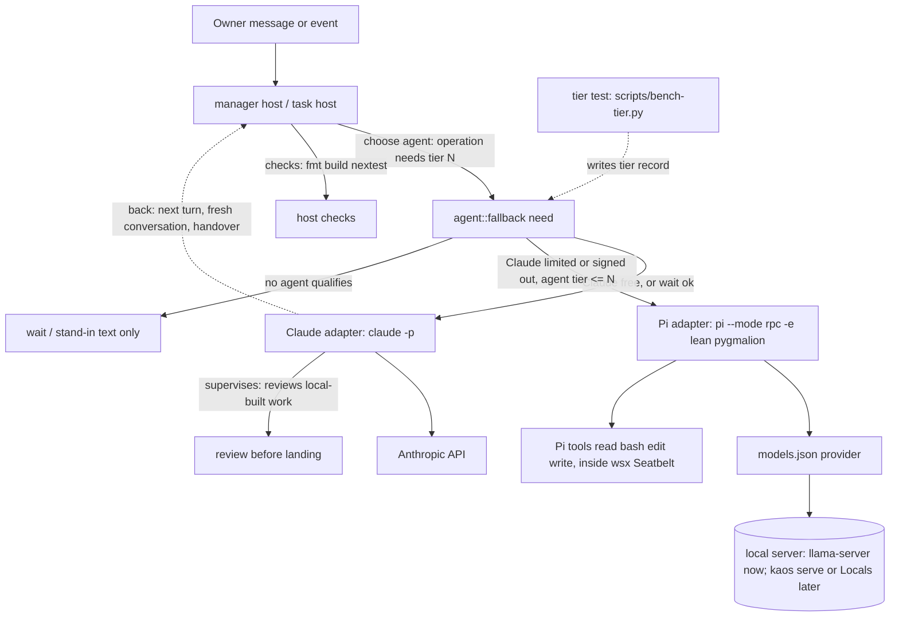

# Local model fallback

Design only, written 2026-11-10 for task #349. No code changes. Builds on #348 (a failed sign-in moves to the fallback list): this design does not repeat it.
Measured numbers: none were taken in this task. Every model number below is a vendor or third-party figure with its source. Section 3 defines the test that replaces them with wsx's own.

## 1. Answer

Claude stays the supervisor. When Claude is down, a local model of 9B or less takes the work it is fit for, through Pi (`pi --mode rpc`) with a lean build of the owner's `pygmalion` package.

| Part | Recommendation |
|---|---|
| Endpoint | wsx needs one thing: an OpenAI-compatible base URL in Pi's `models.json`. Start with a wsx-documented `llama-server` recipe (B below). Move to `kaos serve` or Locals later with no wsx change |
| Models | Test Qwen3.5-9B for the top tier; Gemma 4 E4B and LFM3-1.7B for the lower tiers. Our own test (section 3) decides, not the vendor tables |
| Tiers | `tier` 1..3 on `[[agents]]`, plus a minimum tier per operation in code. No tier test pass means no tier, so the agent stays a stand-in as today |
| Runner | Option B: Pi plus a lean, headless pygmalion extension. Not a new runner in wsx |
| Order | wsx tier gate, then the lean runner and the tier test in parallel, then rules sized for small windows |

## 2. Serving

### 2.1 What exists (read-only search, 2026-11-10)

| Fact | Source |
|---|---|
| `llama-server` build 11960 | `/opt/homebrew/bin/llama-server --version` |
| `pi` installed | `/opt/homebrew/bin/pi` |
| Pi `models.json` already has provider `llama-local`, `http://127.0.0.1:8080/v1`, `openai-completions`, model `lfm3-1.7b` | `~/.pi/agent/models.json` (symlink into dotfiles) |
| No llama-server was listening at the check | `lsof -nP -iTCP -sTCP:LISTEN` |
| Launchd agents `homebrew.mxcl.ollama` and `homebrew.mxcl.omlx` (`omlx serve`) exist; neither listened at the check | `~/Library/LaunchAgents` |
| HF cache holds `mlx-community/Qwen3.5-9B-MLX-8bit`, `gemma-4-e4b-it-4bit` (MLX). No LFM files | `~/.cache/huggingface/hub` |
| kaos: private monorepo `github.com/vlwkaos/kaos`, not cloned here. `@kaos/engines` spawns one `llama-server` per model on a random 127.0.0.1 port with a random key in a mode-600 file. `kaos serve` (stable port) and Kaos Hub (lease/release) are planned, not built | dgv3 manager answer, msg 3647 (vault notes, not measured) |
| Locals (`github.com/Generated-Computers/Locals`, MLX): OpenAI, Anthropic `/v1/messages` and Ollama APIs on 127.0.0.1:8321, no key, continuous batching, grammar-forced tool calls (`--typed-tools`). Not installed | same |
| kaos catalog: LFM3 1.7B GGUF Q8_0 on llama.cpp 11938+, else Gemma 4 E4B Q4_0. Gemma 4 E4B measured 45 tok/s on an M4 Max 36 GB. LFM3 thinks by default: send `reasoning_effort: none`. A Gemma 4 E4B slot of 8192 tokens overflowed in Prescience | same |
| `strata`: one vault line only ("engines such as Strata for low-VRAM GPUs", belongs to kaos). Meaning unconfirmed | dgv3 `PLAN.md:19` |

The Seatbelt boundary leaves loopback open (`crates/wsx/src/task/boundary.rs`), so an agent reaches a 127.0.0.1 server without a profile rule. The server must run outside the boundary. Pi finds the server only through `models.json` (wsx clears the agent's environment to `KEPT_ENV`, `crates/wsx/src/task/pi.rs:18-41`).

### 2.2 Options for a stable endpoint

| | A. Build `kaos serve` in kaos | B. wsx-owned `llama-server` recipe | C. Locals (MLX) |
|---|---|---|---|
| What | Stable port, key, lease of engines from kaos | One documented command plus a launchd plist and a `models.json` entry, in wsx docs | Install Locals, run on 8321 |
| Cost | Highest: unbuilt, kaos not cloned here, Hub design only. Work in another repo | Lowest: about 1 doc and 1 plist, nothing in wsx code | Medium: new install, unmeasured, Apple silicon only |
| Tool calls | `llama-server --jinja`: model's chat template decides; small models can emit bad JSON | Same as A | Grammar-forced (`--typed-tools`): output always parses. Best fit for small models |
| Context | `-c` per slot, set by recipe | `-c 32768 -np 1` for the manager; one slot is enough for one agent at a time | Prompt cache on disk, memory guard |
| Risk | Slips with kaos schedule; couples wsx timing to it | Owner runs a process; no lease, so it holds memory when idle (llama-server `--sleep` idle unload is used by kaos: verify flag in build 11960) | Not installed; Anthropic and Ollama APIs unused by Pi |
| wsx change | none | none | none |

Recommendation: B now. It proves the tiers and the runner with no dependency. A or C swaps in later by editing one `baseUrl`. wsx must never read kaos internals (random port, key file): "kaos is only a server".

Open: if C proves better at tool-call validity in the tier test, the owner decides whether to install it. The tier test (section 3) takes the endpoint as a parameter, so the same test compares B and C.

## 3. Models and tiers

### 3.1 Candidates (2026)

| Model | Size | Context | Tool and instruction figures | License | Source |
|---|---|---|---|---|---|
| Qwen3.5-9B | 9B | 262,144 native | BFCL-V4 66.1, IFEval 91.5; TAU2 79.1 (aggregator) | not checked | [HF card mirrors](https://huggingface.co/QWEN/Qwen3.5-9B), [dev.to](https://dev.to/onewallai/9-reasons-qwen359b-outshines-larger-models-for-local-agents-on-rtx-5070-ti-5c69) |
| Gemma 4 E4B | 4.5B effective (8B with embeddings) | 128K; MRCR v2 8-needle 128k avg 25.4% | native function calling; Tau2 42.2% (card); BFCL 65.3% (community test) | not checked | [Gemma 4 card](https://ai.google.dev/gemma/docs/core/model_card_4), [community](https://www.llmreference.com/compare/gemma-4-e4b/qwen3.5-9b) |
| LFM3-1.7B (Liquid, 2026-10-27) | 1.73B | 256K | BFCL V4 71.39, ToolSandbox 80.36, IFBench 73.03 (vendor); Liquid says not for agentic coding or complex multi-step reasoning | LFM Open License v1.0: free below $10M revenue | [Liquid blog](https://www.liquid.ai/blog/lfm3), [MarkTechPost](https://www.marktechpost.com/2026/10/27/liquid-ai-lfm3-open-weight-2b-multimodal-models/), [aicybr](https://aicybr.com/blog/liquid-ai-lfm3-1-7b-multimodal-local-deployment-license-guide) |
| LFM2.5-2.6B | 2.6B | 131,072 | native tool calling; vendor says it tops instruction-following benchmarks against 4x larger models | LFM license | [HF blog](https://huggingface.co/blog/LiquidAI/lfm2-5-2-6b) |
| LFM2.5-8B-A1B (MoE, 1B active) | 8B | about 300 pages | BFCL v3 64.36, v4 48.50 | LFM license | [Together](https://www.together.ai/models/liquid-lfm2-5-8b-a1b) |

Reading these: the figures do not agree across sources (one listing gives Qwen3.5-9B BFCL as 55.89 against LFM3's 71.39), they are vendor or aggregator numbers, and a context length is a capacity, not a quality: Gemma 4 E4B retrieves 25.4% at 128k. wsx's turns are 6 to 7k tokens of rules and notes (section 5.3), so the window that matters is 16 to 32k, where nothing above is measured. Short list for our test: Qwen3.5-9B (top tier candidate), Gemma 4 E4B, LFM3-1.7B, LFM2.5-2.6B.

### 3.2 Operations and the proposed first gate

The table is a hypothesis. Until a model passes the test (3.3) for a tier, it holds no tier.

| Operation | Launch site | Tools | Output | Tier needed (hypothesis) |
|---|---|---|---|---|
| Manager turn with an owner message | `manager.rs` `next_turn`, `send_turn` | `wsx task` CLI, bash | free text | 1 |
| Manager event-only turn | `manager.rs` `next_turn` (`events_only`), `turn_model` | `wsx task` CLI | text or `-` | 2, if the test shows it |
| Task plan step | `host.rs` `PLAN_REQUEST` (649) | read, rg | plan text | 1 |
| Build step, default size | `host.rs` `start_turn` (1256), `step_text` (1973) | all | result JSON through `wsx task result -` | 2 |
| `--size small` build | `cmd/new.rs` `Steps::Small` | all | result JSON | 2 |
| Review step | custom `steps:` | read, bash | result JSON | 2 |
| Memo and context (folded) | `cmd/new.rs` `folded_steps` | few | notes text | 3 |
| Notes compaction asks | `manager.rs` `check_overview`, `check_context` | files | text | 3 |
| Stand-in | `manager.rs` `stand_in` | none | text, `provisional` | 3 (exists) |
| Retrospect read | `scripts/retrospect.py:173`, calls `claude` directly, outside `[[agents]]` | none | JSON schema | 3, needs routing through the registry first |
| Chat summaries | no model call exists today | | | not applicable |
| Keep-warm ping | `manager.rs` `ping` (Claude only) | | | never on a fallback (exists) |

### 3.3 The tier test: `scripts/bench-tier.py`

One harness, built from `scripts/bench-manager.py` (fixture repo, fake `wsx` on `PATH` serving a fixture ledger, instructions extracted from `instructions.rs`). It drives `pi --mode rpc` against a given endpoint and model, with the lean extension loaded. It replays real wsx turns:

| Case group | Source of the case | Oracle (no model judge) |
|---|---|---|
| Owner turns | `bench-manager.py --cases logged` (real owner messages) | reply or `-`; each `wsx task` argv runs on the fake and parses; the action class matches Claude's logged action |
| Event-only turns | manager logs (245 turns in the 10-27..11-02 audit, `docs/design/manager-efficiency.md`) | quiet vs act matches the logged decision |
| Plan | `test-task.py` fixture repos plus a known target file | the plan names the right files (checked with `rg`) and valid steps |
| Build / small | `test-task.py` fixtures (one-file change with a test) | the fixture's own test passes; result JSON valid against `worker_result_schema` |
| Review | a diff with 3 planted defects | defects found, false positives counted |
| Memo / compaction | a long notes file | output within `notes` byte caps, required facts present (task ids, paths exist) |

Each run records: S (output form valid), T (every tool call ran without an argument error), R (rule obedience: forbidden patterns from `presentation.md` and the instructions), D (the oracle outcome), C (peak prompt tokens at most 70% of `-c`, no `exceed_context_size`), L (turn within the host timeout). Each case runs 3 times; a case passes only when all 3 do.

Proposed bars, to be set after the first runs and written to the doc then:

| Tier | Needs |
|---|---|
| 3 | S, R, C, L pass on every text case |
| 2 | tier 3, plus T pass on every case, D at least 80% of build/small/review/event cases |
| 1 | tier 2, plus D at least 95% of owner and plan cases, plus one full `test-task.py` fixture task that lands 3 of 3 |

Output: `.work/bench-tier/<model>-<endpoint>.json` with the pass rates and a `tier` value. The harness also reports tokens per second and the largest context used, for the `-c` choice. A model re-test is needed when its quant, endpoint or llama.cpp build changes.

### 3.4 Where tier and gate fit the registry (smallest change)

Today: `[[agents]]` has `name, command, adapter, model, budget_usd_per_day, minimal` (`crates/wsx-core/src/config/global.rs:327`, `deny_unknown_fields`). `agent::fallback(names, now, minimal)` (`crates/wsx/src/task/agent.rs:250`) is the one choke point; callers are `fallback_past_wait`, `worker_next`, `stand_in`, `cmd/new.rs:315`.

| Change | Where |
|---|---|
| New optional `tier = 1..3` on `[[agents]]`; validate range | `AgentEntry`, `validate_agents` (global.rs:347) |
| Own agent (`tasks.*.model`, Claude) gets tier 1 by default; no registry row needed | `agent::Choice` (231) |
| `fallback(names, now, need)` replaces the `minimal` bool. An entry qualifies when its `tier <= need`. `minimal` keeps its meaning: a no-tool stand-in; it implies tier 3 | `agent.rs:250` and its 5 callers |
| An operation names its `need` from one table in code (3.2). No new config key | `manager.rs` (`turn_model`, `ping`, `check_*`), `host.rs` (`start_turn`, `move_after_limit`), `cmd/new.rs` |
| No agent qualifies: behave as today (wait, or stand-in text for owner messages) | existing paths |
| The owner writes the tier into the registry by hand after a test run. The proof stays in the `bench-tier` result file; no proof field in the config | none |

Config is read by older wsx with `deny_unknown_fields`: adding `tier` breaks an older binary. Deploy the new binary first (a gotcha already in `docs/design/manager-efficiency.md`).

Supervision rule (new, small): a task built on an agent with `tier > 1` ends in `ready` marked "built on <model>, not reviewed by Claude". It lands only after a Claude review step or the owner's approval. The host's checks (fmt, build, nextest) run as for any task and are the objective gate.

## 4. Task #348 boundary

#348 owns: a sign-in failure records a limit on the account (today `agent::auth_failed`, `agent.rs:71`, holds the manager and retries every minute but never calls `record_limit`) so `choose_agent` and `switch_agent` see it. This design starts after that: it only changes which fallback entry qualifies once a switch happens. W1 below waits for #348.

## 5. The runner: Pi plus a lean pygmalion

### 5.1 Why not as it ships

Read from `~/ws/tui_cli/pygmalion` (v0.83.0, not modified; 102 uncommitted files, of which 49 are session notes, 12 evaluation results, 10 tests, and 25 modified files in `operating-mode`, `permission-gate`, `permission-auto`, `cleanup`, `skill-autocomplete`).

| Fact | Consequence |
|---|---|
| Loads 23 extensions from `package.json` `pi` field; about 44.5k extension lines, 24.8k test lines, 1,127 evaluation files, 92 vendor files | Far past what a runner needs |
| Static prompt text about 25 to 30 KB (6 to 8k tokens): `ask_user` about 6 KB, `delegate` family 6 KB, `job-supervisor` 4 KB, `task_*` 5 KB; up to 8 KB retrieved context per prompt (`task-context`) | Fills an 8k window; heavy at 32k, before wsx's own 6 to 7k |
| `ask_user` and any permission `ask` become an RPC `extension_ui_request` that blocks | The wsx reader ignores that event (`pi.rs` `Run::parse`, 188-223), so a run hangs |
| Real bash and path gating is the external `@gotgenes/pi-permission-system`; `permission-gate` allows bash and delegates to it | Without it, only `secret-guard`, `command-hygiene` and Plan mode remain |
| `prompt-integrity` aborts the turn on a finding | A false positive kills a fallback turn |
| wsx starts Pi with `--no-extensions`, so none of it loads today; an explicit `-e <path>` still loads | wsx needs only a `-e` argument to load the lean build |

The actual sandbox is wsx's Seatbelt (`sandbox-exec` wraps the Pi argv exactly like Claude's). The lean extension is a second layer, not the boundary.

### 5.2 The lean build: keep, drop

Keep:

| Piece | Why | Size now |
|---|---|---|
| Pi built-in tools `read`, `bash`, `edit`, `write` only | Enough for a worker; the manager uses `wsx task` through bash | built in |
| `secret-guard` | Independent, tested (243 test lines): blocks env dumps, secret-path reads, redacts results | 158 lines |
| `command-hygiene` | Blocks bash `timeout >= 1000` | 31 lines |
| Write/edit path gate from `permission-gate/policy.ts`: inside the project only | Deterministic, no model | 131 lines |
| A deterministic bash deny table from `permission-auto/risk.ts` (critical and high: `mkfs`, `dd` to a device, broad `rm -r`, `git reset --hard`, `sudo`, `chmod`, `chown`), with no model reviewer | Replaces the external engine and the 9B model judging itself | about 60 lines new |
| New `headless` mode: every `ask` becomes a deny plus an audit line; never an `extension_ui_request` | Removes the hang | about 150 lines new |

Drop: `pygmalion-core` (TUI kernel, 10.6k lines), `claude-code-provider`, `usage`, `global-config`, `side-chat`, `skill-autocomplete`, `session-*`, `extension-manager`, `effort-control` (raises thinking level on keywords, wrong for a small model), `task-context` (retrieval and its own model calls), `task-run` (auto-continue turns), `operating-mode` (Manual/Auto/YOLO/Plan), `delegate` (child sessions; each costs a context), `job-supervisor` (wsx owns the process tree: `WSX_AGENT_TREE`), `code-intel`, `compact-tools`, `agency-runtime`, `cleanup`, `prompt-integrity`, `vendor/pi-ask`, and the evaluations, knowledge and docs trees.

Target size: at most 20 source files and about 600 lines, no runtime dependency beyond Pi. Static injection at most 1.5 KB (about 400 tokens) over Pi's own prompt and tool definitions.

### 5.3 Prompt size fit

| Input | Size now | Source |
|---|---|---|
| Manager rules (`instructions()`) | 10,596 chars, about 2.6k tokens | measured by the extractor in `bench-manager.py` |
| First turn of a fresh conversation | about 25 KB, 6 to 7k tokens (rules, notes up to 10 KiB, handover 4 exchanges, ledger 12 rows) | read from `notes.rs:13`, `manager.rs` constants |
| Worker rules plus schema | about 5.5 KB plus the result schema | read from `claude.rs:256` area |

An 8k slot cannot hold a manager turn. A 32k slot can. Floor: `-c 32768 -np 1` for tier 1 and 2. For an 8k to 16k slot only tier 3 operations (stand-in, memo, compaction) run, with caps on notes. A "compact rules" variant of the manager and worker instructions (at most 3 KB) is wsx task W3; it is chosen by a `window` value on the agent entry so a large window keeps the full rules.

### 5.4 Stream contract (what the Pi adapter reads)

Commands wsx writes: `prompt` (`streamingBehavior: steer`), `set_model`, `abort`. Events it reads: `agent_start`, `message_end` (assistant: `usage`, text, thinking, `stopReason`, `errorMessage`), `tool_execution_start` (`toolName`, `args` with `command`, `path`, `file_path`, `pattern`, `url`), `response` with `success:false`, `agent_settled`. The lean build must not change any of these and must never emit a blocking UI request. Recordings: `crates/wsx/tests/fixtures/agent-streams/pi/{plain,text-tool-text,quiet,error}.jsonl`, recorded with pi 1.4.0.

### 5.5 Acceptance tests (in pygmalion, plus one in wsx)

| # | Test | Pass if |
|---|---|---|
| P1 | Startup scenario: copy of `tests/native-package-startup.scenario.mjs` with only the lean extension and the fixture provider | no load errors; tool list is exactly `read, bash, edit, write`; system-prompt addition at most 1.5 KB |
| P2 | Permission matrix: 40 bash and path cases (secret paths, env dumps, `sudo`, `rm -rf /`, `git reset --hard`, write outside the project, long timeout, plain safe commands) | every deny case denied with an audit line; every safe case allowed; the existing `secret-guard` and `command-hygiene` tests pass unchanged |
| P3 | Headless: 10 scenarios that would ask a user (outside-project write, `ask`-class command) | zero `extension_ui_request` events; the run finishes |
| P4 | RPC contract: replay the four wsx recordings' scenarios with the fixture provider | the same event kinds and fields as the recordings (reuse `scripts/record-agent-streams.py pi` shape check) |
| P5 | Size: `rg --files` and `wc -l` on the lean tree | at most 20 files, about 600 lines, no dependency added |
| P6 | Network: provider calls only the `models.json` `baseUrl` | no other host contacted |
| W | In wsx: `test-task.py` pi section with `-e <lean>` and the fake provider | argv carries `-e`, a worker returns its result through `wsx task result -` |
| E2E | `scripts/bench-tier.py` tier 2 and 3 runs through the lean build | pass bars of 3.3 |

Unverified and to be checked by test P1 or E2E: that Pi's `--thinking off` reaches the server as `reasoning_effort: none` for LFM3 (the vault says LFM3 thinks by default); that `llama-server --jinja` returns tool calls Pi accepts for each candidate.

### 5.6 How pygmalion is changed

The 102 uncommitted files are the owner's. The work needs a base the owner has committed. Two ways, same result: (i) delete in place on a branch; (ii) a new `lean/` package that copies only the kept files and deletes nothing, then deletes the rest once P1 to P6 pass. Recommend (ii) on a branch from a snapshot commit the owner makes: the tests prove the lean build before anything is destroyed. This is a pygmalion task, outside this repo.

## 6. Options for the whole

| | Cost | Risk | Covers |
|---|---|---|---|
| A. Tier gate plus today's stand-in | W1 only, about 1 small task | Chat answers only; tasks and the manager's real work wait for Claude | owner messages |
| **B. Tier gate plus Pi with lean pygmalion** (recommended) | W1 to W6 and P1 to P4; two projects | Small-model tool errors; mitigated by the gate, the checks and the review rule | manager fallback, tier 2 worker steps |
| C. A new agent loop in wsx (Rust, OpenAI tool calls) | Highest: tool loop, edit tool, streaming, tests | Duplicates Pi and its stream recordings; a second runner to keep | same as B |
| D. Claude Code CLI against a local Anthropic-compatible endpoint (Locals `/v1/messages`) | Low to try | The Claude adapter prefix is about 33k tokens a call (vault audit 2026-11-04), more than a small window; Locals unmeasured | would reuse the Claude adapter and `--json-schema` |

D is worth one afternoon probe only if C (Locals) is installed anyway.

## 7. Task split

| # | Project | Task | Depends | Proof |
|---|---|---|---|---|
| W1 | wsx | `tier` on `[[agents]]`; `fallback(names, now, need)`; operation table; docs/tasks.md "Agents"; "not reviewed" mark | #348 | `wsx task check-run task`: new sections beside 36 and 37 in `test-task.py` (a tier 3 agent is skipped for a plan; a tier 1 fallback is taken; none qualifies waits); `cargo nextest` |
| W2 | wsx | Agent entry `extension = "<path>"` becomes `-e <path>` in `pi.rs` | none | `fake-pi-rpc.py` records argv; `agent_stream_fakes.rs` unchanged |
| W3 | wsx | Compact rules variant and `window` on the agent entry | W2 | size assert in `test-task.py`: manager first turn at most 8k tokens for a `window = 16384` agent |
| W4 | wsx | `scripts/bench-tier.py` and case builders | W2 | run against `fake-pi-rpc.py` (determinism of the oracles), then once by hand on a real server; result files in `.work/bench-tier` |
| W5 | wsx | Serving recipe doc, launchd plist, `models.json` entry, a health check on the endpoint | none | `curl /v1/models`, then a tool-call smoke through Pi (output captured) |
| W6 | wsx | Landing rule for local-built work | W1 | `test-task.py` section: a fallback-built task stops at `ready` with the mark |
| P1 | pygmalion | Snapshot commit and branch (owner) | owner | `git status` clean |
| P2 | pygmalion | Extract the lean package | P1 | tests P1, P5 |
| P3 | pygmalion | `headless` mode and deny table | P2 | tests P2, P3 |
| P4 | pygmalion | RPC replay and network tests; delete the rest | P3 | tests P4, P6 |
| K | kaos | `kaos serve` (only if option A of 2.2 is chosen) | owner | `curl` from wsx host; no wsx change |

Order: W1 after #348; W2, W5, P1 start at once; W4 and P2 to P4 next; W3 and W6 last; then run bench-tier on the short list and write the tiers into the owner's registry.

## 8. Open questions for the owner

1. What is `strata`? One vault line calls it a kaos engine for low-VRAM GPUs. Is it a server wsx may call, or a loader inside kaos?
2. Serving: B first (recommended), or wait for `kaos serve`? Is installing Locals acceptable if the tier test shows grammar-forced tool calls matter?
3. May a task built on a local model land after only the host's checks, or must Claude review it first (the recommendation)?
4. Is the LFM Open License (free below $10M revenue) acceptable for the models in use? Qwen3.5 and Gemma 4 licenses were not checked.
5. pygmalion: will you commit a snapshot of the 102 files (or tell which to drop) before the extract? In place or a new `lean/` package (recommended)?
6. Is 32k context per slot affordable in memory next to your other work? The memory cost of `-c 32768` per model was not measured.
7. Should retrospect (`scripts/retrospect.py`, which calls `claude` directly) go through the registry so it can use a tier 3 local model?
8. Which tier numbering reads right to you (1 = most capable)? Or names such as `plan`, `work`, `text`?
