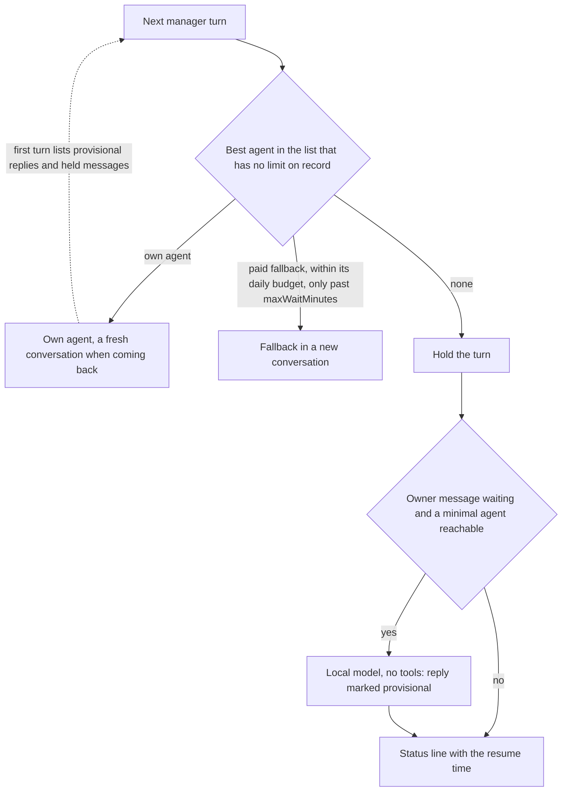

# Manager efficiency and agent fallback: evaluation and design

Status: audit of the week 10-27..11-02 over all 8 projects, 2026-11-03. `(est.)` = estimated. Dollars are API-equivalent at Opus 5.5 $4 in, $20 out, $0.20 read, $8 1-hour write; Sonnet 5.5 $2, $10, $0.20, $4. The plan's quota is not dollars; how it weighs tokens is not known. Earlier audits: `usage-audit.md`, `orchestration-review.md`.

**Answer.** Manager mode used 1.7x the tokens of the heaviest direct week. Parallel work is not the main cause. The cause is one fixed 5-step Opus pipeline per task, with most model calls spent reading the code one search at a time inside a large context.

## Where the tokens went

| Week (Claude transcripts) | Calls | Cache read | Cache write | Output | Est. $ |
|---|---|---|---|---|---|
| 10-12, almost all direct sessions | 7.6k | 1.81B | 29M | 6.6M | 728 |
| 10-19, half tasks | 8.1k | 1.63B | 26M | 4.7M | 627 |
| 10-26, mostly tasks | 19.6k | 2.49B | 64M | 12.7M | 1,262 |

Task log total for 10-27..11-02: workers $808, managers $146 (15%), 190 tasks. Opus workers: reads 41%, writes 33%, output 23%, input 0%. The formula gives $730 against the logged $747.

| Worker step, 3 largest projects ($775) | Share | | Worker spend by tool call ($825 est.) | Share |
|---|---|---|---|---|
| build | 31% | | `rg`/`grep` (4,158 calls) | 30% |
| plan | 16% | | `sed`/`cat`/`ls` and Read | 12% |
| context (`recall`) | 15% | | result call | 10% |
| review | 14% | | other Bash | 10% |
| memo | 11% | | git; cargo; polling; check-run | 7; 7; 6; 5% |
| after the last step | 11% | | Write, Edit; Skill; subagents | 5; 4; 0.4% |

- **Reading is 42% of worker spend.** 11,618 of 12,728 model messages hold exactly one tool call, and each call reads the whole context (median 140k) again.
- **Subagents are about 2%.** 600 calls, mostly Sonnet. They are not the drain; they are underused for search.
- **Polling is 6%**, 915 calls, in spite of the audit's earlier finding.

## Parallel tasks

Parallel work does not multiply a task's tokens. It concentrates them and it chills caches:

- Peak 5 hours $116 against a mean of $28; mean 4.7 and peak 18 active tasks per hour; 120 five-hour and 6 weekly limit events in task transcripts.
- Turns after more than 1 hour idle: 25 turns, $65 on wsx. Turns after a session limit: 10 turns, $32. These overlap; together at most 19% of wsx workers, mostly check-queue and limit waits.

## Task memo and context continuity

| Part | Cost | Verdict |
|---|---|---|
| Memo step (`owner:memo`) | $82, 232 turns | Remove: the result's `memo` field already carries it |
| Idle consolidation (`dream`) | $48, 28 tasks | At most daily: it exists to fold the memo step's files |
| Manager folds memos into `context.md` | $10, 104 turns | Host writes the line; no turn |
| Context step (`owner:recall`) | $115, 162 turns, 57% write | Remove: `plan` looks up what it needs (`seek`), and `plan` skipped tasks already show the same landing rate |
| Worker rotation at 200k | after-rotation turn $0.98; turn over 200k $1.54 against $0.54 | Keep: it pays |
| Manager rotation at 150k | 50-100k $0.12, 100-150k $0.16, over 150k $0.31; first turn after $0.36 | Keep: 100k would save about $5 a week on wsx (est.) |

Memo and context together are 27% of the worker bill.

## Other project managers

| Project | Manager $ | Worker $ | Tasks | $/task | Manager share | Opus; Sonnet $/task |
|---|---|---|---|---|---|---|
| wsx | 72 | 519 | 90 | 5.8 | 12% | 7.27; 0.79 |
| iam-studio | 42 | 215 | 59 | 3.6 | 16% | 4.94; 0.42 |
| pizzahouse | 23 | 51 | 23 | 2.2 | 31% | 2.91; 0.26 |
| pyt | 4 | 18 | 6 | 3.0 | 19% | 4.46; - |
| dotfiles | 4 | 3 | 13 | 0.2 | 58% | -; 0.19 |

Same diff size, landed tasks, lock files left out:

| Changed lines | Opus 5 steps: tasks, $/task | Sonnet 3-4 steps: tasks, $/task |
|---|---|---|
| 10-50 | 11, 1.93 | 18, 0.44 |
| 50-200 | 39, 3.40 | 12, 0.99 |
| 200-1000 | 50, 7.64 | 1, 1.25 |
| over 1000 | 18, 11.23 | 0 |

- **Sonnet is 3 to 4 times cheaper at the same size, not 2 times.** It reads the cache at Opus's price, so the rest comes from fewer steps, half the calls per turn (6 against 12) and a smaller context (57k against 145k read per call).
- **Quality looks equal, with selection bias.** Sonnet tasks land at 83-100% against 88-100%, with fewer send-backs, but the manager picks only exact changes for them.
- **Changes were not small by lines.** 68 of 118 Opus tasks changed over 200 lines; wsx main moved 91k lines in the week, 71% Rust source.

## Manager turns

Events are half of manager cost ($72 of $146). Replaying the logs: 245 event turns held only `landed`, `closed`, a limit or disk wait, or a successful deploy or routine: $18.84, of which 115 did nothing, 104 only edited notes, 21 started a housekeeping task (15 tasks, $31, one every request). Only 22 said anything to the owner.

## The $97 of API credit

Pi spent $96.75 on 10-31..11-01; one interactive session spent $83.61 (388 calls, median context 328k, maximum 520k).

| Cause | Calls | Cost |
|---|---|---|
| Full cache rewrite within 5 minutes: Pygmalion changes the prompt prefix. 8 read only the 41k of tools and system: `task-context` rewrites its packet at the front of the messages at each prompt. 4 read only 8-9k, so the system text changed, and 7 read nothing, so the tool list changed; those two causes are not traced to a line | 19 | $30.6 |
| Cache expired after 5-60 minutes: Pi's default 5-minute cache (`PI_CACHE_RETENTION` unset) | 5 | $9.5 |
| Cache expired after over 1 hour | 7 | $15.2 |
| Everything else: reads, output, small writes | 357 | $28.3 |

Compaction waits for 16k free of a 1M window, so it never ran.

## Why the manager stayed on Pi

1. `is_usage_limit` looks for "insufficient credit"; Anthropic says "credit balance is too low". The 400 became a chat reply, 3 times.
2. The return to Claude ran only inside a rotation, and a manager that answers errors never reaches `rotateTokens`.
3. `fallback()` refuses an agent with the current adapter, so Pi can never fall to a local model through Pi, and limits are kept per adapter, not per account.

## Design

| Rule | Replaces |
|---|---|
| The choice runs before every manager turn; going up is at once, going down only past `maxWaitMinutes` | return only at a rotation |
| A limit belongs to an account: `claude`, or `pi-<provider>` | a limit per adapter; "another adapter" filter |
| Credit, auth and unknown-model errors count as a limit of 6 hours; any other agent error holds the turn and retries with backoff | an error as a chat reply |
| An agent other than Claude has a daily budget, `budget_usd_per_day`, default $10; spent, it counts as limited until midnight | no ceiling |
| Workers have no paid fallback by default: they wait and resume by themselves | the owner's `pi-opus` worker fallback |
| A `minimal` agent answers only owner messages, one call, no tools; the messages stay queued and the own agent answers them after it, told which replies were provisional | silence until the reset |

Limits seen so far are per account (`five_hour`, `seven_day`), not per model, so no Opus to Sonnet step-down on Claude is needed.

Cost of a switch: a cold fresh conversation, not the model. A fresh manager start is about $0.36, against about $0.76 to resume 95k cold (est.). So a return is always a fresh conversation with the handover, and a worker never switches back mid-task.

## Levers, ranked

| # | Change | Saves per week (est.) | Risk | State |
|---|---|---|---|---|
| 1 | Drop `context` and `memo` from the owner's steps | $150-200 (some moves to `plan`) | Less knowledge per task | Owner config |
| 2 | Reading rules: batch reads in one message; a subagent for wide searches | $100-200 | A worker ignores them | Worker rules |
| 3 | Sonnet and build-only is the default for bounded changes | $100-200 | Lower quality on hard work; send-backs show it | Manager rules |
| 4 | No housekeeping task per request; idle at most daily | $50-80 | Duplicates live longer | Manager rules |
| 5 | Events that decide nothing wake no turn | $15-19 | A landed task is not reported until the next turn | Host |
| 6 | Host writes memos into `context.md` | $10 | Duplicates in the file | Host |

Prove them with the loop in `usage-audit.md`: one `decisions.md` line per change, then compare `--until` and `--since` after 8 landed tasks of a kind. Keep when $/task falls and send-backs and failed checks do not rise.

## Pygmalion (separate repository)

| Change | Why |
|---|---|
| `task-context`: a packet stays where it was first sent and a new one joins at the end; only a restored one opens the conversation | 8 rewrites |
| `showCacheMissNotices` on, to find the 11 rewrites not traced to a line | Pi shows each one when it happens |
| `PI_CACHE_RETENTION=long` (the wsx adapter sets it), and `compaction.modelOverrides` so Opus and Sonnet compact near 200k | $9.5 plus the reads |
| `permission-auto`: a review call that gave no verdict moves to the next model: the configured one, the active provider's cheap model, the active model, then the configured fallback, all after the first at low effort | Today a credit, login or limit failure on the configured model ends in a denial with no prompt |
