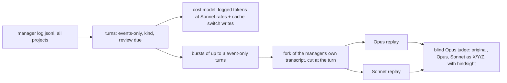

# Manager event turns on Sonnet (`tasks.manager.eventModel`)

Task #462, 2026-11-15. Question: should the manager's event-only turns run on Sonnet?
Owner rules that bind: Q2 of [root-cause-refactor.md](root-cause-refactor.md) (yes, after step 6's
turn count), 2026-11-04 "manager opus high", 2026-11-13 "simply changing the model is risky".

## Decision rule (written before the paid runs)

Switch only if all three hold on at least 40 replayed real event-only turns:

1. Quality: the turns where the blind judge marks only Sonnet wrong (minor or major) are at most
   one more than the turns where it marks only Opus wrong (`only_sonnet_wrong <= only_opus_wrong + 1`).
2. No major wrong decision that only Sonnet made (`only_sonnet_major == 0`).
3. Cost: the modeled weekly saving, after the cache writes the model switches add, is at least
   20% of what those turns cost on Opus.

## Method

`python3 -B scripts/bench-manager.py --mode after --cases events [--samples 45] [--days 14] [--budget 60]`

- Replay: both arms resume a fork of the real conversation at effort high with the current
  instructions. `wsx` is a recorder: acting calls answer ok and are kept; reads cannot run, so the
  turn carries the reads the original turn made then. Both arms see the same evidence.
- Judge: Opus sees the events, the reads, what the log shows later, and three answers in random
  order: the original turn, the Opus replay and the Sonnet replay. The original is a free second
  Opus sample, so original against Opus replay is Opus's own noise.
- Cost model (`event_cost`): routes a turn as `turn_model` does (events only and no ready task
  waiting for review, approximated from the events), prices its logged tokens at Sonnet's rates
  times the replays' token ratio, and adds the writes: Claude's prompt cache is per model, so the
  first Sonnet call after Opus writes what Sonnet's cache lacks, and the next Opus turn writes what
  the Sonnet turns added (all of it after an hour).
- Prices (USD per million tokens, claude-api reference): Opus 5.5 input 4, cache read 0.20,
  cache write 8, output 20; Sonnet 5.5 input 2, cache read 0.20, cache write 4, output 10. The cache
  read costs the same on both, and it is half of the event-turn spend.

## Results

(filled in by the build step)
