# Manager mode: one goal, many projects

Owner, 2026-11-22: manager mode is a superset of **session mode** (the project → worktree → session tree). It takes the cognitive load off the owner: one place to talk across projects, no worktree or process bookkeeping by hand, and long-lived goals, not only open-build-close tasks. It must beat a single session at orchestration, managing, context, cost and quality. This file replaces `consolidation.md`, `lean-refactor.md`, `root-cause-refactor.md`, `cli-lean.md` and `work-model.md`; `transcript.md` stays as the chat rows' contract.

## Model

| Owner's word | wsx | Grounding |
|---|---|---|
| goal | a **chat**: `goal.md`, its log, its notes | its **home**: a registered project or a plain folder (`chat.json home`). The agent runs there: working folder, `CLAUDE.md`, boundary, memory scope |
| projects | `chat.json repos`: the home first, then each project it started work in (grown by `task new -p`) | each project's own `CLAUDE.md` reaches the worker that runs in it |
| works | tasks (a working copy, checks, land) in any of its projects; **approved runs** for work with no repo | a task's events return to the chat that made it (`chats::owner`) |
| talk | `say --to <chat>` from any chat or the owner; a routine's `to` | a routine without `to` reaches its project's main chat, as today |

A routine of one project reaches a goal chat by name: `wsx routine add ... --to mac-health`. Memory stays keyed by project: a chat writes its home's scope (a folder home writes the named scope `chat-<name>`) and reads any scope.

## Abilities to gain (from the 11-22 machine-health day in session mode)

| # | Ability | Design |
|---|---|---|
| 1 | Stop or restart a process the agent did not start | approved run |
| 2 | Ask "go?" and continue | approved run: the answer is an event to the asker; its turn goes on |
| 3 | `sudo` | approved run in a wsxd pane: the password prompt is the owner's |
| 4 | Runbooks | the chat runs in its home: that folder's `CLAUDE.md` and skills |
| 5 | Stay out of the rest of a volume | boundary: `/Volumes` writes denied; `tasks.boundary.writable` in the owner's config allows folders (nothing ships by default) |
| 6 | Work with no repo | a folder home plus approved runs; no copy, no land |
| 7 | See everything in one place | TUI Home = the web Home: chats first, needs first (below) |

## Approved run

```mermaid
stateDiagram-v2
    [*] --> asked: agent runs `wsx task run -- <argv>` (chat or worker)
    asked --> running: owner Approve (TUI, web, `wsx task approve a<n>`)
    asked --> denied: owner Deny
    running --> ended: wsxd pane runs argv as given, no shell; owner can watch and type
    ended --> [*]: exit code + last 40 lines as an event to the asker
    denied --> [*]: "denied" event to the asker
```



It is a new action of the existing approvals (`approvals.jsonl`, `Action::Run{argv, cwd}`), not a second mechanism. Only the owner approves. The argv shown is the argv run.

## Screens: one view model, two renderers

| Piece | Owner | Replaces |
|---|---|---|
| Home rows: chats with needs, news, last reply, order | `wsx_core::task::home` | `chat_contacts` in `wsx-web/src/tasks.rs`, `homeOrder` in `home.js`, the chat rows in `task_list.rs` |
| Words and tones of states | `wsx_core::task::words` | `task-words.js` tables, `state_word`/`state_color` in the TUI |
| Message blocks: paragraphs with inline marks, headings, lists, code, tables, quotes, diagrams | `wsx_core::text::blocks` | `parts` and `chat_table::read` in the TUI |
| Diagram as text: `flowchart` and `stateDiagram` boxes and arrows; other kinds as code | `wsx_core::text::diagram` | mermaid fences shown as source in the TUI |

The TUI opens manager mode as its own top-level view, like the web's tabs: Home (chats) → a chat → its tasks and sheets, with session mode one key away. The web keeps markdown-it and Mermaid. Each block renders once per message and width (cache by id and width).

## TUI mockup (to discuss before building)

The TUI opens on manager mode's Home, the web's first screen; `s` switches to session mode (today's tree), `Esc` returns.

```
 wsx  Home · Sessions · Machine                                    ? help
 ─────────────────────────────────────────────────────────────────────────
 ! For you 3   Approve run: killall fseventsd · land #551 · check #540
 ● mac-health  !1 …2   Approved run a12 ended (exit 0)                  2m
     this Mac's disk and memory health · ~ · shop, dotfiles
 ● wsx         ✓3 …1   I committed the review fixes and opened step 4    5m
     manager mode as a superset of session mode
 ○ studio              #112 waits for you: discard?                     1d
 ── side projects ───────────────────────────────────────────────────────
 ○ notes               no news                                           3d
 ─────────────────────────────────────────────────────────────────────────
 Enter open · n new chat · Tab next ask · s sessions · / search
```

A chat, with the transcript drawn from `text::blocks` (tables, code, diagrams as boxes):

```
 ← mac-health   ~ · shop, dotfiles             Tasks 2 · To check 1
 ─────────────────────────────────────────────────────────────────────────
 You 17:20   free the disk first
 mac-health 17:21
   Found 2,211 Chrome profiles (4.2 GiB):
   │ Source       │ Size    │ Action │
   │ t515 Chrome  │ 4.2 GiB │ remove │
   ┌───────┐    ┌─────────┐    ┌───────┐
   │ asked │───▶│ running │───▶│ ended │
   └───────┘    └─────────┘    └───────┘
 ▸ 2 events: #12 ready · run a12 ended (exit 0)              Space: show
 ─────────────────────────────────────────────────────────────────────────
 ! Approve run: killall fseventsd  ·  28 GB swap · in ~       y yes  n no
 > message…                                                  Enter send
```

## Steps, each one lands, is tested and goes live

| # | Step | Proof |
|---|---|---|
| 0 | Clear the board: commit main's review fixes; close #561, #563, #564, #565 (all on main); close stale chats after reading their notes; `wsx web` | nextest; `web` scenario part `chat` |
| 1 | Boundary: `/Volumes` deny plus `tasks.boundary.writable` | a `sandbox-exec` scenario: write in a listed folder succeeds, beside it EPERM |
| 2 | Approved run | scenario: a worker asks to stop a process outside its sandbox; alive before Approve, gone after, exit 0 event; Deny leaves it alive |
| 3 | Goal chat: folder home, `repos` grown by use, routine `to` | scenario: a chat with a folder home starts tasks in two projects; both report to it; a routine of a third project reaches it |
| 4 | Shared view model: `home`, `words` | the TUI and the web list the same chats in the same order for one fixture store |
| 5 | Blocks and diagram text; TUI Home redesign (mockup first) | render scenario over real messages with a table, code and a flowchart at 3 widths |
| 6 | Land #551 (web design system) on the new main | `web` scenario all parts |
| 7 | Judge: today's Mac-health goal end to end in manager mode | one chat; tasks in two projects; a process outside the sandbox stopped after Approve; a write beside the listed folder refused; no session-mode step |

**Authorized autonomous mode** (owner, 2026-11-22): a chat setting (`chat autonomy on|off`, the owner's). On, a decision the chat would ask about (a design choice, a review gate, its own land) takes its recommended option, says so in one line in the chat, and goes on; the owner overrides afterwards, and the override is the record. What stays an ask always: approved runs, `push`, `close --discard`, and every action the owner config lists in `tasks.*.approve`. Proof: a scenario where a chat with autonomy on lands its task with a one-line note and no approval card, and the same chat with it off asks.

**Every agent, not only Claude.** Autonomy, approved runs and the boundary are wsx's: the chat's host and `task::policy` decide, the broker carries `wsx task run`, and the Seatbelt profile wraps any adapter. None reads Claude's permission mode or settings, so Codex and Pi chats and workers get the same behaviour. Each of these steps' scenarios runs once with the Claude fixture (`fake-claude-stream.py`) and once with the Pi fixture (`fake-pi-rpc.py`).

Open items folded in from the replaced plans: explicit asks with options (`wsx task ask`), For you derived from one `for_you`, one owner field per task, a stopped copy's `target/` dropped after an hour.
