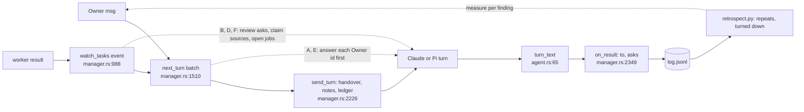

# Manager reliability: the 2026-11-04 retrospect findings

Question (owner, msg 2401): how does wsx stop the manager failures that the 2026-11-04 retrospect found, flexible parts first? Plan only, no code changed. Data: the manager `log.jsonl` of project wsx (message ids below). Related: `manager-continuity.md`, `dynamic-routines-retrospect.md`, `orchestration-review.md`.

Rules (owner): layer 1 is text (instructions, turn text, step prompts, notes, the retrospect prompt). Layer 2 is a fact wsx computes and shows as a hint, never a gate. Layer 3 is named with the evidence that would justify it, and is not built. Each layer covers Claude and Pi. Nothing is specific to the retrospect.

## Findings

**A. Dropped questions.** Reply 2286 has `to` [2284, 2282, 2283]. It was the first turn of a fresh conversation (63k cache write, 11 calls), and it answered only the events. Reply 2313 answered the "improve this" half of 2312.
- Cause: `next_turn` adds events to an owner turn (`manager.rs:1558-1567`), and each block is only `"{heading} (message {id})"` (`manager.rs:1615`). The instructions say "answer what the owner asked" (`manager.rs:277`), not "each Owner message, each question in it". `to` lists every delivered id (`manager.rs:1661-1666`), so the log counts 2284 as answered.
- Lost text before a tool call: a real wsx bug, fixed in 7573b6dc for both adapters. Claude gathers every main text block (`claude.rs:507`, `claude.rs:625-630`). Pi extends `said` with every text block of each assistant message (`pi.rs:288`) and joins them with `turn_text` (`pi.rs:325`). Nothing is left to do here.
- Layer 1: one sentence in `instructions()`: "Answer each Owner message first, every question in it, then do the Events work." When Events go along with an owner turn, the turn text adds one line: "Answer message 2284 first."
- Layer 2, only if repeat asks do not fall: when an owner message repeats an earlier ask (the 3-gram rule of `retrospect.py:96`), the turn names the earlier id ("this repeats message 2284").
- Not built: a gate that refuses a reply without an answer to each id. Justified only if a hint-marked repeat is dropped again.
- Cost: about 25 tokens in the cached instructions, and 8 tokens on a mixed turn.

**B. Promise against delivery.** Reply 2123 said "added to #184". Reply 2210 found it left out. "I'll tell you" (2169) needed the owner's ask in 2244.
- Cause: the manager steers by `steer`/`add` text in the task's log (`host.rs:564`, `host.rs:584`). Its review reads only `git diff` (`manager.rs:305-312`). `wsx task show` (`crates/wsx/src/task/mod.rs:1552`) and `report.md` show no prompt and no adds, so the review has no checklist. The checklist is the task's own prompt (`store.rs:522`) plus its adds.
- Layer 1: a review sentence: "Before you land, read the task's prompt and each later add, and check each ask against the diff. Name each missing ask when you send it back." A promise sentence: "When an event finishes what you told the owner you would report, report it in that turn."
- Layer 2: `wsx task show` prints the prompt and each add in order. This is a read the manager asks for, not a check.
- Not built: a stored per-task checklist that land refuses until each item is marked. Justified if, after layer 2, the retrospect still finds two or more "left out" asks after a land in a week.
- Cost: 0 per turn. The review turn reads 0.5-2k more tokens.

**C. Narrow fixes** (2057 -> 2062, 2087 -> 2091, 2323 -> 2326).
- Cause: the rule exists only as owner lines in `decisions.md`, read through `notes_preamble` (`manager.rs:2494`). That budget keeps only the newest lines (`manager-continuity.md:70-71`).
- Layer 1: one sentence in `instructions()`: "A fix goes in wsx for every project and every agent adapter (Claude and Pi), not in one owner's config or for one routine. A task prompt names the adapters it covers."
- Layer 2 and 3: none. A rule of judgment has no fact to compute.
- Cost: about 35 tokens in the cached instructions.

**D. Relayed worker claims** (2075, 2077; reply 2106).
- Cause: the event clips "worker says" to 160 chars (`manager.rs:109`, `manager.rs:1024`). `report.md` prints evidence as is ("The worker showed", `report.rs:122`). The instructions trust checks over worker words (`manager.rs:312`), but a claim about a cause or a cost is not a check.
- Layer 1, manager: "Before you pass on a worker's cause, count or cost, check it in the transcript, the log or a command, or call it the worker's unchecked claim." Layer 1, worker (`worker_instructions`, `claude.rs:206`, used by every adapter): "A number or a cause in the summary names its source."
- Layer 2: the event says "N claims without a source", counted from `evidence` items that have no command or path.
- Not built: wsx running the evidence commands again, or a tool that quotes transcript lines (`dynamic-routines-retrospect.md:51`). Justified if relayed wrong claims stay at one or more a week.
- Cost: about 30 tokens for the manager and 15 for the worker.

**E. Unexplained terms, contradicting answers** ("asched" 2269 -> 2272, "fork" 2066 -> 2073; 2328 "I never poll" against 2329 "polling happens in wsx").
- Cause: neither the instructions nor `presentation.md` (`crates/wsx-core/integrations/common/presentation.md`) ask for a definition. 2327 came during the turn for 2326, so the next turn answered it with no link to the last answer.
- Layer 1: "Define a name the owner has not used, in the same sentence. When an answer seems to contradict your last one, say how both hold."
- Layer 2 and 3: none.
- Cost: about 30 tokens in the cached instructions.

**F. A plan closed before its Explore returned** (#212, #213). Both task logs have "the result came while N background job(s) run".
- Cause: the Agent tool runs in the background by default. The plan text names Explore but not the foreground (`host.rs:44`; `claude.rs:220` also says `sonnet` where the plan says `haiku`). The worker ended its message to wait. Claude's `--json-schema` mode (`claude.rs:464`) then sent its own "[structured-output-enforce] ... Call this tool now". This text is not in wsx (rg finds nothing), and it overrode the step's wait sentence (`host.rs:1607`). The turn then had a result, so `wait_for_background` (`host.rs:1364`) did not apply. The host only logs the fact (`host.rs:1224-1232`).
- Layer 1: both Explore sentences say "in the foreground (`run_in_background: false`)", and one model name each. The sentence is Claude-only (`claude.rs:218-223`) because Pi has no subagents.
- Layer 2: the ready or waiting event adds "; result came while N subagents ran", so the manager treats the plan's references as unchecked.
- Not built: refusing a result while background jobs run. Justified if the hint fires on two or more plans a week after layer 1.
- Cost: 12 tokens per worker turn, and 10 per event only when the hint fires.

## Steps, smallest first

| Step | Change | Proof | Measure over the following days |
|---|---|---|---|
| 1 | F layer 1: two sentences | the next plan tasks' logs | "the result came while" lines in plan steps: 0 |
| 2 | Retrospect prompt: tag each turned-down reply with a kind A-F, and allow text changes, not only features (`retrospect-prompt.md` asks for product features only) | `retrospect.py --no-model` and one judged run | per-kind counts; the first run gives the baseline over the 7 days before the change (`retrospect.py:31`) |
| 3 | A and E layer 1: instructions and the mixed-turn line | bench replay, see below | "You asked N times", kinds A and E |
| 4 | B, C, D layer 1: review, promise, scope and claim sentences | bench replay | kinds B to D; send-backs for "left out" asks |
| 5 | Layer 2 hints, only for a kind that did not fall within 7 days | the turn text in a replay | the same counts |

Steps 3 and 4 may land as one instruction change, so the manager pays for the change once. The retrospect kinds still measure them apart. A warm conversation gets it as a message, and a cold one rotates once (`manager.rs:2210-2219`). The instructions are 1672 words (`manager.rs:256-388`). Steps 3 and 4 add about 120 words, under 10%, read from cache on each call.

Bench: `scripts/bench-manager.py` has five synthetic turns (`turns()`, `bench-manager.py:146`) and `ROTATE_TOKENS = 150000` (`:32`), where Claude's default is 400000. Step 3 adds cases copied from the logged batches: a fresh start with 2284 plus events 2282 and 2283, then 2312, then 2326 and 2327. Each case lists the owner ids its reply must answer. One sonnet call judges them, in the same way as `retrospect.py:160`. Compare `--mode before` against `--mode after`. This spends real money (about $1-3 a run).

## Results of steps 1 to 4 (2026-11-05)

Steps 1 to 4 landed as one instruction change. Words are counted on the rendered text; `instructions()` includes `presentation.md`.

| Text | Before | After |
|---|---|---|
| `instructions()` | 1619 words | 1695 (+76, +4.7%) |
| `worker_instructions` literals | 461 | 488 (+27; 15 of them only for Claude) |
| `PLAN_REQUEST` (first plan turn) | 80 | 58 (the Explore sentence moved to the Claude-only worker sentence) |

Offsets: the overview's "keep it under the cap" (wsx enforces the cap), "(decisions are in ...)", `-p <project>` in the check-in command, and one shorter `waiting` sentence.

Bench: `bench-manager.py --cases logged --runs 1`, opus, `before` = instructions at 9543a8de. Each run cost $0.51 to $0.55, and the judge cost $0.05. The logged ledger has no working copies, so neither run could review a diff.

| Owner id | Before | After |
|---|---|---|
| 2284 (fresh start, with events 2282 and 2283) | answered | answered; also defines wsxd and asched |
| 2312 (answer that, and improve this) | answered | answered |
| 2326 (all adapters; how review starts) | answered | answered |
| 2327 (is it polled) | not answered (A): "Do you want me to find out" | answered: "not by me; unchecked inside wsx" |

| Turn | Before: cost, cache write, cache read | After |
|---|---|---|
| 1 fresh | $0.185, 15.4k, 172k | $0.192, 15.5k, 172k |
| 2 fresh | $0.136, 9.9k, 121k | $0.144, 10.0k, 121k |
| 3 fresh | $0.170, 10.6k, 177k | $0.186, 10.9k, 233k (2 more tool calls) |
| 4 | $0.017, 0.5k, 29k | $0.032, 1.0k, 58k (1 more tool call) |

The new text adds about 155 tokens to a fresh start's cache write. Most of the +9% total comes from the extra checks in turns 3 and 4, not from the larger prefix. One run per mode is a small sample.

The change itself: each manager and role takes the new instructions once. A warm conversation (under 100k context, active within 60 min) gets them as one message of about 2.3k tokens. Any other conversation rotates once, which is a fresh start (the logged one, 2286, cost $0.82).

Retrospect after step 2, on a copy of the wsx log since 11-04 09:23 (sonnet, $0.08): 4 of 20 replies turned down, A 2, C 1, E 1. All 3 changes it named were instruction text. This is the baseline for the counts per kind.
