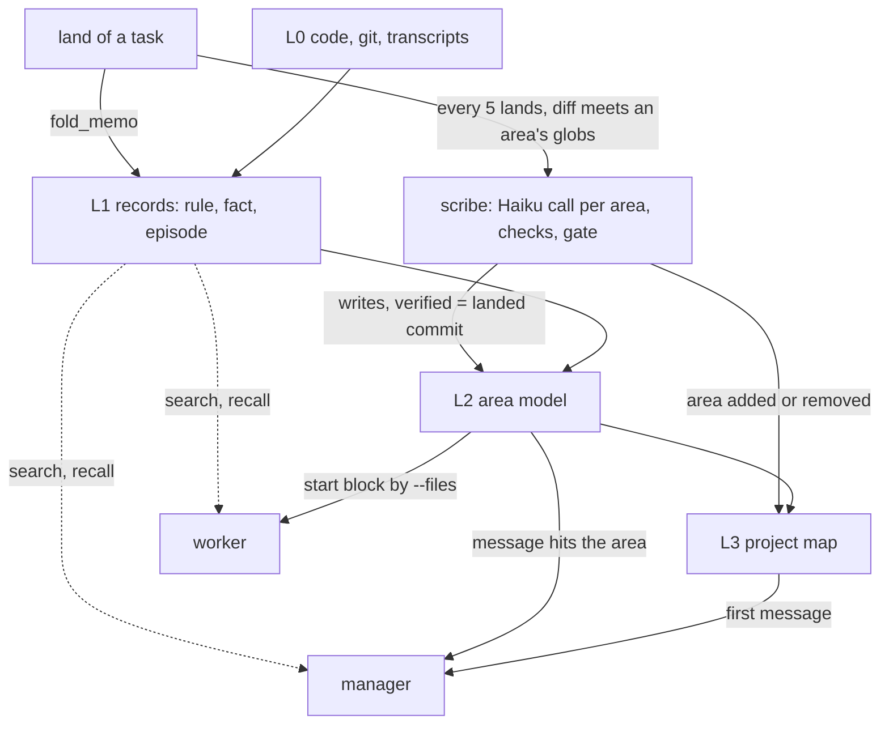

# Memory layers: one resolution per reader, kept by wsx

Status: plan, accepted 2026-11-19 (task 525); the writer was picked by simulation (task 527, 2026-11-19); no step is built yet. `(est.)` marks a number I did not measure.
Owner words: "abstracted mental-model notes made in advance; memory resolution kept in separate layers; if the manager cannot, wsx does it" (wsx 5457); "check code, history and memory before acting" (5455); "reorganize the internals, delete what that makes unneeded, update the mental model" (5461).

**Problem.** A manager guessed why the scenario slot is one. A design doc already said why. Nothing pointed it there: `context.md` was cut ("NOT SHOWN lines 13-119 of 127"), `docs/design` has 67 files and no index, and `wsx.config.yml` sets no `memory.areas`.

**Answer.** Four layers. Each has one writer, one staleness rule, one budget and one reader at one moment. wsx writes L2 and L3 after a land, so nobody has to remember to.

## Layers

| | What | Writer, when | Stale when | Budget | Read by, at |
|---|---|---|---|---|---|
| L3 map | One screen: each area, its globs, the owner function of each concern, links to its model and docs | wsx, after a land that adds or removes a path an area covers; the owner may edit | an area's globs match no file, or a changed path matches no area | 1.5 KiB | Manager: its first message, always. Worker: not shown |
| L2 area model | One per area: how it works, lifecycle (mermaid), owner function per concern, invariants, the owner's rules for it, links to design and research docs that hold the why | wsx's scribe, every 5 lands whose diffs meet the area's globs | `git diff --quiet <verified> HEAD -- <globs>` fails (`start::stale_of`, the rule facts use) | 3 KiB | Worker: start block, by `--files`. Manager: the message that hits the area (words or paths), up to 2 |
| L1 records | `rule`, `fact`, `episode` ([memory.md](../memory.md)) | Owner, worker memo, capture | as today | per search | `wsx memory search` / `recall`, on demand |
| L0 raw | Transcripts, logs, code, git | nobody | never | none | `wsx task search`, `rg`, `git log`, on demand |

Each layer is the summary of the one below and names it: an L2 line cites the record, doc or function it came from, so a reader who needs more resolution drops one layer.



## How wsx keeps L2 and L3

1. **Where they live.** `<memory store>/areas/<area>.md` (L2) and `map.md` (L3), written only by wsx, with the drift rule of `decisions.md` (a hand edit is kept as `.drift` and said once). A file in the repo would need a land for each refresh, and wsx cannot write main's ref. The header holds `globs:` and `verified: <commit>`. `memory.areas` of `wsx.config.yml` stays for a project that keeps its briefs in the repo (studio-app); `memory::start` reads both through one function.
2. **Who and when: a scribe, in the background, on Haiku.** A land costs no extra wait. `fold_memo` stores the records as today, then queues the land. After 5 lands (`BATCH`) the scribe runs: for each area whose globs the batch's diffs meet it makes one bounded call (`wsx_core::process::run_bounded`, Haiku, `tasks.areas.model` to change). A land never waits for it, and a refresh in flight is not repeated: the diff is taken from `verified`, not from the last land. The scribe also gets the owner rules new since its last pass and its own log (2 KiB, a file the owner can open), and runs one curation call over the records the batch touched: merge duplicates, retire facts whose paths are gone. Rules and episodes are never retired.
3. **Input of a call.** The current model, `git diff <verified>..<landed> -- <globs>` cut at 24 KiB, the memos of the tasks that landed, the area's active records. Prompt: change only what the diff changed, keep the form, 3 KiB at most, cite only what you were shown.
4. **Checks, one retry, a gate.** At most 3 KiB; the labels `**Owners.** **Invariants.** **Why.**`; the mermaid fence closed; each cited path and `name()` exists at the commit. A note that fails is sent back once with the failures named; if it fails again the old file stays, marked stale with its `verified` commit, and one line goes to the manager's progress. A batch goes live only if 8 fixed questions score no lower than before; else the whole batch is kept back. Stale is shown, never hidden.
5. **Why this and not the others** (simulation of the last 30 lands):

| Writer | $ per land | Wait added to a land | Notes refused after one retry | Score at the end (24 questions, control 0.12) |
|---|---|---|---|---|
| A, refresh at each land, Haiku | 0.030 | 125 s | 73% | 0.12 |
| A, Sonnet (one try, no retry) | 0.456 | 107 s | 98% | 0.12 |
| **B, scribe in batches, Haiku** | **0.026** | **0 s** | 57% | 0.12 |
| B, scribe in batches, Sonnet | 0.193 | 0 s | 60% | 0.17 |
| Local model (LFM3 via Pi) | not run: the server on 127.0.0.1:8090 was down | | | |

   The pick rule fixed before the runs found no eligible arm: no writer beat the frozen seed by 0.10, because the 24 questions are mostly facts of single tasks that a 3 KiB note cannot hold (the Sonnet rewrite from scratch scores 0.08). So the pick is by cost and wait, with the gate as the guard: B with Haiku is the cheapest, adds nothing to a land and cannot lower the score. Sonnet costs 7 times more for one question more. Both curation models found all 15 duplicates and 4 of 13 stale facts with no wrong merge or retirement.
   The limit that binds is the size: all 139 refusals after the retry name "size" (10 also a missing cited name, 1 an open fence), because the seed notes are 2.2 to 3.1 KiB already. Step 2 raises the cap or trims the seed first; neither is measured.
6. **No `distill`.** The old plan's `wsx memory distill` (a 60k-token transcript read, never built) is not built: the diff and the memo are the input, and they are cheaper and checkable.

## How a request reaches its layer

| Moment | Gets | Where |
|---|---|---|
| Manager turn start | L3 (1.5 KiB) then `decisions.md` newest first. Not the `context.md` memo lines | `task/notes.rs` `preamble` |
| Owner message | Its top record matches (today), and the L2 models of up to 2 areas it hits: a path in the words that meets a glob, else the best BM25 matches over the models (`memory::index` indexes them with the records). Events, recaps and replies get none | `task/notes.rs` `matching` |
| Worker start | The L2 models whose globs meet `--files`, then #520's rules whose paths meet them. No fact records: the paid evaluation (#392) found none gave a gain and likely harm | `memory/start.rs` |
| Any agent, any time | `wsx memory search`, `recall`, `wsx task search`, `rg`, `git log` | CLI |

Limit: the eval kept hand-written briefs. The scribe's notes were scored on questions only; the replay of plan steps with them was not run (budget), so step 6 measures it before anything is deleted.

## What it replaces

| Today | After | Why one owner |
|---|---|---|
| `context.md` memo lines in the manager's first message, cut by a budget split, `context-archive.md`, the 32 KiB ceiling (`notes.rs` `split`, `fit`, `size`, `hidden`, `ranges`; the writer in `manage.rs`) | Deleted. A memo is an L1 `episode`; the ledger's `recent` shows the newest. L3 and L2 take the first message | The cut lists hid the answer; the memos are records already |
| 67 docs in `docs/design`, no index | The L3 map names each doc under its area; a check fails on a doc in no area | One index, written by the same pass |
| Manager notes folder (29 loose files, 37 KB: not memory, scratch) | Left to scratch. Nothing reads it; durable results are L1 records | Memory has one store |
| Memory design doc plan sections (cost study, mapping table, `distill`, build tasks, owner questions: 80 lines) | Deleted in this task; the doc keeps the contract and the owners | The design is built |

## First cut of the areas (L3, 13)

| Area | Globs | Owner function / contract | Docs |
|---|---|---|---|
| Task host | `crates/wsx/src/task/{host,repo,manager}.rs` | `Host::land`, `fold_memo`, manager turns | tasks.md |
| Check scheduling | `crates/wsx/src/task/{slot,checks}.rs`, `scripts/ci-scenario.py` | `slot::take`, `take_free` | tasks.md "Check slot" |
| Task views | `crates/wsx-core/src/task/{status,view}.rs` | `task::status::status` | docs/web-client-tasks.md |
| Memory | `crates/wsx-core/src/memory/**` | `memory::start::block`, `backend::search` | memory.md, this doc |
| Chats and roles | `crates/wsx-core/src/task/{chat,chats,chats_home,policy}.rs` | `task::policy` | tasks.md "Chats" |
| Daemon and sessions | `crates/wsx-daemon/**` | `wsxd` state, leases | daemon-*.md |
| Terminal | `crates/wsx-terminal/**` | PTY runtime | terminal-*.md |
| TUI | `crates/wsx/src/{app,ui}/**` | `app.rs` | ui-state-ownership.md (docs/) |
| CLI | `crates/wsx/src/cli/**` | `cli.rs` | [cli-lean](cli-lean.md), cli.md |
| Web server | `crates/wsx-web/src/**` | `wsx web serve` | web-client.md |
| Web client | `crates/wsx-web/web/**` | embedded files | web-client-*.md, web-themes.md |
| Scenarios and CI | `scripts/**`, `.github/workflows/ci.yml` | `scripts/ci-scenario.py` | tasks.md "Check slot" |
| Deploy and release | `scripts/{deploy-web-live,release}.sh`, `.github/workflows/release.yml` | the two scripts | web-deploy.md |

The globs and owner functions are a first cut from the crate layout and the docs; step 1 checks each against `rg --files`.

## Sample L2: check scheduling

> **Check scheduling** (`crates/wsx/src/task/{slot,checks}.rs`, `scripts/ci-scenario.py`; verified `<commit>`)
> One check run at a time per lane, for every task host of the state folder. A run waits as a ticket file whose flock it keeps; a ticket whose lock is free belongs to a dead waiter and is removed, so a killed host never blocks the queue.
>
> ```mermaid
> flowchart LR
>   A[result or land] --> B[Lane::Checks: fmt, build, clippy, nextest]
>   C[check-run of a scenario, deploy gate] --> D[Lane::Scenarios]
>   E[ci: scenario] --> F{scenarios slot free and nobody waiting?}
>   F -->|yes| D
>   F -->|no| G[GitHub Actions]
>   B & D --> H[ticket sorted: Land first, then first come]
>   H --> I[Slot: flock on slot.lock, dropped with the process]
> ```
> **Owners.** `slot::take` (waits, calls the reason callback), `take_free` (takes it only when nobody holds or waits), `Lane` (queue directory names), `Priority::Land`. The `ci:` choice is in `host.rs` (`take_free(Lane::Scenarios)`), the CI fallback in `scripts/ci-scenario.py`.
> **Invariants.** One holder per lane. A land's checks go first. A local scenario never queues; CI is the overflow.
> **Why one scenario slot.** The scenarios are timed and share a 10-core, 24 GiB machine with the agents' own cargo builds and Chrome (load 14.9 measured). Resource limits are the cause of about 46% of flaky tests. A run takes 16 min. So the slot serializes them, and the queue is the price: 88% of queue time was behind scenarios, 3% behind plain checks. The remedy that was built is the `ci:` lane.
> **Owner's rules.** (the active `rule` records whose paths meet the globs, listed by slug)
> **Why, in full.** docs/tasks.md "Check slot".

That is about 2.4 KiB, inside the 3 KiB budget. It answers the question the manager guessed at.

## Build steps

Each result states lines added and removed (`git diff --shortstat`) and what it deleted (owner 5461).

| # | Step | Proof | Added / removed (est.) |
|---|---|---|---|
| 1 | The area file (header, store folder, drift), `memory::start` reads it and `memory.areas`; `wsx memory area list/show`; seed the 13 areas with the sample above. Check each glob | `scripts/test-memory.py`: `wsx memory start --files crates/wsx/src/task/slot.rs` shows the model; a later commit marks it stale | +250 / 0 |
| 2 | The scribe in `fold_memo`'s wake: queue a land, every 5 lands pick areas, call Haiku, check, retry once, gate, write, stale on failure; the size cap decided; the curation call. A fake model command in tests | `scripts/test-task.py`: 5 lands that touch `slot.rs` make the model fresh at the last commit; a failing fake leaves the old file stale, with the line in progress | +300 / 0 |
| 3 | L3 and the hit models in `preamble` and `matching` | `scripts/test-task.py` fake-manager first prompt holds L3 and, for a message naming `slot.rs`, the check-scheduling model. Bytes before and after | +120 / 0 |
| 4 | Measure the real cost: 5 lands, real Sonnet call | ledger rows against $0.035 and the $0.15 threshold | 0 |
| 5 | Delete the `context.md` split, archive and ceiling; the index check for `docs/design`; edit the 44 `context` asserts of `test-task.py` | scenario `task`, `memory`; the test output no longer names `context.md` | +60 / -350 |
| 6 | Replay the question "why is the scenario slot one": does the manager's answer name the check-queue research. The replay method of the paid memory evaluation | answer, cost under $3 | 0 |

Steps 1 to 3 only add: the owner words ask for removal, so step 5 carries the deletion and waits for steps 4 and 6 to show the layers work. Cost to build: about 5 tasks at ~$4 (est., $20), plus $3 for step 6.

## Decided

Manager, for the owner (wsx 5458), 2026-11-19:
1. L2 and L3 live in the memory store, not in repo files: the repo is public (no personal paths) and the store already has stale-by-commit.
2. The writer is the scribe on Haiku: $0.026 per land measured in the simulation of #527 (against ~$4 per landed task; Sonnet $0.193), nothing added to a land. Step 4 measures the first 5 real lands.
3. `context.md` memo lines leave the manager's first message only in step 5, after step 6 shows the answer reaches the manager.
