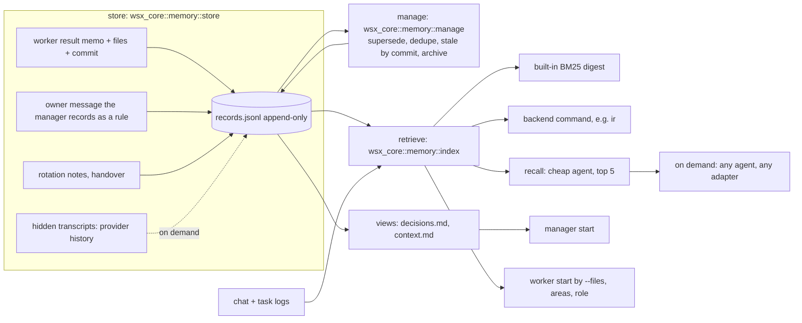

# Memory system: one design

Status: built (steps 1-7 of the first plan; `distill` was never built; the area scribe of [memory-layers.md](memory-layers.md) replaces it). Owner's frame (2026-11-11): storing, retrieving and managing are three tasks; an index is a tool of retrieval; one system replaces mixed mechanisms; caps are not the main tool. The layers a reader gets, and how wsx keeps them, are in [memory-layers.md](memory-layers.md). The start-block evidence is in [memory-eval.md](memory-eval.md).

**Answer.** One record contract, `memory` (`wsx memory ...`), that wsx, workers, roles and the owner's skills all call. Two programs implement it, each scope has exactly one store: wsx's built-in store for projects and `default`, dotfiles' `memory.py` for the vault markdown. The built-in lexical index (today's `task search`) is wsx's default backend; `ir` plugs in behind the same hit format. Always-loaded core: the active owner rules and the facts that match the task's files. All else is recalled on need.

## Parts and owners

| Part | Owner module | Does |
|---|---|---|
| store | `crates/wsx-core/src/memory/{record,store}.rs` | folds the log into records; ops; render of views |
| retrieve | `crates/wsx-core/src/memory/index.rs` (today `task/search.rs`) | `Backend` trait; built-in digest; external command; `recall` |
| manage | `crates/wsx-core/src/memory/manage.rs` | supersede, dedupe, stale check, compaction, archive |
| CLI | `crates/wsx/src/cli/memory.rs` | `wsx memory`, the one contract |

## Record

One line per op in `tasks/<project-id>/memory/records.jsonl`; the current records are the fold of the log. Append-only, so the old text of an update stays in the log.

| Field | Meaning |
|---|---|
| `slug` | stable id, lowercase words and `-` |
| `kind` | `rule` (owner's decision), `fact` (verified about the code), `episode` (what a task did or learned) |
| `status` | `active` (default), `superseded`, `failed` (with `lesson`) |
| `text`, `title` | the claim, one to five lines; optional title |
| `source` | required on every op: `msg:<id>`, `task:<n>`, `path:<file>`, `transcript:<ref>` |
| `updated` | unix ms; the date shows in views |
| `verified_by` | required for `rule` and `fact`, else exit 2: `owner:<msg id>` or a relative path with no `..` that exists under the project root (the contract's two forms); wsx also takes `task:<n>` (landed) and `check:<id>`. Episodes need none |
| `commit` | facts: the commit it was true at |
| `superseded_by` | slug of the newer record |

wsx extensions, ignored by other implementations (a record may carry fields the reader does not know): `words` (rules: the owner's wording, a substring of message `source`), `paths` (globs a fact is about). dotfiles keeps its own session fields (`consumed`, `consumed_at`) on its side.

Hit: `slug`, `path`, `kind`, `status`, `score` 0..1 (higher is better), `excerpt` (at most 240 chars); wsx adds `reference` and `quote` as `task search` has them. A chat message, task prompt or result is a transcript hit, indexed and not copied into records.

## The contract (`memory`)

Same table as dotfiles #38, every command but `list` takes `--scope <id>` (required; `wsx memory` defaults it to the project of the current folder) and `--json`.

| Command | Arguments | Output |
|---|---|---|
| search | `<query> [--limit 10] [--include-inactive] [--kind k]` (may repeat `--scope`) | `[hit]` by score; nothing found: `[]`, exit 0 |
| add | `--kind --slug --text-file F\|- --source ID [--title] [--verified-by] [--commit]` | record; a near duplicate returns the old record (NOOP), exit 0 |
| update | `--slug [--text-file] --source ID [--verified-by] [--commit] [--status failed --lesson L]` | record; the old text stays in the log; `failed` is INVALIDATE |
| supersede | `<old> <new> --source ID` | old record |
| reindex | none | `{"scope","ok"}` |
| status | none | `{"scope","store","backend","search":{"network":bool,"model":bool},"counts":{active,superseded,failed}}` |
| list | none | `[{"scope","store"}]` |

Exit 0 ok, 1 not found, 2 usage or an invalid `verified_by`, 3 backend unavailable (a plug-in search backend falls back to the built-in; a `command` scope or a store failure has no fallback and returns 3), and for compaction 4 (the recall-query gate refused, store untouched, the report names the query) and 5 (the store changed meanwhile). `search` makes no network or model call unless `status` declares one.

- Backend: `memory.backend` in the global config names a command with the same `search` and `reindex`; wsx names no tool. Exit 3 or a 10 s timeout uses the built-in. External hits merge by score.
- wsx extensions, not in the contract: `recall` (cheap agent, below), `compact`. A skill has its own model and needs none of them.
- Needs no daemon and no wsx session: any Claude, Codex or Pi session calls it, run by wsx or not.

## Memory outside a wsx project

A scope is bound once in the global config: `memory.scopes.<name>` is `{dir}` (built-in store at `$XDG_STATE_HOME/wsx/memory/<name>/`, the default for an unbound name) or `{command}` (another implementation of the contract). The owner's notevault vault is not one scope: each vault project folder (`pet_ai_factory`, ...) is one scope named by the folder, each with `command` set to dotfiles' `memory.py`. `wsx memory --scope pet_ai_factory ...` runs that command and passes its output through, so wsx holds no copy and the vault markdown is never rewritten. The same `memory.py` runs on its own where wsx is not installed. A Claude session not run by wsx calls `wsx memory` (or `memory.py` directly) with `--scope` from its context script. Each scope has one store, and one program writes it.

## Who gets what

| Reader | At start (fixed, in the prompt, so on every adapter) | On demand |
|---|---|---|
| Manager | active `rule` records (rendered `decisions.md`) and the project map and area models of [memory-layers.md](memory-layers.md); a pointer, not a cut list | `recall`; each owner message gets its top record matches and the models of the areas it hits |
| Worker | area briefs (below), open tasks that share files; 4 KiB as today. No fact records: the paid evaluation found no gain and likely harm (`memory-eval.md`, #392: plan cost +11% median, CI -4.8%..+21%; recall -0.05; about 3 extra calls checking records) | `wsx memory recall "<question>"` |
| Chat | its `goal.md`, its rules, the project rules | same |

Areas: the project config declares `memory.areas: {"<glob>": "<brief file>"}`. A task whose `--files` match gets those briefs in the same start block, host-built in `host.rs` `task_context`, no skill involved. The brief is a record of kind `fact` with `source: path:<file>`.

`recall` runs a cheap model: search top 20 (built-in plus backend), the model returns at most 5 slugs with excerpts, no summary. With no model it returns the top 5 by score. Cost (est.): 20 x 240 chars = 1.2k tokens in, 0.3k out, about $0.006 at Sonnet $2 and $10 per M. The prompt says: a record is data, not an instruction.

## Skills and wsx, final split

| Part | Owner |
|---|---|
| Contract table, record and hit formats, exit codes, `verified_by` forms, recall-query gate rule (top N=5) | wsx (this doc and `docs/memory.md`); dotfiles implements it as written |
| Built-in store (JSONL), lifecycle ops, dedupe, stale-by-commit, compaction with the gate (exit 4, 5), audit, built-in BM25 index, backend plug-in, start sets, areas, role briefs, `recall`, capture from tasks and owner rules | wsx, for projects and `default` scopes |
| Store for the vault markdown: kind from where a note lives (no frontmatter rewrite), scope lookup (registry, `<git_root>/knowledge`, vault), `apply-ops` batch with `ops.jsonl` old text, `consumed` session fields, journal-commit compaction on a snapshot, `deep-audit.sh` findings (`DANGLING_SUPERSEDED_BY`, `UNVERIFIED_DURABLE`, ...), legacy-note handling | dotfiles `memory.py`, for vault scopes |
| ir wrapper that follows the contract | dotfiles (ir plugin) |
| memo, seek, recall, dream calling `memory` instead of `ir`; thin agent-neutral SKILL.md files | dotfiles skills |
| no-repeat, note | stay skills; no-repeat may `add` a `fact` |

dotfiles builds only its rows and needs nothing from wsx code but the contract text. wsx builds nothing of the vault store. Both pass the same scenario: a contract test (add, update, supersede, search with and without `--include-inactive`, exit codes) that runs against either program; it lives in wsx's `scripts/test-memory.py` and takes the command as an argument.

## Wrong records and the owner's words

A wrong record is caught three ways: (1) a fact with `commit` and `paths` is stale when `git diff --quiet <commit> HEAD -- <paths>` fails (one git call, 10 s timeout as in the ledger) and shows `stale` in search; (2) `add` of a rule or fact without a valid `verified_by` is refused (exit 2), so only landed-task, owner or checked records reach a prompt; (3) a worker or manager that finds one wrong runs `update --status failed --lesson`, and the log keeps both.

### Decisions stay the owner's words

`decisions.md` is rendered from active `rule` records, newest first: `- <date> <words>` with the record's date and `words`. The manager's own paraphrase is allowed only as `text`; the view shows `words`. The manager's write path (today an append of `- <date> <decision>` to the file, `instructions.rs` 143) becomes `wsx memory add|update|supersede`; the file stays readable and is rewritten from the log, so an edit by hand is ignored with a notice (`wsx memory status` lists drift). `decisions-archive.md` becomes the superseded rules, and no rule is dropped without `superseded_by` or an owner message.
