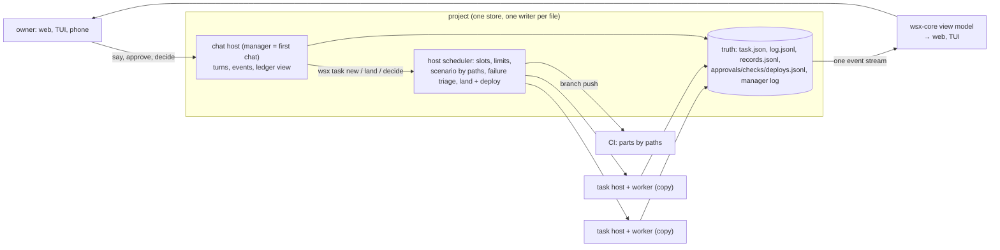

# Orchestration lean design

Design of 2026-11-13, task #422, written on `claude-fable-5-1`. No code changes. Method: for each area, the owner's intention (docs, decisions, code), the leanest system that meets it, today's distance with `file:line` and measurements, the smallest closing steps. Rules honoured: near-zero net growth of manager instructions, one owning module per rule, no duplicate features, no structure for one feature, web and TUI parity, no silent cut of manager context. Judged for Sonnet and a small model, not tuned to Fable (§10).
Sources: `docs/tasks.md`, `docs/memory.md`, `docs/design/{memory-system,memory-eval,orchestration-review,manager-efficiency,manager-reliability,chat-roles-lean-audit,refactor-audit-*,cli-lean,check-scheduling-audit,task-time-cost-audit}.md`, the owner's draft `verification-pipeline.md` (main checkout, untracked). Store measured: `~/.local/state/wsx/tasks/wsx-8cbe3f08` (422 task folders, 7 days to 11-13). Earlier audits are not repeated; §13 says which are done.

## Summary

- The owner decides; one chat per project runs the work; a task is an isolated copy proven by host checks. These three facts are the whole system. Everything else is a cache, a convenience or a leftover.
- The manager's text is 12.2 KB; 45% of it (gates and tool docs) belongs in code or `--help`. The lean prompt is about 4 KB of judgment only, and the same prompt serves Sonnet and a small model because the gates refuse instead of asking the model to remember.
- Truth lives in 6 append-only files per project plus `task.json`. Each derived copy (two overview caches, four `seen` copies, four notes views, the search digest, the event `short`) gets one owner or goes.
- Worker time is not the model: check-run waits are 50% of a task's life and 120 of 229 CI failures are not the task's (#427). The scale fix is scheduling and triage by the host, not a faster agent.
- No new mechanism for "a stronger model for this talk": a `model` field on the Say request, set for that turn, back after. Capability levels reuse `Policy::of(trust, role, may)`.

## 1. Owner and manager: what it is for, the object model

Intention: the owner talks to one manager per project and only decides; the manager turns messages into tasks; tasks run in isolated copies; the host proves them (`docs/tasks.md` "Manager", "Checks"). Essential objects: project, chat (the manager is the first chat, #410/#418), task, check item, approval, routine, memory record. Each has a store file and a web and TUI view.

Gap, with evidence: four objects exist with 0 measured uses since 10-29 (`orchestration-review.md` counts; in the last 7 days the task logs hold no trial or batch event and no task has a `parent`): batch land (`crates/wsx/src/task/batch.rs`, 206 lines), trial (`trial.rs` 81 lines plus about 90 in `host.rs` and branches in `cmd/deploy.rs`), parent `--into` (about 85 lines in `host.rs`, `cmd/new.rs:262-301`, `boundary.rs:77-82`), preview (`preview.rs` 347 lines, seldom used per `orchestration-review.md`). `hand` and `handback` (`host.rs:1176-1250`; handback is `hand --back`) are used and stay.

| Step | Value / cost | Proof |
|---|---|---|
| Remove trial, batch, `--into` after the owner's yes (§12) | ~470 lines gone, 3 fewer HostRequest arms, 1 lock file (`trial`) | `test-task.py` parts pass with their sections removed; `wsx task --help` diff |
| Keep preview but as a worker-only command | one feature, one owner | same |

Risk: the owner may want parent tasks back for release work; the ledger keeps `--after` (#341/#409), which covers ordering without a parent object.

## 2. State: one owner per piece

Intention: every fact written once, by the process that learns it; clients read, never rebuild.

Truth today (store sizes on 11-13): `task.json` per task, `log.jsonl` per task, `manager/log.jsonl` 4.6 MB, `memory/records.jsonl` 252 KB (225 records: 35 active rules, 122 superseded, 47 facts, 21 episodes), `approvals.jsonl` 40 KB, `checks.jsonl` 164 KB, `deploys.jsonl` 196 KB. Derived: `search.jsonl` 6.2 MB (rebuildable digest), four notes views (`decisions.md` 4,140 B, `context.md` 9,544 B, `decisions-archive.md` 20.6 KB, 4 `.pre-memory` copies), 29 loose notes files (about 37 KB, plus a `skill-backup` dir and `t371.json`/`t376.diff` scratch), `overview.md`, `report.md` per task, `follow-up.log` 2.6 MB, `grants.json` 85 B (dead: no code reads grants), `state.json` 55 KB with 15 keys.

Duplicates in code: `seen {state, revision}` in four places (manager `Duties.observed`, `state.json` `seen` `manager.rs:1678`, `turn_seen` `:2615`, web `Watch.seen` `crates/wsx-web/src/tasks.rs:1270`); two overview caches (`App.overviews` `tasks.rs:99`, `Watch.overviews` `:1268`) plus `Watch.replies`/`requests`; the event `short` both stored and derived (`Short::plain` `wsx-core/src/task/manager.rs:251`); `ledger_summary` (`manager.rs:2564-2634`) and `build_overview` count the same things from separate reads; `needs::stage` runs twice per task (`tasks.rs:181,196`); `status::waiters` is O(N²) in `build_overview`.

Target: truth = 6 jsonl files + `task.json`; derived = one `overview.json` written by the chat host after each event (the web and TUI read it; no client-side cache), one search digest, one notes view (`context.md`, a record view), nothing loose.

| Step | Value / cost | Proof |
|---|---|---|
| Delete `grants.json` writer, the `seen` copies but the manager's, `Watch.overviews` | small; removes 3 ways to disagree | web `tasks` part, `test-task.py` host part |
| One `overview.json` from `build_overview`, read by `ledger_summary` and the clients | one read per turn instead of N `task.json` reads per tick (§5) | smoke TUI rows and web overview equal |
| A rule for loose notes files: records only; `wsx memory` refuses a path outside `memory/` | no scratch in the store | `test-memory.py` section |
| `search.jsonl` rebuilt on demand, not on each message | 6.2 MB write path gone from the hot turn | `test-task.py` search section |

Risk: `overview.md` is the manager's own writable file (`boundary.rs:94-101`); the host-written `overview.json` must be another file, or the manager's writes are lost.

## 3. Memory and context: what each turn needs

Intention: the manager knows the ledger and the owner's decisions; a worker knows its task and the project's rules that touch its files. Nothing is loaded that is not measured to help (owner rule after #392).

Measured per manager turn (`crates/wsx/src/task/manager.rs`): `ledger_summary` about 1.4 KB each turn (`:2564-2634`, plus git for `deploy_line` `:2637`); `open_questions` `:2548` unbounded; `notes_matching` `:3195` (≤1 KB on owner turns); `notes_preamble` `:3230` 10 KiB cap on a fresh conversation only, while `context.md` is 9,544 B and `decisions.md` 4,140 B, so the cap already cuts; `handover` `:3237` 4×600 chars; `held_messages` `:2533`. A fresh manager start writes 30-37k tokens; first turn $0.34-0.36 against $0.09 warm (`manager-continuity.md`). Workers: start-block records gave no gain (`memory-eval.md`: plan cost +11% inside noise, recall −0.05).

Target: a turn gets the ledger line (from `overview.json`, §2), the open questions bounded to the last 5, and recall on demand (`wsx memory search`, `docs/memory.md`). No preamble by default. Rotation keeps one handover of a fixed size. The notes cap stops cutting silently: a cut is logged as an event the owner sees (decisions.md rule "no silent cut").

| Step | Value / cost | Proof |
|---|---|---|
| Bound `open_questions`; log a `cut` event when `notes_preamble` trims | correctness of an existing rule | `test-task.py` core part, fake manager notes-block assert |
| Preamble off by default; `context.md` loaded only when `wsx.config.yml` `memory.start` says so | −9.5 KB on a fresh start; keeps the owner's choice | bench-manager replay byte count |
| Records are the only notes store; `decisions.md` and `context.md` become views regenerated from records (#384 already did this for notes files) | one owner | `test-memory.py` |

Risk: the owner may want `context.md` memos at start for the manager (eval covered workers only); §12 asks.

What fills each model call, measured from the transcripts, and the bounds ranked by saving: `context-budget.md`.

## 4. Chats, agents, fallbacks, policy

Intention: a chat is a party the owner talks to; `may` says what the chat can do (#410); a worker is a chat with a copy; trust and role give the tools (`crates/wsx-core/src/task/policy.rs:160` ROLES: Manager ALL; Organizer Read, Answer, Backlog, Note, Recall; Worker Result, Recall, Remember; `Policy::of(trust, role, may)` `:260`). Fallback (`local-model-fallback.md`, #349/#354) gives roles to untrusted local agents; the broker (`broker.rs:76-93`) and the boundary (`boundary.rs`) enforce.

Gap: the chat host is the manager host without `Duties` (`manager.rs:180`), good. Two places still decide what an agent may do by prose: the manager instructions (§7, class 2) and the worker prompt's "never git push" (the boundary denies only the secret folders, `boundary.rs:25,113`). The one-call stand-in during a hold (`manager.rs:2322 stand_in`) is the only code path tuned to a weak model; it is the right shape (no tools, one answer) and §10 builds on it.

Target: the policy is the single capability source: tools, boundary denies, reply schema and prompt text all come from `Policy`. Prose says only what code cannot check (tone, when to ask).

| Step | Value / cost | Proof |
|---|---|---|
| Manager boundary denies main-checkout writes except the owner-said commit path and denies `git push` (profile rule) | removes two class-2 sentences | `test-manager-boundary.py` |
| Prompt text keyed by `Policy` (one function `instructions::for_policy`), not by host kind | one owner for "what this agent is told" | `test-task.py` prompt asserts per role |

Risk: a denied push in the manager profile must leave the host-run approved push (#256) untouched; it runs in the host, not the agent.

## 5. Processes

Intention: one daemon owns terminals; one process per isolated job; the owner's clients are thin.

Measured for one owner message: 5 Unix sockets (wsxd, manager `m-`, manager broker `b-`, task host `t-`, worker broker `w-`); 8 long-lived processes (browser, `wsx web`, wsxd, manager host, task host, two claude, the web observer thread). Each manager `wsx task …` call is 2 extra wsx processes with clap parsed twice (`broker.rs:108` forward, `:402` run spawns `current_exe` with `WSX_TASK_ACTOR`). A land spawns 3 detached wsx (`deploy --if-new`, `close`, `deploy --run-locked`; `hosting.rs:136 spawn_wsx` setsid; `host.rs:3594 after_landing`); a deploy is 3 wsx plus `sh`. Owner-said check: `wsx-core task/owner.rs:538` → `wsx-core manager.rs:758 owner_said_in_turn` reads the whole 4.6 MB log. Manager tick: 11 watchers at 1 Hz (`run` `:507-516`; `watch_tasks :1193` reads every `task.json` each second).

Target: the manager host, task hosts and the web server stay separate (restart and handoff need it, `manager-reliability.md`). The broker becomes a request forwarder with no re-exec: the forwarded command runs in the broker's process (`run` in-process) and the client prints. Watchers become one `notify` watch on the store directory plus a 10 s stall tick. `owner_said_in_turn` reads from the turn's end offset (#289 gave `Kind::History` an end offset).

| Step | Value / cost | Proof |
|---|---|---|
| Broker runs the command in-process | −1 process and −1 clap parse per agent command | `test-task.py` worker part, `test-manager-boundary.py` |
| Store watch instead of 1 Hz reads | −N file reads a second per project | smoke, web `tasks` part (events still arrive within 3 s `EVENT_QUIET`) |
| Land fires one `deploy --run-locked` when `--if-new` says new, no separate spawn | −1 process per land | `test-task.py` host part 32 |

Risk: in-process broker commands must keep the actor's boundary (`WSX_TASK_ACTOR`); the policy check moves from the spawned child's env to a function argument.

## 6. Clients: one view model

Intention: web and TUI show the same facts the same way (decisions.md: web changes keep TUI parity); one view model in wsx-core, no per-client rules.

Gap: JS re-derives Rust in six places: `bubbles.js:17` CLOSED regex vs `tasks.rs:340`; `store.js:122` label regex (fourth copy of `is_task_session`, `session_news.rs:12`); `home.js:11` URGENCY vs `needs.rs:68`; `task-words.js:28 STAGES` and `:56 awaitsManager` vs `needs::stage`; `lib.js:82 firstSentence` vs `view.rs:287`; quote prefix built in `tasks.js:451` vs `QUOTE_REF`. Done since the client-logic audit: `needs::stage` (#404), `chat_rows` (#240), `short`, post flag, asks.

Target: the wire carries kinds, not strings: `closed: bool`, `rank`, `tone`, `task_session: bool`, server-built quote prefix. JS and the TUI only map a kind to a style.

| Step | Value / cost | Proof |
|---|---|---|
| Add the five fields to the overview and chat rows; delete the six JS derivations | −6 duplicate rules; TUI gets them free | web parts, smoke TUI rows, `scripts/*-check.mjs` asserts updated |

Risk: none beyond scenario asserts that match today's class names.

## 7. Instructions: what should be code

Measured: the manager instructions are one `format!` string of 181 lines (`crates/wsx/src/task/instructions.rs`), rendered 12,153 B, 2,211 words, about 3k tokens (`scripts/bench-manager.py:86-95`; `presentation.md` 739 B inside). The 81 sentences fall in four classes (Appendix A):

| Class | Sentences | Bytes | Share | Lean home |
|---|---|---|---|---|
| 1 code-enforced already (the model is told what the host does anyway) | 22 | 3,085 | 25% | delete; the refusal text teaches |
| 2 could be code (work only because the model is strong) | 14 | 2,416 | 20% | a gate or a command (table below) |
| 3 judgment (when to ask, tone, what a good task is) | 21 | 3,576 | 29% | stays; the lean prompt |
| 4 tool docs | 24 | 3,076 | 25% | `wsx task --help` and the broker's refusal text |

Worker prompt (`claude.rs:216-281 worker_instructions`, `:284 steps_note`, `:299-347 check_run_note`, `host.rs:2083-2110 step_text`): 5.9-7.1 KB; of about 20 rule sentences, 4 are code, 7 partly, 9 prose (commit before finish, few calls, never poll, evidence sources, memo, run only touched checks, rerun the whole scenario, the `pkill` rule that the sandbox enforces anyway `boundary.rs:296-301`). The skill list adds 8.9k tokens per prefix (`skillsOnly` in `wsx.config.yml`).

Class 2, each with its code owner:

| # | Sentence | Owner today | Lean mechanism |
|---|---|---|---|
| 2 | never edit project files | manager profile allows the main checkout (`boundary.rs:94-101` adds only the overview to `own_prefix`) | deny writes in the manager profile |
| 9 | answer each owner message | `Delivered` ids known (`manager.rs:2166`) | host check: unanswered ids re-queued, or reply schema (§10) |
| 15 | a routine "for the owner" is never `-` | `for_owner` `:2043`; `-` still hidden `:3069` | re-ask like `THOUGHT_ASKED` `:3097` |
| 23 | compare with open tasks before `new` | `new.rs:55`, `record.files` | `new` refuses and prints the overlap |
| 24 | `--title --files` on every `new` | optional (`args.rs:353-369`) | required when `acting_as_manager` |
| 34 | review diff, prompt and adds | prose only | `wsx task review <n>` prints all three |
| 52 | a parent with ≥3 children | prose only | event from `watch_tasks` (or gone with `--into`, §1) |
| 55 | say the owner was asked | prose only | host posts the ask line |
| 57 | `live` only when deploys shows the commit | prose only | `live` flag on ledger rows from `deploys.jsonl` |
| 63 | one commit on the owner's yes | prose only | `wsx task commit <files> --owner-said` (owner-said check exists, `wsx-core task/owner.rs:538`) |
| 64 | never `git push` | only the secret folders denied (`boundary.rs:25,113`) | deny in the profile |
| 67 | long `wsx memory add --kind rule …` | `check_words` `wsx-core memory/manage.rs:635` | `wsx task decide --msg <id>` |
| 74 | overview in place | prose only | only the overview writable (§2) |
| 80 | `@<project>` consult | no code | host resolves the mention |

Lean target: about 4 KB (class 3, plus one line per tool naming `--help`). Proof: `bench-manager.py` replay of the same owner messages gives the same task set; `test-task.py` prompt asserts. Steps are ranked in §11 as tasks 1 and 2. Risk: the fake manager in `test-task.py` reads some class-4 sentences; its fixture moves to `--help` text.

## 8. A stronger model for this conversation or turn

Today: no path. `Say` (`wsx-core manager.rs:786`) carries `{text, from, short}`; `say` has no `--model` (`args.rs:226`); `--model` exists only on `task new` (`:358`); a chat's agent is fixed at host start (`wsx-core task/chats.rs:210`, `manager.rs:328`). `set_model` exists for Claude (`claude.rs:398` control request) and Pi (`pi.rs:205`) through `agent.rs:218`, used only by `eventModel` in `send_turn` (`manager.rs:2826`, `turn_model :2179`).

Leanest design: a `model: Option<String>` field on `Say`, filled by `wsx task say --model <name>` and by a composer pill in the web and the TUI form. The host calls `set_model` for that turn and sets it back after (the `eventModel` path, so one owner). Cost: one cache write per switch (measured on `eventModel`: a Sonnet event turn $0.063 against $0.023 on Opus). `chat new --agent` stays for a different adapter (Pi, a local server); no third mechanism. An `[[agents]]` entry is not needed for a model of the same adapter.

| Step | Value / cost | Proof |
|---|---|---|
| `Say.model`, `say --model`, host set-and-restore, pill | one field, about 60 lines; answers the owner's ask | `test-task.py` section (fake agent logs the model), web `tasks` part |

Risk: a model the adapter refuses must fail the turn with the refusal text, not fall back silently (the fallback job gate `may` decides fallbacks, #410).

## 9. Scale: many tasks landing fast and cheap

Intention: the owner adds tasks freely; each lands when proven; the machine's one check slot, the limits and the deploy do not stack up.

Measured (#427, 108 tasks since 11-08; store, 7 days):

| What serializes | Owner | Number |
|---|---|---|
| created-to-landed | | p50 89 min (#427) |
| check-run waits | `slot.rs:1-6` one `flock` per lane (`check-slot`, `scenario-slot` `:42-43`) | 50% of a task's time (#427); 1,437 runs in 7 d, queue 171 h, run 260 h; scenario queue p90 41 min, run p50 16 min |
| scenario failures | | 751 scenario runs, 484 failed (64%); 374 CI runs for 100 landed, 61% failed, 120 of 229 failures not the task's (shared assert 68, 60 min queue cancel 18, gh 403 27, flake 7) |
| limit slot | #430 record ticket | 8% of task time; 50 `limit_wait` events |
| manager review | `manager.rs` land/add | p50 0.3 min at every load: not a bottleneck |
| land + deploy | `store.rs:781 deploy.lock`, `:808 push.lock`; `host.rs:3594` fires `deploy --if-new` then `--run-locked` | 245 deploys in 7 d (239 deploy, 6 release) for 264 lands; p50 486 s, p90 1,025 s, max 2,402 s, sum 39 h = 23% of the week; 13 failed |
| `--after` | #341/#409 | 11% of task time |
| CI | `ci.yml`, `ci-scenario.py` | macOS job 1.55× the Mac (`check-scheduling-audit.md` Q11) |
| money | | worker $2.34 + manager $0.51 a task; plan step 24% of worker cost, asked the owner once in 76 turns |

Target shape: the host decides what runs and when; the worker only names what it changed.

1. Scenario selection by paths (owner's draft item 1): `tasks.scenarios.<name>.paths` globs; the host runs the scenarios a diff touches, once per clean revision, before the worker's review step. The worker's "run only the checks your change touches" sentence goes.
2. Failure triage by the host (draft items 3 and 4): a failed part reruns once alone; a failure in a part the diff does not touch is a finding on main, not a block and not a worker turn. This alone keeps the 120 non-task failures out of the worker's turns; #427's rerun after a week measures the saved share.
3. Deploy coalesced: one `deploy --run-locked` per quiet window, started by the last land in the window (the `--if-new` check already exists), not one per land: one deploy per burst of lands instead of 245 in 7 days, and the 39 h under the deploy lock shrinks to the deploys that run. Release stays a deploy of its own kind.
4. Limit waits serve the fallback: during a limit, a task with `may` fallback goes to the local or second provider (`local-model-fallback.md`), the rest hold.
5. The plan step folds into build for `--size small` (owner config `steps`), since it asks the owner once in 76 turns.
6. CI parts as matrix jobs by paths (draft item 2, #293/#321 gave `--part`), so a `web` rerun is one part.

Proof for each: `test-task.py` host part (scenario by paths, rerun once, finding on main), `task` scenario on CI, the audit script `task-time-cost-measure.py` rerun after a week (p50 created-to-landed and the share of non-task failures). Risks: path globs can miss a cross-cutting change (a protocol bump); the host falls back to all scenarios when the diff touches a path no glob names.

## 10. Capability levels: what code must enforce

The rules that work only because the model is strong are exactly class 2 (§7). A level is a `Policy` plus a prompt and a reply contract, not a new object:

| Level | Agents | Tools | Prompt | Host check |
|---|---|---|---|---|
| A trusted strong | Opus, Fable, Sonnet with care | today's set | class 3 only (about 4 KB) | gates of §7 refuse |
| B capable, checked | Sonnet, Pi + Claude | same tools | class 3 plus one line per tool | structured reply: `answers: [ids]`, `actions: [...]`; the host re-queues unanswered ids and refuses actions the policy lacks |
| C small or untrusted | LFM3-1.7B, local Qwen | none; organizer role | one task, one answer, under 1 KB | one call, the stand-in shape (`manager.rs:2322`); the result is a message to the owner or a record, never a command |

Scaling rule: a sentence that a level C model cannot follow is a gate; a sentence that level B follows only with a schema is a schema; what remains is prose, and it is the same prose for every level. Instructions grow per level only by the tool lines (level B) and shrink for C. Proof: `test-task.py` 23s (fake weak model) for C; `bench-manager.py` with Sonnet for B, scored on the task set it creates against the Opus set.

## 11. Ordered plan (one task each, with its proof)

Superseded on 2026-11-14 by `root-cause-refactor.md`, which merges this order with `context-budget.md` and places every open task in a step.

| # | Task | Proof |
|---|---|---|
| 1 | Instruction lean pass: delete class 1, move class 4 to `wsx task --help`, one rotation | `bench-manager.py` replay same task set; byte count ≤ 5 KB; `test-task.py` prompt asserts |
| 2 | Gates for class 2: `new` requires `--title --files` and refuses overlap; `task review <n>`; manager profile denies main-checkout writes and push; `task decide --msg`; host resolves `@project`; host posts the ask line | `test-task.py` core and host parts, `test-manager-boundary.py` |
| 3 | Scenario by paths, rerun once, non-task failure is a finding (§9 items 1, 2) | `test-task.py` host part; `task-time-cost-measure.py` after a week |
| 4 | Deploy coalesced per quiet window (§9 item 3) | `test-task.py` part 32; `deploys.jsonl` count per land |
| 5 | `say --model` (§8) | `test-task.py` section; web `tasks` part |
| 6 | One transition table in `host.rs` (15 `set_state`, 12 `wait`, 4 raw `record.waiting`, `Failed` from 6 functions, `Checking` from 2; `host.rs` 4,069 lines, 0 tests) | `task` scenario unchanged |
| 7 | Store cleanup: `grants.json`, one `seen`, one overview cache, loose notes rule, remove trial, batch, `--into` after the owner's yes | `test-task.py`; `rg` for the file names |
| 8 | Wire kinds for clients (§6) | web parts, smoke |
| 9 | Capability profiles (§10): prompt and reply schema keyed by `Policy` | 23s, `bench-manager.py` with Sonnet |
| 10 | Broker in-process, store watch instead of 1 Hz reads (§5) | `test-task.py` worker part, smoke, web `tasks` part |

## 12. Owner questions

1. Remove trial, batch and `--into`? (0 uses since 10-29.)
2. Load `context.md` memos at manager start, or recall only? The eval covered workers only.
3. Keep `hand`? (Used; the design keeps it.)
4. Sonnet for manager event turns by default, once level B's reply check exists?
5. A per-message model (`say --model`) is the design; `chat new --agent` stays for adapters. Agreed?
6. Delete the 29 loose manager notes files and the scratch files from the store?
7. Deploy per quiet window instead of per land: is a 10 min window right for your deploy?

## 13. Earlier audits: status

- `orchestration-review.md`: rec 1 done (#182 `--size small`); rec 2 release verb not done; rec 3 scenario parts partly (#293/#321); rec 4 not done; rec 5 partly (roles → chats #410/#418; trial, batch, parent stay, §12).
- `manager-efficiency.md`: levers 1, 2, 5, 6 done; 3 is a manager rule (§7 moves it to code); 4 off (`recapMinutes 0`).
- `manager-reliability.md`: steps 1-4 landed 11-05.
- `client-logic-audit.md`: 1 (#404), 7-10 done (#240, `short`, post flag, asks); 2 tone open; 3-5 partly; 6 partly (`chat.rs` fixed, `store.js` regex stays); 11 partly (#236); 12 partly (#332). §6 closes the rest.
- `refactor-audit-web.md`: 1 partly, 9-12 done (#334). `refactor-audit-core.md`: 4, 6, 7 partly (#332).
- `memory-system.md`: steps 1-7 done, 8 waits. `cli-lean.md`: C1 done (global `-p/--json`), C2-C7 open.
- `verification-pipeline.md` (owner draft): items 1, 3, 4 not built; §9 makes them task 3.
- §11 step 3 (`root-cause-refactor.md` step 9, #441, 11-14): built as measured, not as §9 items 1-2 wrote it. The host runs the scenarios whose `tasks.scenarioPaths` name a changed path after a done result; `tasks.scenarioFree` names paths that need none; any other path runs every scenario with paths; a named scenario outside the change fails as a finding (host evidence, one manager event, no turn). Dropped: rerun-once (10 flaky runs, 231 min, against about 294 real failures that each would wait one more run, about 5,200 CI min) and per-part paths (web failures come with `app.css`, `http.rs`, `store.js` in nearly every diff). Baseline, `task-time-cost-measure.py --since 2026-11-07` (169 landed): created-to-landed p50 88.6 min; check-run 46.8% of task time; 554 check-runs, 331 with a failure; 551 CI runs, failed by cause assert 221, timeout 29, gh-403 27, queue-cancel 25, other 38; flakes 10 runs. By the first globs (crate edges, replaced below) over the same tasks: 18 of 663 scenario runs touched no glob, 68 touched scenarios never ran. Measure again with `--since 2026-11-15` after a week.
  - The map names every path a scenario's journey reads, not its crate edges: `task`, `web` and `boundary` drive the real task host, manager and wsxd through the CLI, and `task` and `smoke` drive the TUI. Proof against history: the main breaks of 11-01 to 11-14 that a later landing repaired. Commits from `git log --since=14.days main` on `scripts/test-task.py`, `test-web-client.py` and `runtime-smoke.py`, keeping only those that changed an assert after a break. 140 of 225 test-only commits were read: 40 had the break in the same landing and about 90 were flake or fixture fixes, so neither counts. 60ada2c3 has no breaking commit found. Each C is the breaking commit; "picked" is the real `copy::touched_scenarios` on C's own change (`.work/t441-proof`, a scratch caller), new map / first map.

| C (breaking) | Changed paths | Broke | Fixed by | Picked new / first |
|---|---|---|---|---|
| 9f28e05d | 20, `crates/wsx/src/ui/mod.rs` footer `(t)asks` | task (TUI) | bcdd5dad | yes / yes |
| bd4d0740 | 1, `crates/wsx/src/ui/task_chat.rs` find hints | task (TUI) | 19128b80 | yes / **no** |
| a0e84de5 | 14, `ui/task_chat.rs` heading, wsx-web, `task/view.rs` | task (TUI) | 44f7c91c | yes / yes |
| e828955c | 9, `ui/task_chat.rs` manager name, `task/status.rs` | task (TUI) | 5923c8d6 | yes / yes |
| c85702d3 | 22, `ui/mod.rs` `(a)gent` before `(u)sage` | task (TUI) | 02665ca2 | yes / yes |
| bf35ba80 | 24, `wsx-core/src/task/view.rs` `clip` | task | 4261cf1a | yes / yes |
| c766ffe3 | 15, `wsx-core/src/memory` search adds transcripts | task | d03a4f33 | yes / yes |
| 0d5a8067 | 14, `crates/wsx/src/task/mod.rs` `after --because` | task | f5c1fe85 | yes / yes |
| 646b6818 | 23, `wsx-core/src/task/status.rs` minute words | web | c0efcd09 | yes / yes |
| dd861363 | 17, `crates/wsx/src/task/manager.rs` `post_asks` | web | not yet | yes / yes (by `task/view.rs`) |
- `check-scheduling-audit.md` fixes 1-3: 1 partly (#293), 2 and 3 not built; task 3 and 4 cover them.

## Appendix A. Manager instruction sentence classes

Rendered with `scripts/bench-manager.py:86-95` (`python3 -I`), split on sentence ends; 81 sentences, 12,153 B. Class 2 is listed in §7. Class 1 (22, 3,085 B): what `new`, `land`, `close`, `steer`, `check` and the broker already do or refuse (for example, "a task you close is closed for good", "the host runs the checks after a result", "the broker refuses a command outside the policy"). Class 3 (21, 3,576 B; 2,837 B without `presentation.md`): when to ask the owner, what a good task prompt holds, how to answer, tone. Class 4 (24, 3,076 B): argument lists and option meanings of `wsx task new/steer/land/decide/memory`.

## Appendix B. One owner message, hop by hop

`tasks.js:442 send` → `POST api/tasks/{p}/say` (`http.rs:107/1381`) → `tasks.rs:1178 say` → `wsx-core owner.rs:75 say` / `cmd/chat.rs:27 ensure_manager` (10 s start wait) → `call_socket` (`wsx-core task/mod.rs:969`) → `manager.rs:552 handle` / `:1699 accept` (log `:1734`, `next_id` `:1968`) → `:2079 next_turn` / `:2011 take_batch` / `:2743 send_turn` → `claude.rs:388 send` / `:455 read_stream` → `manager.rs:2942 on_result` (Reply `:3073`, quote `:3110`) → agent runs `wsx task new` via the broker → `new.rs:213 create` (232 lines; `copy.rs:138`; `ops.rs:764` session) → `host.rs:299 run` / `:664 first_turn` → `:1580 on_result` → `:2721 start_checks` / `:2757 spawn_checks` / `:3966 run_check` → `:3065 on_checks` / `:3631 record_revision` / `:2983 checked_revision` → `set_state(Ready) :3690` → manager `watch_tasks :1193` → `task_event :1425` → `flush_events :1646` (3 s `EVENT_QUIET`) → `state_wakes` (`wsx-core manager.rs:308`) → web `events.rs:155` → `tasks.rs:1672 watch` (`store::stamp` stats 4N+6 files) → SSE `http.rs:668` → `tasks.js:719 load` → `tasks.rs:674 chat` → `wsx-core chat.rs:563 read_for` / `:691 chat_rows`. Land: `cmd/land.rs` → `HostRequest::Land` → `host.rs:3197 land` / `:3215 land_on_tip` / `:3370 fast_forward` / `:3457 landed`.

Worker turns: 14 `TurnTrigger` values (`wsx-core task/mod.rs:541-566`), all through `start_turn host.rs:1287` → `try_start_turn :1333` → `send_to_agent :1423`, gates `:1290-1410`; `settle_result :1737-1843` (107 lines), `on_result :1580-1735` (156). Long functions: `next_turn` 97, `send_turn` 89, `watch_tasks` 145, `on_result` 151, `build_overview` 160, `chat` 108, `detail` 101, `create` 232, `router` 101.

## Appendix C. How the numbers were taken

- Instruction bytes: `bench-manager.py` render, `wc -c`; sentence classes by hand, each sentence tagged once.
- Store sizes: `ls -l`, `du` under `~/.local/state/wsx/tasks/wsx-8cbe3f08`; records counted by `kind` and `superseded` in `memory/records.jsonl`.
- Check-run and deploy numbers (7 days to 11-13): one Python pass over `*/log.jsonl` (`checks` and `check_run` events, `queued_ms` present, `stored` skipped, one run per event) and `deploys.jsonl` (`duration_ms`, `kind`, `exit`); the query is adapted from `check-scheduling-audit.md` (window moved, deploys added).
- Task life and cost: `task-time-cost-audit.md` (#427, branch `wsx/t427`), 108 tasks since 11-08.
- Model turn costs: `manager-continuity.md` and the `eventModel` measurement in `manager-efficiency.md`.
