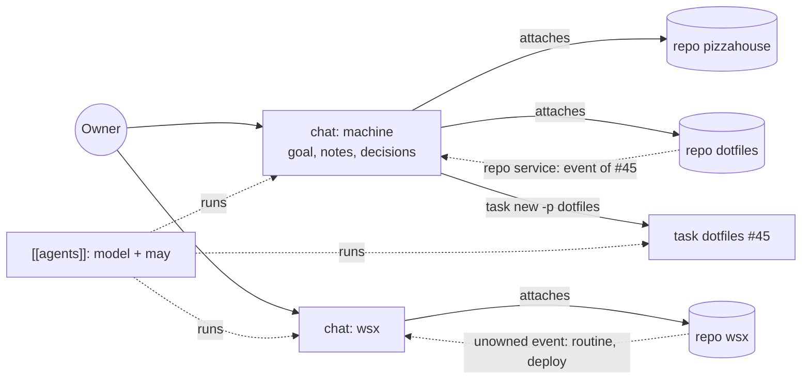
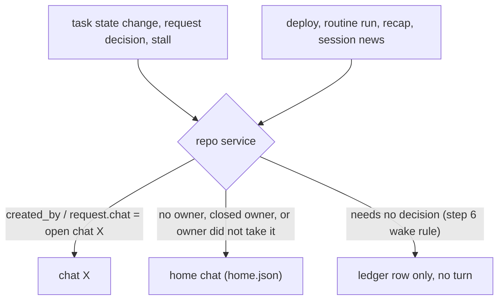
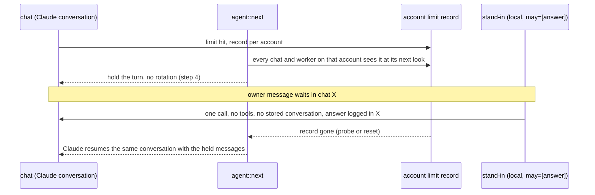
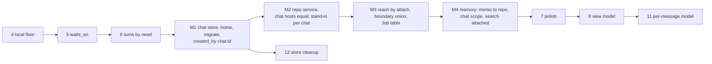

# Orchestration model: repos, chats, tasks and agents (design)

Status: design only, 2026-11-15, task #460. No code. It answers the owner (wsx 2026-11-15): one model in which wsx works smoothly, with speed, cost and quality measured, and with the fallback, the local model, permission and memory fitted in.

Assuming: the `tasks/chats/<id>/` folder and the `chat-host`/`repo-host` names are proposed names, not settled. Code lines are at `c3e163dc`. The numbers come from `docs/design/orchestration-model-measure.py` (read-only, stdlib) on `~/.local/state/wsx/tasks`, latest row 2026-11-14.

## 0. The answer

| Layer | Owns | Runs as |
|---|---|---|
| **Repo** (today's project) | tasks, worktrees, checks, deploys, releases, routines, approvals, memory facts | code only: one repo service per repo, with no agent (today's `Duties`) |
| **Chat** | a name, a goal, its conversation, its notes and decisions, the repos it attaches, the tasks and requests it made | one agent conversation; all chats are equal |
| **Task** | one repo, one branch, files and skills | a worker, as today |
| **Agent** | model, adapter and `may` | an `[[agents]]` entry; a chat or a task names one |

Every event goes to the chat that made its task or request. An event with no owner goes to the repo's **home chat**. A chat creates tasks directly in each repo it attaches. "Role" is left only as the table of three jobs (chat turn, stand-in answer, task step), which `may` filters.

The money case is small: the relay that this removes costs about 4% of manager spend. The large costs are event-only turns (49%), which refactor step 6 owns, and cold starts after rotations (11%). The model is worth doing for quality and for less code. A goal that spans repos gets one context, the owner stops routing between managers, and the first-chat special case leaves the code.

## 1. What the owner asked

| Message | Words (short) |
|---|---|
| iam-studio 836 | Chats are about context; cross-project work orchestrates itself; maybe a "team" concept |
| iam-studio 888 | team - goal - manager - projects (several) - members (several); add a *chat*, not a project; lift the project level to the chat/context level; "pizzahouse is really managing this machine" |
| wsx 4278, 4280 | different contexts with different goals in iam-studio; two chats in one project: separate contexts, they talk when needed, each searches its own |
| wsx 4284 | roles existed for two things: task scope, and permission for a weaker fallback model; "break this down to the absolute minimum" |
| wsx 4286 | destructive refactor, "I dont want the code to be additive" |
| wsx 4639 | spontaneous use; idle gaps start new conversations; wants context kept |
| decisions 2026-11-12 | on a usage limit fall back at most to a local model and let wsx live |
| 2026-11-13 | changing the model is risky: a stand-in never takes over the context; Claude resumes it |

## 2. The manager's analysis, checked

Source: `notes/chat-model-analysis.md` of the wsx manager. Method: section 6 and the script.

| Claim | Measured | Verdict |
|---|---|---|
| 16 projects with a manager log | 16 (5 other store folders are slots or `agents`) | right |
| 1 named chat ever | 1: iam-studio `research`, 44 lines, 11-11 to 11-14; it made 1 task | right (deleted chats cannot be seen) |
| ~200 manager-to-manager messages; from pizzahouse 58, wsx 53, dotfiles 28, iam-studio 26 | 369 received: 202 `manager:` and 167 `manager-reply:`. Sent: wsx 129, pizzahouse 88, dotfiles 56, iam-studio 37 | **wrong split**: the per-sender counts do not reproduce |
| owner messages: wsx 649, pr-review 167, iam-studio 146, pizzahouse 100, ir 43 | 650, 173, 146, 102, 43 | right within the log growth |
| rotations: wsx 145, iam-studio 56, pizzahouse 28 | 145, 56, 28 (313 in all) | right |
| a cross-repo goal is relayed manager to manager | **only partly.** Since #396 (landed 2026-11-11 13:39 UTC) the first chat creates tasks in another repo directly (`broker.rs:337`, `created_by: manager@<origin>`). After that, 62 messages arrived. In 30 sampled: 15 replies, 6 reports, 5 questions, 4 work requests. Only 1 task was ever made directly (dotfiles #44), while 10 jobs were still relayed after #396 | the relay is now a habit plus a gap: a **named** chat is refused every `-p <other>` command except `ledger` (`broker.rs:342`) |
| the first chat ranks above others because it holds `Duties` | `duties: chat.is_none().then(...)` (`crates/wsx/src/task/manager.rs:352`); the stand-in too (`manager.rs:2522`) | right, and the named chats also get no stand-in |

## 3. One model

### 3.1 Entities, ids, store

| Entity | Id | Store (target) | Today |
|---|---|---|---|
| Repo | store id `<slug>-<8 hex>` (`crates/wsx-core/src/task/store.rs:83`), unchanged | `tasks/<repo-id>/`: tasks `<n>/`, `approvals.jsonl` (`store.rs:1276`), deploys, locks, memory records, **`home.json {chat}`** | same, plus `manager/` and `chats/` inside it |
| Chat | name, unique on the machine (`chats::name_problem`, `chats.rs:46`) | `tasks/chats/<id>/`: `log.jsonl`, `state.json`, `notes/`, `goal.md`, `chat.json {agent?, repos: [repo-id...]}` | `tasks/<repo-id>/manager/` (first) or `chats/<name>/`; `ManagerDir.chat: Option` (`store.rs:1031`, `None` = first) |
| Task | `<repo> #<n>`, number per repo | unchanged; `created_by: chat:<id>` or `owner` | `created_by` is `manager`, `chat:<n>`, `manager@<origin>` or `owner` (`crates/wsx-core/src/task/mod.rs:319`) |
| Routine | path hash (`crates/wsx-core/src/routine/store.rs:75`) | unchanged | same |

`repos[0]` is the chat's default repo: its host runs in that main checkout, and `-p` may be left out for it.

### 3.2 Who owns which event

- One rule, `chats::owner` (`crates/wsx-core/src/task/chats.rs:108`), changes its fallback from "the first chat" to `home.json`. A missing or closed home is opened again by the repo service under the repo's name, so an unowned event is never lost.
- The routing at `manager.rs:1556-1561` loses its `Party::Project` arm (`crates/wsx-core/src/task/manager.rs:34`). The owner is always a chat.
- **The repo service** is today's `Duties` (`manager.rs:178-200`: store watch, stalls, approvals, deploys, routines, sessions, stale-worktree and capture sweeps, overview) in its own host `wsx task repo-host <repo-id>`, with no `ManagerDir` and no agent. It stays on, as the first chat's host does today; only a named chat's host leaves after `CHAT_LINGER` (`manager.rs:113`, `:1700`). So the count of always-on hosts stays one per repo.
- **A chat host** (`wsx task chat-host <id>`) only talks. It leaves 20 s after an empty queue, as named chats do today (docs/tasks.md "Chats"). The stand-in and the notes-view checks move into it, because they belong to a conversation.

### 3.3 Chats that attach several repos; Home and the lists

- `wsx task chat attach <chat> <repo>` and `detach` are the owner's commands. When a chat asks to attach a repo, an approval card comes up, as for `project add`. `chat new <name> [--repo ...]` defaults to the folder's repo.
- A repo is attached to any number of chats. Task numbers, branches `wsx/t<n>` and copies `<repo>-t<n>` are per repo, so nothing collides. Deploy and push locks stay per repo.
- **Web Home** shows one row per chat: name, goal line, repo labels, and the tray counts of what the chat owns (`home.js:186 ChatRow`, `trays.js:32 chatCounts`). Routes: `#/c/<chat>` for a chat and `#/p/<pid>` for a repo view (tasks, deploys, routines, panels, a link to the home chat). Task chips read `<repo> #<n>` when the repo is not the chat's default.
- **TUI**: the tree stays per repo, and `t` lists the repo's tasks. The chat list (`crates/wsx/src/task_list.rs:666`) lists every chat, with its repos before its goal.
- For pizzahouse ("manage this machine"), the owner renames its chat to `machine`, attaches dotfiles and the other repos, and sets it as their home. Two managers no longer relay to each other.

## 4. Agents and permission

| Piece | Today | Target |
|---|---|---|
| Agent | `[[agents]]` `AgentEntry` with `may` (`crates/wsx-core/src/config/global.rs:353`, `:380`) | unchanged |
| Job table | `policy::Role {Manager, Organizer, Worker}` (`crates/wsx-core/src/task/policy.rs:150`), capabilities at `:160`, `filled_by` at `:201` | the same three rows named `Job` (chat turn, stand-in answer, task step). This table is all that is left of "role" (Q5) |
| Reach | `broker.rs:304 reach`: the first chat gets `MANAGER_REACH` (`:295`) with `-p <other>`; a named chat is refused (`:342`); `say --from-chat -p` reaches another first chat (`:333`) | one rule: a chat may run any task command with `-p <repo>` when it attaches that repo. Approved actions (deploy, release, push) are asked as cards in that repo's `approvals.jsonl` with `chat` set. Any other repo is refused with "attach it first", and `ledger -p` stays a read |
| Creator | `creator()` writes `ManagerOf` when `WSX_TASK_FROM` differs (`crates/wsx/src/task/mod.rs:338`) | `chat:<id>` always; `Actor::ManagerOf` (`mod.rs:187`) and `origin()` are deleted |
| Chat boundary | `Boundary::manager(main, own, overview, policy)` for one repo (`crates/wsx/src/task/boundary.rs:102`): main checkout and git dir write-denied (`:104`), push exec denied (`:33`, `:358`) | the union over attached repos: each main checkout and git dir write-denied, its own chat folder writable, each repo's overview readable. Same secrets list (`boundary.rs:110`) |
| Worker boundary | `Boundary::worker` (`boundary.rs:81`), built from the task's repo and copy | unchanged |

A weaker agent is held back by its `may`, not by the chat. A chat that runs an agent whose `may` lacks `create_task` cannot create tasks in any repo.

## 5. Fallback and the local model

- **The account owns the limit, not the chat.** The record is per account (`crates/wsx-core/src/task/store.rs:470 mark_limited`, `:496 account_limit`), and `agent::next` (`crates/wsx/src/task/agent.rs:439`) reads it for every host. So a limit in one chat holds every chat and worker on that account at their next look, and each keeps its own conversation paused.
- **The agent owns its fallback chain.** Today `fallbacks` is "the project's list" (`agent.rs:436`, `tasks.manager.fallback` in `crates/wsx-core/src/config/project.rs:244`, the owner's list when the project names none at `:499`). A chat spans repos, so it reads the owner's list. A task keeps its repo's `tasks.agent.fallback` (Q3).
- **The stand-in answers in every chat.** Today only the host with `Duties` runs it (`stand_in_if_duties`, `manager.rs:2522`), so a named chat's owner gets no answer during a hold. The stand-in (`manager.rs:2579`) is stateless, so running one per chat with a waiting owner message costs one local call each and takes over no context.
- **The local floor** (step 4, #423, working): a Claude limit never rotates the conversation, and the local model only answers. This matches the outside practice that a fallback is per request with the same messages and no carried state (OpenRouter, section 10).

## 6. Memory

| Scope | Id | Holds | Written by |
|---|---|---|---|
| Repo | repo id (`crates/wsx-core/src/memory/store.rs:166 validate_scope`) | facts about the repo's files, a landed task's memo, the owner's repo rules | `fold_memo` in the repo service (`manager.rs:1502`), into the task's repo only |
| Chat | `chat:<id>` | goals, decisions, promises, the chat's own rules | the chat's agent; `notes/decisions.md` and `notes/context.md` stay the views (`tasks/chats/<id>/notes/`) |

- `fold_memo`'s second copy into the origin's scope (`manager.rs:1514-1525`, slug `memo-in-<project>`) is deleted. A chat's search covers the scopes of its attached repos, so a copy is not needed.
- `wsx task search` and `wsx memory search` from a chat read its own log, the chat scope and every attached repo scope with their task histories. Today `cli/memory.rs:372` reads only the own project's transcripts.
- **No start block.** The eval found the plan arm harms (+11.2% cost, 95% interval -4.8% to +21.4%; docs/design/memory-eval.md, "Plan arm" verdict). Decision #393 removed fact records from the start block. Search stays on demand until a measurement shows a gain.
- The first turn of a fresh conversation keeps today's notes and handover (docs/tasks.md "Manager", 10 KiB). A goal chat's notes are narrower than a repo's mixed notes, which is the quality gain the owner asked for in 4280.

## 7. Cost, speed and quality

Measured over 2026-10-16 to 11-14, 16 stores: 3,513 manager turns cost $663.51. wsx accounts for $401.95 (61%). A turn is a `reply` with `usage` and no `post`, and its cost is `usage.cost_micro_usd`.

| Measure | Value | Method |
|---|---|---|
| Event-only turns (every delivered id is from `events`) | 1,912 of 3,512 turns (54%), $327.86 (49%); last 7 days 529 of 1,107 (48%), $108.09 (45%) | `delivered` ids since the previous reply plus `reply.to` (they agree in 3,509 of 3,512 turns) |
| Cold start after a rotation | 274 first turns, median $0.409 against $0.131 for all turns: about +$76 in all (11%) | the turn after each `rotated` row. wsx reasons: 55 none, 44 instructions changed, 41 idle over 60 min |
| Relayed cross-repo job | 73 jobs (63 before #396, 10 after), median 6 turns, $1.109 | A's `sent`, then B's `manager:A` message within 3 min, then a single B task made in that turn or within 30 min. Count A's send turn, B's turns on the message and the task's events, B's reply turn, and A's turn that reads the reply |
| Direct cross-repo job | 1 (dotfiles #44): 6 turns, $3.04 | the creating turn plus the turns whose events name `dotfiles #44` |
| Saving per relayed job | 2 turns, $0.34 median (32%) | B's delivering turn, B's reply turn and A's turn that reads the reply drop out. Derived, not observed: the direct sample is 1 |

**Expected saving of this model, with its method:**

1. Relay: 73 jobs × $0.34 = **$25 over 29 days (3.7%)**. At the post-#396 rate (10 jobs in 3 days) it is about $1 a day, plus two agent hops of delay per job. The delay is not measured. Method: time from A's `sent` to B's `new` in the same script.
2. Event-only turns: the model does not lower these. Step 6's wake rule does. The model gives that rule one home (the repo service) and sends each event to one chat only.
3. Rotations: the model does not lower these. More chats mean more first turns at $0.41 each. A goal chat's context grows more slowly than a mixed repo chat's, but that is **not measured**. Method: after migration, compare rotations per 100 turns and the median `context_tokens` per chat against today's per-repo values.
4. Quality: not measurable from today's logs. Proxy after migration: the share of cross-repo tasks made directly (today 1 of 74) and owner messages that route work between chats (target 0).

## 8. Migration: no data lost, no second structure

`chats::migrate` (`chats.rs:335`) already moves `roles/` to `chats/` once per store, under `migrate.lock`, and is idempotent. It gains these moves:

| Today | Target |
|---|---|
| `tasks/<repo-id>/manager/` | `tasks/chats/<repo-name>/` with `repos: [repo-id]`; `tasks/<repo-id>/home.json` names it |
| `tasks/<repo-id>/chats/<n>/` | `tasks/chats/<n>/`, or `<repo-name>-<n>` when the name is taken; `closed` is kept |
| `created_by`: `manager`, `chat:<n>`, `manager@<origin>` | `chat:<repo-name>`, `chat:<new id>`, `chat:<origin-name>` (1 task) |
| approval lines: `chat` absent or `<n>` | `chat:<id>` written out |
| log rows `from: manager:
`, `manager-reply:
` | kept as history; new talk is `chat:<id>` |
| sessions `task-manager`, `task-<n>` | `repo-<name>` and `chat-<id>`; the old `manager-host` argv starts the new host for one release (live handoff) |
| web `#/p/<pid>` as the chat | `#/c/<chat>`; `#/p/<pid>` stays as a redirect to the repo view |
| routines, panels, memory records | unchanged keys; routine results go to the home chat |

The move is a rename on one filesystem. Nothing stays under the old paths, and a store whose folders are already moved is left alone.

**Code it deletes:** `Duties` inside the chat host and `duties: chat.is_none()` (`manager.rs:182`, `:352`), `stand_in_if_duties` (`:2522`), `Party::Project` (core `manager.rs:34`) and its routing arm (`manager.rs:1556-1561`), `Actor::ManagerOf` and `origin()` (core `mod.rs:187`, `:236`), the `ManagerOf` branch of `creator()` (`task/mod.rs:338-340`), `MANAGER_REACH` with the per-actor `-p` table (`broker.rs:295-346`), `say --from-chat -p`, `record_memo_at` (`manager.rs:1523`), `ManagerDir.chat: Option` (`store.rs:1031`), and docs/tasks.md "Managers talk".

## 9. Fit with the root-cause refactor

| Refactor step (docs/design/root-cause-refactor.md) | State (task.json) | Change |
|---|---|---|
| 1, 2, 3, 3a, 9, 10 | landed (#452, #458, #459, #453, #441, #442) | none. Step 2's main-checkout denial becomes the union in section 4 |
| 4 local floor, #423 | working | keep. M2 moves the stand-in from `Duties` to every chat |
| 5 `waits_on`, #443 | waiting | keep. `waits_on: manager` reads as "the owning chat" |
| 6 turns by need | not started | do before M. Its wake rule (`state_wakes`, core `manager.rs:313`) moves into the repo service in M2 |
| **M1 to M4 (new)** | | after 6, before 7 |
| 7 UI polish (7a landed, #454) and 8 view model, #444 | waiting | after M, so Home and the lists are drawn once on chats |
| 11 per-message model, #439 | waiting | after M; the model choice is per chat |
| 12 store cleanup, #447 | waiting | takes over the leftover loose notes; M1 owns the folder moves |

Each M step proves itself with `task` (a new `test-task.py` section: two fixture repos, a chat that attaches both, a task in each, events to the right chat, an unowned routine result to the home chat, a refused unattached repo, and a migrated fixture store with no file left behind). M3 also needs `boundary`, M4 needs `memory`, and Home in step 7 needs `web`.

**Not to build:** teams, members or roles as entities; a group chat; shared context between chats (talk by `say --to <chat>` and search only); per-chat permission lists; a fallback chain owned by a chat; a memory start block; keep-alive pings or a written handover (#456 measured it and did not adopt it); a host queue for overlaps (refactor §4).

## 10. Earlier attempt and outside practice

**teams.md** (`git show 960315f0:docs/design/teams.md`), deleted in `6fb80619` under #418:

- *Right:* the store id stays the key; task numbers stay per repo, so branches never collide; deploy locks stay per repo; a plain project stays the same; `<project> #<n>` chips; team scope for decisions and repo scope for facts; one module decides who hears a task.
- *Dropped:* it was additive. It put `[[teams]]` and members on top of project, manager and roles. #410 removed roles (wsx 4284 to 4287), and the owner asked for destructive work, not additive (4286). Its team id was the main project's store id, which keeps the chat bound to one repo, the coupling 888 asked to remove.

| System | Fact used here |
|---|---|
| Claude Code subagents ([docs](https://code.claude.com/docs/en/sub-agents), seen 2026-11-15) | each subagent has its own context window and its own `tools` allow and deny lists; only its summary returns. Matches: a task is a worker with its own context; a chat gets results, not transcripts |
| Anthropic multi-agent research ([post](https://www.anthropic.com/engineering/multi-agent-research-system)) | multi-agent uses about 15x the tokens of chat and fits parallel work badly when the work needs shared context (most coding). Matches: one chat per goal, no chat-to-chat context sharing |
| OpenAI Agents SDK ([handoffs](https://openai.github.io/openai-agents-python/handoffs/), [patterns](https://openai.github.io/openai-agents-python/multi_agent/)) | as a tool, the manager keeps control and owns the answer; in a handoff, the other agent takes over. Today's relay is a handoff between managers; the model makes cross-repo work a tool call (a task) of one chat |
| OpenRouter fallbacks ([docs](https://openrouter.ai/docs/guides/routing/model-fallbacks)) | a fallback is per request, gets the same messages and carries no state. Matches the stand-in: one stateless call, and the primary keeps the conversation |

## 11. Questions for the owner

| # | Question | Recommendation |
|---|---|---|
| 1 | Move chats out of the repo stores into `tasks/chats/<id>/`, with the web route `#/c/<chat>`? This is destructive: paths and routes change. | Yes. Leaving them under one repo keeps the coupling 888 asked to remove |
| 2 | Every repo has one home chat, named after the repo at migration, which you may repoint (pizzahouse and dotfiles to `machine`)? | Yes |
| 3 | A chat's fallback list comes from your global `tasks.manager.fallback` only, and the per-repo manager key is retired? Workers keep their repo's list. | Yes |
| 4 | Talk between chats is only `say --to <chat>`, and `say -p <repo>` (the relay to a first chat) is removed? | Yes. 15 of 30 sampled messages after #396 were replies to such relays |
| 5 | Rename `policy::Role` to `Job` (chat turn, stand-in answer, task step), so nothing called "role" is left? | Yes, in M3. It is a rename with no behavior change |
