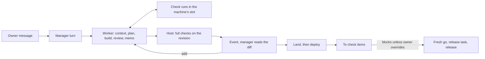
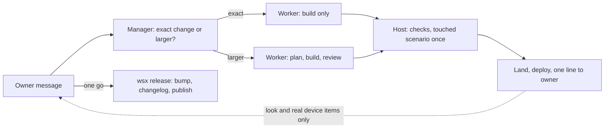

# Orchestration review: is wsx's manager and worker setup worth it?

Status: review of wsx on this repo only, 2026-10-31. `[name]` = measured, rerun in "Sources" (live logs drift a little); `(est.)` = estimated.

| Question | Verdict | The number behind it |
|---|---|---|
| 1. More efficient than one owner session per change? | **No on tokens. Yes only on commits per day**; changed lines per day did not rise | 179 against 101 output tokens per changed line, manager not counted [git, transcripts] |
| 2. Leaner, achieving more or on par? | **Not leaner.** It achieves more, at a high cost to own | 0 to 14,887 lines of task code in 15 days; 49% of non-move changes went to the task system itself [wc, git] |
| 3. Lower load on the owner? | **Lower per commit, not per day.** Reading and typing stayed flat, new concepts were added | 29 against 31 owner messages per day; 13 To check items open [manager log, transcripts, checks] |



The minimum, and the smallest flow recommended. Who decides: the owner decides what, and when it goes public; the manager decides how. Who works: one worker in one copy. What proves it: the host's checks on one commit. What the owner sees: the result, and only decisions nobody else can make.



## Part by part

| Part | Use here | Verdict | Why |
|---|---|---|---|
| Task record, log, ledger, working copy | 164 tasks | Keep | The minimum memory, plus the baseline's worktree; this review runs on them |
| Manager agent | $112.53, 797 replies since 10-24 | Simplify | Keep triage and review; usage audit lever 6 removes turns on quiet events |
| Events to the manager | 524 since 10-24, 267 quiet replies | Simplify | The host can handle `landed` and `closed` with no model turn |
| Five worker steps | all, unless `--skip` (22 commands) | Simplify | An exact change does not need them; see #162 |
| Host checks | 416 runs | Keep | The only proof a worker cannot fake |
| Worker check runs and slot | 647 runs, 54 min wait per landed task | Simplify | The slot is needed on one machine; the wait comes from the long web scenario |
| Land, conflict return, deploy | 175 lands, 52 conflicts, 172 deploys | Keep | Real owner load removed |
| Batch land, trial, parent tasks | 0 manager batch lands since 10-29, 0 trial log events since 10-23, 0 `--into` | Remove | Never used here; a faster web scenario treats the cause batch land was for |
| Hold | 8 tasks | Simplify | Owner called it hard to follow (10-24); keep the one line on the record |
| Preview, by hand | 0 manager previews, owner clicks not logged; 0 by-hand log events | Simplify | Live deploy covers this repo, other product kinds not measured; opening the worker's session is the whole need (msg 1894) |
| To check | 69 items, 3 failed | Simplify | Look and real device only; no release gate |
| Approvals, `--owner-said` | 10 distinct owner messages | Simplify | Keep for public or lost work; stop logging retries |
| Release | 4 tags since 10-27, one failed preflight | Simplify | Version and changelog are fixed steps, not a task |
| Routines, recap, notifications | 5 routine commands, 20 recaps | Keep | Routines are older than tasks and run in wsxd; the owner being away is the point; wsx writes the text |
| Web view, TUI view, `scripts/usage-report.py` | main surface; TUI 680 lines | Keep | Both views read the same record; without the report none of this is measurable |

## Recommendations, ranked

1. **Size the work to the change.** Removes for an exact change: the review and memo steps, and every scenario the change does not touch. #162 lost 18.6 min to a web rerun after a failure under load, so items 1 and 3 together give a one-sentence change in about 15 min, not 33 (est.).
2. **Make release one wsx verb.** `wsx task release <version>` bumps the version, moves the changelog entries, runs preflight before it asks, and takes one go that names a commit or "after #n lands". Removes the #161 kind of task ($0.31, 5.3 min, `161/log.jsonl`), the preflight failure and the second go. The owner gets one word per release.
3. **Make the web scenario reliable and short.** It failed 177 of 408 runs [task logs]. First split real failures from flakes: the logs do not separate them. Removes retries and queue time. The owner gets faster lands and fewer "failed once under load" notes.
4. **Stop To check from gating a release.** Allow only look and real-device items; close unanswered items at the next release. Removes the override message per release and old items. The owner gets a short list where a verdict matters.
5. **Remove trial, parent tasks, roles and batch land.** Removes 534 lines in `trial.rs`, `roles.rs` and `batch.rs`, code in other files (not counted), 3 verbs and about 54 doc lines. Roles and batch land are only 2 days old, and other projects were not measured. The owner gets fewer concepts.

## Question 1: efficiency against the plain baseline

The baseline is real but thin: the owner's 9 Claude sessions in this repo on 10-11..15, just before the manager started on 10-16. It covers only 5 days. It mostly built new web client code, which is cheap per line: `feat` commits are 39% there and 11% in the task window, where test, fix and refactor commits are 74% [git]. Subagent files are left out on both sides. Elapsed time and turns per change have no baseline, because a session is not a change: **not measurable**.

| Measure | Baseline, 5 days | Tasks 10-24..31, 8 days | Source |
|---|---|---|---|
| Commits per day; median changed lines per commit | 17.6; 132 | 58.3; 20 | [git] |
| Changed lines per day, without 9 pure-move commits (63,480 lines) | 6.2k | 5.3k | [git] |
| Output; cache-read tokens per changed line (all Opus; 8% of worker calls Sonnet) | 101; 30.3k | 179; 47.4k, workers only | [git, transcripts] |
| Model calls per commit; per 1,000 changed lines | 36; 102 | 28; 304, workers only. A landed task is 6.0 worker turns [report] | [git, transcripts] |
| Dollars per 1,000 changed lines | $11.1 (est.: $25 output, $10 write, $0.50 read per million, x 0.5, the ratio of [report] to that formula on workers) | $21.6 ($803.30 workers + $112.53 manager) | [report] |
| `fix` commits as a share of all commits; reverts | 35%; 0 | 27%; 0 | [git] |

- **Tokens: no.** Cost per changed line is about 2 times higher (est.); the mix of work explains an unknown part of that. The manager adds 14% on top of workers [report].
- **Elapsed time: mixed.** Commits arrive 3.3 times as fast, but they are smaller, and lines per day fell 14%. A landed task takes a median 112 min and waits 54 min on checks on average; 22 of 124 landed in under 30 min [task logs, report].
- **Rework: some gain, not proven.** 0.5 send-backs and 1.7 failed check runs per landed task are caught before land [report]; the baseline has no such count. The manager caught #161's changelog entry under 0.6.0 (msg 1917); a script could catch that too. Quality after landing is not traced (`docs/design/usage-audit.md`).
- **Small changes are clearly worse.** #162 changed one sentence: 33.3 min, $0.40, the web scenario failed under load at 14.1 min and passed on its rerun at 32.7 min (`162/log.jsonl`). The same edit by hand takes a few minutes (est.).

## Question 2: what it costs to own against what it achieves

| Cost to own | Count | Source |
|---|---|---|
| Task code, core + CLI | 14,887 lines, 26 files (10,018 on 10-24; 0 on 10-16) | [wc] |
| Web and TUI task views; task scenario scripts | 5,111 lines; 5,740 lines | [wc] |
| Docs | 547 lines, 135 KB; `docs/tasks.md` went from 315 to 428 lines since 10-24 | [wc] |
| CLI verbs; states | 30 `wsx task` verbs, plus 11 routine, 3 role, 3 check; 7 task states, 6 wait reasons, 26 log kinds used, 4 To check states | [wc, task logs] |
| Manager prompt; notifications | 138-line function, 10 KB of source, median context 99k tokens; 2 channels (one push, daily digest), 9 kinds of change | [wc, manager log] |
| Non-move changes spent on the task system | 49% (20,533 of 42,316 lines) | [git] |

What the baseline cannot do: work goes on while the owner is away or on a phone (mean 3.5 tasks open, peak 11), and resumes by itself on 8 tasks after a session limit and 14 after a disk wait. 52 landing conflicts went back to the worker, not the owner. The manager survived 70 rotations through the task record. Checks a worker cannot fake are bound to one commit. Cost per turn is traced at all [task logs, manager log, report]. The owner's rule of 10-24 says changes must replace, not add (`decisions.md`), yet task code grew 49% in 7 days. **Not leaner; ahead on unattended running and proof; behind on cost.**

## Question 3: load on the owner

| Measure | Baseline | Tasks | Source |
|---|---|---|---|
| Owner messages per day; per commit | 30.6; 1.7 | 29.1; 0.5 | [transcripts, manager log] |
| Agent text per day, characters | 44k | 47k of chat replies, plus 65 event lines a day; task reports not counted | same |
| Replies ending in a question, per landed task | not measurable | 0.7 | [manager log] |
| To check items | none | 69 items on 41 tasks; 13 open, oldest 2.4 days | [checks] |
| Concepts to know (est.) | about 6: worktree, session, branch, merge, checks, release | about 20: task, revision, manager, worker, step, land, deploy, release, hold, trial, preview, by hand, To check, check slot, approval, go, routine, role, recap, digest | `docs/tasks.md` headings |

- **Removed from the owner:** watching terminals, permission prompts, rebases, running checks, landing, 172 deploys [deploys].
- **Moved onto the owner, To check:** every item waits for a verdict, yet only 3 of 56 verdicts were fail, all phone layout (c8, c9, c15). The owner overrode the release gate in msgs 1189, 1799 and 1912 [checks, `decisions.md`].
- **Moved onto the owner, release:** the go in msg 1912 was spent on a release that failed preflight, since nobody had bumped the version; msg 1919 asks again. The earlier yes in msg 1791 was refused in msg 1794 [manager log]. Approvals name 10 distinct owner messages, but the log holds 167 requests, 149 of them on 10-28 while a deploy ran [approvals].
- **Direction:** about 47 of 116 `decisions.md` lines concern how this system's web, chat or TUI looks or reads, and 6 replace an earlier line (est., keyword count). The owner steers the tool as much as the work.

## Sources

Run from the repo root. `[report]`: `/usr/bin/python3 -B scripts/usage-report.py ~/.local/state/wsx/tasks/wsx-8cbe3f08 --since 2026-10-24`. `[wc]`: `wc -lc` on `crates/wsx-core/src/task/* crates/wsx/src/task/*`, `docs/tasks.md docs/web-client-tasks.md`, `crates/wsx-web/web/{tasks,task,checks}.js crates/wsx-web/src/{tasks,chat}.rs crates/wsx/src/ui/{tasks,task_chat}.rs`, `scripts/{test-task.py,web-tasks-check.mjs}`; past sizes: `git show $(git rev-list -1 --before=<date> HEAD):<path>`; verbs and states: `crates/wsx/src/task/mod.rs:71`, `crates/wsx-core/src/task/mod.rs:29`; prompt: `crates/wsx/src/task/manager.rs:179`; notifications: `docs/web-client-tasks.md` "Task notifications". Tags: `git tag`. Msg numbers: `manager/log.jsonl`. Transcripts can age out of `~/.claude/projects`. Dates: git local, transcripts UTC. The manager can also read `wsx task ledger -p wsx --json`. All other tags print from this block:

```python
import collections as C,glob,json,os,re,statistics as S,subprocess as P,datetime as D
E=os.path.expanduser;ST=E('~/.local/state/wsx/tasks/wsx-8cbe3f08');PR=E('~/.claude/projects');W=[('base','2026-10-11','2026-10-16'),('task','2026-10-24','2026-11-01')]
def jl(p): return [json.loads(l) for l in open(p,errors='ignore') if l.strip().startswith('{')]
win=lambda t:next((n for n,a,b in W if a<=t<b),None); T0=D.datetime(2026,10,24).timestamp()*1e3; SYS=re.compile(r'wsx-core/src/task/|wsx/src/task/|wsx/src/ui/task|web/tasks|web/task\.|web/checks|wsx-web/src/(tasks|chat)|scripts/(test-task|web-tasks)|docs/(tasks|web-client-tasks)')
g=C.defaultdict(lambda:[0,0,''])
for l in P.run(['git','log','--no-merges','--format=@%ad %h %s','--date=short','--numstat','--','.',':!vendor',':!Cargo.lock'],capture_output=True,text=True).stdout.splitlines():
    if l[:1]=='@': w=win(l[1:11]); k=(w,l.split()[1]); g[k][2]=' '.join(l.split()[2:]) if w else ''
    elif l and w and l[0]!='-': a,d,p=l.split('\t'); g[k][0]+=int(a)+int(d); g[k][1]+=(int(a)+int(d)) if SYS.search(p) else 0
for n,_,_ in W:
    c=[v for k,v in g.items() if k[0]==n]; mv=[v for v in c if v[2].startswith('refactor') and v[0]>=1900]; print('[git]',n,'commits',len(c),'median',S.median(v[0] for v in c),'lines',sum(v[0] for v in c),'moves',len(mv),sum(v[0] for v in mv),'fix',sum(v[2].startswith('fix') for v in c),'revert',sum('revert' in v[2].lower() for v in c),'system',sum(v[1] for v in c),C.Counter(re.split(r'[(:!]',v[2])[0] for v in c).most_common(4))
t=C.defaultdict(C.Counter)
for d in os.listdir(PR):
    if not d.startswith(E('~/ws/wsx').replace('/','-')) or '--work' in d: continue
    who='task' if re.fullmatch(r'.*wsx-t\d+',d) else 'base' if not re.search(r'wsx-t\d+',d) else None
    for f in glob.glob(f'{PR}/{d}/*.jsonl') if who else []:
        seen=set()
        for r in jl(f):
            if win(r.get('timestamp',''))!=who: continue
            m=r.get('message') or {}
            if r.get('type')=='user' and not r.get('isSidechain') and not r.get('isMeta') and isinstance(m.get('content'),str) and not m['content'].lstrip().startswith('<'): t[who]['owner']+=1
            if r.get('type')=='assistant' and m.get('id') not in seen and m.get('model')!='<synthetic>':
                seen.add(m.get('id')); u=m.get('usage') or {}; t[who]['calls']+=1; t[who]['sonnet']+='sonnet' in m.get('model',''); t[who]['out']+=u.get('output_tokens',0); t[who]['cw']+=u.get('cache_creation_input_tokens',0); t[who]['cr']+=u.get('cache_read_input_tokens',0); t[who]['text']+=sum(len(b.get('text','')) for b in m.get('content') or [] if isinstance(b,dict))
print('[transcripts]',dict(t)); ml=jl(ST+'/manager/log.jsonl'); new=[d for d in ml if d['unix_ms']>=T0]; nq=[d for d in new if d['kind']=='reply' and not d.get('quiet')]; f=lambda n:sum(d['kind']=='message' and d.get('from')==n for d in new)
print('[manager log] owner',f('owner'),'events',f('events'),'recaps',sum(d.get('from')=='recap' for d in ml),'replies',sum(d['kind']=='reply' for d in new),'not quiet',len(nq),'chars',sum(len(d['text']) for d in nq),'end in ?',sum(d['text'].rstrip().endswith('?') for d in nq),'rotations',sum(d['kind']=='rotated' for d in ml),'median context',S.median(d['usage']['context_tokens'] for d in ml if d['kind']=='reply' and d.get('usage',{}).get('context_tokens')))
ck=C.defaultdict(list); [ck[d['id']].append(d) for d in jl(ST+'/checks.jsonl')]; print('[checks]',len(ck),'tasks',len({v[0]['task'] for v in ck.values()}),C.Counter(v[-1]['state'] for v in ck.values()),'failed',[k for k,v in ck.items() if v[-1]['state']=='failed'],'oldest open days',max((ml[-1]['unix_ms']-v[0]['unix_ms'])/864e5 for v in ck.values() if v[-1]['state']=='open'))
ap=jl(ST+'/approvals.jsonl'); print('[approvals] requests',C.Counter(a.get('action') for a in ap if a['kind']=='request'),'on 10-28',sum(a['kind']=='request' and D.datetime.fromtimestamp(a['unix_ms']/1e3).strftime('%m-%d')=='10-28' for a in ap),'distinct owner messages',len({a['owner_said'] for a in ap if a.get('owner_said')}))
J=[d.get('text','') for d in ml if d['kind']=='agent']; print('[deploys]',len(jl(ST+'/deploys.jsonl')),'[use]',{p:sum(bool(re.search(p,x)) for x in J) for p in ['task land \\d+ \\d+','--skip','--into','task trial','task role','task preview','task routine','routine add']})
k=C.Counter(); tk=C.Counter(); r=C.defaultdict(lambda:[0,0]); wall=[]; iv=[]
for f in glob.glob(ST+'/[0-9]*/log.jsonl'):
    q=jl(f); k.update(d['kind'] for d in q); tk.update({d['kind'] for d in q}); ld=next((d['unix_ms'] for d in q if d['kind']=='landed'),0); end=next((d['unix_ms'] for d in q if d['kind'] in('landed','closed')),q[-1]['unix_ms'])
    if q[0]['unix_ms']>=T0: iv+=[(q[0]['unix_ms'],1),(end,-1)]; wall+=[(ld-q[0]['unix_ms'])/6e4] if ld else []
    for d in q:
        for x in d.get('results') or []: n=x['command'].split('&& ')[-1]; r[n][0]+=1; r[n][1]+=bool(x.get('exit'))
o=p=peak=area=0
for a,d in sorted(iv): area+=o*(a-p) if p else 0; p=a; o+=d; peak=max(peak,o)
print('[task logs] events',dict(k),'tasks with kind',dict(tk),'runs, failed',dict(r),'landed since 10-24',len(wall),'median min',S.median(wall),'under 30',sum(w<30 for w in wall),'open mean',area/(p-sorted(iv)[0][0]),'peak',peak)
```
