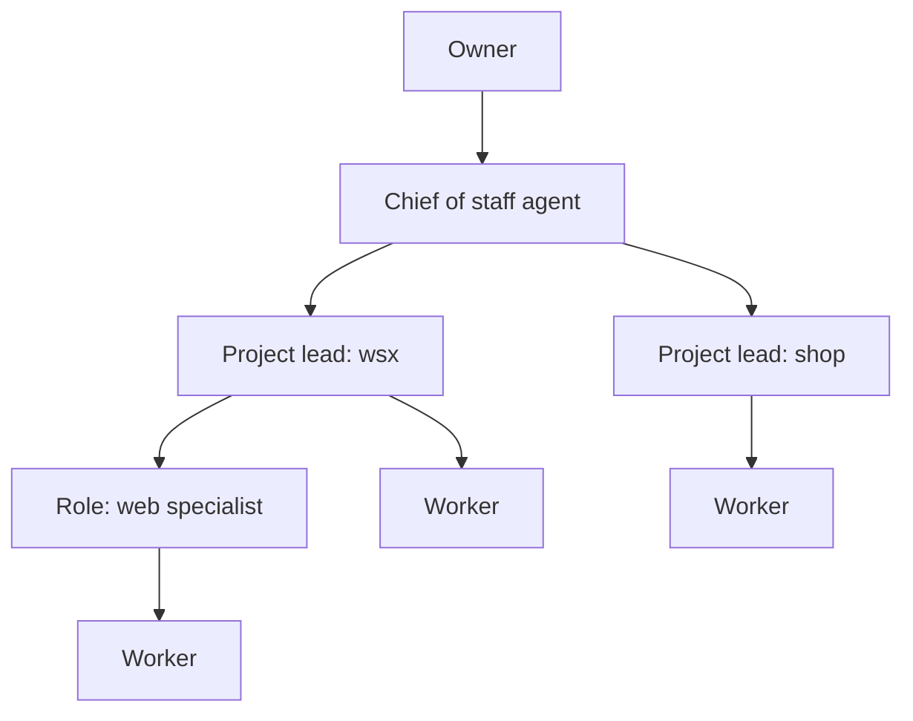
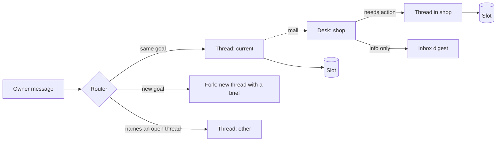
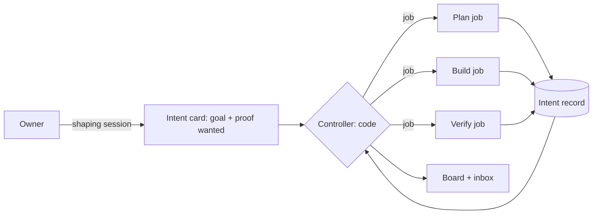
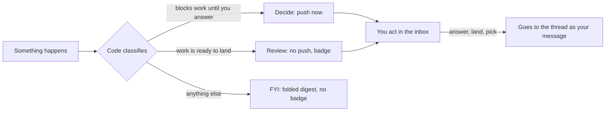

# Orchestration: threads, desks and slots

Status: proposal, 2026-11-23. No code. Owner mandate: a complete refactor of the aligned orchestration system that
replaces manager chat. It replaces `manager-mode.md` (goal chats, which the owner no longer wants; removed, see git history) and
changes step 1 of [lean.md](lean.md) (the phase model moves from task to thread).
Evidence: the audits deleted in `285af8cc` and `73bce862` (read with `git show <hash>^:docs/design/<file>`) and an outside
survey (section 10). The live task store was not found at `~/.local/state/wsx/tasks` on this Mac, so no new run data was measured.
`(est.)` marks a number that was not measured.

## 1. What the evidence says before any design

The numbers are from 2026-10-28 to 2026-11-20. The last column says what shipped after the measure, so a number may be lower now.

| Brief's premise | What was measured | Consequence | Shipped since |
|---|---|---|---|
| Shipping got slow because the manager queues, leases and offloads | A landed task takes p50 89 min, p90 381 min. Check-run waits are 49.8% of that time, and worker turns are 9%. Ready to land is p50 0.3 min (task-time-cost-audit, 11-13) | The hierarchy is not the bottleneck. The gate is. Every approach below changes the gate the same way (section 3) | Scenarios run on this Mac only (`[Unreleased]`); a check-run never holds a task (`885b67d7`, 11-22). Not measured again |
| The gate proves the change works | 227 of 318 `web` runs failed. 108 of those were fixed only in `scripts/`. Workers were told to edit the asserts they broke (verification-bottleneck, 11-14) | A pass meant "the script matches this tree", not the owner's decided behavior | `wsx.config.yml` now allows an assert edit "only for a core contract or a bug", and "if your change was the decided behavior". The worker still judges that |
| Memory can carry context across rotations | Start-block facts had a recall of 0.07 against a 0.60 target, and the verdict was "harms". Hiding stale facts was the loss: 94% of facts were marked stale. Memory-based rotation scored 0.69 of 2 [unverified]. A written handover tied with a fresh start (memory-eval, manager-continuity) | Memory is for lookup on demand. Continuity has to come from conversations that are small enough not to rotate | Worker start blocks carry no facts (#393) |
| Forking a conversation keeps the context clean | Threads inside a chat were built and then removed (flat-chats). A search seeded with the owner's message recalled 0.00 to 0.30 of a thread. One conversation per thread was modelled at +$20 to $98 per week in cold starts (thread-context) | A fork must carry its context at birth. It must not reconstruct the context later | nothing |
| Splitting work helps | A follow-up as an add took 17 min and $0.93. As a new task it took 43 min and $2.05. 86% of follow-ups start inside 24 h (work-model) | Continue a line of work by default. Fork only for a separate goal | nothing |
| A manager agent should watch events | Event-only turns were 49% of manager spend (orchestration-model). In a replay most of them did nothing [unverified count] | No LLM turn on an event. Code handles events | 0.43.0: a landing, a close, a limit wait and a deploy no longer start a manager turn. Other event turns remain |
| More structure lowers owner load | Concepts rose from about 6 to about 20, and owner messages per day stayed at 29 against 31 (orchestration-review) | Count the concepts of each approach and cap them | nothing |

Outside evidence points the same way. Anthropic names "most coding" a poor fit for multi-agent work. Cognition defaults to one
linear agent. Every shipped tool gives the human one artifact per unit of work (a PR, a diff, a plan), not a stream of
messages (section 10).

## 2. Goal and judge

- **Goal beyond the goal:** the owner ships across many projects with less attention than one focused session, and the
  machine never fills up.
- **Hard targets:** a small change goes from first message to landed in p50 15 min or less (now 65.9 min). No LLM turn
  is started only by an event. Disk for working copies is bounded by a slot count, not by a task count. The owner learns
  5 concepts or fewer. The owner gets 10 or fewer decision items per day.
- **Outside judge:**
  - **Replay:** a logged day's owner messages from a chat log, replayed through the new router and engine with the fake
    agents (`scripts/fake-claude-stream.py`, `fake-pi-rpc.py`). It measures routing against a hand-labelled answer, LLM
    turns, peak disk and time to proof.
  - **Scenarios:** one scenario per walkthrough row of section 7, run through the real entry point.

## 3. Shared ground under every approach

These four parts are the same whichever approach wins. They carry most of the measured gain.

1. **Gate: owner-decided proofs only.** This extends `lean.md` steps 3 and 4 (nextest as the default gate, scenarios
   in tiers). The new part is the contract file and the triage.
   - Plain checks (fmt, build, nextest; p50 1.7 min) gate every land.
   - Scenario asserts that encode decided behavior live in contract files. A worker cannot edit a contract file. Only
     the owner's approved change to it can, so a red contract is a real red.
   - Scenarios run by changed path, and once on main after each batch of lands.
   - A red result that is not the task's own (main already red, an infrastructure failure) is triaged by code against
     main's last result. It is never charged to the task.
2. **Slots, not worktrees per task.**
   - Each project has N working-copy slots (default 2, a machine cap across projects).
   - A slot is a git worktree plus its own `target/`, and it is reused: a new line of work runs `git switch -c` in a free
     slot. Its build stays warm, and disk is N times one build. The Rust project measured one dev `target/` at 3,151 MiB.
   - A shared `CARGO_TARGET_DIR` is rejected: builds lock it one at a time. sccache does not cache bin or proc-macro crates.
   - The existing scheduler (`wsx_core::task::schedule`, `crates/wsx/src/task/slot.rs`) stays the one owner of heavy runs.
   - A slot idle 1 h drops its `target/` (an open item of the removed manager-mode.md).
   - A thread keeps its slot until it lands, or until it waits on the owner for over 1 h. A reopen takes any free slot
     and resumes its conversation by session id. Claude finds a session by folder (work-model), so wsx must move the
     session to the new slot's path, or keep slot paths stable per thread. Which one works for Claude and Pi is
     [unverified].
3. **Memory: canon plus search, nothing injected.**
   - Canon: what the owner accepted (`CLAUDE.md`, `docs/`, the desk's decision list, 4 KiB or less).
   - Record: every log, decision, proof and diff, append-only and source-linked, found with `wsx search`.
   - No fact block goes into a prompt. Nothing is hidden as stale, since hiding was the measured loss (94% of facts were
     marked stale). A hit shows its date and the commit it names, and the reader judges it.
4. **Landing per project:** `land: local` (fast-forward after plain checks, as today) or `land: pr` (push a branch and
   open a PR; CI and review happen on GitHub). Every unit of work ends in one **proof card**:
   - the diff stat
   - the commands run and their exit codes
   - for a visual project, captures of each option at the project's widths
   - for a non-visual project, the output excerpt that proves the behavior
   - while the slot runs, a **preview**: the project's `watch` or `dev` command on a leased port, the same watch script as before

## 4. Approach A: Company (long-lived agents hold the context)



- A standing LLM agent per level. The chief of staff talks to the owner and routes. A project lead owns its project's plan.
  A role specialist owns an area of a monorepo. Workers are ephemeral.
- Manager-to-manager talk is native: leads message each other.
- **Inside:** context lives in the leads' conversations, so they rotate. A fresh start lost to the long conversation in 4
  of 14 judged mid-work cases (manager-event-model). Each hop is a relay (73 relayed jobs, median 6 turns, $1.11 each).
  Leads watching events is the 49% spend again.
- **Owner:** one voice, which feels calm. Status is second-hand, though: the owner hears what the chief of staff
  understood, and the "relayed worker claims taken without checking" failure (manager-reliability) has two more hops.
- **Concepts:** chief of staff, lead, role, worker, task, mailbox, inbox, slot, proof (9).

## 5. Approach B: Threads and desks (the owner's conversations hold the context)



- **Thread:** one goal, one agent conversation, as capable as a single session: same tools, skills, boundary and
  approved runs. It is synchronous while the owner is in it, and it goes to the background when the owner leaves.
  Workers are its subagents, for independent questions and searches. A thread lives until its goal lands, and an add
  within 24 h reopens it with its conversation (the measured cheaper path).
- **Fork:** when the owner says something with a different goal, the router forks. There are two cases:
  - An unrelated aside: the owner's message is the whole brief. The current thread takes no turn and is untouched.
  - A part of the current goal ("do the tests for this in parallel"): the current thread writes the brief in one short
    turn, while it still has the context, so there is no seed search later.
  The owner sees a chip, "forked to *thread name*", that undoes the fork in one tap.
- **Desk:** one per project. Its core is code: a memory scope, a mailbox, the slot pool, the policy and the deterministic
  event handling. It grows from today's repo service (`wsx task repo-host`), which already owns the store watch, stalls,
  approvals, deploys and routines. A desk starts an LLM turn only for mail that asks for action. Then it opens a thread
  in that project with the mail as the brief. The security fan-out works this way: one thread mails every desk, each
  desk with matching dependencies opens a thread, and the owner sees them grouped under the origin.
- **Desk lead (owner's choice 1):** an always-open thread per desk with no goal of its own. It takes a message sent to
  the project with no open thread, and talk between projects. It never watches events, and it forks every goal it hears.
  Without it, such a message opens a new thread.
- **Role:** a desk profile (path globs, skills, model, memory area). A thread can open "at" a role. The owner can talk to
  it, since it is a thread, but usually the owner talks to the project desk's threads.
- **Router:** the cheapest model plus rules. It reads the message, the current thread's goal line and the goal lines of
  open threads. It never reads full conversations. Ambiguous means stay in the current thread.
- **Multi-day goal:** a goal thread keeps `plan.md` in the desk record and forks child threads per part. Its own
  conversation stays short because the children hold the detail.
- **Inside:** no relay hop; the thread that talks is the thread that builds. Conversations stay small because each has
  one goal. Risk: a long synchronous thread still rotates, and the fork brief must be good.
- **Owner:** talks to the work directly. Background threads appear in the inbox only as decide, review or FYI items.
- **Concepts:** thread, desk, slot, proof card, inbox (5).

## 6. Approach C: Board (records hold the context, agents are stateless)



- The owner shapes an **intent** in a short synchronous session: the goal plus the proof that counts as done. A
  deterministic controller reconciles intents toward done, as a Kubernetes controller does. It runs stateless agent
  jobs (plan, build, verify) against slot and token budgets. It handles failure with a restart budget that escalates to
  the owner after K tries in T minutes (the OTP rule).
- **Inside:** no long conversation, so no rotation loss. Every job starts from the record. Cost is predictable. Risk:
  every job pays a cold start, which is the 36% fixed base of a fresh conversation (manager-context-split), and design
  talk has no home after shaping ends.
- **Owner:** a board and a decision inbox, never a chat stream. Quick work feels slow: shaping, then a job, then a proof,
  for a one-line UX change.
- **Concepts:** intent, job, board, shaping session, proof, inbox, budget (7).

## 7. Walkthrough on paper (not a measurement)

| Scenario | A Company | B Threads and desks | C Board |
|---|---|---|---|
| 1 Quick sync UX change (the gate is the same for all) | 3 relays (CoS, lead, worker); 4 conversations take a turn | 0 relays; the thread that talks edits in its slot while the owner watches the preview | 0 relays; 3 cold-start jobs (shape, build, verify) |
| 2 Unrelated aside mid-talk | CoS opens a task; the lead's context takes it in | router forks; the owner's message is the brief; the current thread takes no turn | the owner opens a new shaping session by hand |
| 3 Security fan-out to all projects | lead to lead messages; each lead's context grows | one mail to every desk; matching desks open threads; grouped in the inbox | one intent with a child per project |
| 4 Multi-day goal | the lead holds it and rotates (loss risk) | goal thread with `plan.md` and child threads | the intent record holds it; strongest here |
| 5 Five Rust builds at once | slots (shared ground) | slots (shared ground) | slots (shared ground) |
| 6 Red check not the task's own | triage (shared ground) | triage (shared ground) | triage (shared ground) |
| 7 Owner back after 8 h | the CoS summary, second-hand | inbox: decide first, then proof cards, then FYI digest | board diff since last visit |
| LLM turns on events | high: leads watch | none: desks are code | none: the controller is code |
| Concepts | 9 | 5 | 7 |

## 8. Recommendation: B, with C's controller rules inside the desk

### First: is any of this better than one Claude session?

For one focused change in one project, no. A worker's own build turn was p50 5.8 min. The other 83 min of a task's p50
89 min were gate waits and hand-offs that a plain session does not have. Anthropic names "most coding" a poor fit for
multi-agent work, and the orchestration work so far raised the concepts from about 6 to about 20 while owner messages
per day stayed flat (29 against 31).

A plain session lacks these things, and only these are worth building:

| A plain Claude session lacks | Smallest answer |
|---|---|
| Several sessions at once without watching terminals and worktrees | slots with cleanup |
| One place on the phone for what needs you | an inbox fed by session hooks |
| Recovery from a usage limit | wait, the stand-in lane, a code-built brief (section 9) |
| A notice to other projects (the security case) | mail between desks |
| Search across projects' history | `wsx search` |

So there is a fourth approach. **D: plain sessions with rails.** Keep session mode. Each piece of work is a Claude Code
session (or Codex, or Pi) in a slot, as today. Add only the five rails above, through hooks and the CLI. There is no
router and no thread engine. Threads and desks (B) are D plus the router, the fork and the desk lead.

**Step 0, before any refactor:** work one week in D. Measure what the audits measured: time from first message to
landed, owner messages per day, cost per landed change, working-copy disk and leaked copies. Then build B only for the
gap that D leaves. If D meets the targets of section 2, stop there.

B is the only approach where the conversation that talks is the conversation that builds. It is also the only one that
matches the owner's own wish: "the manager will sort out the branching or forking of session". From C, the desk takes
the restart budget, the reconcile loop over records and the board as a view. A has no part the other two lack, except
the chief of staff, and the router replaces it.

What goes, against today (verify each count before deleting):

| Today | In B |
|---|---|
| manager and chat hosts, event turns, stalls report, keep-warm pings, rotation handovers | desk (code) plus threads |
| task, revision, step, hold, after, parent, check-run, by hand | thread phases: Talking, Working, Waiting{on}, Proof ready, Landed, Closed |
| a worktree per task, stale-worktree sweeps | slots |
| `memory start` blocks, notes budget | canon plus `wsx search` |
| `manager-mode.md` goal chats | threads at a desk; a folder home is a desk with no repo |
| session mode (project, worktree, session tree) and `hand` | stays one key away as the Sessions view; each slot is a session there; `hand` becomes "take over": the owner attaches to the thread's slot session |

### Presentation (mockup to discuss before building)

```
 wsx   Inbox 4 · Threads · Desks · Machine                          ? help
 ───────────────────────────────────────────────────────────────────────────
 Decide 2
   ● shop  bump openssl? 3 desks share it          [Yes all] [Per desk]
   ● wsx   header layout: 2 options                [A] [B]  ▸ captures
 Review 2
   ✓ wsx   tab pill width            +18 −6  plain checks ok   [Land] [Open]
   ✓ notes  fix sync crash            +4 −1  repro test green  [Land] [Open]
 ── Threads ────────────────────────────────────────────────────────────────
 ▶ wsx   orchestration design       talking now            slot 1 · 12 min
 ◐ wsx   tab pill width             proof ready            slot 2
 ◐ shop  openssl advisory           waits on you           forked from wsx
 ○ dotfiles  zsh startup            landed 2 h ago         reopens on add
 ───────────────────────────────────────────────────────────────────────────
 > message…                         ⑂ forked to "tab pill width"   undo
```

- Three inbox kinds only: Decide, Review and FYI (folded). Everything else is a thread line with one deterministic status.
- The pills of today's composer survive as the inbox counts and the fork chip.

### UX model (the rules, before any pixels)



| # | Rule | Evidence or reason | Measure |
|---|---|---|---|
| 1 | One place for what needs you. Every ask is an inbox item, never only a chat bubble | 0.43.0 already moved Approve to the Needs you list; questions were dropped in chat (manager-reliability) | items answered in the inbox vs. in chat |
| 2 | An attention budget. Only Decide pushes, batched per 10 min; Review is a badge; FYI never interrupts | owner messages stayed about 29 a day while concepts grew to 20 (orchestration-review) | 10 or fewer Decide items a day; pushes per day |
| 3 | Sync or async is where you are, not a mode. The thread on screen streams live; leaving it sends it to the background; opening it shows "since you left" in one line | the brief: "some work should be synchronous" | no command or toggle exists for it |
| 4 | A fork never takes your focus. You stay in your thread; the chip names the new thread and undoes it; any message can be moved to another thread by hand | threads failed before when context was guessed (thread-context) | undo and move rate, target under 10% |
| 5 | Status is a word from code, the same in web, TUI and CLI: state plus what it waits on | `task::status` and `chat_rows` already do this for tasks | owner messages that ask "status?" drop to near 0 |
| 6 | Proof before prose. A Review item opens on its proof card; the thread's summary sits under it; Land is the primary action | every surveyed tool hands over one artifact per unit of work (section 10) | time from opening to land |
| 7 | Options are choices, not text. Visual options are captures side by side (a swipe on the phone); other options are a table of trade-offs; a pick is a message to the thread | the owner liked image options; "presentation needs polishing" | picks made without typing |
| 8 | A preview is a link with a state: live, starting or stopped. It lives while the slot runs | the watch-script workflow of session mode | preview opens on the first tap |
| 9 | Coming back is a summary, not a replay. Decide first, then Review, then one FYI line per thread that changed | a "Since you left" line exists on Home today | taps to clear the inbox after 8 h |
| 10 | A fan-out is one row. One origin, N child threads under it, counts per state | the security case of the brief | one row per origin |
| 11 | The desk view is rare. It shows slots in use, threads, canon and policy, and the owner rarely opens it | desks are code | |
| 12 | Session mode stays one key away, and "take over" attaches to a thread's slot | owner and agents both use sessions today | |

How to get there, in order:

1. **Decide the four choices** below. Choices 1 and 2 change the inbox and the fork rules.
2. **Freeze the journeys:** the seven walkthrough rows of section 7, each with its success measure from the table above.
3. **Build the projections first:** `inbox`, `thread_rows` and the status words in wsx-core, tested against fixture stores. The web and the TUI render the same rows, as `home` and `words` were meant to (manager-mode.md steps 4 and 5).
4. **Check the attention budget on real data before drawing:** replay a logged day into the inbox projection and count Decide, Review and FYI items per hour. If Decide passes 10 a day, change the classification rules, not the screen.
5. **Then a mockup to discuss,** then build phone-first (390x844 and 390x420 with the keyboard up) and the TUI at 80 columns and wide, with the design lint on each capture.
6. **Human verify** what code cannot judge: after one day of real use, the owner clears the inbox in under 2 minutes and never asks a thread for its status.

### The owner's decisions (2026-11-23; step 0 skipped, build B)

1. **Desk lead: yes.** One always-open lead thread per project. Events about a thread's own work go to code and to that
   thread; the lead takes a turn only for a message from the owner or from another project's lead, and forks every goal.
2. **Router: automatic with undo.** Rules first (`/new`, `@thread`, a reply-quote decide with no model), then a small
   model (Haiku, or the local model while Claude is limited) that reads only the message and the open threads' goal
   lines and answers `stay`, `thread:<id>` or `new:<title>`. A moved message dims in place under "⑂ moved to *name* ·
   undo · open"; focus stays; a long-press moves any message by hand.
3. **Landing: `local`, `pr` per project** in its `wsx.config.yml`.
4. **Ask items, closed by code only.** Every suggestion, question or approval is one inbox item with a basis (subject,
   commit, files); prose cannot ask. Code closes an item when a newer item of the same thread and subject replaces it,
   when a land changes its basis files ("stale: X changed", re-ask from FYI), when its thread ends, or after 3 days; at
   most 20 open per project, oldest first out; closed items stay 30 days, then only in the log. No agent gardens them.
   Contract files: a stricter contract (asserts only added) lands as FYI; a changed assert is a Decide item.
   **Autonomy is off by default** per project; on, a higher-tier reviewer may approve a changed assert and the owner gets
   it as Review with a one-tap revert for 24 h.

### Steps, each proven by a scenario through the real entry point

| # | Step | Proof |
|---|---|---|
| 1 | Gate: contract files, triage of reds that are not the task's own, scenarios by path | replay of the 227 red `web` runs: the script-only reds no longer block |
| 2 | Slots with a warm `target/` and idle drop | five parallel builds keep disk at or below N times one build |
| 3 | Thread engine on the lean phase table; desk as code; no event turns | the replayed day: zero event-only LLM turns |
| 4 | Router and fork with brief | the replayed day's owner messages against hand labels: 90% routed right (target) |
| 5 | Proof card, preview on a leased port, inbox | scenario 1 of section 7 under 15 min end to end |
| 6 | Mail between desks | scenario 3: one notice opens threads only in matching desks |

## 9. Agents, fallbacks and limits

Owner, 2026-11-23: a fallback model must not take over a running session. A weaker model can ruin the work. It may run
as its own desk role with its own permissions, for basic operations and for finding information.

What exists: `[[agents]]` entries with `may`; `Policy::of(trust, role, agent)` in `wsx_core::task::policy`; trusted and
untrusted Seatbelt profiles; a limit record per account (`tasks/agents/<account>.json`); the stand-in (`organizer` role)
and the local floor (`floor.rs`). What changes: today a long limit or a failed sign-in switches a worker or the
manager to a fallback agent in the same task (`agent_switch`, then a rotation). That switch goes.

```mermaid
stateDiagram-v2
  [*] --> Working
  Working --> Waiting: account limit or sign-in failure
  Waiting --> Working: the record clears; same agent, same conversation
  Waiting --> Asked: the wait passes maxWaitMinutes
  Asked --> NewThread: you say yes (Decide item)
  Asked --> Waiting: you say wait
  NewThread --> [*]: a new thread on a peer of the same tier, from a brief built by code
```



| Part | Rule |
|---|---|
| Catalog | Each entry: client (Claude Code, Codex, Pi, local server), model, account, trust, cost, and **tier** |
| Tier | Read (search, status, summaries), Operate (wsx commands that change no code: hold, note, queue a message, start a preview), Build (edit in a slot, produce a proof card), Lead (open threads, land under policy). A tier is passed by an eval set with an outside judge, rerun when the model id changes. Today the owner writes `may` by hand after a tier test |
| Permission | What a thread may do = its role's needs, cut to the agent's tier, inside its trust profile. The broker refuses the rest, as `Policy::of` does now |
| No switching | A thread keeps one agent for life. On a limit it waits and resumes the same conversation. Measured: one conversation is the cheaper path (work-model) |
| Stand-in desk role | During a wait, and for plain lookups at any time, the cheapest Read or Operate agent answers in a side lane: it searches records and canon, reports status from code, and queues messages. Its replies are marked "stand-in, not checked" and never enter the thread's conversation as the thread's own. On resume the thread gets them as unchecked notes (this generalizes today's stand-in) |
| Re-dispatch | A long wait becomes a Decide item: "continue on *peer* as a new thread?". The new thread gets a brief built by code from the record: goal, plan, the slot's diff as a work-in-progress commit, the last proof, your messages. No agent continues another agent's conversation |
| Lower tier output | A proof card from a lower tier, or from an untrusted agent, is offered for Land only after a review by a higher tier agent or by you |
| Circuit breaker | An agent whose results you undo or reject 3 times in 1 day drops one tier until it passes its eval again (the OTP rule) |
| Provenance | Every message and proof card shows its agent and tier |

## 10. Outside survey (short, with sources)

- Anthropic, multi-agent research system: a lead with subagents beat a single agent by 90.2%. It used about 15x the
  tokens of chat, and "most coding" is named a poor fit. https://www.anthropic.com/engineering/multi-agent-research-system
- Cognition, "Don't build multi-agents": share full traces; default to one linear agent; subagents answer well-defined
  questions. https://cognition.com/blog/dont-build-multi-agents
- MAST: 14 failure modes over 1,600+ traces, in system design, misalignment between agents and verification.
  https://arxiv.org/abs/2503.13657
- Claude Code agent teams: a lead, a shared task list and mailboxes. The docs advise 3 to 5 teammates and separate files.
  https://code.claude.com/docs/en/agent-teams
- Devin knowledge is retrieved by trigger, not loaded up front. https://docs.devin.ai/product-guides/knowledge
- OTP supervision: a restart budget (MaxR in MaxT) escalates to the parent. https://www.erlang.org/doc/system/sup_princ.html
- GitHub merge queue: a temporary branch per queued change; a failing change is removed. https://docs.github.com/en/repositories/configuring-branches-and-merges-in-your-repository/configuring-pull-request-merges/managing-a-merge-queue
- Rust `target/` size: 3,151 MiB for a dev build with incremental and debuginfo.
  https://blog.rust-lang.org/inside-rust/2026/08/18/reducing-target-dir-size-on-nightly/
- Retrieval against full context has no consistent verdict across studies (ConvoMem, MemDelta). This is a reading across
  search summaries, not one paper's conclusion [unverified].

## 11. Prompt for the manager, after the owner accepts B

```
Build approach B of docs/design/orchestration.md: threads, desks and slots.
Start with step 1 (the gate), because check-run waits are half of a task's time.
Raw material: the chat and task logs of the last 30 days, the 227 red web runs, and the slot scheduler.
Methods: replay a logged day through the router and the engine with the fake agents; a scenario per walkthrough row.
Hard targets: a small change lands in p50 15 min or less; no LLM turn starts only from an event;
working-copy disk stays at or below the slot count times one build; 5 owner concepts.
Pass: the replay and the scenarios show these numbers. A miss with real numbers is a result; report it as one.
```
