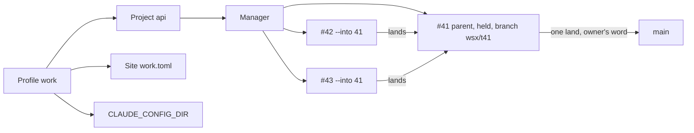

# Profiles and parent tasks (design)

Status: proposal, nothing built. The answer in two lines:

- **Profile**: a named table in `config-v2.toml`. A project names one profile. The profile chooses the agent account and is a site's grant. The store, the managers and wsxd stay as they are.
- **Parent task**: an ordinary held task that other tasks name as their land target (`task new --into <p>`). Its land into main is an ordinary land. There is no second manager and no extra layer.

## Today (source)

| Piece | Behavior | Source |
|---|---|---|
| Groups | A filter only: `GlobalConfig.groups`, `ProjectEntry.groups`; one active key in `group-selection-v1.toml` | `crates/wsx-core/src/config/global.rs:225`, `:277` |
| Web site | One file per process. `[access] projects` is paths or `"all"`; unknown keys are refused | `crates/wsx-web/src/site.rs:61`, `:134` |
| Agent account | `SessionCreate` has no environment, so task hosts, managers and workers get wsxd's `CLAUDE_CONFIG_DIR`. A resumed agent keeps its own (`AgentSessionRef.launch`) | `crates/wsx-core/src/runtime/protocol.rs:255`, `crates/wsx/src/task/claude.rs:31`, `crates/wsx-core/src/runtime/domain.rs:183` |
| Manager | One per project, `tasks/<project-id>/`; its host builds its agent's `launch.env` | `docs/tasks.md` "Manager", `crates/wsx/src/task/manager.rs:1271` |
| Land target | Every task records `default_branch`. Land, rebase, revision base, close and the worker boundary read it. The fast-forward runs in the checkout that has that branch | `crates/wsx/src/task/mod.rs:894`, `host.rs:1678`, `host.rs:1930`, `mod.rs:1426`, `boundary.rs:37`, `crates/wsx-core/src/task/copy.rs:414` |

`docs/web-deploy.md` "Site file" shows a `[project]` table that `site.rs` refuses. That doc is stale; fix it with this work.

## A. Profiles

```toml
# config-v2.toml
[[profiles]]
name = "work"
claude_config_dir = "~/.claude-work"     # optional; absent = wsxd's environment
[[projects]]
name = "api"
path = "/abs/api"
profile = "work"                         # absent = "default"
groups = ["backend"]                     # still a filter, inside the active profile

# ~/.config/wsx/web/work.toml (site file)
[access]
projects = { profile = "work" }          # new third form, beside paths and "all"
```

| A profile owns | How it is attached |
|---|---|
| Projects | `ProjectEntry.profile`; exactly one profile per project |
| Agent account | Task hosts set `CLAUDE_CONFIG_DIR` in the agent env they already build (`manager.rs:1271`, the worker's `KEPT_ENV`). Nothing changes in the protocol |
| Manager | Unchanged. It is per project, so it belongs to the project's profile |
| Web sites | A site grants `{ profile = "<name>" }`. A project that joins the profile later is reachable at once, as with `"all"` |
| Skills | The skills of its config root (`crates/wsx-web/src/commands.rs:169` already reads `$CLAUDE_CONFIG_DIR/skills`); the host reads them from the profile's config root |

Migration: wsx rewrites no file. With no `[[profiles]]` there is one implicit `default` profile that holds every project and uses wsxd's environment. Groups, group selection, the site's path list and `"all"` keep working as they do today. The active profile is kept beside the active group (`group-selection-v1.toml`, next field).

## B. Parent tasks



| Concern | Rule | Reuses |
|---|---|---|
| Create | `task new --hold "<why>"` is the parent. Any open task can be one | `hold` (docs/tasks.md "Hold and trial") |
| Child | `task new --into <p>`: base is p's tip, `default_branch = wsx/t<p>`, `parent: p` in `task.json` | `--from`, `record.default_branch` |
| Child checks | Run in the child's copy, as today | host checks |
| Child land | Refused while p is `working`, `checking` or by hand: "parent #p is busy", and the land retries when p is free. Otherwise rebase onto p's tip and fast-forward in p's working copy | `land_on_tip`, `copy::fast_forward` |
| Parent after a child land | p's host makes a new revision of those commits and runs checks, as `handback` does. Without this, `host.rs:1682` would fast-forward main with an unchecked HEAD | `handback` path (`host.rs:651`) |
| Child follow-ups | `close` as today (it compares with `wsx/t<p>`). No `deploy --if-new`, because main did not move | `after_landing` (`host.rs:1881`) |
| To check | A child's items join the project list at p's land into main, read from its landed children's `result.json`. A release waits for them only after that | `collect_verify` |
| Conflicts with main | Only at p's land: rebase onto main, a conflict starts p's worker turn, checks, then the land. A child's conflict is with p, resolved by the child's worker | `resolve_conflict` |
| Long life | p's copy and host live until close (pane process, kept across daemon restarts). `trial` and `preview` work on p as on any task | "Host", "Preview" |
| Close or land of p | Both refuse while p has open children; `--discard` names them | `close` rules |
| Thread | p's task sheet is its chat: `add`, `steer`, timeline. The project manager still coordinates every task | task sheet |
| Ledger | Each open task gets `parent`; a parent row counts its open children | `ledger` |

## C. UX

TUI, Workspace (profile chip first, groups after it, `P` switches profile):

```
 work ▾ │ Recent  Ungrouped  backend  frontend
 ▸ api        main   3 tasks · 1 to check
 ▸ web        main
```

TUI, Tasks view (`t`, `crates/wsx/src/ui/tasks.rs`); children sit under their parent:

```
 api · 1 to check · 0 approvals
 Open
   #41 Billing rewrite       ready    try first: long work · 2 open
     #42 Invoice schema      working
     #43 Tax rules           ready
   #44 Fix login             checking
```

TUI manager chat (the owner's #117): `c` in the Tasks view (unbound today, `crates/wsx/src/event.rs:1016`). Same bubbles as the web.

Web Home (`crates/wsx-web/web/home.js`): a profile site shows only its projects. A site with `"all"` heads the rows by profile:

```
 WORK
 api     2 need you · #41 3 open        5m
 PERSONAL
 notes   all done                       2d
```

Web project screen (`tasks.js`, `bubbles.js`): the reservoir shows a parent as one row with child chips. Its sheet adds *Children* over the timeline:

```
 #41 Billing rewrite · held: long work
 Children  #42 ●  #43 ●       [Land into main]
 ─ timeline ─  #42 landed into #41 · checks 4/4
```

## Left out on purpose

- No per-profile daemon, store or state dir: the store already keys by project.
- No parent kind, parent state, profile manager or "line" layer: a parent is a held task.
- No nested parents and no stacked branches that rebase each other.
- A project with open tasks cannot move to another profile (refused).

## Open questions for the owner

1. Should profiles replace groups? Recommendation: no. Groups stay filters inside a profile, so nothing breaks.
2. Can a project be in two profiles? Recommendation: no. One project has one account and one manager.
3. One wsxd for all profiles, or one per profile? Recommendation: one. The account goes per agent in the host's env, and live handoff stays as it is.
4. How does a parent take in new commits from main while children are open? Recommendation: only at its land, or by `task add <p> "rebase onto main"` when it has no open children.
5. When do the To check items of children count? Recommendation: at the parent's land into main, so a release is not held by work that is not on main.
6. Does a parent need its own worker conversation? Recommendation: yes, optional. It is empty until the owner adds to it, and it resolves the conflicts with main.
7. Should the agent account also cover Codex (`CODEX_HOME`)? Recommendation: yes. Use one `config_root` per provider, as `integration::root_variables` already lists them.
