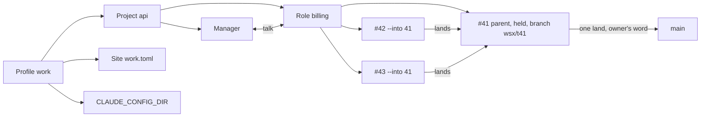

# Profiles and parent tasks (design)

Status: proposal, nothing built. The answer:

- **Profile**: a named table in `config-v2.toml`. A project names one profile. The profile chooses the agent account and is a site's grant. The store, the managers and wsxd stay as they are.
- **Parent task**: an ordinary held task that other tasks name as their land target (`task new --into <p>`). It owns the files and the one land into main.
- **Role** (option C, recommended together with parent tasks): the manager host with a name. The manager is role `manager`. A role is a persistent chat, not a holder of files. A long branch effort is a role that drives one parent task.

## Today (source)

| Piece | Behavior | Source |
|---|---|---|
| Groups | A filter only: `GlobalConfig.groups`, `ProjectEntry.groups`; one active key in `group-selection-v1.toml` | `crates/wsx-core/src/config/global.rs:225`, `:277` |
| Web site | One file per process. `[access] projects` is paths or `"all"`; unknown keys are refused | `crates/wsx-web/src/site.rs:61`, `:134` |
| Agent account | `SessionCreate` has no environment, so task hosts, managers and workers get wsxd's `CLAUDE_CONFIG_DIR`. A resumed agent keeps its own (`AgentSessionRef.launch`) | `crates/wsx-core/src/runtime/protocol.rs:255`, `crates/wsx/src/task/claude.rs:31`, `crates/wsx-core/src/runtime/domain.rs:183` |
| Manager | One per project, `tasks/<project-id>/`; its host builds its agent's `launch.env` | `docs/tasks.md` "Manager", `crates/wsx/src/task/manager.rs:1271` |
| Land target | Every task records `default_branch`. Land, rebase, revision base, close and the worker boundary read it. The fast-forward runs in the checkout that has that branch | `crates/wsx/src/task/mod.rs:894`, `host.rs:1678`, `host.rs:1930`, `mod.rs:1426`, `boundary.rs:37`, `crates/wsx-core/src/task/copy.rs:414` |

`docs/web-deploy.md` "Site file" shows a `[project]` table that `site.rs` refuses. That doc is stale; fix it when `site.rs` gains the profile form.

## A. Profiles

```toml
# config-v2.toml
[[profiles]]
name = "work"
claude_config_dir = "~/.claude-work"     # optional; absent = wsxd's environment
[[projects]]
name = "api"
path = "/abs/api"
profile = "work"                         # absent = "default"
groups = ["backend"]                     # still a filter, inside the active profile

# ~/.config/wsx/web/work.toml (site file)
[access]
projects = { profile = "work" }          # new third form, beside paths and "all"
```

| A profile owns | How it is attached |
|---|---|
| Projects | `ProjectEntry.profile`; exactly one profile per project |
| Agent account | Task hosts set `CLAUDE_CONFIG_DIR` in the agent env they already build (`manager.rs:1271`; a worker today only passes wsxd's through `KEPT_ENV`, `claude.rs:21`). A session the owner starts (TUI, web `session_start`) gets the argv `env CLAUDE_CONFIG_DIR=<root> <agent>`. Nothing changes in the protocol |
| Manager, roles, skills | Unchanged and per project, so they belong to the project's profile; skills come from its config root (`crates/wsx-web/src/commands.rs:169`) |
| Web sites | A site grants `{ profile = "<name>" }`. A project that joins the profile later is reachable at once, as with `"all"` |

Migration: wsx rewrites no file. With no `[[profiles]]` there is one implicit `default` profile that holds every project and uses wsxd's environment. Groups, group selection, the site's path list and `"all"` keep working as they do today. The active profile is kept beside the active group (`group-selection-v1.toml`, next field).

## B. Parent tasks



| Concern | Rule | Reuses |
|---|---|---|
| Create | Any open task becomes a parent when a child names it. `--into` holds p when it is not held ("parent of #n"), so p never lands by itself or by review | `hold` (docs/tasks.md "Hold and trial") |
| Child | `task new --into <p>`: base is p's tip, `default_branch = wsx/t<p>`, `parent: p` in `task.json`. Its boundary denies p's branch ref | `--from`, `record.default_branch`, `boundary.rs:37` |
| Child land | Refused while p is `working`, `checking` or by hand ("parent #p is busy"); the child stays `ready` and the manager lands it again on p's next event. Otherwise rebase onto p's tip and fast-forward in p's working copy | `land_on_tip`, `copy::fast_forward`, manager events |
| Parent after a child land | p's host makes a new revision of those commits and runs checks, as `handback` does. Without this, `host.rs:1682` would fast-forward main with an unchecked HEAD | `handback` path (`host.rs:651`) |
| Child follow-ups | `close` as today (it compares with `wsx/t<p>`). No `deploy --if-new`, because main did not move | `after_landing` (`host.rs:1881`) |
| To check | A child's items join the project list at p's land into main, read from its landed children's `result.json`. A release waits for them only after that | `collect_verify` |
| Conflicts with main | Only at p's land: rebase onto main, a conflict starts p's worker turn, checks, then the land. A child's conflict is with p, resolved by the child's worker | `resolve_conflict` |
| Close or land of p | Both refuse while p has open children and name them, also with `--discard` | `close` rules |
| Ledger | Each open task gets `parent`; a parent row counts its open children. `overlaps` leaves out a task's own parent and children, which always share paths | `ledger`, `list --json` overlaps |

## C. Roles (option C, msg 1433)

A role is a named, persistent agent conversation with its own instructions and notes, for example `billing` (a long branch effort), `qa`, `marketing` or `release`. The manager is the one role that always exists. The manager, when it sees the need, or the owner creates the others.

The manager host is already that thing, keyed to one name. Generalizing it is a parameter, not a layer:

| Manager piece today | As a role | Source |
|---|---|---|
| Folder `tasks/<id>/manager/`: `log.jsonl`, `state.json`, `notes/`, sockets | `tasks/<id>/roles/<name>/`; the manager keeps `manager/` | `crates/wsx-core/src/task/store.rs:636` (`ManagerDir`) |
| Host `wsx task manager-host <id>`, session `task-manager` | `manager-host <id> --role <name>`, session `task-<name>`; it starts on `say` and leaves after its turn queue is idle | `crates/wsx/src/task/manager.rs:287` |
| Instructions built in code | The same code plus the role's brief, `roles/<name>/brief.md`; a new brief starts a fresh conversation (the instruction digest already does this) | `manager.rs:155`, docs/tasks.md "Manager" |
| Rotation, handover, notes on the first turn | Unchanged, per role | `manager.rs:1355` |
| Events of every task | Events of the tasks the role created (`created_by` gains `role:<name>`); the manager keeps every other task and sees all in its ledger summary | `crates/wsx-core/src/task/mod.rs:107` (`Actor`), `manager.rs:1089` |
| Recap, idle task, approvals, project page | The manager only | `manager.rs:42` |
| Managers talk (`say --from-manager`, one reply) | Roles talk the same way inside a project: `say --role <name> --from-role` | docs/tasks.md "Managers talk" |

New surface: `wsx task role new <name> --brief <file>`, `role list`, `role close <name>`, and `--role` on `say` and `chat`. The broker refuses `role new` for a role that is not the manager.

| Need | Parent task (B) | Role (C) | Own project, same profile |
|---|---|---|---|
| Separate chat | Task sheet (worker turns only) | Yes, a contact | Yes, its own manager |
| Holds files for days, lands once | Yes | No; it drives a parent task | Its own repo and main |
| Own notes and instructions over weeks | No (ends at close) | Yes | Yes |
| Shares checks, deploy, To check, page | Yes | Yes | No, its own |
| New code | `--into`, `parent`, revise on child land | `--role` on host and store, events by creator | None |
| Cost while idle | A host in a pane | None (host leaves) | A manager host |
| Risk | None new | Two coordinators: only a task's creator gets its events and steers it | Work across both needs managers talk |

What roles replace: the parent-task thread (the role's chat is the thread; the sheet stays the record) and nothing in profiles, because a profile never had its own manager. What they do not replace: the parent task, because a conversation cannot be a land target or hold a working copy.

Own project instead of a role when the domain has its own files or repo, its own checks, deploy or release, or its own audience (a separate site grant or account). Marketing with a website and a mailing list is a project in the same profile, and the two managers talk. Marketing that writes release notes in this repo is a role.

Recommendation: build B and C, in that order. B closes the git gap. C is the manager host with a name.

## D. UX

TUI Workspace: a profile chip leads the group header (`work ▾ │ Recent  Ungrouped  backend`); `P` switches profile.

TUI, Tasks view (`t`, `crates/wsx/src/ui/tasks.rs`); children sit under their parent:

```
 api · 1 to check · 0 approvals
 Open
   #41 Billing rewrite       ready    try first: long work · 2 open
     #42 Invoice schema      working
     #43 Tax rules           ready
   #44 Fix login             checking
```

TUI chats (the owner's #117): `c` in the Tasks view opens the manager (unbound today, `crates/wsx/src/event.rs:1016`); a *Roles* section under *Open* lists the other roles, and `Enter` opens one.

Web Home (`crates/wsx-web/web/home.js`): a profile site shows only its projects; a site with `"all"` heads the rows by profile. Only the manager's chat is a row; roles add to its count:

```
 WORK
 api     2 need you · billing replied   5m
 PERSONAL
 notes   all done                       2d
```

Web project screen (`tasks.js`, `bubbles.js`): `⋯` gains *Roles*, a contact list (name, last line, unread); a role chat is `#/p/<project>/r/<role>` with the same bubbles. The reservoir shows a parent as one row with child chips; its sheet adds *Children* and *Land into main*.

## Left out on purpose

- No per-profile daemon, store or state dir: the store already keys by project.
- No parent kind, parent state, profile manager or "line" layer: a parent is a held task, a role is the manager host.
- No role with a working copy, and no role that lands, deploys or approves: those stay with tasks and the manager.
- No nested parents and no stacked branches that rebase each other.
- A project with open tasks cannot move to another profile (refused).

## Open questions for the owner

1. Should profiles replace groups? Recommendation: no. Groups stay filters inside a profile, so nothing breaks.
2. Can a project be in two profiles? Recommendation: no. One project has one account and one manager.
3. One wsxd for all profiles, or one per profile? Recommendation: one. The account goes per agent in the host's env, and live handoff stays as it is.
4. How does a parent take in new commits from main while children are open? Recommendation: only at its land, or by `task add <p> "rebase onto main"` when it has no open children.
5. When do the To check items of children count? Recommendation: at the parent's land into main, so a release is not held by work that is not on main.
6. Does a parent need its own worker conversation? Recommendation: yes, optional. It resolves the conflicts with main; the owner talks to the role that drives it.
7. Should the agent account also cover Codex (`CODEX_HOME`)? Recommendation: yes. Use one `config_root` per provider, as `integration::root_variables` already lists them.
8. May the manager create a role without asking? Recommendation: it asks once in chat, and the owner's yes is `--owner-said`, as for a land.
9. Does a role's chat notify like the manager's? Recommendation: yes, under the existing *Manager needs me* topic, with the role's name.
