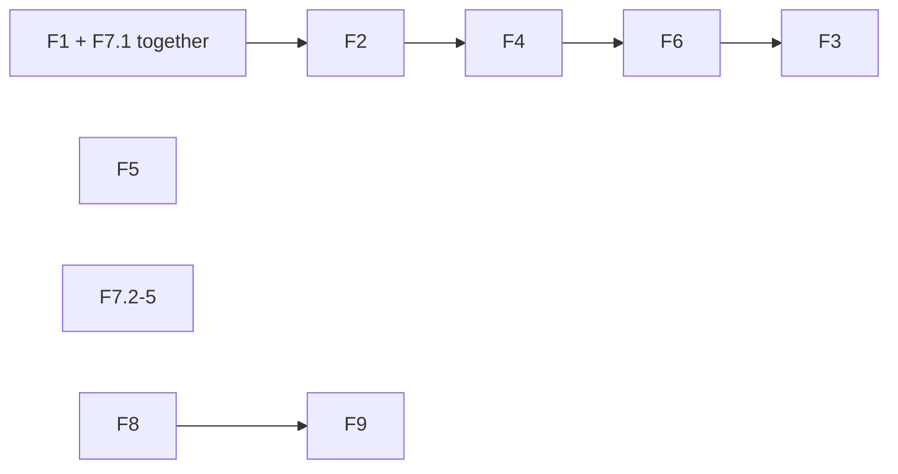

# Refactor audit: TUI and CLI since v0.41.0

Status: read-only audit, 2026-11-07, HEAD `ef7a3b5d`. Scope: `git diff v0.41.0..HEAD -- crates/wsx/src scripts/runtime-smoke.py` (141 commits, +8,828 lines) and the scripts that test it. Owner plan: msg 3189. Paths are relative to the repo root. Left out: task #264 (question jump, composer pills) and the speed and stability items already ranked in [tui-health-audit.md](tui-health-audit.md) and [task-host-health-audit.md](task-host-health-audit.md).

**Answer.** Nine findings, no dead code. Two bugs of the "second copy" kind come first: the manager is told a flag that four commands reject, and the limit rule exists twice. The big item (F3) is shape: `task/mod.rs`, `host.rs` and `manager.rs` hold 10,200 lines. It lands last, because it moves code the other fixes edit.

Proof marks. **R** = I read the lines on HEAD. **G** = I confirmed callers or absence with `rg` or a script (listed under "Checked, nothing found" and in the task result). **†** = read by the Explore subagent, not re-read by me. Nothing was built or run: the smoke and task scenarios were not started, and the local `target/debug/wsx` is stale (`wsx task checkin --help` fails with a socket error), so the `--json` finding is from source.

## Findings, ranked

| # | Sev | Where, commit | Problem | Fix | Files | Size | Proof |
|---|---|---|---|---|---|---|---|
| F1 | med | `task/manager.rs:263` (6932db1e, before tag) and `:327`; `task/mod.rs:573-620` `json_output`, `:360-410` | The manager's instructions say "Every `wsx task` command takes `-p {project} --json`", and `docs/tasks.md:3` says "`--json` works on all of them". `digest`, `checkin`, `post` and `check-run` have no `--json` arg. `:327` tells the manager to run `checkin`. A manager that follows `:263` gets a clap error. | Change both sentences to name the four exceptions. No code change. | `task/manager.rs`, `docs/tasks.md` | small | R, G |
| F2 | med | limit: `task/manager.rs:2580-2587` (c1b1266d, "one limit decision") and `task/host.rs:1459-1465` (aa7b181a, before the tag); spend: `host.rs:1368` (ba2389c3), `:1474`, `manager.rs:2100,2380,2572` | The limit hit is recorded by the same four steps in two places (`limit::resume_at`, `limit::known_reset`, `store::mark_limited`, a "cannot record" message). `agent::note_spend` plus `if let Some(m) { self.say(&m) }` is written five times. | `agent::record_limit(adapter, model, resets_at, attempt, now) -> (until_ms, Option<String>)` and one `note_spend` call per owner that says the result. | `task/agent.rs`, `manager.rs`, `host.rs` | small | R, G |
| F3 | med | `task/mod.rs` (3,349 lines, +962), `host.rs` (3,659, +1,215), `manager.rs` (3,195, +1,763) | Grown by patches. `mod.rs` holds the clap enum (`:89-640`), a 415-line `run` match (`:668`), and ~40 command bodies: `deploy` 236 lines (`:2309`), `create` 174 (`:1380`), `push`, `search`. Four `#[allow(clippy::too_many_arguments)]` (`:1242,1379,2308,3248`) mark the patch points. `host.rs`: `check_run` 187 (`:2135`), `on_checks` 137 (`:2597`). `manager.rs`: `next_turn` 192 (`:1683`), `instructions` 154 (`:244`, one string literal). | Split `mod.rs` by command group (`task/cmd/{new,check,land,deploy,chat}.rs`); `run` arms become one call each. Fold the arguments of `create`, `deploy` and `push` into the arg structs clap already builds. Move the manager's instruction text to its own file. Behavior stays. | `task/mod.rs` and new files | large, mechanical | R, G (lengths by brace-matching script) |
| F4 | low | `wsx-core/src/task/history.rs:65` (cdc5120a), `wsx-core/src/task/report.rs:175` (9a11d53f), `task/host.rs:3435` (a7486903), closure `task/mod.rs:2198` (dd7616bf) | Four short-commit helpers. cdc5120a is titled "one short-commit helper" but adds a third. The history one cuts at 7 chars, the others at 12, so one commit shows two ways. | One `wsx_core::git::short_commit` at 12; update `scripts/test-task.py` asserts that read the 7-char form in `task search` and history rows. | the four files, `scripts/test-task.py` | small | R, G |
| F5 | low | `ui/panels.rs:62` `fit` (497b2896) = `ui/tasks.rs:257` `cell` (54e764b0) | Same body (`truncate_to_width`, then pad). `wrap_cells` lives in `ui/task_chat.rs:527` but `ui/tasks.rs:3` imports it; `truncate_to_width` lives in `ui/workspace_tree.rs:31`; `ui/tasks.rs:190` `hard_wrap` repeats the split loop of `wrap_cells`. | New `ui/text.rs` with `truncate_to_width`, `fit`, `wrap_cells`, `cells`; delete `cell`. | `ui/{text,panels,tasks,task_chat,workspace_tree}.rs` | small | R, G |
| F6 | low | `task/host.rs:2071-2073` (7a1ea054); `:2066` `state_words`, `:2897-2902` | The doc comment of `check_run` ("`wsx task check-run [<n>...]` from the worker...") sits on top of `switch_agent`; `check_run` (`:2135`) has none. Two places spell a task's waiting state by hand (the second is a refusal text for a busy parent). | Move the comment. Leave the strings: `status::status` (`status.rs:122`) needs a `TaskDir` and `Facts`, so it is no drop-in. | `task/host.rs` | small | R |
| F7 | med | Docs vs code | See the list below. | Edit the docs. | `docs/*.md`, `README.md`, `ui/mod.rs:989` | small | R for 1-3 and 4, † for 5 |
| F8 | med | Five PTY harnesses: `scripts/runtime-smoke.py:1848` `tui`, `:1976` `remove_tui` (975a575f), `:2532` `tui_over_pty` (62915a2d), `:2869`; `scripts/test-task.py:93` `tui_run`, `:260` `tui_screens` | Each spawns a PTY TUI, reads output in a thread, and parses the screen in its own way (`bytearray` against `Screen`). Two were added since the tag. | One `scripts/tui_pty.py` class (spawn, reader, `screen`, `send`, `wait_text`, close) used by both scripts. | `scripts/{runtime-smoke,test-task}.py` | medium | R (headers), † (differences) |
| F9 | low | `runtime-smoke.py:2272-2280` and `test-task.py:2679-2692` | The manager chat find (`/`, oldest entry past the newest 200) is driven in both. Smoke adds the 7.5 MiB log timing and the 20 KB paste, which `test-task.py` lacks. | Keep find in `test-task.py` (it has the log-roll fixture); keep only the size and timing steps in smoke. | both scripts | small | R |

## F7 detail: docs that no longer match

1. `docs/tasks.md:3` and `task/manager.rs:263`: `--json` on all commands (F1). R.
2. `docs/design/tui-parity.md:8,10,11,12,15,19` say "missing" for the overview, routine post border, session link, `files/` link and Tokens tab. They exist (`task_list.rs:25` `Overview`, `dispatch.rs:131-166`, `ui/tasks.rs`). Rewrite the table as status, or delete the rows. R for row 8, † for the rest.
3. `docs/panels.md:87,92`: only `Esc` closes the panels view; `app/dispatch.rs:181` closes on `Esc`, `q`, `v` and `M`. R.
4. `README.md:73-79` Navigation table lacks `v`/`M` panels, `d` with `H`, and the Tasks keys `o`, `u`, `a`; `ui/mod.rs:989` help line for `t` lacks `o`, `u`, `a`. R (README, help line at `ui/mod.rs:989`).
5. No doc names `routine add|edit --revision` (`cli/args.rs:526,550`), `--new-name` (`:533`) or `routine fire --kind --event-id --payload` (†); the `docs/tasks.md:6-24` synopsis omits `new --into --size --skip` and `deploy|release --owner-said`. †

## Smaller test notes (no finding)

- `runtime-smoke.py:2514` `time.sleep(11)` waits out a panel with `refresh: 10` (62915a2d). A fixture with `refresh: 2` and `sleep(3)` saves 8 s. R.
- 19 hand-written `deadline`/`sleep(0.05)` loops remain beside `wait_for` (`:153`), and `wait_ready` `:180`, `wait_singleton_released` `:196`, `wait_socket_stopped` `:228` repeat one 5 s loop. None is new since the tag. †
- A claim of the Explore read was wrong and is dropped: the wait at `runtime-smoke.py:1760-1768` is not vacuous, because `:1769` asserts the helper marker.

## Order

- F1 and F7.1 change one sentence in two files: one task.
- F2, F4, F6 edit `host.rs`, `manager.rs`, `mod.rs`; land them before F3, or F3 conflicts with all of them.
- F4 changes output text, so its `scripts/test-task.py` asserts go in the same task.
- F5, F7 (2-6) and F8/F9 touch no `task/` file and can land at any time. F9 follows F8 (same two scripts).
- `task` scenario runs on CI for F2, F3, F4, F8, F9; `smoke` for F5 and F8.

## Checked, nothing found

- Dead code in the diff: a script listed every non-test `fn`, `const`, `struct` and `enum` under `crates/wsx/src` whose name occurs once in `crates/`, and every struct field with no read (`.field` outside an assignment). It found only `terminal_owner_probe` (`tui.rs:665`, an `#[ignore]` test driven by `scripts/test-ui-state.py`) and fields read by destructuring in code older than the tag. `Slot(#[allow(dead_code)] File)` (`task/slot.rs:56`) is a lock guard. No dead flag found.
- Local-time wrappers are repeated (`task/limit.rs:57`, `wsx-core/src/task/ledger.rs:376`, `usage.rs:533`, `routine/cron.rs:22`, `ui/preview.rs:709`), but all are older than the tag. It is item 12 of [client-logic-audit.md](client-logic-audit.md).
- Chat reading: `task_chat.rs:666,701` and `task/mod.rs:2961` all go through `chat::read_chat`, `chat_window` and `chat_rows`. No second reader. `rg 'Command::new("git")' crates/wsx/src` finds no direct git call outside tests.
