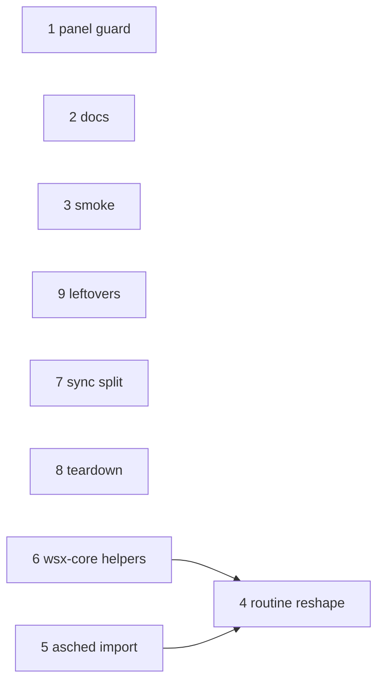

# Refactor audit: wsxd and wsx-terminal since v0.41.0

Status: read-only audit, 2026-11-07. Range: `git diff v0.41.0..HEAD -- crates/wsx-daemon crates/wsx-terminal` (18 commits, 21 files, +2166/-405). Plan: this audit, then one refactor task per finding, then the release (decision 2026-11-04, msg 3189). Paths are relative to the repo root. Open task #264 (tasks.js, app.css, web-tasks-check.mjs pills) is left out.

**Answer.** 11 findings, none a data-loss risk. Finding 1 is a real bug in new code. Finding 5 deletes about 190 lines once the owner picks the release. Findings 4 and 6 are the larger refactors: the new routine scheduler and panel cache copy helpers that wsx-core does not offer yet.

## Findings, ranked

Commit = the commit that added the line. Size: S = a change you can state; M = several files or a choice to make.

| # | Finding | Sev | Where (HEAD) | Commit | Fix | Files | Size |
|---|---|---|---|---|---|---|---|
| 1 | A panel run thread has no panic guard. A panic leaves `running` true, so the panel never refreshes | med | `wsx-daemon/src/panel.rs:105-114` | 5b24f8bb | Drop guard that clears `running` and stores a failed `PanelRun` | panel.rs | S |
| 2 | `AGENTS.md:67` says user changes "save before publication" and a "dirty durable snapshot" is retried. The code publishes first, the reply waits for the save (`dispatch.rs:9-21`), the saver retries (`state_store.rs:316`). `daemon-health-audit.md:21,24,25` list findings that are fixed | med | `AGENTS.md:67`; `docs/design/daemon-health-audit.md:21,24,25` | f8d00484, 4747f2b9 | Rewrite the AGENTS.md sentence from `docs/daemon-state-store.md`; add "Fixed in d113a708 / 98ef55c4" to the audit rows | AGENTS.md, daemon-health-audit.md | S |
| 3 | The OSC 7 smoke section sends 220,000 reports (waits 60+120+60 s) for a callback that is deleted. The RSS reads and the 40,000-line wide pane only print and assert nothing. No test names `Saver::hold`, `flush_held` or the rollback `release` | med | `scripts/runtime-smoke.py:1368-1391,1392-1411`; `live_handoff.rs:115,121,245` | 98ef55c4, d113a708 | Delete the OSC section and the printed-only RSS lines; keep the 20,000-line scrollback assert (`:1376-1380`); add one live_handoff rollback case | runtime-smoke.py, wsx-daemon/tests/live_handoff.rs | S |
| 4 | Routine scheduler grew by patches: `owned`, `failed`, `owned_changed` are one state in three fields (`:36-41`, read at `:114,164`); `SCHEDULER` (`:32`) and the panel cache `runs()` (`panel.rs:23`) are process globals while `saver` is on `Daemon`; `process()` is 165 lines (`:187-352`); the `Fire` arm round-trips `Trigger::Event{..}.validated()` with `unreachable!` (`:297`) and checks the event id inline (`:300`); the trigger match is written twice (`tick :373`, `views :553`); `handle` holds `owned` for a whole request, and `cancel` sleeps up to 2 x 2 s inside it (`:163,656-671`) | med | `wsx-daemon/src/routine.rs` | afa7a9ad, c3ff6571 | One `Ownership` enum under one mutex; scheduler and panel cache become `Daemon` fields; one fn per `Action` arm; event-id and trigger logic into wsx-core `routine`; wait outside the lock | routine.rs, panel.rs, lib.rs, server.rs, wsx-core routine/mod.rs | M |
| 5 | The asched import is a one-release bridge: import and retire code, `AschedProject`/`AschedRuntime`, `ASCHED_ROOT`, `UPGRADE_NOTE`, the `toml` and `dirs` deps (only used there), the import test and fixture, and docs | med | `routine.rs:98-108,905-1091`; `wsx-daemon/Cargo.toml`; `crates/wsx/tests/routine_wsxd_lifecycle.rs:298-443`; `tests/fixtures/asched-store`; `docs/tasks.md:593`; `README.md:54`; `AGENTS.md:38` | afa7a9ad, 9c155344 | Delete it all, plus the comments at `wsx-core routine/store.rs:15,74` and `runtime/protocol.rs:76`. Owner gate: owners who never ran 0.42 or later still have an asched store. Recommend: keep through the next release, delete in the one after | files listed | M |
| 6 | No shared owner in wsx-core, so each feature copies: (a) group kill, 6 copies: `routine.rs:656` (TERM, KILL after 2 s), `wsx-terminal/src/lib.rs:715` (no wait), `wsx/src/task/preview.rs:263` (5 s), `task/agent.rs:517`, `plugins/review.rs:209`, `wsx-core/src/panel.rs:565`; (b) `try_lock_file` (`server.rs:450`) repeats the flock in `wsx-core task/store.rs:174` and `wsx/src/tui.rs:109`; (c) unix-ms clocks: `lib.rs:439`, `wsx-core panel.rs:469`, `task/mod.rs:602`, `runtime/client.rs:2096`, plus `routine.rs:476-480,680` | low-med | as listed | afa7a9ad, 9c155344, 62915a2d | `fs_util::try_lock_file` beside `private_dir`; one `terminate_group(pgid, grace)` (the grace differs today: the task picks and states the change); daemon and panel use `task::now_unix_ms` | wsx-core fs_util.rs and a process module, routine.rs, server.rs, preview.rs, wsx-terminal lib.rs, panel.rs | M |
| 7 | `synchronize_projects` is 140 lines; the gone-worktree block is a nested-lookup closure inside it | low-med | `wsx-daemon/src/sessions.rs:5-145` (block `:101-130`) | b7299489 | Extract `sessions_on_gone_worktrees(persisted, retained) -> HashMap`. The test `a_session_on_a_removed_worktree_moves_to_the_main_checkout` already covers it | sessions.rs | S |
| 8 | `run_daemon` writes its teardown twice (join recovery, `routine::stop`, cleanup, five joins); `routine::stop` was added to both with different arguments | low | `wsx-daemon/src/server.rs:245-256,259-270` | afa7a9ad | One `shutdown(..., cancel_runs)` fn | server.rs | S |
| 9 | Leftovers of the saver change: `save_state` (cfg(test)) and `state_store::save` (cfg(test)) have one caller outside `state_store` (`tests.rs:4475`); `secure_parent` is a one-line wrapper over `fs_util::private_dir` with 2 callers; the production `TIMEOUT` reads `cfg!(test)` | low | `lib.rs:454,499`; `state_store.rs:101`; `plugins.rs:22` | d113a708, 8261a9db | Inline the wrapper; tests call `write_state`; pass the plugin timeout in | lib.rs, state_store.rs, tests.rs, plugins.rs, reporter.rs, server.rs | S |
| 10 | `SAVE_TICKET` is set by code that runs outside `handle`, where nothing waits for it (`lease.rs:208`, `server.rs:393`, `sessions.rs:838`). Harmless and documented in `daemon-state-store.md`; no task | info | `lib.rs:508` | d113a708 | None | | |
| 11 | Checked, no finding: `machine.rs` thresholds match `docs/panels.md:70-75`; scrollback constants match `docs/terminal-raw-stream.md:49`; the removed pwd callback leaves no reader | info | | | | | |

## Order

- 1, 2, 3, 7, 8, 9 are independent of each other and of 4 to 6.
- 5 before 4, so the reshape never rewrites code that is deleted next. 5 also waits for the owner's release choice.
- 6 before 4, so 4 calls the shared helpers instead of adding a seventh copy. The group-kill, lock-file and clock parts of 6 land together in wsx-core.
- 4 and 5 each carry their own docs (`docs/tasks.md` Routines, README, AGENTS.md:38).

## Proof

Read on HEAD: every `file:line` above, plus `git diff v0.41.0..HEAD` for the range. `git blame -L` gave each commit.

Confirmed by running a command (no test or build was run):
- `rg catch_unwind crates/wsx-daemon/src` finds nothing (finding 1).
- `rg 'toml::|dirs::' crates/wsx-daemon` finds only `routine.rs:105,944,981`, all in the import (5).
- `rg 'PWD_CHANGED|pwd_change' crates/wsx-terminal/src` outside `bindings.rs` finds nothing; `rg 'rss_|osc_growth' scripts/runtime-smoke.py` shows one assert, at `:1411` (3).
- `rg '\.hold\(\)|flush_held|\.release\(\)'` finds only the definitions and `live_handoff.rs:115,121,245` (3).
- `rg 'fn (terminate_group|kill_group)|killpg|kill\(-'` and `rg 'fn now_ms|now_unix_ms|unix_time_millis'` give the copies in finding 6.
- `rg 'handle_inner|secure_parent|save_state'` give the caller counts in findings 9 and 10.

Read only, not run: findings 1 and 4 (the cancel wait under the lock) were not reproduced; findings 2, 7 and 8 are code and text reads.
