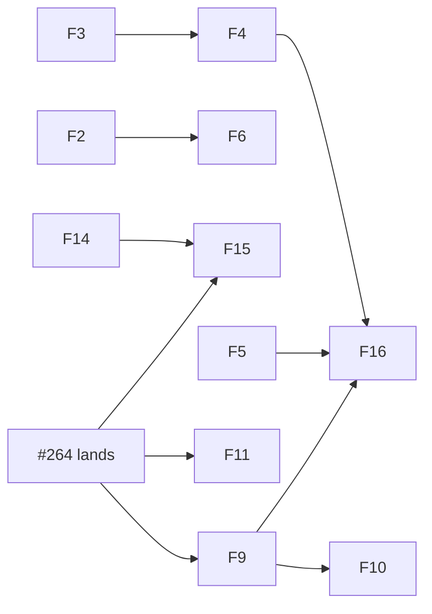

# Web refactor audit: wsx-web changes since v0.41.0

Status: read-only audit, 2026-11-07 (owner decision 2026-11-04, msg 3189). Scope: `git diff v0.41.0..HEAD -- crates/wsx-web scripts/test-web-client.py scripts/web-tasks-check.mjs scripts/web-browser-check.mjs`, read on HEAD `ef7a3b5d`. The tag is dated 2026-10-30. Each finding becomes one refactor task, then the release.
Left out: perf and stability (see [web-server-health-audit.md](web-server-health-audit.md), [web-client-health-audit.md](web-client-health-audit.md)), duplicated rules in [client-logic-audit.md](client-logic-audit.md), and anything open task #264 changes (question jump, composer pills: `tasks.js`, `app.css`, pills blocks of `web-tasks-check.mjs`). Findings 9, 10 and 11 touch `tasks.js` outside the pills code and wait for #264. Paths are from the repo root. "Commit" is the one that added the code or made it a leftover (`git blame`, `git log -S`).

## Findings, ranked

| # | Sev | Where (commit) | Problem | Fix; files; size | Proof |
|---|---|---|---|---|---|
| 1 | high | `chat.rs:1212` (53a38d30), `store.js:123` (96876efd); owner `wsx-core/src/task/session_news.rs:12` (aee351e3) | `is_task_session` exists three times. The owner strips `-hand`; the web copies do not. A `task-N-hand` session counts as an ordinary agent in `needs_owner` (`chat.rs:1229`) and in the lists. | `chat.rs` calls the core fn with label and provider; the JS regex takes `(-hand)?`. `chat.rs`, `store.js`. Small. | grep, read |
| 2 | med | `compact.rs:121` (0c3e0bdd), `shell.rs:54-66` (06a11d1e), `wsx-core/src/panel.rs:543-565` (62915a2d); owner `wsx-core/src/git/mod.rs:264-278` | Four copies of "own process group, poll, kill, tail the pipes". The compact copy sets no group, so a timeout leaves ffmpeg/whisper children running. | Give the core runner two options (merge stderr, keep partial output on timeout); the three callers become thin. `git/mod.rs`, `compact.rs`, `shell.rs`, `panel.rs`. Medium. | grep, read |
| 3 | med | `tasks.rs:198` hold (30820187), `:200` conflict (8a4e7a5f), `:215` summary and `:230` denials (abfd9b22), `:208` `read_result` | Overview rows send `needs[].summary`, `needs[].denials` and row `hold`, `conflict`. No browser file reads them (the reads went in ba8e78d0 and c1449b46, before the tag; `tasks.rs` was rewritten in 646b6818). `read_result` runs per waiting, failed or ready task only to feed them. | Drop the keys and the read. `tasks.rs` plus asserts found by `rg` in `scripts/`. Small. | grep |
| 4 | med | `tasks.rs`: `build_overview` 161 lines, `chat` 111, `detail` 112, `watch` 129, `flush` 113 | Grew by patches. `Status` is asked twice (`:125` b5381d16, `:757` abfd9b22); approvals read twice in one build (`:176` 646b6818, `:234` abfd9b22); the `news` json is built in `build_overview` and `role_contacts`; `Watch.overviews` and `App.overviews` both hold the last overview; `Key::Alert` (d343d46b) enters `pending` and is split out in `flush`; `chat()` shadows `window`, `log`, `status`. | Task A: `manager_status()`, reuse `approvals`, one news helper, split `chat` and `detail`. Task B: `Alert` on its own list, one overview cache, split `watch` and `flush`. `tasks.rs` (`lib.rs` for B). Medium each. | grep, read |
| 5 | med | `exchange_shell`: `runtime/domain.rs:519` (a7f413ce), `dispatch.rs:676`; `exchange.rs:331` `shell_line`; `chat.rs:602` | 06a11d1e moved the `!` line to the server and removed the only reader. The capability, `shell_line` and the daemon's `!` round stay. `run_shell` answers a `shell` key the page ignores. | Remove the capability, `shell_line` and its branch with a protocol revision; answer a plain ok. `domain.rs`, `dispatch.rs`, `exchange.rs`, `protocol.rs`, `chat.rs`, `test-web-client.py:1742`. Medium. | grep |
| 6 | med | `crates/wsx-web/src/panels.rs:21-104` (62915a2d), `wsx/src/panel_view.rs:103-135` (cf3aee99), `wsx-core/src/panel.rs:447,469` | Web and TUI both list built-in panels, list each project's panels, keep scope `machine`, and match `Response::Panels` alike. `machine_get` is `get` with another project. `panel.rs:469` `now_ms` copies `task::now_unix_ms`; `MAX_VOLUMES` (`wsx-daemon/src/machine.rs:35`, 5b24f8bb) copies `MAX_ITEMS`. | Core `panel::list/get/machine_sources`; both clients call them. `panel.rs`, `panels.rs`, `panel_view.rs`, `machine.rs`. Medium. | read |
| 7 | low | `http.rs:815`, `:906` (53d217e9); `:824`, `:914`, `projects.rs:28` (d163acbe) | The session-start limit (`start:{id}`, 3.0, 6.0) and the 409 `config_invalid` fault are written 2 and 3 times; four handlers repeat the project-path lookup. | `start_budget()`, `site::config_or_fault()`, `chat::project_path()`. `http.rs`, `projects.rs`, `panels.rs`, `site.rs`. Small. | grep |
| 8 | low | `media.rs:107-131,160-166` (0c3e0bdd, 735775e5), `http.rs:1542-1553` (d0e66322), `compact.rs:210-308` | The entry's file list is built three times; `prompt_line` indexes `files[0]`. If the slow copy panics, `preparing` stays set and the chip polls forever. `compact::video` is 99 lines with locals that shadow `transcript` and `sheets`. | `Entry::files()`; `Media::attach_copy` clears `preparing` in a drop guard; split the digest text. `media.rs`, `http.rs`, `compact.rs`. Small. | read |
| 9 | med | `store.js:185` (1af4b6f5), `main.js:117`, `tasks.js:809,1051`; flags added by ee7dc30e, 62915a2d, f38ff5c4 | Each sheet is a boolean route flag copied into a prop and a hand-written `<Sheet>`; adding one touches 4 places. The `page` flag, `page.js` and `.project-page` still use the name the UI replaced with "Overview". | `parseRoute` returns `sheet`; `Manager` renders from a table; rename to `overview`. `store.js`, `main.js`, `tasks.js`, `page.js`, `app.css`. Medium. | read. After #264 |
| 10 | med | `routines.js:58` (ee7dc30e), `panels.js:131` (62915a2d), `usage.js:201` (f38ff5c4), `page.js:17`, `checks.js:136` | Five sheet pages repeat the bar, the `grip.ready()` effect and the load ladder; `panels.js` writes `grip?.ready?.()`, the rest `grip.ready()`. | One `SheetPage` and one read hook in `ui.js`. Those five files. Medium. | read. After 9 |
| 11 | med | `tasks.js:809-1076` `Manager`, 268 lines (1e9b4b6f, bf35ba80); `chat.js:396` `Composer` and `tasks.js:534` `ManagerComposer` (492e4a19); `tasks.js` imported by `bubbles.js`, `checks.js`, `page.js`, `task.js` | `around`, `find` and the read state are mirrored in 3 places; the composers copy list keys, draft keeping and paste code; `tasks.js` is an import hub with cycles; helpers added since went into it. | `useManagerLog` and a row-cache hook; shared `useListKeys` and `useDraft`; move the task words to `task-words.js`. Medium or more, in 3 tasks. | read. After #264 |
| 12 | low | `chat.js:662` (305c4435), `app.css:311,313` | `--log-scrollbar` is set by the session `Chat` only. The manager and role chats use the same `.markdown` wide-block rules, so the variable falls back to 0 there. A visible bug on classic scrollbars is possible. | Move the observer into `useFollowEnd` (`lib.js`). Check in Chrome first. Small. | read only |
| 13 | low | `app.css:724` `.need-form` (JS removed in 2afc0028); `plural` private to `story.js` while `=== 1 ?` appears 21 times in 10 files (`rg -c`; not all are plurals); `localStorage` get/set pairs in `ui.js`, `terminal.js` beside `lib.js` `readMap` | Dead selector and small copies of owned helpers. | Delete `.need-form` and the assert at `web-tasks-check.mjs:1090`; export `plural` and `kept/keep` from `lib.js`. Small. | grep |
| 14 | med | `web-tasks-check.mjs:1920,2064` (`pause(said*3000)`), `:2324,:2677` (`pause(12000)`), retry loops `:3402,:3430,:3469,:3523`; `test-web-client.py` fixed sleeps `:1996,:2369,:2436,:2759,:3142,:3837,:4544,:4567,:4614` | Seven scenario waits sit on the `act_budget` request limit (`http.rs:1070`): about 24 s fixed plus 3 s per message, and four loops of up to 20 tries. The Python sleeps are 4.2 to 10.5 s. | A `say()` that waits on 429, or a fresh device per heavy block; replace media-expiry sleeps with a wait on 404. Small to medium. | grep |
| 15 | med | `shot()` `web-browser-check.mjs:45` vs `web-tasks-check.mjs:97`; `pair()` `:120` vs `:163`; asserts `web-browser-check.mjs:824` (`first > 1500`), `web-tasks-check.mjs:458`; `history.back` `:2560`, `:3549` (dc467d58, c0e7a986); `test-web-client.py:1488-1490`, `:3780` | Two copies of the screenshot, audit and pairing helpers have drifted (only the tasks copy handles an open modal). A pass depends on wall-clock ms. `history.back` per sheet is asserted again after the matrix. The "64 tokens" comment sits above `== 75`; `owner_name` is never read. | Move the helpers to `web-cdp.mjs`; assert render counts, log ms; drop the two repeats; read the token count from `theme.toml`; delete `owner_name`. Medium. | grep; drift read. After 14 and #264 |
| 16 | low | `docs/web-client.md:110`, `:115`, `:201`, `:292-294`, `:158-164`; `docs/web-client-tasks.md:5-27` | Stale: Settings lists sections "UI, Usage" but code has General, UI, Usage (`settings.js:238`); the phone bar omits Machine (`store.js:161`, cf3aee99); "no polling timer" but `panels.js:89-102` and `chat.js:167` poll; `--browser` lists three scripts, the run also starts `web-panels-check.mjs` (`:3854`) and `web-projects-check.mjs` (`:4842`); the lint table omits `page`, `events-dark`, `events-light` (`web-tasks-check.mjs:33`); `api/logout` is in no doc; the route table lacks the `page` and `usage` routes. | Edit the lines. Docs only. Small. | grep |

## Order

- Free to start now, in any order: 1, 3, 5, 7, 8, 12, 13, 14. Findings 2 and 6 both edit `wsx-core/src/panel.rs`: land 2 first. 5 needs a protocol revision bump and the test edit in the same change. 12 may share a task with 11 (`useFollowEnd`).
- 16 lands last so it reads the final code.

## Proof

Confirmed by a command I ran on HEAD:
- Greps for callers and readers: `is_task_session` (1), `ManagerRequest::Status` and `read_approvals` (4), the unread keys in `web/*.js` (3), `exchange_shell` and `shell_line` (5), `try_wait|process_group|killpg` (2), `config_invalid` and `start:` (7), `need-form` (13), `pause(` and `time.sleep(` (14), `api/logout`, `check.mjs` and `setTimeout` in `panels.js` (16).
- `git blame` and `git log -S` for every commit above; `awk` for function lengths (4, 11).

Read only, not run: the panel duplication (6), the media and compact details (8), the sheet and composer shapes (9 to 11), the missing scrollbar variable (12), the helper drift (15). A sub-agent pass found no other unused export, CSS class, CSS variable or theme token; I re-ran only the `.need-form` grep. No scenario was run: this task changes no code.
