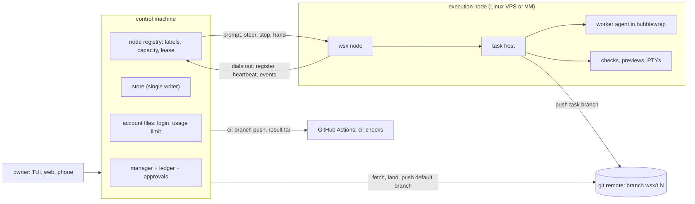

# Scale-out: running wsx work on VPS and cloud machines

Design study of 2026-11-07. Owner goal: "wsx can orchestrate over VPS and different cloud computing resources in the future; consider architecture for scale out."
Contracts read: `docs/daemon-discovery.md`, `docs/daemon-state-store.md`, `docs/web-deploy.md`, `docs/tasks.md`. No code changes. Research sources are vendor docs and blogs; claims marked *unverified* need a check before work starts.

## Answer

Keep one **control machine** (manager, ledger, approvals, owner chat, store, web). Run **execution nodes** that the control machine never reaches into. A node dials out, takes a whole task, and sends back events. Work travels as a prompt and a git branch, never as a shared disk or an absolute path.

Recommended order: (0) free rules now, (1) a full headless wsx on one Linux VPS, (2) `wsx node`, (3) label scheduling, (4) ephemeral machines. Option (a), a remote `wsxd`, is the weakest base.

## 1. Single-machine assumptions, hardest to cut first

"Cut" means what must change if that piece runs on a node.

| # | Assumption | Evidence | Cut |
|---|---|---|---|
| 1 | The working copy is a sibling directory of the main checkout. Records and the ledger hold absolute paths. | `copy.rs:23-37` (`<parent>/<repo>-t<n>`), `copy.rs:221-227` (`cp -c` or `--reflink=always`), `task/mod.rs:177,181` (`project_path`, `working_copy`), `ledger.rs:192,275`, `store.rs:82` (id from a hash of the path) | The node clones from a remote into its own tree. Records keep ids, a branch and a commit; a path is local to the node. Touches every reader of `working_copy`. |
| 2 | The manager learns about workers by reading files each second. | `manager.rs:514` (1 s `Tick`), `:1033` `watch_tasks` reads `task.json` and `result.json`; `view.rs:398` `project_tasks`; `stall.rs` reads logs | An event feed from the node replaces the file reads. Today the log is already the durable stream (`store.rs:584` `append`, `:636` `read_log_tail`), so a byte offset in it is the resume cursor. |
| 3 | The agent boundary exists only on macOS. | `boundary.rs:66` (`cfg!(target_os = "macos")` bails), `:13` `/usr/bin/sandbox-exec`, `docs/tasks.md:161-163` | A Linux boundary, see section 4. Also `agent.rs:592-595`: `marked()` returns nothing off macOS, so stop-the-whole-tree cannot find children on Linux. |
| 4 | A usage limit and a login belong to an account, but are stored per machine and keyed by adapter. | `agent.rs:223` `account()` (`claude` for every Claude login), `store.rs:375` `account_file`, `:466` `mark_limited`, `claude.rs:59` `config_root`, `usage.rs:485` | Account files stay on the control machine; nodes ask and report. The key must name the login, or two logins share one limit. |
| 5 | `wsxd` listens on a Unix socket only; trust is the file mode and the peer uid. | `server.rs:483` `bind_owner_only`, `client.rs:708,771` `validate_socket`, `validate_peer_owner`; `docs/daemon-discovery.md:8-15`; only TCP is the web server (`wsx-web/src/lib.rs:137`) and a preview probe | Do not cut it. Each node runs its own local `wsxd`. A remote socket would need a new auth layer. |
| 6 | The store is local files with `flock` and one writer per file. | `docs/tasks.md:43`, `store.rs:326` `write_atomic`, flock at `store.rs:176,189,743`, `slot.rs:60`, `server.rs:469`, `devices.rs:120`; `state_store.rs` single saver | Stays on the control machine. A node has its own store for its own tasks. The control copy is built from events, never written by two hosts. |
| 7 | One check slot per lane, one disk slot, per state folder. | `slot.rs:1-9,30-53` (`check-slot`, `scenario-slot`), `host.rs:1949` `low_disk`, `:110` `DISK_POLL`, `config/project.rs:98` `minFreeGb` | Becomes per-node capacity for free: each node has its own state folder. The work is the control side that picks a node. |
| 8 | Git over ssh finds the macOS login agent through `launchctl`. | `git/mod.rs:29` `remote_cmd`, `:71` `login_agent` | A node pushes with its own scoped credential, section 6. The macOS branch stays as is. |
| 9 | `machine` panels have a scope, not a host. | `panel.rs:49-54` `PanelScope`, `docs/panels.md:62` (runs in the project's main checkout), `wsx-web/src/panels.rs:62` | Add a node field to a panel later. Small. No remote machine type exists in this tree. |
| 10 | The web server binds loopback; Tailscale and PM2 expose it. | `wsx-web/src/lib.rs:136-137`, `docs/web-deploy.md:38-46,79` (PM2, not launchd) | Stays on the control machine. The tailnet can also carry the node link. |

Not an assumption, a template: **`ci:` checks** already run on another machine. `scripts/ci-scenario.py` pushes a one-commit tree of HEAD to a throw-away branch (`:48-56`, `:148-153`), finds the run (`:58`), polls it (`:69`), downloads a tar of result files (`:84`), and deletes the branch and cancels the run in `finally` (`:114`). The host treats it as "no slot, answer `queued`" (`host.rs:2163-2175`, `CI_TIMEOUT` 75 min at `:164`). A node uses the same contract: ship a branch, get files and events back.

## 2. The cut

| Stays on the control machine | Runs on a node |
|---|---|
| Manager, ledger, approvals, owner chat | Task host (`host.rs`), one per task |
| Store, account files (login, limit, spend) | Worker agent inside the boundary |
| Web server, pairing, push | Checks, previews, hand sessions, PTYs |
| Landing and the default-branch push | Working copy, build caches |

What travels:

| Direction | Carries | Carrier |
|---|---|---|
| Control to node | prompt, steer, add, stop, hand, hold (the `HostRequest` set, `task/mod.rs:580`) | Node link, one request per call, same JSON as `hosting.rs` |
| Node to control | log events, result, usage, rate-limit notes, heartbeat | Node link, tail of the node's `log.jsonl` from a cursor |
| Both | the code | A git remote. Node pushes `wsx/t<n>`; control fetches it. Control never reads the node's disk. |

Failure cases:

| Case | What happens | Rule |
|---|---|---|
| Node lost mid-task | No heartbeat. Today `stall.rs` already reports "its host is down" when the socket does not answer. | After the lease, the task becomes `waiting` on `node`. The branch holds the last pushed commit; the log holds the rest. The node pushes at the end of each agent turn, so a loss costs at most one turn. Restart on another node from the branch. |
| Network split | The node still runs; control cannot see it. | The node stops its agent when it has had no heartbeat answer for the lease time L. Control treats the node as dead only after L plus a margin. Stop wins over a silent worker. |
| Two writers | A node comes back after control restarted the task elsewhere. | Each start gets an attempt number, like `checks_epoch` (`host.rs:190`). Events and branch pushes carry it; control drops an older attempt. `task.json` has one writer, the host that owns the attempt; control changes it by a request, not a file write. `--force-with-lease` on the task branch only (`docs/tasks.md:601`). Only control writes the default branch. |

## 3. Options

| | (a) Remote `wsxd` over SSH or Tailscale | (b) Node agent `wsx node` | (c) Ephemeral machine per task |
|---|---|---|---|
| Idea | Client and task host talk to a daemon on another host | A long-lived agent on each VPS registers and runs task hosts | A VM or container is created for a task, and removed after |
| Setup | Expose a socket; add auth | Install `wsx`, run one join command with a one-time token | Cloud account, image, API token, boot time |
| Cost | A VPS always on | A VPS always on, shared by many tasks | Pay per task, cold start, cache lost each time |
| Security | New: `wsxd` trusts the peer uid only (`client.rs:771`). A TCP or forwarded socket gives full control of sessions. | Node dials out; control holds the node's key; revoke like a device (`devices.rs:19-22`) | Smallest blast radius: the machine dies with the task. Needs a credential per machine. |
| wsx owns | Auth, reconnect, and still the sibling-path and macOS-boundary problems | Registry, lease, event feed, git relay, Linux boundary | All of (b) plus a provisioner and image |
| Verdict | Weakest: moves the socket, not the task | **Base** | Phase 4, started by (b)'s agent inside the machine |

Established tools, by what wsx would own:

| Tool | Model | Lesson for wsx |
|---|---|---|
| GitHub Actions self-hosted runner | Runner polls GitHub; `--ephemeral` and just-in-time registration give one job per runner ([appsec guide](https://appsec.equinor.com/guidelines/gh-actions-runners)) | Pull model and one-job nodes work. Guidance says avoid self-hosted runners on a public repo, so do not register nodes as runners for this repo. |
| Buildkite agent | Agent polls over HTTPS, no inbound port; queue tags route jobs; `--acquire-job` and `--disconnect-after-job` for ephemeral ([docs](https://buildkite.com/docs/agent.md), [glossary](https://buildkite.com/docs/pipelines/glossary)) | Closest fit to (b): outbound-only, labels, capacity at the agent. Buildkite prefers the agent that finished a job most recently, for warm caches. |
| Nomad | Client `node_class`, driver allow-list; `raw_exec` off by default and has no isolation ([client](https://developer.hashicorp.com/nomad/docs/configuration/client), [raw_exec](https://docs.hashicorp.com/nomad/docs/drivers/raw_exec)) | Placement by node attributes with constraints. A full scheduler is more than wsx needs. |
| Coder | Terraform templates make workspaces; WireGuard tunnel; LLM credentials stay in the control plane ([architecture](https://coder.com/docs/about/architecture)) | Good model for (c) and for keeping the login off the node (*the second point is Coder's Agents product; unverified for the open tool*). |
| OpenHands | Docker, process or remote sandbox; the agent server runs in the sandbox and talks over WebSocket ([sandboxes](https://docs.openhands.dev/openhands/usage/sandboxes/overview.md)) | Same split as (b): a thin server on the execution side, the loop on the control side. |
| Claude Code on the web | Sandbox with a scoped git credential; a proxy swaps it for the real token and limits pushes to the working branch (third-party notes, research preview) | Template for section 6. |

## 4. Sandbox per OS

Rule kept: one OS boundary per role, applied to the whole agent process tree, checked with a no-op run before the agent starts (`boundary.rs:151-179`; the owner decision of 2025-10-25, restated in `docs/tasks.md:161-163`).

| OS | Boundary | Notes |
|---|---|---|
| macOS | Seatbelt, a deny-list on `(allow default)` (`boundary.rs:111-137`) | Unchanged. Stays the control machine's and any Mac node's boundary. |
| Linux | **bubblewrap** (`bwrap`), one invocation per role | No root, small code, and the sandbox Claude Code uses on Linux. Read-only root, a tmpfs over `~/.ssh`, `~/.aws`, `~/.gnupg` and the wsx state folder, write bind only for the task copy and task folder, `--unshare-pid` and `--die-with-parent`. Preflight: run `bwrap ... true`. |
| Linux, extra | Landlock | Kernel file rules, paired with bubblewrap in other agents. It has no mount view, so it adds a layer; it does not replace bubblewrap. |
| Container or VM | The node itself, in option (c) | The machine is the boundary; bubblewrap inside is a second layer. |

The same deny-list rule holds on Linux in effect, not in form: the sources found describe allowlist-first sandboxes, so the Linux profile hides the secrets by mounting over them instead of denying them. Two gains: `--unshare-pid` ends the `pkill` incident class (`boundary.rs:102`) by construction, and a node holds only the task's files. Gaps to close first: `marked()` for Linux (`/proc/<pid>/environ`, `agent.rs:592`), and the AppArmor limit on unprivileged user namespaces on some distributions (*unverified*, check per image).

## 5. Scheduling

| Topic | Today | With nodes |
|---|---|---|
| Capacity | One `flock` slot per lane per machine (`slot.rs`) | Each node keeps its own slots and disk wait. It advertises `agents`, `checks`, `scenarios` and free disk. |
| Pick a node | Not needed | Labels: `os`, `arch`, `cpu`, `mem`, `gpu`, `cost`. A task or project says `needs`; control filters, then takes the least loaded, then the cheapest. A task stays on its node (its copy and caches live there). |
| Pull or push | n/a | Node asks for work when it has a free slot (Buildkite style); no inbound port, and the slot stays a local fact. |
| Usage limit | Per account string, files on one machine (`store.rs:375`) | Stays per account and stays on control. A node asks before a turn and reports rate-limit notes as events (today `host.rs:640` writes the file). Fix the key to include the login (`agent.rs:223`) first. |
| macOS-only checks | Local slot | Run on a macOS node, or the control Mac (`os=macos`). `ci:` checks stay on GitHub. |

## 6. Credentials, least privilege

| Secret | Today | On a node |
|---|---|---|
| Agent login | Read by the CLI from `CLAUDE_CONFIG_DIR` or the keychain (`claude.rs:199-202`) | Never copy the owner's keychain. A node gets its own login or API key with its own budget, revocable alone. Whether one subscription may be used from several machines is the owner's question (*terms unverified*). |
| Git fetch | Local repo | Read-only deploy key or token for the repo. |
| Git push | ssh agent on the control Mac (`git/mod.rs:29`) | A token that may write `wsx/*` branches only. A ruleset on the default branch (*verify in GitHub docs*) keeps that token from it. A short-lived installation token per task is stronger and costs a GitHub App. The default branch is pushed by control after approval (`wsx task push`, `docs/tasks.md:601`). |
| Join | n/a | One-use token, expires in minutes, stored as a digest like pairing codes (`devices.rs:19-22`). The node gets its own key; control can revoke it. |
| Deploy and web secrets | Control only | Never on a node. |

## 7. Rules for work running now (no extra cost)

1. A new record field names an id, a branch or a commit. A path is a local fact of one host; do not write it to a record another host reads.
2. Read another task's or host's state through a request or a log event, not through its file path. (#278: a task that waits for a task should wait on a status request or event.)
3. Anything a user quotes or links has a stable id that survives file moves. (#279: quote ids, and a log roll that keeps old files, fit: a cursor then stays valid.) (#277: store an attachment by content id plus a relative name.)
4. A derived store is rebuildable from the logs and keyed by task id and log offset, never by path. (#280: the search index.)
5. No new `flock` file outside `tasks/`, and no new absolute path in a wire type.
6. New cross-process data is JSON with an additive field, as `HostRequest` and `PanelInfo::scope` already are.

## 8. Phases

| Phase | Gives the owner | Cost | Risk |
|---|---|---|---|
| 0. Rules above | Nothing visible; no later rework | None | None |
| 1. Full headless wsx on one Linux VPS (its own control machine; the web client reaches it as another site) | Agents off the Mac, a Linux target, more parallel work, a separate login and limit | Linux bubblewrap profile, `marked()` for Linux, a systemd or PM2 recipe in `docs/web-deploy.md` style. `cp --reflink` already exists (`copy.rs:225`); ext4 has no reflink, so use a plain copy there. | Two control machines, no shared view. Manual choice of where a task runs. |
| 2. `wsx node` (option b): registry, lease, event feed, git relay, attempt numbers | One manager runs tasks on any registered VPS | The largest step: records without paths (rule 1), an event feed replacing file reads (`manager.rs:1033`), join and revoke | Split brain; losing a turn; a git remote now carries every task |
| 3. Labels, per-node capacity, account limit service | Right machine per task; limit shared across nodes | Scheduler on control; login-aware key | Starvation, a node with a stale label |
| 4. Ephemeral machines (option c) | Pay per task, clean machine each time | Provisioner for one cloud, image with `wsx node` | Cold start, cloud credentials, cost runaway: need a hard ceiling |

Owner questions (none blocks phase 0 or 1):

1. One subscription login on many machines, or one login or API key per node? It sets the account key and the cost.
2. Does a node hold a push token for `wsx/*` branches, or must all pushes go through control?
3. Is GitHub the git relay, or a self-hosted git server?
4. A monthly cost ceiling for cloud nodes?
5. Must macOS-only work (Seatbelt tests, Xcode) stay on the control Mac?
