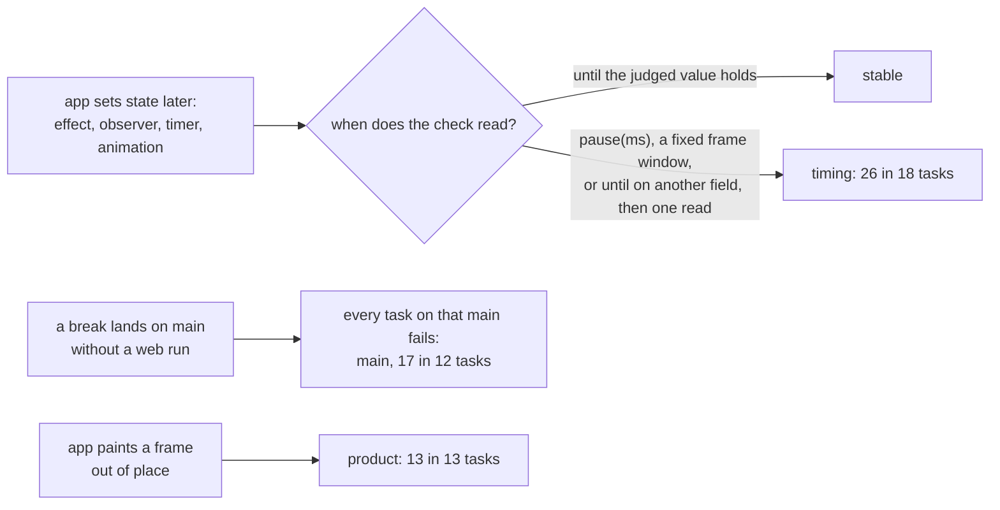

# Web scenario failures: one cause?

Asked 2026-11-15 by the owner. Measured by `python3 -I docs/design/scenario-flakes-measure.py --until 2026-11-15T10:00`, which is read-only. Each number below is a line of its output. `--gh` caches the CI runs and `--load` caches the passing runs' load lines, both in `.work/scenario-flakes/`.

**Answer.** No single cause explains most failures, and most of the recent "timing flakes" are not flakes.

- Tasks shared 72 failures. Those split into 4 causes, and one is in the check scripts: a check judges a value that it read at a moment it chose (26 failures in 18 tasks). Of those, 22 were fixed one at a time before 11-12.
- In the last 3 days, the shared failures were mostly a broken main (8) and product bugs (6), not timing reads (4).
- Runner load does not separate failing runs from passing ones (median 12.6 vs 11.8).
- The change that removes the most failures is one wait primitive, `expect()` in `scripts/web-cdp.mjs`, plus a pause ratchet. It removes 26 failures of 223 in this window, and it stops the pattern from coming back.
- Of the 5 cases the owner named, only the since line is a timing read. followEnd and the steady scroll (the same assert, `web-tasks-check.mjs:2149`) are #463. The To check motion is a product hypothesis. The card pictures check already waits 30 s on the value it judges.

## The failures (21 days, since 2026-10-25)

There were 312 `web` check runs and 223 of them failed. In the last 24 h there were 49 runs and 32 failed. The owner's figure of 66 failed runs in 24 h counts every scenario; this doc counts only `web`. 298 runs name their task's HEAD through the CI run's scenario commit.

| class | rule (script §3) | fails | 24 h | tasks |
|---|---|---|---|---|
| own | the task's diff adds or changes a line with the failing assert's words | 38 | 5 | 17 |
| once | one task, which did not change the assert | 49 | 6 | 25 |
| generic | no assert named (design lint, uncaught exception, console errors) | 26 | 3 | 19 |
| infra | no assert failed: gh 403 or rate limit, a queue cancel, a job cancelled, a DNS failure | 38 | 1 | 18 |
| **shared** | the same assert failed in 2 or more tasks that did not change it | **72** | **17** | 35 |

"Code the task did not touch" is shared plus infra: 110 of 223 (49%).

## Shared groups and the first wrong state

| kind | fails (last 3 days) | groups (fails) and assert, file:line in this checkout |
|---|---|---|
| timing | 26 (4) | Jump to latest 4 `web-terminal-check.mjs:422`; working chat 4 `web-browser-check.mjs:431`; age timer 4 `web-tasks-check.mjs:3440`, `web-browser-check.mjs:330`; since line 4 `web-tasks-check.mjs:710/725`; wide blocks 3 `web-browser-check.mjs:699`; stream frame 3 `test-web-client.py until`; key row 2 `web-terminal-check.mjs:245`; typing dots 2 `web-tasks-check.mjs:477` |
| main | 17 (8) | push badge 8, unchanged-stamp reads 4, `held_pdf` NameError 2, CSS literals 3, all in `test-web-client.py` |
| product | 13 (6) | followEnd 7 `web-tasks-check.mjs:2149` (#463); To check motion 6 `web-tasks-check.mjs:176` (hypothesis) |
| ranout | 6 (4) | card pictures 3 `web-panels-check.mjs:216`; no reply after the question 3 `web-tasks-check.mjs:1290` |
| input | 4 (0) | Inbox slide 4 `web-browser-check.mjs:320`; since #291 the check sends touch events, not a synthesized gesture |
| not read | 6 (2) | New session + 3, manager's quote 3 |

**timing: proven by the code and by the fixes.** A read of each assert at the file:line above found the same shape:

- **One field waited, the rest read once.** The `working chat` and `wide blocks` checks wait with `until()` on one field, then read the other fields once. The `Routines pill`, `manager's quote` and `Home chat row` checks are written the same way and have not failed yet.
- **A read after a fixed pause.** `age timer` reads the time once after `pause(1200)` (`web-browser-check.mjs:329`), and `typing dots` reads `animationName` once (`web-tasks-check.mjs:477`). The since line's fit is read once, right after its animation check (`:725`).
- **The fixes.** Task 283's notes describe its fix as a wait on the judged value: the key row's `dataset.more`, the `--log-scrollbar` width that `wide blocks` reads, and the age timer. Jump to latest, working chat and stream frame have not failed since 11-07, and since 11-11 only the since line and typing dots (last on 11-13) have failed.
- **The pattern is still there.** The scripts hold 127 `await pause(` calls. At least 33 of them are followed within 3 lines by a read that feeds `fail()` with no retry. 16 of those judge a state that comes later (for example `web-tasks-check.mjs:1762, 1840, 2200, 2472, 2646, 3891-3904`). There are also 9 hand-written polling loops that copy `until()` (`web-tasks-check.mjs:335, 708, 728, 832, 895, 3893`).

**main: proven by the trees.**

- The push badge assert failed 8 times in 4 tasks (#459, #432, #442, #433) from 11-14 17:31. It failed twice on the same tree (`7dfb043f`, `1768a1d8`).
- None of the failing trees contains `b60c4c7e` (19:49, "the ask line ... counts in the badge"). The first tree that has it passed (#442 `c3e163dc`).
- The break landed at 16:44 with #458 (`fb9846ef`). #458's log has check runs for `task` and `boundary` only, never `web`. It landed 10 min before #441 made the host run scenarios by changed paths (`7f346ab5`, 16:54).
- The unchanged-stamp reads failed in 4 tasks within 32 min on 11-08, between main `3e8d3931` and `3078a264`. That range was not bisected.

**product: followEnd proven (#463), To check a hypothesis.**

- Every To check failure starts `[844,844,1xx,…]`. In #433 (11-15 01:35) the sheet's top goes `844, 127, 563, 377, 299`: it is painted at its resting place, then goes back down and rises. `oneMotion` fails on any step back, and a longer window would not hide one.
- Cause (#482): no remount and no second animation. The sheet's page events are only `added`, `open` and one `animationstart`, three frames late; the dialog count stays 1. The `sheet-in` animation (`from` only, no fill) is pending for a frame or two under load, and one read in that window returns the rest value. Not the scroll of `ChecksPage` (the same rate with and without it). Proof on the host (CI run 44034340215, the same open repeated under CPU x10 and x16, 60 opens each): without a fill 5 of 120 opens stepped back, with `animation-fill-mode: backwards` 0 of 120. Earlier rate: 1 in about 14 opens at x4 (run 44023745560). Fix: `backwards` in the `.task-sheet[open]` animation (app.css), so the sheet holds its `from` value until the animation starts. `oneMotion` is unchanged; it prints the animations' `currentTime` with one decimal, which a rounded `-0.4` hid.
- followEnd is the same symptom, one frame in the wrong place, on the chat scroll. Both show only on CI.

**ranout: cause not proven.** The card pictures check already waits up to 30 s for `img.complete && naturalWidth > 0` (`web-panels-check.mjs:216`), and it failed in #420, #443 and #463. A wait on the judged value that runs out says that the state never came, not that it was read too early. Hypothesis: the image route or the image cache.

**Runner load: measured, not the cause.** test-web-client.py prints `wsxd watch` at exit: the 1-minute load at the 5 worst wsxd stalls, on a runner with 3 cores. The median of each run's samples:

- timing failures: 12.6 (n 26)
- other assert failures: 12.7 (n 159)
- passing runs (the last `wsxd watch` line of each job's log): 11.8 (n 50 of 89; `--load` was stopped there, and a rerun fetches the rest)

The scenario loads its own runner, and the load is the same whether a run fails or passes.

## The one change

**`expect(read, ok, label, attempts = 100)` in `scripts/web-cdp.mjs`.** It is `until()` that returns the judged value. It evaluates `read` every 100 ms until `ok(value)` holds, then returns the value. When its bound passes, it calls `fail(label + ': ' + JSON of the last value)`. A frame check gets `watchUntil(expr, done)`, which samples until `done` holds (for example, every `document.getAnimations()` entry is finished), not for a fixed time. They replace:

- each `until(a); v = read(); if (!ok(v)) fail(v)` pair, which becomes one `expect`;
- each `pause(n)` followed by a judged read;
- the 9 hand-written loops.

`until()` stays, as `expect(read, Boolean)`.

**Count it removes:** the 26 timing failures in 18 tasks. Each of them cost a failed run, a worker turn and a rerun before its group was fixed alone. The 16 timing-prone pause sites that have not failed yet move to `expect()` in the same change.

**Rule that keeps it out.** `launch()` in `web-cdp.mjs` counts `await pause(` in `scripts/web-*.mjs` and fails when the count is above a constant (`PAUSES = 127`, lowered by each migration). A new check cannot add a pause, so it uses `expect()`. A pause stays legal only before a "nothing happened" read that follows a later positive event, the `stays()` rule of test-task.py (task 316). The rule goes into docs/web-client.md, beside "wait for a state, not a pause".

**Not in this change:** the `main` class. Its root cause, landing without a web run, was closed at 11-14 16:54 by #441. A land still rebases onto a newer main without running the scenarios again. That gap is a hypothesis: no failure since 16:54 has been traced to it.

## Product bugs, not flakes

| bug | evidence | status |
|---|---|---|
| The chat moves one frame without the reader (390 and 1280 px) | 7 tasks, `web-tasks-check.mjs:2149`; 2 same-tree reruns passed, so it depends on frame timing, but the frame is real | #463 is fixing it |
| The To check sheet paints a frame at rest before it rises | frames `844, 127, 563, 377` (#433); 6 tasks | hypothesis: the animation restarts |
| The panel card pictures do not load in 30 s | 3 tasks, 2 failures on 11-15; the check waits on the judged value | hypothesis: the image route or cache |
| The page asks for more than the device budget (240 a minute) and the browser logs 429; the card of c904 shows no three captures | `console errors: ... 429 (Too Many Requests) /api/tasks/3/chat` in the logs of #486, #487, #490, #493, #498; `the card of c904 does not show three captures` in #482, #493, #502. #482 counted the requests of the tasks check (`requestRates`, `web-cdp.mjs`), run on 2c397dfb: busiest 60 s **433** (74 refused, 104 sent from the check itself: its `until` reads and the retries of `watchFetch`), the page's own about 329; each mount of the manager screen read chat 1, checks 2, routines 2 | Two causes. (1) `until` asks every 100 ms, so a wait that fetches spends up to 600 requests a minute: now `untilApi` (once a second) in the 7 fetch-bearing waits. (2) The manager screen read checks and routines at the mount and again when the chat arrived (`noted` and the newest row's key change then): now both start once the chat is in (`chatIn`, `tasks.js`). The c904 card: the list is the sheet's own read at open; the 429 retries and delays of (1) can hold it past the 10 s wait. This is read from the code and the counts, not seen in a failing c904 log (the CI logs cut it). A per-hook read gap (1.5 s) was tried and removed: it does not touch mount reads and moved late rows under position checks. The check now fails when the page's own busiest 60 s is above 240 |

## Questions for the owner

1. **Build `expect()`, `watchUntil()` and the pause ratchet as one task, and migrate the 33 pause-then-judge sites and the 9 loops?** Recommendation: yes. It is the only shared cause in the check code. It costs one web check-run per batch of migrated files.
2. **Open the To check sheet animation as a product task now, beside #463?** Recommendation: yes. Its step back is not a timing artifact, and it has the same symptom as followEnd (a frame in the wrong place). Hold the card pictures until the next failure, which should be read with the server log.
3. **Run the touched scenarios again at land when main has changed their paths since the pass?** Recommendation: not yet. No failure since #441 needs it. Run this script again on 2026-11-22.

## Task scenario, host part: 37c and 39b (task 502)

Two causes, not one. The #484, #490 and #491 failures of 37c ran on trees without 457bdb23; #470, #482, #485, #495 and #498 failed 39b.

- **37c, "the refused fallback sends the worker home for the wait".** A task away on a fallback whose account holds a limit record, with no other fallback free, got `Next::Wait` from `agent::next` before its turn. The host held the turn with `wait_at_home` and left the record on pi (log tail: `message`, `limit_wait`, no `agent_switch`). `refused()` went home first. Both now use `wait_away`. The record came from another host's pi turn (the manager quoting PIREFUSE, fixed by 457bdb23); section S2q stages the record by hand, so the check no longer depends on that race.
- **39b, `KeyError: 'limit'`.** The manager logged `stopped` and `limit`, then ran `alert_failed` (reads every task record of the project), and only then saved `state.limit`. The check reads the state as soon as it sees `stopped`. The hold is now saved first, in the error branch and in `hold_on_account`. Not done: `refused()` on a fallback still logs `rotated` before the hold is saved (37c S1 reads state after `rotated`).
