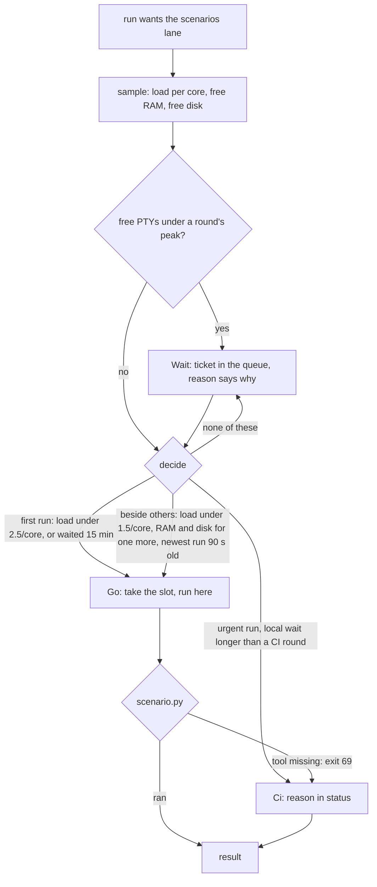

# The machine's scheduler

One owner decides when a heavy run starts on this Mac: `wsx_core::task::schedule` (plain rules over plain
facts, unit tested) and `crates/wsx/src/task/slot.rs` (the `flock` files and tickets that hold the runs).
Heavy runs are: a task's checks (lane `checks`, one at a time), a scenario round (`task`, `web`; lane
`scenarios`, several at once), and the deploy's smoke test and the release handoff (`wsx task slot <cmd>`,
which replaced `scripts/check-slot.py`). Owner words, wsx 5441 and 5461: watch the disk, schedule well,
go to the slow external CI only when there is nothing else.

## Flow

States of a waiting run: `queued for the <lane> slot` (record `waiting.on = check_slot`) until it takes the
slot, then `checking`. A run on CI shows `Running its scenario tests on CI` (kind `ci_scenario`) until the run
ends. Both end when the run answers.

## Rules

| Rule | Where |
|---|---|
| Sample: 1-minute load per core (`getloadavg`), free RAM (macOS `host_statistics64`, Linux `/proc/meminfo`), free disk of the working copy's volume | `schedule::sample` |
| Width: at most `MAX_SCENARIO_RUNS` (3); `WSX_SCENARIO_SLOTS` lowers it. A first run needs load under `START_LOAD` 2.5/core, or has waited `LOAD_WAIT` 15 min with the lane free for it (`schedule::load_waited`: time queued behind another run does not count; the deploy's smoke test, `wsx task slot`, waits like a task round and says `load N on C cores` in deploy.log). Each extra run needs load under `WIDEN_LOAD` 1.5/core, `RUN_RAM_MB` and `RUN_DISK_MB` (3 GiB each) free, and the newest run older than `SETTLE` 90 s (the load average lags) | `schedule::decide` |
| PTYs: free = `kern.tty.ptmx_max` (macOS) or `/proc/sys/kernel/pty/max` minus the slave devices that exist (`/dev/ttysNNN`, `/dev/pts/N`). A run of the checks or scenarios lane starts only with its peak free (`schedule::run_ptys`: 222 for `scenario.py task`, 274 for `web`, `CHECK_PTYS` 60 for checks) times the runs in the lane plus itself, since a run that just started has not opened its PTYs yet; else it waits with `waiting for PTYs: <free> free, a round needs ~<n>`; no wait time lifts it, because a run that starts without a PTY fails with `failed to openpty`. Off with `WSX_SCENARIO_SLOTS` (fixtures) | `schedule::decide`, `Lane::ptys` |
| Order: `Land` (a land's checks), `Urgent` (another open task waits for this one through `after`), `Asked` (the owner made the task), `Normal`; then arrival. A ticket's priority is fixed when it joins | `schedule::urgency`, `slot::ticket_name` |
| Turns: a worker turn takes a place in the `turn-slot` queue (one slot) before it starts. It starts under `START_LOAD` per core, or after `LOAD_WAIT`; the slot stays held 60 s (`disk_settle`) so the next turn sees the load this one adds. It waits as `waiting.on: load` and resumes by itself; its text rides `disk_wait`, as a turn held for disk does | `host.rs` `wait_for_load`, `slot::admit` |
| History: a scenario run's `check_run` result has `width` (runs in its lane at its start); `wsx task widths` prints runs and failed runs per part and width, from the summary line of `scripts/scenario.py` | `schedule::widths` |
| CI: only an urgent run, and only when its estimated local wait (rounds ahead times the median recorded `ms` of that command, else 15 min) is longer than a CI round (25 min, p50 of 40 runs) | `schedule::decide` |
| CI: any scenario-only run when free disk is under `tasks.minFreeGb` after the cleanup (`build::reclaim`); a run with plain checks is refused as before | `host.rs` `start_check_run` |
| CI: the scenario exits 69 (`cannot run here: ...`: cargo, git, node or Chrome missing) | `scripts/scenario.py`, `host.rs` `spawn_checks` |
| CI run: `WSX_SCENARIO_ON=ci` makes `scenario.py` run `scripts/ci-scenario.py`: push HEAD with main's workflows to `wsx-scenario/<name>/<time>-<commit>[--<part>]`, `ci.yml` runs the parts (`scenario.py --matrix` lists them), wait up to 70 min, print the failed section lines, fetch the captures, delete the branch | `scripts/ci-scenario.py`, `.github/workflows/ci.yml` |

The status and the log say why: `queued for the scenario slot behind <holder>; <note>` while it waits, and
`went to CI: <reason>` for a CI run (`task::status::slot`).

## Not done

- A turn that runs cannot be throttled: the gate holds only the start of a turn. Load comes from what the
  agent builds during a turn, so the gate lowers the number of turns that start at once, not their size.
  The gate has no setting. Fixtures set `WSX_SCENARIO_SLOTS`, which turns the machine rules off, so their turns
  start first come, first served.
- The constants are first guesses. At 10 cores and 24 GiB with agents building, load sits near 18, so the
  lane stays at width 1 until load drops; `docs/design/check-queue-research.md` rank 7 (N slots) was
  rejected because timed tests fail under load, so the width follows load, not a fixed N.

## Measured

Source: the host's check-run on head 259a89ed (`check-run-8.log`, `check-run-9.log` of task #522), 10 cores,
24 GiB, other tasks building at the same time.

- `task`: 7 parts as 7 processes at once, 653 s for the slowest (`core`); `web`: `chat` 431 s, `tasks` 675 s.
  The `wsxd watch` samples in the web log show load 35 to 60 during the round.
- Free disk of the working copy's volume: 16 GiB at the end (`df`); it was about 11 GiB at the start of the task.
- Section `32v2` (disk low, scenario-only run goes to CI with `went to CI: ... GB free of the 100000 GB`) passed in part `deploy`.
- Not measured: two tasks' rounds at once at width 1 against a wider lane. Load stayed over 1.5 per core on
  this Mac all through the task, so the rule kept the lane at width 1 and a wider lane never ran here.
  The failure counts at width 1 against width 2 or 3 are open.
- PTYs: `kern.tty.ptmx_max` is 511. Source: the `PTYS in use: <start> at start, peak <n>` line that
  `scripts/scenario.py` prints, in the two check-runs of this task on c42ff1c7: 114 at start, peak 336 and 114 at
  start, peak 388, so a round adds 222 and 274 PTYs. Which is which is not read from the logs (they are not readable
  from the working copy): the lines came in the order of the checks, `task` then `web`, so `task` 222 and `web` 274
  [unverified]. With 511 in the pool and the live wsxd holding ~144, 367 are free: one round starts and a second
  needs 444, so two rounds never run side by side (unit test `a_run_waits_for_the_ptys_its_round_needs`).
  The checks' 60 is the rise of `cargo nextest run --workspace` (460 to 513 in `/dev/ttysNNN` while other
  runs were on the Mac, so at most 53, rounded up). While other tasks held 476 to 515 of the 511, every PTY test
  failed with `failed to openpty`; a run now waits with `waiting for PTYs` instead.
- Turn gate: not measured. The gate adds a wait only above `START_LOAD` per core, and the first turn after 60 s
  settles; whether it lowers the load of a day with seven tasks building is open.
- Width history: `wsx task widths` has no rows until runs that carry `width` are recorded.
