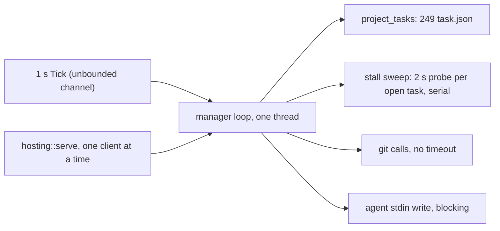

# Task host and manager host health audit

Status: read-only audit, 2026-11-06. Scope: `crates/wsx/src/task/` and `crates/wsx-core/src/task/`. Paths below are relative to `crates/`. The findings come from the source. The numbers come from the owner's real task state, read only: 408 tasks over all projects, 249 of them in the wsx project, 9 working and 5 ready at the time of the audit.
Out of scope, already planned: [client-logic-audit.md](client-logic-audit.md) (#238), #236 status wording, #240 chat rows, #241 role timers, #243 scenario queue, #235 usage filters, #242 web back and zoom. The per-poll `read_log` calls in `wsx-web/src/tasks.rs` and the 1 s ledger rebuild in `wsx/src/task_list.rs` belong to the client audits.

**Answer.** The file I/O per sweep is cheap at today's sizes. The real costs are elsewhere. Worker agents leak their process trees. A crash can lose an owner message. One serial manager loop lets a slow host or git call delay every `wsx task` request.

## Findings, ranked by impact

| # | Place | Problem | User-visible effect | Evidence | Proposed fix | Size | Risk |
|---|---|---|---|---|---|---|---|
| 1 | `wsx/src/task/claude.rs:371`, `pi.rs:83`, `claude.rs:426-436`, `host.rs:1213`, `manager.rs:2362` | The agent starts with no process group. `stop` kills only the agent pid. A stream end sets `self.agent = None` and never waits on the child. | Bash children, dev servers, test runs and MCP servers outlive close, rotate, discard and re-exec. A self-exited agent stays a zombie until its host exits. | `rg 'process_group\|setsid'` finds no match in the agent spawn code. The only `wait` and `try_wait` calls are in `stop()`. `preview.rs:189` and `git/mod.rs:196` do use process groups. | `process_group(0)` on spawn. `killpg` with SIGINT, then SIGKILL, in `stop`. `try_wait` and `wait` on stream end. Stop the agent from a `Drop` guard. | S-M | Low. The Seatbelt profile stays the same. |
| 2 | `wsx/src/task/manager.rs:688-716` (`restore`), `:1676-1687` | `restore` requeues only messages that have no `Delivered` entry. If the agent dies after `Delivered` and before `Reply`, the message is not requeued. If `send_turn` fails, the popped ids are gone from the queue until the next restart. | After a crash or kill during a turn, an owner message stays unanswered with no error. A failed agent start leaves messages that no later turn sends. | `restore` builds `delivered` from every `Delivered` entry, then skips those ids. `send_turn` errors return after the `pop_front` at `:1575`. | On restore, requeue ids that are delivered but have no `Reply`. On a `send_turn` error, push the items back to the front of the queue. | M | Medium. A requeued message can be answered twice. Mark it as a replay. |
| 3 | `wsx/src/task/manager.rs:514`, `:1179-1215`, `hosting.rs:54-80`, `manager.rs:2096` | One thread runs every watcher. A 1 Hz Tick goes into an unbounded `mpsc`. The stall sweep probes each open task's host in turn, with a 2 s timeout each (`stall.rs:21`). Git calls in `deploy_status` have no timeout. `hosting::serve` handles one client at a time and waits up to 15 s for the loop. | A busy loop makes `wsx task say`, `post` and the web chat slow. A timed-out client that retries can send its message twice. Ticks pile up and then run back to back. | 14 open tasks give a worst case of 28 s per sweep while the hosts are live but busy. `hosting.rs:73` uses `recv_timeout(reply_wait)` inside the accept loop. | Coalesce ticks with a bounded `sync_channel(1)` and `try_send`. Run the probes on threads and join them. Give the git calls a timeout. Answer each connection on its own thread, as `broker.rs:212` does. | M | Medium. The watchers' state must stay on the loop thread. |
| 4 | `wsx/src/task/host.rs` run loop, `agent.rs:354` | A worker's agent turn has no idle or turn deadline. The stall sweep only reports. A read error on stdout ends the stream as `Ok(0)` does, while the child may still run. | A stuck `claude` or `pi` keeps its task in `working` until the owner acts. After a read error the task shows `failed` while the old process still runs. | `agent.rs:354`: `Ok(0) \| Err(_) => return`. The host has timers for disk, limit, background and ping, but none for a quiet turn. | On a stream end, call `stop()`, which waits and kills. The bounded quiet stall (`stall.rs:182`) can ask the host to stop the turn. The owner decides that policy. | S | Low |
| 5 | `wsx/src/task/claude.rs:416`, `pi.rs:128`, `pi.rs:137` | `write_all` to the agent's stdin runs on the host loop. A message can be 64 KiB, which is more than a pipe buffer. Pi's `stop` writes `abort` before its kill timer starts. | If the agent is stopped or hung, the whole host freezes, and its status probe then reads as "host does not answer". | Code read | Write from the reader-side thread or with a deadline. In Pi `stop`, signal first. | S | Low |
| 6 | `wsx-core/src/task/copy.rs:193-196`, `copy.rs:48-55`, `:229-236` | Any clone error, ENOSPC included, clears the copy and falls back to a plain copy that includes `target/`. `git` and `cp` have no timeout. A host killed mid-copy leaves a `-t<n>` folder, and `remove_orphans` does not reap it. | When the disk is full, the plain copy makes it fuller. A retried task fails with "already exists". | `if clone_all(true).is_err() { clear_except_git(path)?; clone_all(false)?; }` | Fall back only on `ENOTSUP` or `EXDEV`, and pass other errors up. Add timeouts. Reap a `-t<n>` copy whose task has no live host. | M | Medium. The disk data path changes. |
| 7 | `wsx/src/task/batch.rs:178-185` | A detached batch polls `task.json` with no bound while the task is `checking`. | If the host dies in `checking`, the batch process and its scratch copy stay until the host restarts. | `loop { ... if record.state != Checking { return } sleep(POLL) }` | Exit when the host socket does not answer, or after the check timeout. | S | Low |
| 8 | `wsx/src/task/manager.rs:995`, `:2156`, `stall.rs:44/129/182` | Every tick, the manager reads every `task.json`, plus `approvals.jsonl` and the deploys. `ping` reloads the config and all tasks every second while it is due. The stall sweep loads `wsx.yml` 2 to 3 times per open task every 10 s. | None today. The cost grows with task count and keeps the manager awake on an idle laptop. | Reading the 249 `task.json` files takes 8.3 ms in Python, which is about 1% of a core at 1 Hz. | Gate the scans on a stamp of directory and file mtimes, as `task_list.rs` does. Load the config once per sweep. | S-M | Low |
| 9 | `wsx/src/task/manager.rs:689`, `:1374`, `:2506`, `:2603`, `:1422` | The manager log is parsed in full at restore, recap, quote and rotation. Each agent progress line is logged. The first recap after a start parses every task log for `cost_since`, without the 7-day filter that `usage::spend` uses. | A slower first recap, and log growth | The log is 2.7 MB with 8,897 lines since 2026-10-16. 4,634 of those lines are `agent` (773 KiB). The task logs hold 25 MB and 33,725 lines, which take 155 ms to parse in Python. The log rolls over at 8 MiB and keeps one old file. | Do not log agent progress to the manager log. Filter `cost_since` by `updated >= since`. | S | Low |
| 10 | `wsx-core/src/task/store.rs:462`, `:474-481`, `:518` | `append` does not end a torn last line, so the next event glues onto it and both are lost. A glued line over 160 KiB makes `read_log` return `Err`, and most callers turn that into an empty log. `last_entry` falls back to parsing up to 16 MiB when its 512 KiB tail has no hit. The stall sweep calls it every 10 s for each ready task. | After a crash, one event is lost. In the rare case of a glued line, the usage shows 0 and `report.md` is not written. | No open task hits the tail fallback today. 3 logs are over 512 KiB, and all 3 are landed. | Write a newline first if the file does not end with one. Skip a long line as the manager reader does (`store.rs:844`). | S | Low |
| 11 | `wsx/src/task/notes.rs:239`, `manager.rs:244` | The archive rewrite reads only the last 256 KiB (`read_note`) and writes it back. | Past 256 KiB, the head of `context-archive.md` is cut with no notice. | No archive exists yet. | Append to the archive instead of rewriting it. | S | Low |

## Proposed fix tasks, in priority order

1. **Agent process lifecycle (findings 1, 4, 5).** Files: `wsx/src/task/claude.rs`, `pi.rs`, `agent.rs`, `host.rs`, `manager.rs`. Proof: in the `task` scenario (`scripts/test-task.py`, CI), a fake agent starts `sleep 600 &` and then exits. Run `wsx task close`. Assert that the sleep pid is gone and that `ps` shows no zombie under the host.
2. **Manager message durability (finding 2).** Files: `wsx/src/task/manager.rs`. Proof: in the `task` scenario, `wsx task say` to a manager with a fake agent that never replies. `kill -9` the manager host after `delivered` is logged, then start it again. Assert that the message reaches the next turn exactly once.
3. **Manager loop latency (finding 3).** Files: `wsx/src/task/manager.rs`, `hosting.rs`, `wsx-core/src/task/stall.rs`. Proof: in the `task` scenario, add three task hosts whose sockets accept a connection but never answer. Time `wsx task say` during a stall sweep and assert under 1 s. Assert that the stall is still reported after `GRACE`.
4. **Copy and batch cleanup (findings 6, 7).** Files: `wsx-core/src/task/copy.rs`, `wsx/src/task/batch.rs`. Proof: in the `task` scenario, kill a host during the copy, then run `wsx task add` again. Assert that it succeeds and that no `-t<n>` folder is left. Then kill a host in `checking` and assert that the batch process exits.
5. **Log robustness and scan cost (findings 8, 9, 10).** Files: `wsx-core/src/task/store.rs`, `wsx/src/task/manager.rs`, `stall.rs`. Proof: in the `task` scenario, cut a task log mid-line, then append an event. Assert that `wsx task show` lists the new event. Run an idle manager over a fixture of 250 tasks for 60 s and assert that its CPU time (`getrusage`) stays below a bound.

## Checked and fine

- Writes of `task.json`, `state.json`, `result.json` and notes go through `fs_util::write_atomic`: a temp file, `fsync`, then rename.
- Re-exec after a deploy (`host.rs:300-312`, `manager.rs:536-543`) stops the agent and removes both sockets before `exec`. Rust opens its fds with `CLOEXEC`. A host that restarts reruns its checks if it was `checking`, and parks a `working` task (`host.rs:530-548`).
- Check, scenario, limit and disk slots are an `flock` that the kernel drops when the holder dies (`slot.rs:6`). A dead ticket is removed when the next waiter joins (`slot.rs:168-190`). Three dead `disk-slot` tickets from 2026-10-29 are still on disk, but `lsof` shows no holder, so they block nothing.
- The task log is capped at 8 MiB for progress events and 16 MiB in total (`store.rs:16-18`). `follow-up.log` is truncated past 4 MiB (`store.rs:575`). The manager log rolls over at 8 MiB. The stream reader caps a line at 4 MiB (`agent.rs:355`). Agent stderr is inherited, not piped, so it cannot fill a pipe and deadlock.
- `usage.rs:127-153` caches parsed logs by length and mtime. The manager log reader skips bad lines instead of failing (`store.rs:844`). Broker connections have 10 s timeouts (`broker.rs:222`). Report git calls time out after 30 s.

## Top 3

1. Worker agents leak their child processes and zombies, because they run with no process group and are not reaped.
2. A crash during a manager turn, or a failed agent start, can leave an owner message unanswered with no error.
3. One serial manager loop, with serial 2 s host probes, git calls with no timeout and a one-client socket, can delay `wsx task say` by seconds.
