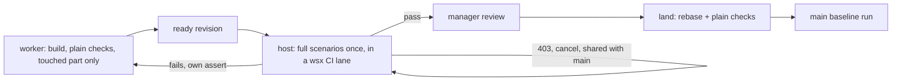

# Task time and cost: where a task's 89 minutes and $2.85 go

Audit of 2026-11-13, run on `claude-fable-5-1`. Window: the 108 tasks created from 2026-11-08 00:00 KST (#321 to #427), 100 landed. Query: `python3 -I docs/design/task-time-cost-measure.py` (tables T1 to T7; `--gh` fetches the CI jobs once into `.work/task-time-cost/`). Earlier: `check-scheduling-audit.md` (11-07).

## Answer

1. A landed task takes p50 89 min, p90 381 min. The worker's own turns are 9% of that (build p50 5.8 min). Half is waiting for CI check-runs (T2): 3.7 CI runs a task, 61% of them fail, each about 17 min.
2. Of the 229 failed CI runs, 120 (2352 min, 24 min a task) are not the task's: an assert that also failed in another task (68), a 60 min queue cancellation (18), a GitHub 403 rate limit (27), a flake the same commit then passed (7). Each wakes the worker for a turn ($0.15) and a rerun.
3. The manager is not the bottleneck: ready to land p50 0.3 min at every concurrency; created-to-landed p50 is 96 / 85 / 84 min with 1-2 / 3-4 / 5+ tasks open. What serializes at scale is GitHub's 5 macOS jobs (queue p50 15 min, p90 40 min once 5 jobs run), `--after` chains (1709 min) and the usage limit (1152 min, rising with load).
4. Cost: worker $2.34 a landed task (p50 $1.86), manager $0.51. 97.5% of input is cache reads (786 M tokens, 56 model calls a task). The plan step is 24% of worker cost and asked the owner once in 76 turns; small tasks (one step) are sent back as often as full ones.

Since 11-07: the local check lane no longer waits (queue 260 min in 5 days, 1.7% of task time, against 70% of check time then). The scenario time moved to CI and grew: 7332 CI wall-min, fail rates unchanged (web 69% against 74%, task 56%), plus two new failure classes (403, queue cancel) and 2302 min of GitHub queue.

## Measurements (landed tasks; min = minutes)

| # | Measure | Number |
|---|---|---|
| T1 | created to landed | p50 89.0, p90 381.1; small (11) 65.9 / 196.6; full (89) 89.0 / 414.9; sum 14983 |
| T2 | phases, share of the sum | check-run waits 49.8% (88 tasks, p50 63 p90 187); `--after` 11.4% (20 tasks, p50 42); manager wait 10.7% (#345 alone 1319 min after a failed sign-in turn; p50 0.3); limit 7.7% (16 tasks, p50 51); parent waits for children 7.2% (2 tasks); build turns 5.4%; host checks 2.6% (p50 2.4); plan 2.0%; sent-back turns 0.9%; review 0.8%; land 0.8% |
| T3 | worker turns by step | build 240 turns $122.6 ($1.23/task); plan 76 turns on 57 tasks $55.9 ($0.98); sent-back 113 turns on 31 tasks $26.5; review 128 turns $25.5 ($0.45); conflict 20 turns $3.4 |
| T3 | turns by trigger | step 203 ($144.8); check-run answer 198 ($30.0); message 81 ($33.0); rotation 45 ($12.0); limit 11 ($8.0) |
| T4 | USD a landed task | worker p50 1.86 p90 5.09 (small 1.22, full 2.02); manager review share p50 0.30, other 0.06; pings $0.34 in all |
| T4 | tokens | cache read 786 M, cache write 20.4 M, fresh input 0.1 M, output 5.9 M; calls a task p50 56 p90 122; turns p50 5 p90 12; 43 rotations; repeated reads 20% of 205 Read calls |
| T4 | plan's yield | 1 of 76 plan turns blocked on the owner; sent back: full 30/89, small 4/11 |
| T5 | check-runs | 360 in 88 tasks, p50 3 max 16; 214 with a failure; local queue sum 192 (p90 7.1), local run p50 4.8; CI wall p50 16.8 p90 34.7 sum 6596 |
| T5 | host checks | 235 runs, queue sum 68, run p50 1.6; 8 failed (caught); 49 inside lands; conflicts 19; revisions p50 2; sent back 51 times in 34 tasks |
| T5 | CI runs | 374: task 123 fail / 98 pass, web 106 / 47; wall 7332, failed 4301; job-minutes 10863 (109 a task) |
| T5 | failed CI by cause | assert 141 (2764 min; 68 shared with another task, 1315 min), queue cancel 18 (745), timeout 18 (358), script error from the change 19 (304), gh 403 27 (126), push or uncommitted 6 |
| T5 | GitHub queue | task p50 0.3 p90 23.9 sum 1507; web p50 0.1 p90 18.8 sum 795; longest job p50 14.2 / 15.0; with 0-2 / 3-4 / 5+ scenario jobs already running: p50 0.1 / 3.0 / 14.9, p90 5.0 / 11.9 / 40.1 (190 / 71 / 90 runs) |
| T5 | `--after` by reason | check 10 tasks 560 min, files 6 tasks 504, needs 4 tasks 645 |
| T6 | manager | ready event to delivery p50 0.0; review turn p50 0.2 p90 0.5; ready to land or add p50 0.3 p90 5.5; open tasks at ready p50 3 p90 9 max 11 |
| T6 | limit by load | 196 / 370 / 586 limit-min at 1-2 / 3-4 / 5+ open |
| T6 | deploys | 88, p50 8.4 min, 768 min of the Mac; they block no land |

## What the pipeline must guarantee, and the leanest one that does

Must hold: (a) main gets only a tree whose checks passed on that tree: the land's rebase plus the four plain checks do this (49 land re-runs, 8 failures caught in 235 runs); (b) the scenarios pass on main: today nobody proves this, the land runs none, so a break lands and the next 3 to 7 tasks each fail on it (68 shared-assert runs); (c) the owner's decisions hold: the manager's review and send-back (51 in 34 tasks at $0.30 a task) and the to-check list do this cheaply. Everything else is the worker proving its own work, and today it proves it 3.7 times a task on a shared 5-job runner, with a model turn to read each answer.

## Ranked changes (saving per landed task, averaged over the 100)

| # | Change | Saves | Evidence | Fix (one line) | Proof |
|---|---|---|---|---|---|
| 1 | CI runs that are not the task's start no worker turn: the host retries a 403 or a queue cancel on the same tree, and answers an assert that main or another task also has as "fails on main" | 24 min, $0.20 (120 turns at $0.15 plus their reruns) | T5 causes: 120 of 229 failures, 2352 min; 198 check-run turns $30 | `host.rs` check-run: classify the `ci:` result by cause before it becomes a turn; `task::failure` already keys shared failures | `scripts/test-task.py` stages a 403 and a shared assert: one `check_run` entry, no `result`; this script's cause table goes to 0 for 403 and cancel |
| 2 | Scenarios run once per ready revision by the host in a wsx-side CI lane; the worker's own `check-run` on CI takes `--part` of the touched part only | 12 to 25 min (half of 2302 queue-min and of 3.7 runs a task), $0.10, 50 of 109 job-min | T5: 374 runs for 100 tasks; queue p50 15 min once 5 jobs run; 90 runs started into a full runner | the host runs `ci:` checks after the last step as it runs the plain ones, serialized by a lane in `slot.rs`; the worker's instructions name `--part` | CI runs a landed task from 3.7 toward 1.5; GitHub queue p90 under 5 min after a week |
| 3 | `--after --because files` and `check` go: the land's rebase and the land notice cover shared files, change 1 covers "fails on main until #m lands" | 11 min (1064 of 1709 after-min) | T5 after by reason | manager instructions: `--after` only for `needs` | after waits by reason in this script: files and check at 0 |
| 4 | Fewer context re-reads in waits: with change 1, 120 of the 254 non-build turns (check-run answers, rotations, limit) go; a task in a limit continues its remaining steps on the fallback model | 12 min (1152 limit-min), $0.20 | T2 limit 7.7% rising with load; T4 786 M cache-read tokens, 56 calls a task | `host.rs` limit wait: start the next step on `agent::fallback` when the project allows the job | limit phase sum a week in this script; cost p50 |
| 5 | Size: a task whose prompt states what, where and how runs as `--size small` (build only); `--plan` stays for the manager's read | 3 to 14 min (plan wall p50 2.7, p90 14.4), $0.87 (plan $0.98 on 89% of tasks) | T3, T4: 1 of 76 plan turns asked the owner; sent back 34% full against 36% small (11 tasks, small sample) | manager instructions' sizing rule; `task new` default stays | the share of small tasks and the send-back rate over the next 50 tasks |

Not proposed: cutting the plain checks (8 catches), the manager's review (p50 0.3 min, the only owner-decision gate), or the deploys (they block no land). Parent waits (2 tasks, 1075 min) are the children's time, not a loss. #345's 22 h was a failed sign-in turn while the manager was signed out too; change 4's fallback covers it.
