# Task views: lists and task page

Design only (task 433). No code changed. Two options: **A** starts from the data wsx has, **B** from how a person perceives and thinks. The comparison and the 3 questions for the owner are at the end.

## Option A: from the data

The owner's three asks: a better place for the task number and the dot; icons or another compact form for dependency, steps and "what is worked on now", also when every task is "running" and one is blocked; a task page that is short and useful. Choices that have a real alternative are in the 3 questions at the end.

Data: the real task store of this project, read on 2026-11-14 (`wsx task ledger` refuses a worker). The To check and Routines words are samples in the shape of real items; the real To check list was empty. "Before" is the current markup (`tasks.js`, `story.js`) rendered statically; "after" is a static mockup. Both use the real `app.css` and the default theme. Mockup CSS: [task-views/rows.css](task-views/rows.css).

### What is wrong now (390 px, "before")

- Every row: the chip (dot and number) takes 64 px before the title, and line 2 is cut ("Paused, the manager continues it · build 3/3 · i…"). The agent and "into main" repeat on every row.
- Running: `#443` waits for `#442` and `#459` waits for CI, yet each has the same pulsing dot as the task that works.
- To check: three icon buttons leave 125 px for the check ("Open a task that w…"). Task page: five blocks come before the one action; the wait is said twice and the stage a third time.

### One row for the four lists

```
[glyph]  Title, wraps or cuts ............ #444      glyph: who has the ball (the tray's own icon)
         now · relation · relation                  one muted line; "now" first, in tone
```

| Part | Rule |
|---|---|
| Glyph | Replaces the dot and takes the tray's icon: run (`play`, accent) when something runs for the task (agent or a CI check-run); wait (`pause`, muted) when nothing runs and it waits on a task, a limit, the manager or disk; you (`unchecked`, attention) in Needs you; check (`pass`, attention) in To check; failed (`fail`, danger). Shape and the word on line 2 carry the state, not colour. |
| Number | After the title, muted, never cut (as the sheet bar has it). In To check it moves to line 2: it is the task the check belongs to. |
| Line 2, "now" | What it does or waits for, as few words: `build 2/3`, `CI check-run 12 min`, `after #442`, `waits for you`, `limit, resumes 14:00`, `held: deploy freeze`. Run in the working tone, wait in muted, you in attention, failed in danger. |
| Line 2, relations | `blocks #444 #447` (open tasks that wait for it), `in #451` (parent, with `3/12` for a parent), `builds on it` (the `after` reason). Dropped from rows: `into main` (the default), the agent (kept only for `fallback`), the status label that repeats the glyph. |
| Chain | A task nests under the task it waits for (`after`), else under its parent. One rail under the parent's glyph, one step in per level, depth 2, deeper rows flatten with `after #n`. A task with 2 blockers nests under the slowest and says `after #443 and #433`. |

#### The lists at 390 px

| | before | after |
|---|---|---|
| Running | 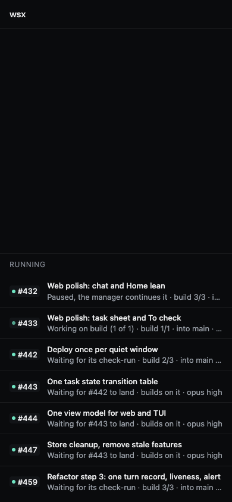 | 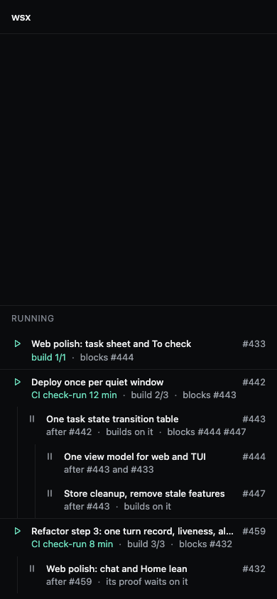 |
| To check | 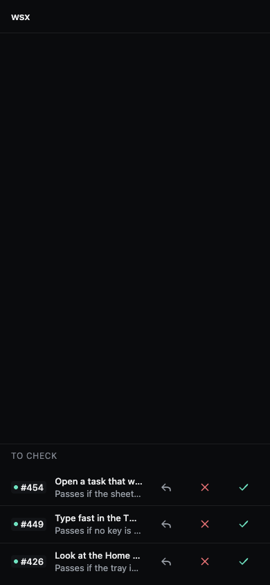 | 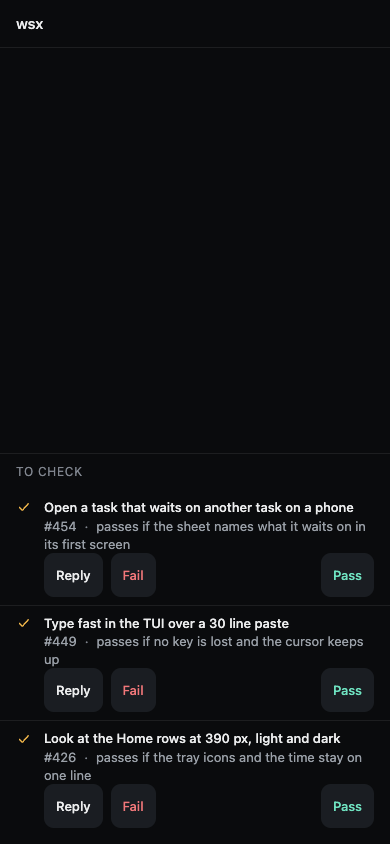 |
| Routines | 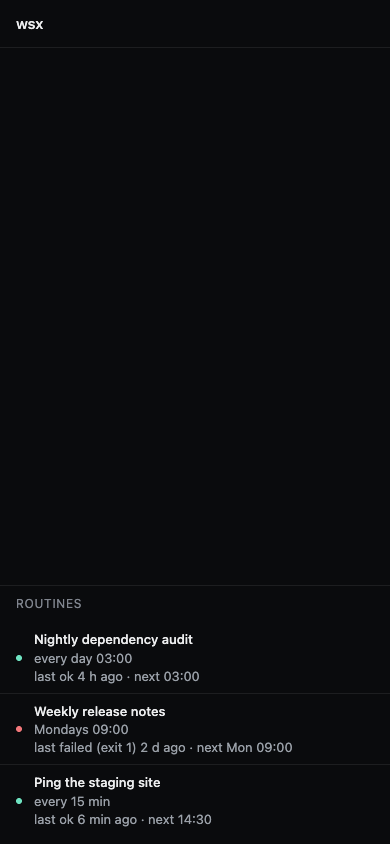 | 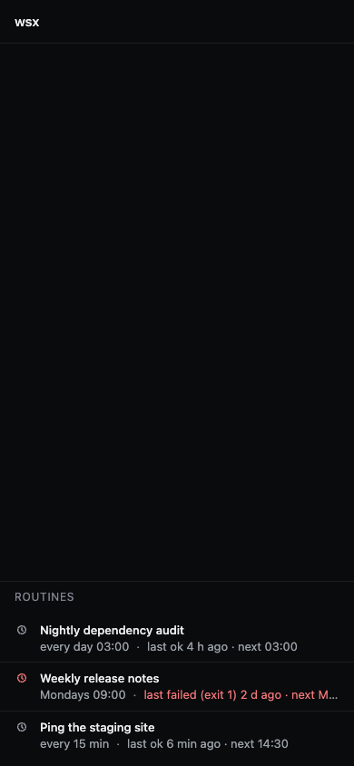 |

- Running: `#433` runs, `#442` and `#459` run on CI (their agent idles, so line 2 says "CI check-run 12 min"), four tasks wait, each under what it waits for. A glance gives 3 moving, 4 blocked and the blocker of each.
- To check: the check wraps to 2 lines, "passes if" is readable, the buttons have words and their own line, Pass at the right edge under the thumb. A row is 105 px, was 52 px.
- Routines: the clock icon, red when the last run failed; line 2 is the schedule, the last run, the next one.
- 1280 px keeps a 72ch measure and the number beside the title: [Running before](task-views/before-running-1280-dark.png), [after](task-views/after-running-1280-dark.png); To check [before](task-views/before-check-1280-dark.png), [after](task-views/after-check-1280-dark.png).

### Task page (first screen)

| 390 before | 390 after |
|---|---|
| 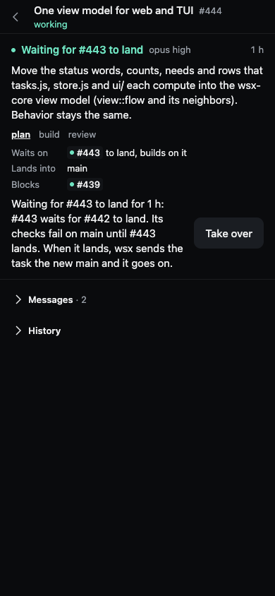 | 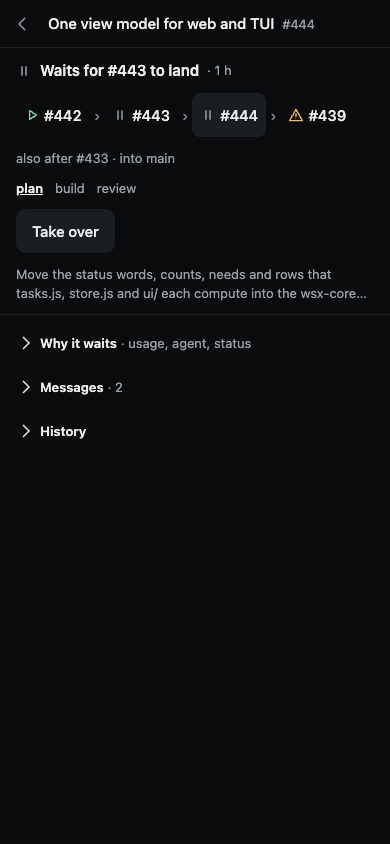 |

First screen, top to bottom: (1) title and number; (2) now: glyph, what it waits for, how long; (3) chain: the blockers it waits on, itself, what it blocks, each a tappable chip with its glyph, then `also after #433 · into main` when more than the chain; (4) steps on one line; (5) the actions; (6) the goal, 2 lines. For a task with an open To check item the item rows follow here (they stay open: they are the owner's). A parent shows `3/12 landed` and its children as chips with glyphs in place of the chain.

Folded (not removed from the page): *Why it waits* (the status sentence, usage, agent, the check list, the summary and "Decided"), *Messages*, *History*. 1280 px: [before](task-views/before-task-1280-dark.png), [after](task-views/after-task-1280-dark.png), the sheet is 600 px wide on the right.

Removed from the first screen: the state word in the bar (the now line says it), the health line plus its model and age (merged into the now line), the 5-line status sentence (folded), the "Waits on / Lands into / Blocks" grid (the chain strip says it), `Lands into main` (default branch), the worker's "now" tool line, the agent name, the summary's lead (folded under *Why it waits*, with "Decided"), the "Report" and "Usage" blocks (folded). Net: 13 text lines become 6, and the action moves up next to them.

### TUI (same rules, one line per row, 100 columns)

The TUI already has the tray marks `…` `!` `✓` (`workspace_tree::tray_marks`); a row's glyph column reuses them and adds `‖` (waits) and `✗` (failed). Today a row is `title  #444 working  Waiting for #443 to land · builds on it`.

```
Running 7
… Web polish: task sheet and To check           #433  build 1/1 · blocks #444
… Deploy once per quiet window                  #442  CI check-run 12 min · build 2/3 · blocks #443
  └ ‖ One task state transition table           #443  after #442 · blocks #444 #447
    ├ ‖ One view model for web and TUI          #444  after #443 and #433
    └ ‖ Store cleanup, remove stale features    #447  after #443
… Refactor step 3: one turn record, liveness    #459  CI check-run 8 min · build 3/3 · blocks #432
  └ ‖ Web polish: chat and Home lean            #432  after #459 · its proof waits on it
To check 3
✓ Open a task that waits on another task        #454  passes if the sheet names what it waits on
```

Under 64 columns line 2's tail goes first, then the number; the glyph and the title stay. Detail, first screen (`Details` below it, scrolled to):

```
#444 One view model for web and TUI
‖ Waits for #443 to land · 1 h
Chain    … #442 › ‖ #443 › [#444] › ! #439       also after #433 · into main
Steps    plan · build · review                      (current step reversed)
Keys     H take over   a answer   [ ] chain   Enter opens the chain's task
What     Move the status words, counts, needs and rows that tasks.js, store.js …
Details  agent, usage, checks, result, status sentence, history
```

`[` and `]` select the task before and after in the chain (the same keys as the chat's links); `Enter` opens it, `Esc` returns.

### Where it lives

wsx-core owns it, for step 8 of docs/design/root-cause-refactor.md: one row view (`view::row`) per task with `glyph` (`run|wait|you|check|failed`), `now`, `relations`, `under` and `depth`, ordered in chain order. Web and TUI only draw it. The glyph and `now` read `waits_on` (step 5); until it lands they read `status.kind`, `flow.after` and the check-run wait. Asserts to change at build: the row texts in `scripts/web-tasks-check.mjs`, the `Waits on`, `Goes` and `Blocks` rows in `scripts/test-task.py` (TUI detail), docs/web-client-tasks.md "Project screen" and "Task sheet", docs/tasks.md "TUI".

### If A: its three choices

1. **The glyph says who has the ball** (run, wait, you, check, failed) and replaces the state dot; the number moves after the title. Alternative: keep the dot and only move the number. Recommended: the glyph. The dot's colour is the only signal today, and a task that waits on CI or on another task looks like one that works.
2. **Running nests a task under the task it waits for** (depth 2, the same in the TUI). Alternative: a flat list with `after #442` on line 2. Recommended: nested. It shows the chain and which blocker holds up the most work; the cost is that the list order is no longer by number, and the tree is computed once in wsx-core.
3. **To check keeps Reply, Fail and Pass on the row**, in their own line with words. Alternative: no buttons on the row; a tap opens the item's sheet. Recommended: keep them on the row. It is the quick path on a phone (#454 chose it); the row grows from 52 to 105 px.

### Proof A's build will give

`check-run web task smoke` on the final head; design lint at 390 and 1280 on every changed screen (the mockups pass with no error; two warns kept: the 165 px gap before Pass in To check at 390, which puts Pass under the thumb, and the stub rail of the mockup); captures at 375, 390, 1280 in light and dark.

## Option B: from the person

Same store, same `app.css`. B's mock uses the 9 real open tasks (3 work, 6 wait; `after` fields read 2026-11-14: #433 → #444 → #439 → #447, #459 → #423 → #443, #459 → #432, #442 alone). To check and routine words are samples. A's mock above has 7 tasks and a chain (#442 → #443) that the `after` fields do not show now, so the comparison redraws A on the same 9 tasks: [A, 9 tasks](task-views/a-nine-390-dark.png).

### The owner's questions, by how often a message asks them

Source: the owner's messages in the manager chat (`search.jsonl`), read by hand. A message records a question the screen did not answer, which is the right set to design for. It is not how often each screen opens.

| # | Question when a screen opens | Messages (id) |
|---|---|---|
| 0 | Does anything need me? | none: the Home trays answer it today (assumed first, from use) |
| 1 | Is work moving, or is it stuck? | "142 stuck?" 1714, "waiting for review stuck?" 2643, "what is running currently? why all say waiting" 3193, "it says waiting for check run, on click it shows build" 3199, "is this stuck" 4477, "manager seems stuck" 4507 |
| 2 | Stuck on what, and why? | "waiting for the managers review means what?" 2284, "very vague" 2661, "dependencies ... and reason (conflict or relies on)" 3201, "why is #451 held?" 4604, "waiting for check slot ..." 2114 |
| 3 | Where is it going? | "which stage, what it is doing now" 3231, "if it is doing ok, the progress?" 1803, "which steps are left ... where is this going" 4611 |
| 4 | What do I do here? | "fail, pass and reply" 4611, "the check buttons ... feels very verbose" 935, "what do check and skip do?" 2060 |

The owner names tasks by number ("142", "#451"), and wants the same words everywhere (2661).

### What the findings say, and what B does with each

| Finding (source) | Layout choice |
|---|---|
| One channel per meaning. Colour, motion, orientation and size guide search; the shape of a small icon does not reliably (Treisman and Gelade 1980, *Cognitive Psychology* 12; Wolfe and Horowitz 2004, *Nat Rev Neurosci* 5:495, tiers read from a secondary summary) | Position carries the state: 3 bands. Colour only for the band tone and for failure. No icon per row: A's five glyphs differ by shape only, so each row needs its own look |
| Common region and uniform connectedness group stronger than proximity or similarity (Palmer and Rock 1994, *Psychon Bull Rev* 1:29; common region: Palmer 1992, not re-read) | One tinted card per holder: "Held by #433". The reason is said once in the header. On the task page the chain has a rail and the current task a raised region |
| About 4 chunks fit in working memory (Cowan 2001, *Behav Brain Sci* 24:87) | 3 states on the list (For you, Moving, Waiting); failure is a tone. A has 5 glyph states |
| Recognition over recall; show system status (Nielsen 1994, heuristics 1 and 6) | Chain rows carry titles, not bare numbers. The page says "You: nothing to do": a missing button is not an answer |
| Answer first, detail on demand (inverted pyramid and progressive disclosure, NN/g; Carroll and Rosson found little controlled evidence for the second, via a secondary source) | Question 0 leads: For you is the first band. The page starts with state and "You:". Folds as in A |
| Changes are missed unless attention is on the change, even large and repeated ones (Rensink, O'Regan and Clark 1997, *Psychol Sci* 8:368; Simons and Rensink 2005, *Trends Cogn Sci* 9) | A row that changes band keeps a 3 px edge in its new band's tone until the screen has been in view for 5 s (no animation, so reduced motion is the same). Today the dot changes colour in place, the case the studies say is missed |
| Search cost: none per item for one feature, 10 to 50 ms per item for combined features (Wolfe 1998, *Psychol Sci* 9, as cited in 2015); a fixation is about 0.3 s (Rayner 1998, *Psychol Bull* 124:372, range not re-read) | The estimate method in the table at the end |

### The screen

| 390 dark | 390 light |
|---|---|
| 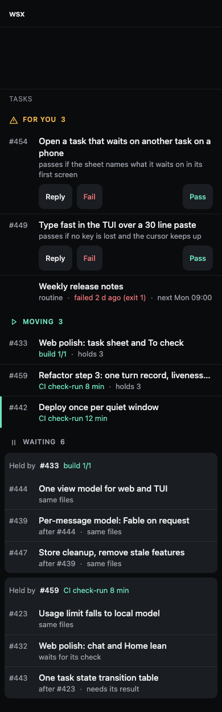 | 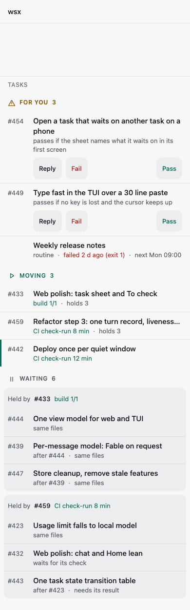 |

[1280 dark](task-views/b-tasks-1280-dark.png): list at a 72ch measure, number column and buttons beside their text. The mock stages #442 as just moved to Moving (the green edge).

| Today | B |
|---|---|
| Four lists: Running, Needs you, To check, Routines | One list, **Tasks**, in three bands by who has the ball: **For you** (Needs you, To check and a failed routine), **Moving** (agent or CI works), **Waiting**. Routines stays its own list: it is a schedule and answers a different question |
| Home: 4 trays | 3 trays: For you, Tasks, Routines |
| Dot and number before every title; the dot colour is the state | No dot. The band is the state. Number in a fixed left column, muted: the owner names tasks by number, and a known number is found by position |
| One sort per list | One rule in every band: what holds the most work first (`holds 3`, `frees #444 +2`), then oldest. Rows move only when a count changes |
| Line 2: label, phrase, agent, into main | Line 2: what it does now, in tone, then one fact. Moving: `holds 3`. Waiting: the reason in 3 words |
| Waiting rows each name their blocker | Waiting rows sit in a card per holder (a task, the usage limit, disk, the manager). Reasons: `same files` (conflict), `needs its result` (relies on), `waits for its check`. `after #n` only when the row waits for another row of its card |
| Every working dot pulses | Only the Moving header icon pulses, while something runs; static under reduced motion |
| Home tray icons | Band headers reuse them (`unchecked`, `play`, `pause`): learned on Home |

For you rows keep Reply, Fail and Pass in their own line (as A). A needs-you row names the verb (`approve push`, `answer`) and what it frees.

### Task page

| 390 dark | 390 light |
|---|---|
| 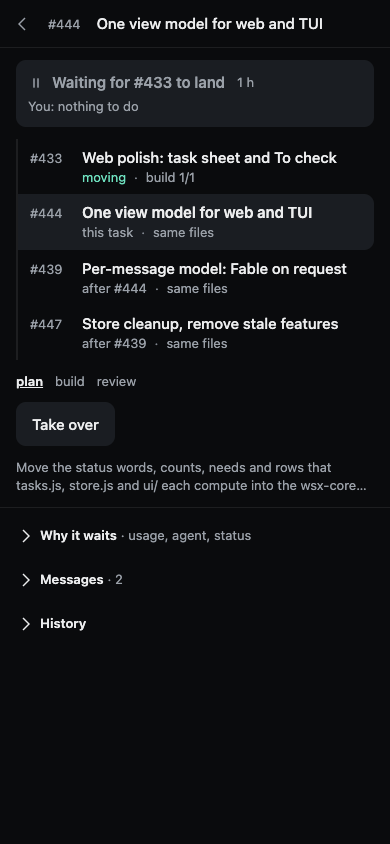 | 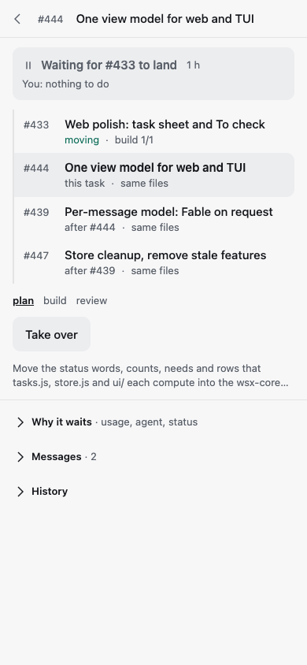 |

Top to bottom: (1) number and title; (2) a raised box: state and what it waits for with its age, then `You: nothing to do` or `You: check it`; (3) the chain as a connected list with titles, upstream above, this task raised, what it blocks below; (4) steps; (5) Take over when it applies; (6) goal, 2 lines. Folded as in A. [1280 dark](task-views/b-task-1280-dark.png). Versus A: "what do I do" is a sentence, not an absent button; the chain has titles (A has chips with bare numbers); A is shorter on "where is it going".

### TUI

```
FOR YOU 3
#454  Open a task that waits on another task on a phone
      passes if the sheet names what it waits on         [r]eply [f]ail [p]ass
#449  Type fast in the TUI over a 30 line paste
      passes if no key is lost and the cursor keeps up   [r]eply [f]ail [p]ass
      Weekly release notes   routine · failed 2 d ago (exit 1) · next Mon 09:00
MOVING 3
#433  Web polish: task sheet and To check          build 1/1 · holds 3
#459  Refactor step 3: one turn record, liveness   CI check-run 8 min · holds 3
#442  Deploy once per quiet window                 CI check-run 12 min
WAITING 6
 held by #433  build 1/1
#444  One view model for web and TUI               same files
#439  Per-message model: Fable on request          after #444 · same files
#447  Store cleanup, remove stale features         after #439 · same files
 held by #459  CI check-run 8 min
#423  Usage limit falls to local model             same files
#432  Web polish: chat and Home lean               waits for its check
#443  One task state transition table              after #423 · needs its result
```

Band names are bold and coloured, `held by` is dim. No glyph column and no tree glyphs: the number column and the card header carry it. Detail, first screen: title; `Waiting for #433 to land · 1 h   You: nothing`; the chain as 4 rows with the current one reversed; `Steps`; `What`; `Details` folded. `[` `]` select a chain row, Enter opens it, Esc returns (as A).

### What B costs

- 9 tasks take 695 px in B and 473 px in A (measured in the mocks): a second line on every row and 2 card headers (44 px each). Cut if wanted: no line 2 on a row whose only fact is `same files` (4 of 6 here).
- Home and the lists change shape, not only the rows: the trays, the TUI tree and the Needs you and To check screens. A changes the rows and keeps the lists.
- The sort rule needs the count of tasks a task holds. `flow.blocks` gives one level; the transitive count is new work in wsx-core.

## Compare A and B

Method. Fixations: one for each region found by position or tone, plus one for each row whose words must be read; 0.3 s each (assumed in the range of Rayner 1998); no scrolling or taps. The foveal span covers 1 to 2 rows on a phone, so both columns are high by the same bias. A model estimate, not a measurement: a 5-second test on the captures (4 questions, one timer) should run before the lists change in code. Data: the 9 tasks above, 2 To check items, 1 failed routine.

| Owner question | A | B |
|---|---|---|
| 0 Does anything need me? | 1 on Home; 0 on the list (not there) | 1 on Home and on the list (first band) |
| 1 and 2 Moving? Stuck on what? | 4: top, 3 root rows; the indented rows read as stuck. With the usage limit and disk as holders: 4 to 10 (each held row names its own reason) | 4: Moving header, Waiting header, 2 cards. With 2 more holders: 6 |
| 3 Where is it going? (no ETA exists in either: step and age only) | 3: now line, chain chips, steps | 5: state box, 4 chain rows, steps |
| 4 What do I do here? | list: Home, To check list, row, buttons = 3; page: scan for a button, 3 | list: first band, row, buttons = 3; page: `You:` line, 1 |
| Marks learned, by form (words not counted) | 12: 5 glyph shapes, clock, 4 tones, rail, chain arrow; 7 or more new | 8: 3 band icons (from Home), card, edge, 3 tones; 2 new |
| Relation words | 8: after, blocks, builds on, in, into, 3 reasons | 6: held by, holds, after, 3 reasons |
| States held at once | 5 | 3 |
| Rows per screen, 390 x 844 | 9 tasks in 473 px; To check apart (105 px a row) | 8 rows in view of 12 (1049 px); Moving and Waiting alone 695 px |
| Lists to open for the whole picture | 3 | 1, plus Routines |

Lint on all B captures (390 touch, 1280, dark and light): no error. Warns kept: the gap before Pass at 390 (Pass stays under the thumb, as A), the padding of the button line (a calc of tokens), the stub rail in the mock. Not mocked: Home with 3 trays, Routines, a holder that is not a task.

## Questions for the owner

1. **A, B, or B's page with A's rows?** A changes the rows and keeps the four lists; B changes the lists. Recommended: B. Two findings carry it: state is read from position, not from a shape (the owner's "why all say waiting" is a shape and tone failure), and "Held by" says the reason once. A is shorter on "where is it going" and on height.
2. **Merge Needs you and To check into For you, and Running into Tasks?** Alternative: keep the four lists and use B's rows and cards inside them. Recommended: merge. Both are "the ball is with me", one answer to question 0.
3. **The number in a fixed left column, not after the title?** Alternative: A's number after the title. Recommended: left column. The owner searches by number; the cost is that a title starts 48 px in.
