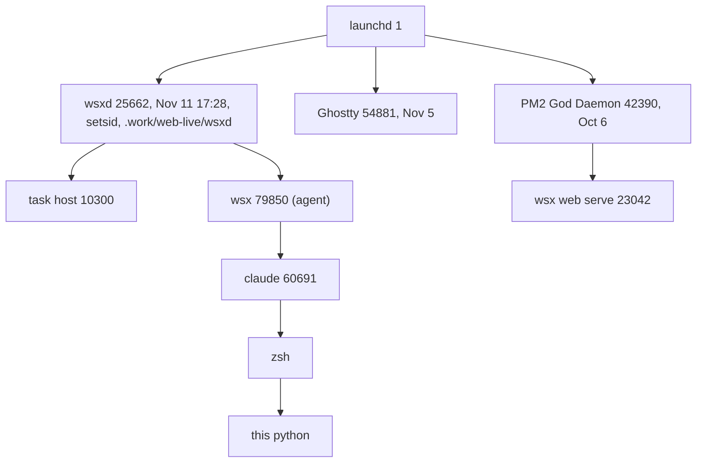

# Agents cannot read /Volumes/EXTDRIVE (TCC audit)

Report (projk manager, 2026-11-16, unchecked): agents started by wsx get "Operation not permitted" on `/Volumes/EXTDRIVE`, though Ghostty has removable-volume access.
Audit run 2026-11-16 inside the worker boundary, read only. No code, setting or store file changed.

## Verdict

Assuming: the cause is macOS TCC (service `kTCCServiceSystemPolicyRemovableVolumes`), not wsx's Seatbelt profile.
Seatbelt is ruled out by the profile text. TCC is likely but not proven: the check that names the denied client cannot run inside the boundary.

## Evidence

| Item | Result | Source |
|---|---|---|
| (c) Worker in the boundary | `os.listdir('/Volumes/EXTDRIVE')` and `/bin/ls /Volumes/EXTDRIVE` give EPERM (errno 1). `stat` works but is masked (1970 dates, `drwx------`). `/Volumes/Macintosh HD` lists. | run here; `mount`: `/dev/disk6s2 on /Volumes/EXTDRIVE (exfat, local, fskit)` |
| (a) Ghostty shell | Not run: no access from the boundary. Ghostty is pid 54881, started Nov 5, ppid 1. | `pgrep -lf` |
| (b) wsxd pane | Not run: a pane needs a new session, which writes the store. | none |
| Seatbelt rules | Profile is `(allow default)`. Read denials: `.ssh`, `.aws`, `.gnupg` (`boundary.rs:26,135`). A strict profile adds `.config/gh`, `.netrc`, `.npmrc`, `.claude`, `Library/Keychains` and the wsx config dirs (`boundary.rs:28,136-141`). No `/Volumes` rule: `rg /Volumes crates/wsx/src/task/boundary.rs` is empty. | `boundary.rs:310-340` |
| Boundary EPERM path | `boundary.rs:395-410` runs only when `sandbox-exec -p <profile> /usr/bin/true` fails, and then fails the agent start with a hint. It never touches a file read. | `boundary.rs:385-410` |
| TCC log | `/usr/bin/log show --last 1d --predicate 'subsystem == "com.apple.TCC"'` answers `Cannot run while sandboxed`. No denied client named. | run here |
| Responsible pid | `responsibility_get_pid_responsible_for_pid` returned the pid itself for every pid (python, wsx, wsxd, task host, Ghostty). A shell under Ghostty should give Ghostty, so the answer is not usable here. | python3 ctypes |
| `sandbox_check` | Returned -1 for all paths, also `/etc/hosts`. ctypes cannot pass its variadic path on arm64. No proof from it. | python3 ctypes |

Tools that ran: `pgrep -lf`, `pgrep -P`, `launchctl print gui/501`, python3 `proc_pidinfo` and `proc_pidpath`. `ps` is refused.

## Who starts wsxd

- Start: `start_daemon` runs `Command` with `spawn_detached` (`runtime/client.rs:1653-1710`): `setsid()`, null stdio, no posix_spawn disclaim. It is called by `ensure_available` (`crates/wsx/src/main.rs:68`, `cli/session.rs`, `app/*.rs`).
- `wsx web serve` does not start wsxd (docs/web-deploy.md:46). Deploy (`scripts/deploy-web-live.sh`) swaps `.work/web-live/wsxd` and runs `pm2 restart wsx-web`.
- No wsx LaunchAgent: `ls ~/Library/LaunchAgents | rg -i wsx` is empty; `launchctl print gui/501 | rg -i wsx` is empty (Ghostty labels only).
- Every pane, task host and agent is a child of wsxd (`pgrep -P 25662`), so all share wsxd's TCC attribution.
- The client that started wsxd 25662 is unknown: its parent has ended and wsxd was reparented to launchd.

## Cause (by elimination, not yet proven)

TCC checks the responsible process, which a child inherits when the chain starts. `setsid` and the reparent to launchd do not change it. wsxd carries the attribution of whatever app ran the `wsx` client that started it. If that was not Ghostty (an agent, PM2, ssh, another terminal), wsxd has no Removable Volumes grant, and so has every agent below it. wsx has no code for TCC, `/Volumes` or `responsibility`: nothing detects or reports a missing grant.

## Proof on the host

Run outside the boundary:

1. Ghostty shell: `ls /Volumes/EXTDRIVE`. Then the same in a wsxd pane. Then `sandbox-exec -p '(version 1)(allow default)' /bin/ls /Volumes/EXTDRIVE` from Ghostty. Ghostty works, the pane fails and the bare sandbox-exec works: attribution is the cause, not Seatbelt.
2. `log stream --predicate 'subsystem == "com.apple.TCC"'` during the pane `ls`; or `log show --last 5m --predicate 'subsystem == "com.apple.TCC" AND eventMessage CONTAINS "RemovableVolumes"'`. The accessing and responsible fields name the denied client.
3. Name the owning app: `python3 -c 'import ctypes;print(ctypes.CDLL("/usr/lib/libSystem.dylib").responsibility_get_pid_responsible_for_pid(<wsxd pid>))'`, then `pgrep -lf` on that pid.

## Smallest fix (not built)

One probe in `crates/wsx-daemon/src/server.rs::run_daemon`, after the singleton lock and before the accept loop:

1. For each entry in `/Volumes` that is not the symlink to `/`, call `read_dir`.
2. On EPERM, read the responsible pid of `getpid()`, resolve its `.app` name with `proc_pidpath`.
3. Report one line: "`<app>` has no Removable Volumes access: grant it in System Settings > Privacy & Security > Files and Folders (or Full Disk Access), then restart wsxd."
4. Surface it where wsxd already shows facts: the `this-mac` panel (`wsx-daemon/src/machine.rs`, volumes list at `:95-103`) or the daemon notice the TUI shows. No new channel.

Owner grant: to the responsible app named in the line (for example Ghostty.app), not to `wsxd` or `claude`. A start from a non-app source (launchd job, ssh) needs Full Disk Access for that source, or a restart of wsxd from Ghostty.

Limit: the probe runs once per daemon start, so a volume mounted later is not covered.
