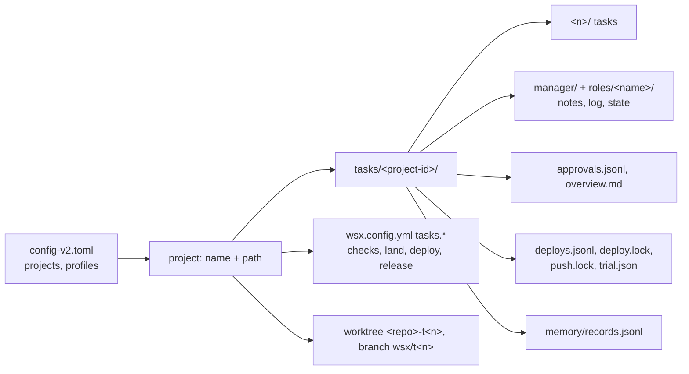
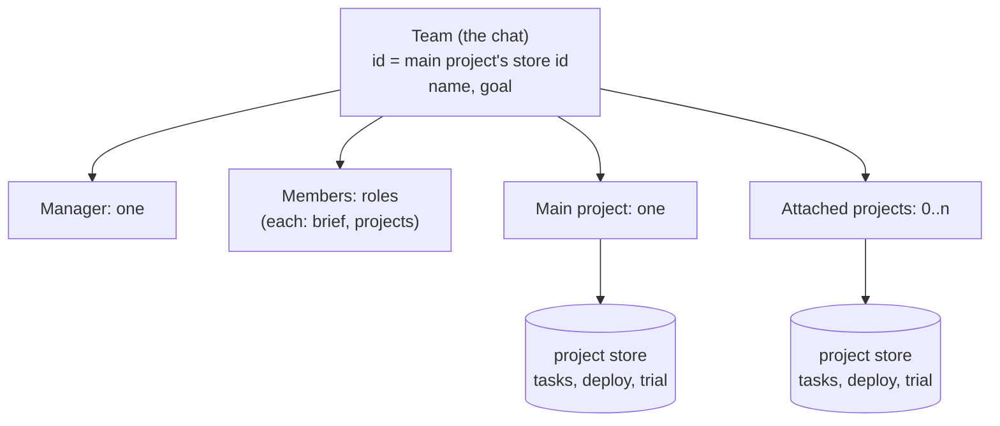

# Teams: the chat first, projects attached (design)

Status: superseded (2026-11-11). The owner chose the small path: a project's manager works in another registered project directly, and a role stays in its own project (docs/tasks.md "Managers talk", "Roles"), with the role room change; there is no [[teams]]. The rest is kept as history.

Status: design only, 2026-11-11. No code. Owner target (iam-studio msg 888): team - goal - manager - projects (several) - members (several). The chat is the top unit; the project is attached to it. Earlier direction (msg 836): rooms are about context, wsx orchestrates cross-project work, the owner does not route it.

Assuming: "team" and "chat" are one thing (the owner's chat with a goal and one manager). memory facts below come from [memory.md](../memory.md) (the contract) and [memory-system.md](memory-system.md) (the design). Sizes are estimates, marked (est.).

## 1. Today

One key runs through everything: the project's store id, `<name-slug>-<8 hex of sha256(path)>` (`crates/wsx-core/src/task/store.rs:83`). The project, its task store, its manager and its chat are one thing.



| Piece | Where it is keyed | Source |
|---|---|---|
| Project, profile | `[[projects]]` name, path, groups, `profile`; a profile is the agent account and the web grant, not a store or a manager | `crates/wsx-core/src/config/global.rs:286`, `:305`; [profiles-and-parent-tasks.md](profiles-and-parent-tasks.md) |
| Task | `tasks/<project-id>/<n>/`; `TaskRecord` already holds `project`, `project_id`, `project_path`, `default_branch`, `created_by` | `crates/wsx-core/src/task/mod.rs:224`; docs/tasks.md "Store" |
| Numbers, branch, copy | The store's locked counter; `wsx/t<n>` and `<repo>-t<n>`, so they are unique per store and per repo | `crates/wsx-core/src/task/copy.rs:18`, `:22` |
| Manager | One per project: `tasks/<id>/manager/`, host `task-manager`; `tasks.manager.*` in the project's config | docs/tasks.md "Manager" |
| Roles (members) | `tasks/<id>/roles/<name>/`; one `Role::Area` capability group, no per-project part; at most `tasks.roles.max` open | `crates/wsx-core/src/task/policy.rs:135`; docs/tasks.md "Roles" |
| Events | Only the manager host watches the store (`project_tasks(project_id)`); an open role's tasks (`created_by: role:<name>`) go to that role, the rest to the manager | `crates/wsx-core/src/task/view.rs:396`; `crates/wsx/src/task/manager.rs` |
| Managers talk | `say -p <other> --from-manager` and `ledger -p <other>` are the only commands a manager may aim at another project; a manager creates tasks only in its own | `crates/wsx/src/task/broker.rs:236`, `cmd/chat.rs:45`; docs/tasks.md "Managers talk" |
| `-p` | Resolves a registered project by name only | `crates/wsx/src/task/mod.rs:253` |
| Policy | Capabilities per actor (manager, area role, worker), one Seatbelt profile per role, built from the task's project | `policy.rs`; `crates/wsx/src/task/boundary.rs` |
| Approvals | `approvals.jsonl` of the project; land, discard, deploy, release, push, role, project add | docs/tasks.md "Approvals" |
| Deploy, release, push | Per project: its config command, `deploy.lock`, `push.lock`, `trial.json` | `store.rs:770-886`; docs/tasks.md "Deploy and release", "Push" |
| Routines, panels | Routines by a hash of the project path; panels by `(project path, name)` in wsxd memory | `crates/wsx-core/src/routine/store.rs:75`; `crates/wsx-daemon/src/panel.rs:21` |
| Memory | Scope = the project's store id; `wsx memory` defaults to the folder's project scope; a read may name any scope; `add`, `update` and `supersede` are limited to the agent's own project scope (another is refused); an agent's search finds the transcripts of its own project only; a landed task's memo is captured by the manager host (`fold_memo`) | [memory.md](../memory.md) "Scope", "Agents", "Capture" |
| Web | Home: one row per granted project. Routes `#/p/<pid>[/t/<n>\|/r/<role>\|/page\|/checks\|/usage\|/panels]`; `pid` is the numeric wsxd project id; API `api/tasks/{project}/...`; the chat already shows `<project> #<n>` chips for another project's task | `crates/wsx-web/web/store.js:179`, `home.js`; `crates/wsx-web/src/tasks.rs:55` |
| TUI | `t` Tasks view and `m` manager chat act on the selected tree project; Roles section opens a role chat | `crates/wsx/src/app/actions.rs:591`, `task_list.rs:222` |

What stops the owner's example today: pizzahouse is "manage this machine", but its chat can only create tasks in the pizzahouse folder. Another repo it needs (dotfiles, an infra repo) is another project with another manager, reached by `say`, and the owner routes between them.

## 2. Target model

### Entities and ids



| Entity | Id | Lives in | Notes |
|---|---|---|---|
| Project | store id, as today | config `[[projects]]`; its store `tasks/<project-id>/` | Unchanged: tasks, worktrees, checks, deploy, release, push, trial, routines, panels |
| Team | the main project's store id | config `[[teams]]` (owner-owned, outside the agents' boundary); room state in `tasks/<team-id>/` | The id is never new: a plain project is a team of one, so no folder moves |
| Goal | the team | `[[teams]] goal`, read by the manager's instructions (a changed goal changes the instruction digest, so the next turn is fresh, as a new role brief does) | One paragraph |
| Manager | the team | `tasks/<team-id>/manager/` (today's folder) | `tasks.manager.*` stays in the main project's `wsx.config.yml` |
| Member | role name in the team | `tasks/<team-id>/roles/<name>/` plus `projects` (default: every project of the team) | Names stay unique per team |
| Attach | `(team, project)` | config `[[teams]] attach` | Owner's act; the manager asks like `project add` |

```toml
# config-v2.toml. Absent = every project is a team of one (today).
[[teams]]
name = "Machine ops"        # shown; default: the main project's name
main = "pizzahouse"         # a registered project name; its store id is the team id
attach = ["dotfiles", "infra"]
goal = "Manage and control this machine"
```

### Where each piece of state lives

| State | Team store (`tasks/<team-id>/`) | Project store (`tasks/<project-id>/`) |
|---|---|---|
| Manager log, roles, notes, overview, recap | yes | |
| Approvals (`approvals.jsonl`, each request gains `project`; absent = main) | yes | |
| Tasks `<n>/`, counter, worktree, branch, checks, To check items | | yes |
| `deploys.jsonl`, `deploy.lock`, `push.lock`, `trial.json` | | yes |
| Routines, panels, `wsx.config.yml tasks.*` | | yes |
| Memory | team scope: goal, decisions, rules the manager records | project scope: facts about the project's files, a landed task's memo |

### A task names its project

A task stays in its project's store, so number, branch `wsx/t<n>`, `<repo>-t<n>`, checks, land target, deploy and boundary are exactly today's. The record gains one field, `team` (the team id; absent = the project's own). `wsx task new -p <project>` run by a manager is allowed for the projects of its own team; the broker sets the team and the new task's `team` from it. The ref in text is `#<n>` for the main project and `<project> #<n>` for an attached one (the web chip exists). One module owns the rule "which team hears this task": `wsx_core::task::team` (new), read by the manager host, the ledger, the web and the TUI.

### Events

The manager host watches the stores of its team's projects and takes the tasks whose `team` is its team (today: every task of its store). Open roles keep `created_by: role:<name>`, which resolves inside the task's team. A project that is also its own team of one keeps hearing its own tasks only. To check items, `result`, checks and holds follow the task's team.

### A member's tasks reach another project

A member creates tasks in any project of its `projects` and steers only the tasks it created (today's rule). The broker's `reach()` (`broker.rs:239`) changes from "only `ledger` and `say --from-manager` may name another project" to "a command that the actor's capabilities allow may name a project of its own team; everything else of another team stays refused". `say -p <project>` between two teams stays as today.

### Permissions, approvals

- Capabilities are unchanged (`policy.rs`); the new part is one project filter on a member: the broker refuses a project outside `projects`.
- A worker's Seatbelt profile is built from its task's project and copy: unchanged.
- An approval request lives in the asking team's store, names its project, and runs `wsx task <action> -p <project>` as today. `deploy`, `release` and `push` stay per project with the project's `tasks.*` and locks.
- `team attach` by the manager is an approval request, like `project add`.

### Memory

Team scope = the team id. Reads need no change: a read may name any scope, so a team's search names its scope and its projects' scopes. Two rules of memory.md change, in `task::policy` and the store: (1) "own project scope" for a write becomes the team scope for the manager and a role, and the task's project scope for a worker and for `fold_memo`'s capture (paths resolve under that project's root, so a fact about `infra/` is checked against `infra`); (2) "transcripts of its own project" becomes the transcripts of its own team: the chat and the task stories of its projects. A role's task keeps its memo in the role's notes, as today. Cost: for the main project the team scope and the project scope are the same scope.

### Screen

| Place | Plain project | Team with attached projects |
|---|---|---|
| Web Home | One row per project (today) | One row per team: name, goal line, the needs of all its projects; attached project names as a small second line. Attached projects that are also teams of one keep their own row |
| Web route | `#/p/<pid>` | Same: `<pid>` is the main project, so the team chat is the main project's route. Task segment gains an optional project: `t/<n>` main, `t/<n>@<pid2>` attached |
| Chat | As today | Same chat; the goal shows under the name; chips `<project> #<n>`; a project filter on the pills |
| Roles | `⋯` menu | Same; a role row shows its projects when not all |
| TUI | Tasks view `t`, chat `m` | Same keys on the main project; the tree marks an attached project (`↳ Machine ops`); the task list has a Project column when the team has more than one project |
| CLI | `wsx task ... -p <project>` | Same; `-p <attached>` acts in that project's store; `wsx task team list\|attach\|detach` |

Web and TUI both read `task::team`, so they change in the same step.

### The plain case

No `[[teams]]` entry: every project is an implicit team of one; no `team` field is written; ids, folders, routes, rows, CLI and prompts are byte-identical to today. A scenario in each step proves it by running today's `test-task.py` unchanged.

## 3. Options

| | A. Team layer over per-project stores (tasks stay in the project store; `team` field routes) | B. Store moves to the team (`tasks/<team-id>/` with a `project` field per task) | C. Smaller steps to the owner's examples |
|---|---|---|---|
| Data model | `[[teams]]` config; `TaskRecord.team`; roles get `projects` | Task numbers and counter per team; `TaskRecord.project` becomes the routing key; locks and trial must still be per project, so a project folder remains | Only what each example needs: an attach list, a goal text, `task new -p` for attached projects |
| Chat | Team = main project's chat plus goal and project chips | Same | Chat of the main project reaches the attached project's tasks |
| Routing | Manager host reads N stores, filters by `team` | One store; filter by `project` for the views | Same as A, for one pair |
| Roles | Same table + project filter | Same | Not in the first step |
| Panels, routines | Per project, unchanged | Re-key by project inside a team store | Unchanged |
| CLI | `-p` accepts an attached project; `team` verbs | `-p` means team; new `--project` | `-p <attached>` for a manager |
| Web, TUI | Home groups by team; project chips; a route segment | Routes carry a team id, not a project id | A project chips line; Tasks list column |
| Migration | None: team id = main project's store id; absent field = own | Move each attached project's tasks or leave two stores; renumber risk | None |
| What breaks | Nothing for projects with no team; a project in two teams has two managers writing one repo (numbers are per project, so branch and copy names do not collide; two lands into one repo are not proven to serialize: S1 checks it) | `wsx/t<n>` and `<repo>-t<n>` collide when two teams touch a repo; every `project_id` site changes meaning (`rg -o project_id crates --glob '*.rs' | wc -l` counts 754 in 73 files on this tree, tests included) | Nothing |
| Size (est.) | 8 to 10 tasks | 15 to 20 tasks plus a migration scenario | 2 to 3 tasks for the first visible result |

B is the model the owner draws, but A gives the same screen with no moved data. B's gain (one task counter per team) is bought by ambiguity of branch names and by moving locks back to the project anyway.

## 4. Recommendation

Do C, in the order that builds A. Never B unless a team must exist without a main project folder (see question 1).

First step with a visible result: one chat attached to two projects. The owner sets `[[teams]] main = "pizzahouse", attach = ["dotfiles"]`; pizzahouse's manager creates a task in `dotfiles`, the task's events and To check come back in the pizzahouse chat as `dotfiles #7`, and dotfiles' own chat is unchanged.

| Step | Adds | Proof (scenario) |
|---|---|---|
| S1 (2 to 3 tasks) | `[[teams]]` read and checked (name, main, attach; a missing or duplicate project refuses); `TaskRecord.team`; broker `reach()` allows `task new`, `list`, `show` with `-p <attached>` for the manager; the manager host and the ledger read attached stores; chips in the web chat and the TUI list | `scripts/test-task.py`: new core part with two fixture repos; a task in the attached repo lands, its event reaches the main chat and not the attached project's own; the whole existing run unchanged. `web` tasks part: chip and sheet for `<project> #<n>`. `smoke` for the TUI list |
| S2 (2 tasks) | Home row per team; goal in the manager instructions and chat header; overview with a section per project (deploy facts, branch) | `web` capture of Home and chat with goal; plain project row equal to today's capture |
| S3 (2 tasks) | Member `projects` filter in the broker; approvals carry `project`; `team attach` as a manager request | `test-task.py`: a role outside its projects is refused; approval of a deploy in the attached project runs there and takes its lock |
| S4 (1 task) | Team scope in memory search and capture routing | `scripts/test-memory.py` plus `docs/memory.md` "Agents" changed with it: a write to the team scope and to the task's project scope is allowed, another team's is refused; team search reads both |
| S5 (1 to 2 tasks) | "Add chat" flow: web and TUI form; `team list\|attach\|detach` | `web` form journey and `smoke`; capture for Human Verify |

Each step ships alone and leaves a plain project untouched. One risk S1 must prove: `GlobalConfigWire` (`global.rs:463`) has no `deny_unknown_fields`, so an older wsx reads a config that holds `[[teams]]` and ignores it, but an older wsx that saves the config (project add) would drop the table. The scenario writes a config with `[[teams]]` through the current save and checks that it survives.

## 5. Open questions for the owner

1. **Must a team exist without a main project folder?** Default: no. The goal says "one default main project (as today)", and the team id is that project's store id; this keeps the plain case identical. A folder-less chat would need B's new id.
2. **May one project be attached to several teams?** Default: yes. Numbers are per project, so nothing collides; each task belongs to one team; the project's deploy lock keeps deploys one at a time.
3. **When an attached project also has its own chat, does it keep it?** Default: yes, as a team of one that hears only its own tasks.
4. **Chat or team on the screen?** Default: "chat" in web and TUI (the owner's word), "team" in config, CLI and code.
