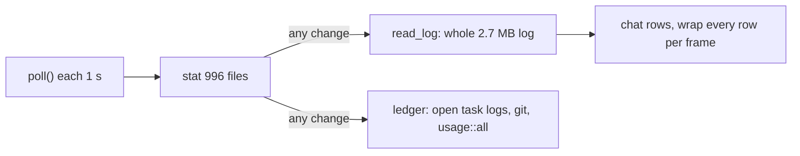

# TUI and CLI health audit: speed and stability

Status: read-only audit, 2026-11-06. Scope: `crates/wsx/src/` (the `app/` loop, `ui/`, `task_list.rs`, `task_chat.rs`, `cli/`) and the core readers they call in `crates/wsx-core/src/`. Paths are relative to `crates/`. Owner request: msg 2726. Related audits: [client-logic-audit.md](client-logic-audit.md) (#238, duplicated rules), [usage-audit.md](usage-audit.md).

**Answer.** The draw loop is sound: it draws only on demand, workers run off the UI thread, and replies have bounds. The cost is in the task views. Each second they check about 1,000 files, and any change in a project makes them read the whole manager log and rebuild the full ledger. The stability gaps are git and wsxd calls that can block, and a routine refresh that can start a wsxd the owner stopped.

Measured on the owner's real wsx project (read-only, `~/.local/state/wsx/tasks/<project>`, Python stdlib):

| Fact | Value |
|---|---|
| Files in `store::watched_files` (4 per task, plus project files) | 996 (961 exist); one stat pass takes 3.5 ms |
| `manager/log.jsonl` | 2,667,040 bytes, 8,734 entries; Python JSON parse 27 ms (stand-in for the Rust cost) |
| Open tasks (the ledger reads each one's log) | 13 |

## Findings, ranked by impact

| # | Place | Problem | What the user sees | Evidence | Proposed fix | Size | Risk |
|---|---|---|---|---|---|---|---|
| 1 | `wsx/src/task_chat.rs:593`, `wsx-core/src/task/store.rs:844` `read_log`, `:903` `watched_files` | The chat reads and parses the whole manager log (old and current, up to 8 MiB each) whenever any watched file changes. A worker's log line is enough. It then keeps 200 entries. | CPU and disk work about once a second while workers run, and it grows with the log | 2.67 MB and 8,734 entries, measured above | read only the tail that holds the last `CHAT_ENTRIES` (`read_tail` exists); stamp only the manager log, roles and approvals for the chat | M | L |
| 2 | `wsx/src/task_chat.rs:911-925` `open_find`, `close_find` | After one `/`, `whole` stays true for the rest of the session. Every later refresh reads the whole log, and every frame wraps all its rows. `:613` also clears `asks` on every earlier row for each owner message, which is O(n²) over the whole log. | The chat gets slow after a search, and stays slow until the TUI restarts | source read | `close_find` sets `whole = false`; set `asks` with one backward pass | S | L |
| 3 | `wsx-core/src/task/ledger.rs:174` `main_checkout`, `:193` `stray_worktrees`, `:159` `land_blockers` | Git runs with `.output()` and has no timeout. If git hangs, `pending` stays set in `task_list.rs`, and nothing reports an error. | The Tasks list stops updating and shows no reason | source read; `wsx-core/src/git` already has `output_with_timeout` | use the timeout helper; a timeout becomes a visible ledger note | S | L |
| 4 | `wsx-core/src/task/view.rs:321` `task_agent`, `wsx/src/task_list.rs:156-165` | Every ledger rebuild reads the whole log of each open task to find one `AgentSwitch`. It also runs `usage::all` over every workspace project. Any task-file change starts a rebuild. | The same steady background load as #1 | 13 open tasks; worker logs up to 800 KB in this store | add an `agent_switched` field to the record when the switch happens, or cache by stamp; refresh `usage::all` on its own slower timer | M | M |
| 5 | `wsx/src/app/dispatch.rs:296`, `app/actions.rs:363`, `app/run_loop.rs:99` | Each resize event sends its own `Resize` on the stream. Each one also sets mode reassert and a forced redraw, which clears the screen and then draws. Nothing merges the events, and an unchanged size is sent again. | Lag and flicker while a window is dragged; wsxd reflows the PTY many times | source read | keep the last sent size; merge resizes until the event queue is empty, then send once | S | L |
| 6 | `wsx/src/app/events.rs:319`, `app.rs:1840`, `cli/routine.rs:212` | The 30 s timer starts one thread per project with no guard against a call still in progress. Each thread calls `ensure_available`, which skips the check in `ensure_background_available` (`wsx-core/src/runtime/client.rs:909`). | Threads pile up when wsxd is slow; a `wsx daemon stop` from another shell can be undone within 30 s | source read | a pending flag per project; use `ensure_background_available` | S | M |
| 7 | `wsx/src/app/actions.rs:156,234,463`, `app/dispatch_ops.rs:49,77,151`, `app/run_loop.rs:529` | Focus, split, close, stream connect, reattach and session create call wsxd on the UI thread. Each call opens a connection plus Hello. The IO timeout is 5 s (`client.rs:27`), and a handoff retry can add another 5 s (`:30`). | The TUI freezes for up to about 10 s when wsxd is wedged or during a handoff | source read | move these calls to the worker channel that refresh already uses; show a pending state | L | M |
| 8 | `wsx-core/src/runtime/client.rs:2567-2580`, `wsx/src/app/events.rs:21` | When wsxd is stopped and recovery fails, the monitor sends the disconnect error and then the recovery error, every 250 ms. The two texts differ, so each one counts as a new reason. | The error notice flips between two texts about 4 times a second until wsxd returns | source read | send one combined reason; back off the retry | S | L |
| 9 | `wsx/src/app/runtime_sync.rs:575` | Every 500 ms the preview asks for `Request::View`. The reply carries the full `Snapshot` of all sessions, but only `snapshot.epoch` is used. Each poll is a new connection. | Steady wsxd and JSON load that grows with the number of sessions | source read | a frame-only view reply with the epoch, or an event-driven preview | M | L |
| 10 | `wsx/src/ui/task_chat.rs:582` `composer` | `while cells(&before) >= width { before.remove(0) }`: each removal shifts the string and recounts its width, so the loop is O(n²). | A long paste into the chat input makes each key take seconds | source read | find the cut point with one backward pass over the width | S | L |
| 11 | `wsx/src/ui/task_chat.rs:39,468,591` | `chat_lines` wraps every row on every draw. `wrap_cells` allocates a `String` per character, and a find wraps a second time (`matches`). | Slow draws in long chats, worst in whole mode (#2) | source read | cache the wrapped lines by (rows revision, width) | M | L |
| 12 | `wsx/src/ui/workspace_tree.rs:367`, `app.rs:1777` | The tree builds a `ListItem` for every row, not only the visible ones. `stale_project_indices` is O(projects × sessions) on each frame. The spinner redraws every 500 ms. | CPU load in big workspaces while an agent works | source read | build only the rows in the viewport; compute stale projects on refresh | S | L |
| 13 | `wsx-core/src/task/usage.rs:133,144` | The static `CACHE` never drops a log path. `lock().unwrap()` panics after any earlier panic while the lock was held. | Memory grows over a long session across many projects | source read | drop entries whose path is not in the latest set; `lock().unwrap_or_else(PoisonError::into_inner)` | S | L |
| 14 | `wsx/src/ui/task_chat.rs:50,53,109` | `lines.len() as u16` and a `u16` scroll wrap past 65,535 lines. | Scroll jumps in a whole-log chat | source read | clamp, or use `usize` scroll with a window | S | L |
| 15 | `wsx-core/src/runtime/client.rs:544`, `wsx/src/terminal_surface.rs:104` | Terminal stream reads have no timeout, so a wsxd that stays connected but stops sending is never noticed. Each patch also copies the whole pane frame (rows × cols `String`s) before it applies. | The terminal can freeze with no notice; CPU cost on big panes | source read | a heartbeat or an idle read timeout; validate the patch, then apply it in place | M | M |

Seen in the source, not run: if a cache save keeps failing (a corrupt TOML or a busy lock), `persist_state` sets `cache_dirty` back to true (`app/runtime_sync.rs:22-26`). Every terminal key then retries the lock, read and parse (`app/dispatch.rs:232`), and the "Cache save failed" notice comes back each time.

**Fixed in #338 (fix task 3).** #5: a resize only sets a flag; `flush_terminal_resize` (`app/actions.rs`) sends one size after the queued events (at most 100 ms), and not a size wsxd already has. #6: the 30 s refresh skips a project with a request in flight and uses `ensure_background_available`. #8: the event monitor sends one reason per outage (the disconnect and a failed restart in one text) and backs off 250 ms to 2 s. Cache save: after a failure `persist_state` waits 2 s, doubling to 60 s, and shows the notice once (`cache_retry`).

What the open tasks miss: #240 builds the chat rows in core, but it keeps the whole-log read (#1), the `whole` flag that stays on (#2) and the wrap per frame (#11). #241 covers web timers only. The TUI spinner redraw (#12) is outside it.

## Fix tasks, in priority order

1. **Chat reads a bounded tail (#1, #2, #10, #11, #14).** Read the tail that holds the last 200 entries. Read the whole log only while the find is open, and return to the tail on close. Cache the wrapped lines by width. Build `asks` in one pass. Replace `remove(0)`.
   Files: `wsx/src/task_chat.rs`, `wsx/src/ui/task_chat.rs`, `wsx-core/src/task/store.rs`. Proof: a `scripts/runtime-smoke.py` step with an 8 MiB manager log fixture. A worker log line is appended. Check that the chat still shows the last entry, that refresh time stays under a fixed limit, and that the chat shows the tail again after `/` then Esc.
2. **Ledger git timeouts and a cheaper rebuild (#3, #4).** Run every ledger git call with the timeout helper, and show a timeout on the ledger row. Record the agent switch, or cache it by stamp. Move `usage::all` to a slower timer.
   Files: `wsx-core/src/task/{ledger,view,usage}.rs`, `wsx/src/task_list.rs`. Proof: `scripts/test-task.py` (GitHub Actions) with a `git` on `PATH` that sleeps. The Tasks list updates and names the timeout, and the row agent label is unchanged.
   **Done (#337).** Held at HEAD (#304, #317 and #324 did not touch them). #3: `Git` in `ledger.rs` runs `main_checkout` and `stray_worktrees` through `git::output_with_timeout`, `land_blockers` through `copy::read_git`, each 10 s (`copy::READ_TIMEOUT`); a hung folder is asked once, and `ledger.notes` names it (TUI: warning lines). #4: `usage::task_switched` shares the usage cache's single parse (a ledger build parsed each open log twice, now once, and not again while its size and time hold); `usage::all` runs on a 30 s timer in `task_list.rs`. #13: the cache drops entries idle 10 min at the next miss, and a poisoned lock is taken as is. Proof: `scripts/test-task.py` 14c1 and 14c2, and the host part's fallback row.
3. **Resize, routine refresh and the reconnect notice (#5, #6, #8).** Merge resizes and skip a size that was already sent. Add a pending flag per project, and use `ensure_background_available`. Send one reason per outage, with backoff.
   Files: `wsx/src/app/{run_loop,dispatch,actions,events}.rs`, `wsx/src/app.rs`, `wsx/src/cli/routine.rs`, `wsx-core/src/runtime/client.rs`. Proof: `scripts/runtime-smoke.py`. A burst of 20 resizes gives one daemon resize. After `wsx daemon stop`, wsxd is still stopped 60 s later while the TUI runs, and the notice text stays the same.
4. **wsxd calls off the UI thread (#7).** Run focus, split, close, connect, reattach and create through the worker channel, with a pending state on screen.
   Files: `wsx/src/app/{actions,dispatch_ops,run_loop,input_confirm}.rs`. Proof: a `scripts/runtime-smoke.py` step with wsxd stopped by SIGSTOP. Keys still move the selection within 200 ms, and the action reports its failure after the timeout.
5. **A lighter preview and tree (#9, #12, #15).** Add a frame-only view reply, draw only the visible tree rows, and add a stream idle timeout.
   Files: `wsx-core/src/runtime/{protocol,client}.rs`, `wsx-daemon` view handler, `wsx/src/app/runtime_sync.rs`, `wsx/src/ui/workspace_tree.rs`. Proof: the `scripts/runtime-smoke.py` preview and stream steps; reply bytes per poll before and after, with 50 sessions.
   Status (#340): done. `frames` request, visible-row tree, stream heartbeat and idle timeout, in-place patch (daemon revision 48). Numbers: `scripts/runtime-smoke.py` prints the `view` and `frames` reply sizes with 50 sessions.

## Checked and found fine

- Redraw is on demand (`needs_redraw || mode_check`, `app/run_loop.rs:35`), not on every tick. The wake every 100 ms (4 ms in a terminal) does only cheap drains.
- These workers have a pending guard and do not pile up: session refresh, preview capture, plugin view, manager asks, git local (one per path, CPU semaphore), git fetch and review (`review.rs:203`).
- Every `runtime::Client` call has a 5 s IO timeout, and replies are capped at 32 MiB (`client.rs:377`). The stream queues are bounded (input 1024, updates 64), and `TerminalStream::drop` joins its threads.
- A stream EOF or a lost lease reattaches once. A second loss within 5 s returns to Workspace with a notice. A live handoff counts as a handoff, not as a failure (`wait_for_handoff`).
- I found no non-test `unwrap` or `expect` on daemon replies, files or git output. Frame patch bounds are checked (`wsx-core/src/runtime/domain.rs`). The panic hook restores the terminal.
- The reads are bounded: overview 256 KiB, record 64 KiB, the asks poll and `roles::last_active_ms` read a 64 KiB tail, and the chat file view reads 256 KiB and refuses `.git` and paths outside the project.
- The notice queue holds at most 8. The diagnostics log is capped at 64 KiB. `pending_session_kills` and terminal frames are checked against live state.
- The CLI talks to wsxd through the same client timeouts. Prompt and context input is bounded (`cli/args.rs:700`).

## Summary of the top 3

1. The manager chat re-parses the whole 2.7 MB log about once a second while workers run. After one `/`, the whole log stays loaded and every row is wrapped on every frame.
2. Ledger git calls have no timeout. A hung git freezes the Tasks list with no error. Each rebuild also reads every open task's whole log.
3. Resizes are not merged, and several wsxd calls block the UI thread for up to about 10 s. The routine refresh can also restart a wsxd that the owner stopped.
