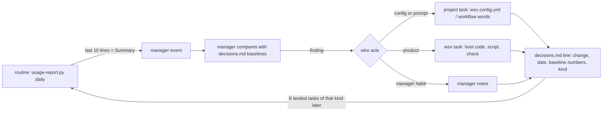

# Usage audit: where tokens, time and quality go

Status: audit of project `wsx` (state `~/.local/state/wsx/tasks/wsx-8cbe3f08`), logs 10-16 to 10-28. Numbers come from `scripts/usage-report.py` (stdlib, `/usr/bin/python3 scripts/usage-report.py <state dir> [--since D] [--until D] [--task N]`). Usage fields: docs/tasks.md "Usage".

**Answer.** The daily rise comes from volume, not from more expensive work. Since 10-26 a landed task costs less, waits less and fails fewer checks. More tasks per day, each with 5 steps, multiply the turns. Within that volume, the cost goes to long contexts, to the turns after the last step, and to cache rewrites after idle gaps longer than 1 hour.

## Evidence (report output)

| day | tasks | landed | worker $ | worker turns | turns/task | $/turn | turns > 200k ctx | manager $ |
|---|---|---|---|---|---|---|---|---|
| 10-23 | 7 | 7 | 14.49 | 14 | 2.0 | 1.03 | 0 | 4.64 |
| 10-24 | 7 | 7 | 90.76 | 92 | 13.1 | 0.99 | 37 | 13.13 |
| 10-25 | 17 | 13 | 105.95 | 82 | 4.8 | 1.29 | 27 | 11.81 |
| 10-26 | 24 | 22 | 177.22 | 186 | 7.8 | 0.95 | 40 | 17.60 |
| 10-27 | 30 | 30 | 174.61 | 202 | 6.7 | 0.86 | 38 | 18.34 |
| 10-28 | 14 | 8 | 139.43 | 155 | 11.1 | 0.90 | 52 | 12.86 |

```
window start .. 2026-10-25: tasks 53, landed 36, worker $419.75 in 299 turns, manager $40.99 in 352 turns
per landed task: $8.58, 6.5 turns, 17.9 h wall, 0 min check wait, 0.9 send-backs, 4.2 failed check runs
window 2026-10-26 .. now:   tasks 68, landed 60, worker $379.97 in 494 turns, manager $48.80 in 370 turns
per landed task: $3.49, 6.0 turns, 0.9 h wall, 32 min check wait, 0.6 send-backs, 1.4 failed check runs
```

Window since 10-24 (92 tasks, worker $608.50, manager $73.75):

| worker turns by | turns | cost $ | $/turn | median ctx | cache write share |
|---|---|---|---|---|---|
| context > 200k | 151 | 270.28 | 1.79 | 259k | 21% |
| other | 447 | 273.93 | 0.61 | 110k | 32% |
| after > 1 h idle (all days) | 73 | 171.22 | 2.35 | 208k | 62% |
| after 5-60 min idle (all days) | 178 | 93.48 | 0.53 | 189k | 11% |
| first turn after a session limit | 10 | 31.97 | 3.20 | 231k | 56% |
| step `build` | 108 | 204.68 | 1.90 | 121k | 20% |
| after the last step: `add` (send-back) | 32 | 60.83 | 1.90 | 197k | 42% |
| after the last step: `check_run` answer | 57 | 40.13 | 0.70 | 194k | 22% |
| after the last step: `conflict` | 22 | 35.32 | 1.61 | 285k | 19% |
| after the last step: no event (result retry, limit resume) | 109 | 47.56 | 0.44 | 186k | 37% |
| model opus | 569 | 565.04 | 0.99 | 144k | 28% |
| model sonnet | 29 | 3.15 | 0.11 | 59k | 49% |
| manager turn: events | 350 | 41.10 | 0.12 | 97k | 30% |
| manager turn: owner | 165 | 27.38 | 0.17 | 100k | 35% |

Fields used: `result.usage` and `reply.usage` (`cost_micro_usd`, `session_cost_micro_usd`, `context_tokens`, `cache_read_tokens`, `cache_creation_tokens`, `duration_ms`, `model`), plus `rotated`, `revision`, `message.mode`, `check_queued`, `check_run`, `checks`, `check_retry`, `conflict`, `landed`, the manager's `message.from` and `delivered`, and `task.json` `steps`, `files`, `model`. Lines from before `session_cost_micro_usd` existed (before commit 94f0b26, 10-21) store the session's running total in `cost_micro_usd`. The report turns those totals back into per-turn costs. Cache write share prices writes at 2x and reads at 0.1x base input: the transcripts show only 1-hour cache writes (`ephemeral_1h_input_tokens`). The 5-60 min idle row writes 11% and the over-1-h row 62%, so the cache lives 1 hour.

## What is traceable and what is not

| Traceable now | Gap |
|---|---|
| cost, tokens, context and model of each worker turn and manager turn | step, trigger and `calls` are on `result` since #125; older lines replay `task.json` `steps` |
| rotations, session limits (`<synthetic>` results), idle gaps | lines before 10-24 have no `context_tokens` or `model` |
| send-backs, failed check runs, check-queue wait, wall time to land | subagent and tool-call cost inside a turn: only the turn's sum (`calls` counts main calls since #125; older lines estimate it as cache reads / context) |
| repeated commands, from the first line of `agent` | `agent` keeps one line, so heredoc bodies (about 1,230 `python - <<EOF`) are not visible |
| | quality after landing (To check results, reverts, follow-up fix tasks) is not tied to the task's cost |
| | the owner's own Claude use outside wsx, and the plan's 5-hour quota left |

## Ranked causes and levers

| # | Cause (since 10-24) | Lever | Speed | Cost | Quality |
|---|---|---|---|---|---|
| 1 | Volume: 7 → 30 tasks a day, 5 steps each; $/turn stayed about $1 | manager: one task per request area (`add` over `new`); `--skip context,plan` with `--model sonnet` for exact changes (only 29 sonnet turns) | = | -30% for small tasks | = when the prompt carries the files |
| 2 | Contexts over 200k: 151 turns, $270 (44%), $1.79/turn against $0.61 | `rotateTokens` 350000 → 200000; rotate at a step start (review and memo need the diff, not the history) | = | estimate -20 to -30% on these turns | review sees a fresh context, which can be better |
| 3 | Cold cache after more than 1 hour idle: 73 turns, $171, 62% cache write; session limits add $57 | before a turn after more than 1 h idle with context over 150k, rotate instead of resuming (a fresh 30k start writes less than 250k) | = | estimate -$1 to -2 per cold turn | needs good handoff notes |
| 4 | Turns after the last step: 234 turns, $196; send-backs $61 at $1.90 | the manager's review findings go into the review step (one turn) rather than an `add` after the checks; handle conflicts in the host when only CHANGELOG or docs conflict | faster land | about -$60 since 10-24 (estimate) | = |
| 5 | Retries for a missing result: 109 turns, $48 | count these turns per step in the host and put the result call in each step prompt; find why a step ends without one | = | up to -$48 | = |
| 6 | Manager events turns: 350, $41; 155 quiet | `eventModel: sonnet`, or handle a `landed` or `closed` event with no memo in the host with no turn | = | up to -$41 (estimate) | = |
| 7 | `context` step writes 66% cache, then `/recall` again in build | the host puts the seek result for the task's `--files` in the first prompt; drop the `context` step for kinds that do not need it | -1 min per task | up to -$41 | = |

## Next 3 changes

1. Log `step` and `trigger` on each `result`, and the turn's main-call count, in `crates/wsx/src/task/host.rs`. Then the report stops guessing, and the loop below has exact data.
2. Lower `tasks.agent.rotateTokens` to 200000, and rotate before a turn that follows more than 1 hour idle (`rotation_due`). This targets causes 2 and 3 ($270 and $171).
3. Manager rule: an exact change runs on sonnet with `--skip context,plan`, and review findings go into the review step. Measure with the kind table below.

Changes 1 and 2 shipped in #125 (`rotateIdleSeconds`, default 3600, needs a context of at least half of `rotateTokens`), with the stale docs/tasks.md line removed.

## Self-improvement loop (owner msg 1441)

The loop uses existing pieces only: a routine, the manager's `notes/decisions.md`, the ledger and the memos. It adds no new scheduler or store.



| Part | How | Owner |
|---|---|---|
| Measure each task | cost, turns, wall time to land, check wait, send-backs, failed checks, `limit`, context trail, per kind (area of the first path) | wsx (logs, report) |
| Measure each manager turn | kind (owner, events, recap), cost, context, quiet | wsx |
| Cadence | one routine: `wsx task routine add usage -p wsx --cron "0 6 * * *" --arg /usr/bin/python3 --arg scripts/usage-report.py --arg <state dir> --arg=--days --arg 7 --owner-said <id>`; the recap already reports cost since the last recap | project sets the schedule |
| Review | the routine's event wakes the manager; it reads only the Summary and the kind table, never the full output | wsx gives the event; the manager judges |
| Act | config or prompt change (model, steps, `--skip` per kind, `rotateTokens`, workflow words) goes through a project task; deterministic work goes through a wsx task; a manager habit goes into its notes | project for config, wsx for code |
| Prove | each change is one `decisions.md` line: date, kind, baseline medians. After at least 8 landed tasks of that kind, it compares `--until <date>` with `--since <date>` | the manager |
| Keep or roll back | keep it when $/task or turns fall and failed checks and send-backs do not rise; otherwise revert the commit through a task and note why | the manager; a revert is a normal task |

The rule for code or judgment: a step the agents repeat with the same inputs and the same output goes into code. A step whose output depends on reading the owner's words or the diff stays with the agent.

| Repeats today (agent log counts) | Make deterministic as |
|---|---|
| 590 background-job polls (`until grep`, `sleep`), 52 `TaskStop`, 46 `ScheduleWakeup` | `wsx task check-run` blocks and answers itself; the build words forbid polling |
| 171 `cargo build`, 83 `cargo fmt` before checks that the host runs anyway | let the host's checks be the build; agents run only the scenario they changed |
| 185 skill-helper `bash .../memo.sh context` runs, often from the wrong folder | the host puts project context in the first prompt |
| manager: 161 `task show`, 146 `task ledger` (30 piped to python), 132 `git diff` per review | the review event carries diffstat, files outside `--files` and the checks |
| manager: 192 notes reads and edits by python to fold memos | the host appends the memo line; the idle task deduplicates |
| manager: 130 `task land` after a review with no findings | stays with the agent: the judgment is the review itself |
