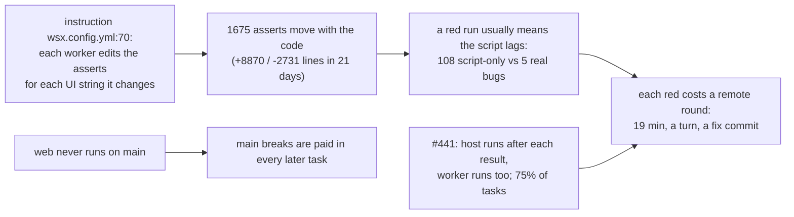

# Verification bottleneck: is the web scenario a necessary step, and can it be done better?

Asked 2026-11-15 by the owner. Read-only study. Counts come from two scripts and git:
- **TC**: `python3 -I docs/design/task-time-cost-measure.py --since 2026-11-08 [--landed-since 2026-11-14T16:30] --gh`
- **SF**: `python3 -I docs/design/scenario-flakes-measure.py --until 2026-11-15T11:00 [--days 0.77] --gh --yield --commits --asserts [--rows yield|commits]`

The hand-read samples are in `verification-bottleneck-sample.md`.

## Answer

1. **The step is necessary, but its gate is not the guarantee.** The web scenario is the only proof through the real browser entry point. In 21 days it found **5 product bugs** in the tasks' own changes before land, plus 3 design-rule breaks. In the same 21 days, **108 failed runs were fixed in the scripts only** (1878 CI min, $17.45 in 91 worker turns), against 21 runs fixed in product code only.
2. **First wrong state.** The scenario checks a spec that the same change rewrites. The worker instructions tell every worker to edit the asserts for each UI string it changes (`wsx.config.yml:70-73`). So a red run most often means "the script is behind an intended change", not "the owner's behavior broke".
3. **#429 and #441 moved the wrong numbers.** #429 removed infrastructure failures (34 to 0). #441 now runs the scenarios after every done result *and* the worker still runs them itself. Since then a landed task has **6.3 CI runs instead of 3.7**, and the web fail rate stayed at 61%.
4. **The gate does not hold today anyway.** 14 of 133 landed tasks landed with their last whole web run red; 4 of the 8 tasks that ran web since #441 did. The web scenario never runs on main.
5. **Smallest design that keeps the guarantee.** Gate on the owner's decided behavior only, run it once per ready revision and once on main after each land, and turn layout and motion literals into captures. Details are in §7.

## 1. The guarantee

| Must hold | Which step proves it today | Holds? |
|---|---|---|
| G1. Main builds and its tests pass | land: rebase plus the 4 plain checks on the stacked tree | yes (TC `--landed-since` T5: 31 host check runs, 8 in a land, 0 failed) |
| G2. The live deploy does not break | `deploy-web-live.sh` smoke test and live handoff, after a land | for the daemon and TUI; no browser check |
| G3. The behavior the owner decided holds in the browser | the web scenario on the task's tree, before the land | **no**: it never runs on main or on the rebased tree, and a red run does not block `ready` (`#444 ready r2` in the manager log: "checks 4 of 4 passed", while web failed at 08:49) |

Every step below is judged by G3: does it make G3 hold at lower cost?

## 2. Now, after #429 (11-13) and #441 (11-14 16:54)

| Measure | 11-13 audit (100 tasks) | Landed since 11-14 16:30 (15 tasks, TC `--landed-since`) |
|---|---|---|
| created to landed p50 | 89 min | 290 min (7 of 15 were created before 11-14, so this is not comparable) |
| check-run phase | 49.8% of the sum, p50 63 min | p50 135.5 min (sum 2059 min) |
| CI runs a task | 3.7 | **6.3** (94 runs) |
| CI fail rate | 61% | 53% (50 of 94); web alone 61% (SF `--days 0.77`: 27 of 44) |
| failed by cause | assert 141, 403 27, queue cancel 18, timeout 18 | assert 43, timeout 5, queue cancel 1, 403 **0** |
| web failures by class (SF) | week before: own 22, shared 18, once 42, generic 21, infra **34** | own 5, shared 15 (main 8, product 3, timing 2, ranout 2), once 5, generic 2, infra **0** |
| CI job-minutes a task | 109 | 247 (3699 for 15 tasks) |

- **#429 worked.** The 403 and queue-cancel failures are gone. Since 11-13 the logs have 7 "known failure" turns and 4 "failed on main too" results.
- **#441 added runs.** In #461's log the worker ran `task` (07:31). The host then ran `web` after the build result (07:54), both again after the review result (08:39), and both again after the rebase (10:47): 4 scenario rounds for one change. #444 has 13 scenario runs.
- **#441 also widened the reach.** The web paths in `wsx.config.yml` name `crates/wsx-core`, `crates/wsx-daemon` and `crates/wsx/src/task`. 99 of 132 tasks landed since 11-08 change one of them, so web now runs for 3 of every 4 tasks.

## 3. Yield against cost (21 days, SF `--yield`)

There were 318 web runs; 227 failed, which cost 3805 CI min and $37.18 in 191 reading turns. For each failure, the measure compares the task's patch at the failing HEAD with its patch at the task's next web run on another tree:

| What the next attempt changed | runs | CI min | turn USD |
|---|---|---|---|
| only `scripts/` (the check was adapted or fixed) | 108 | 1878 | 17.45 |
| only `crates/` (upper bound for bugs found) | 21 | 373 | 4.10 |
| both | 42 | 876 | 8.27 |
| neither, or no later run | 56 | 679 | 7.35 |

- **The 21 product-only runs, read one by one (sample file):** 5 are product bugs in the task's own change: #275 (one column, 44 px send button), #279 (a quote tap did not open), #356 (pill labels), #413 (tables under list items) and #420 ("qa" not refused, 2 runs). 3 are design-rule breaks: CSS literals in #264 and #273, and design lint in #415. The other runs were unrelated work done between the attempts.
- **Bugs found but landed anyway:** followEnd (#463, 7 tasks) and the To check motion (6 tasks) are real product frames. Both landed red (§1, G3).
- **The 244 script-only commits on main** (SF `--commits` reproduces the manager's 1453 / 472 / 244). The rule classes them as adapt 149, timing 71, coverage 13 and other 11. 242 of them map to a task, and 8 tasks landed only script changes. A hand read of 35 non-timing rows found 15 adapt, 6 timing, 13 fixes of the check's own logic and 1 refactor. Estimate for all 244 (hypothesis from that sample): adapt about 30%, timing about 38%, the check's own logic about 26%, new coverage 5%.

The turn cost above is only the turn that read the failure. The later fix turns are not counted, so the $ figures are a lower bound.

## 4. What the asserts check (SF `--asserts`)

The checks have 1675 assert sites: words on the screen 658, behavior (a route, state or count) 635, layout (px, rect, size) 239, motion (frames, animation) 75 and style (computed style, CSS literals) 68.

| Kind | Sites | Failures (non-infra) | Failures a site | Real bugs found (§3) |
|---|---|---|---|---|
| layout, motion, style | 382 (23%) | 93 | 0.24 | #275 (44 px), plus followEnd and To check, which both landed |
| words, behavior | 1293 (77%) | 96 | 0.07 | #279, #356, #413, #420 |

- A literal assert fails 3.3 times as often as a contract assert. Sampled contracts: "a device without task_act has routine actions" (`web-tasks-check.mjs:1609`) and "history.back() leads to ..., Back to ..." (`:2895`). Sampled literals: "a reply below moved the row in view by N px" (`:2202`) and the token audit `assert literals == []`.
- Contract asserts catch most of the bugs that were fixed before land. Script-only fixes come from every kind (behavior 44, layout 22, words 17, motion 12, style 4). So the churn is not only literals: about a quarter is the journey's own ordering and fixture logic (§3 sample).

## 5. Where and when

- **Why GitHub macOS.** On 2026-10-27 the owner decided: "always outsource heavy work where possible (GitHub Actions, remote); local resources are tight. No local VMs/containers for proofs" (`manager/decisions-before-trim-2026-11-05.md:60`). The jobs are on `macos-15` (`ci.yml:223`).
- **Cost.** The repository is public (`gh repo view --json visibility`), so standard runner minutes cost $0. The cost is the queue and the worker turns.
- **Measured (TC, 11-08 to now, 193 web runs).** GitHub queue p50 0.1 min and p90 14.5 min. With 5 or more scenario jobs already running, the queue is p50 14.3 min and p90 40.7 min (98 runs); the account runs 5 macOS jobs at once. Longest job p50 15.0 min. Wall time the worker waits p50 18.9 min, p90 27.4 min. 16830 job-minutes in all, 127 a task.
- **This Mac.** A whole run took p50 17.8 min locally (11-07 audit Q6), with a 29 min p50 wait for the check slot. Running it here changes the 10-27 decision, and that is the owner's call. Not recommended.
- **Linux.** The `weblinux` job exists (`ci.yml:294`, built on 11-07 as a probe) but has **0 runs** in any task log. Linux runners are still GitHub Actions, so they keep the 10-27 decision, and they lift the 5-macOS-job queue (the free plan runs 20 jobs). This task ran both on the same tree, c3027564 (`check-run-9.log`, `check-run-10.log` of task 468). On macOS `web` passed in 21.2 min, with 0 min of queue. On Linux `weblinux` failed after 4.9 min (cold build 3 min 02 s), at `test-web-client.py:2017`, before any browser step. That assert expects no PDF tool on the scenario's PATH. apt puts `pdftotext` in `/usr/bin`, which is on that PATH; brew's `/opt/homebrew/bin` is not (hypothesis from the comment at `:2018`). This is a fixture assumption in the script, not a product bug. So the probe has not reached a layout assert yet, and the Linux time for a whole run is still unknown.

| Point | What it catches (21 days) | Cost now |
|---|---|---|
| every worker iteration | own asserts (40 fails) and the script lagging the worker's own change (108) | 3 to 4 runs a task |
| once per ready revision (host, #441) | the same, without the worker's turn | 1 to 3 more runs a task, run in addition |
| once per land batch, rebased tree | no failure traced to it yet (11-15 doc) | 0 today |
| on main after a land | main breaks (17 shared failures in 12 tasks, 8 of them since #441) | 0 today; each break is paid once in every task after it |

## 6. The cause

- **The first wrong state:** the pass of the web scenario is defined by asserts that the change under test edits. A pass therefore proves "the script matches this tree", not G3. No one owns *which* behaviors the owner decided. The worker instructions, the host (`host.rs:1915`), `ci.yml` and the 12.6k lines of scripts each own a part, so each fix improved its own part.
- **Why about 15 fixes did not remove it.** #283, #291, #316 and #406 fixed timing reads. #293, the build cache and #429 fixed CI plumbing. #441 fixed selection. #321 and #328 fixed task-scenario parts and main-only CI failures. Each removed a class of *symptom*. None reduced the number of asserts that an intended UI change breaks. #441 also made the scenario run more often.

## 7. Options and the smallest design

| Option | Bugs found (21 d) | CI runs a task | Reading turns, 21 d ($0.16 a failure) | Maintenance |
|---|---|---|---|---|
| A. Today | 5 own + 3 rules; 2 product bugs landed red | 6.3 runs, 247 job-min | $37.18 for 227 failures | 244 script-only commits |
| B. A plus `expect()` (11-15 doc) | same | -26 timing failures (11%) | -$4 | churn unchanged |
| C. One run per ready revision; the worker runs only `--part` of its own area | same | about 3 runs (hypothesis) | fewer turns, not measured | same |
| D. The gate asserts contracts only; layout, motion and style literals become captures plus design lint (lint stays a gate) | 4 of 5 own bugs, all 3 rule breaks | -93 literal failures (49% of the 189 that name an assert) | -$15 | adapt churn on literals goes |
| E. Web on main after each land batch (host, `ci-scenario.py web` on the new tip); a red run starts one fix task and is `on_main` for #429 | main breaks found once, not in 12 tasks | +1 run a batch | -$2 (the 8 main failures since #441, as one) | none |
| F. Web on Linux runners (after a 3-run probe) | same if fonts match | queue p90 40.7 min to about 0 at peak (hypothesis) | 0 | per-OS layout literals, which D removes |

**Recommended: C + D + E, then F after the probe.**
- **Replaces:** the "search scripts ... update those asserts" sentence (`wsx.config.yml:70-73`). The new sentence: the worker edits a gate assert only where the owner's decided behavior changed, and a layout change gets a capture in `human_verify`.
- **Changes:** the worker's whole-scenario runs. The host's one run per ready revision (#441) stays the only whole run.
- **Moves:** about 380 literal sites out of the gate, into a capture report.
- **Adds:** one main run per land batch. It is the missing G3 step: it also covers the deploy (G2) and gives the `web` scenario the main block that #429 needs.
- **Keeps the owner's rules:** a real browser and the real entry point, no mocks. TUI parity is unchanged, since `smoke` and `task` still drive the TUI.
- **Proof:** TC `--landed-since` a week after the change, with these targets: CI runs a task at 3 or fewer, web fail rate under 30%, and no task landed red (§1 query).

## Questions for the owner

1. **Gate only on the behavior you decided, with layout and motion as captures for you to look at?** Recommendation: yes. Literal asserts fail 3.3 times as often as contract asserts, and they stopped none of the 2 frame bugs from landing.
2. **Run `web` on main after each land batch, and treat a red run as one fix task?** Recommendation: yes. It is the only step that makes G3 hold. Today a red run lands by judgment (14 tasks).
3. **Fix the probe's PDF-tool fixture (`test-web-client.py:2017`), run `weblinux` 3 times, and move `web` to Linux runners if all parts pass?** Recommendation: yes. This keeps your 10-27 "GitHub Actions" decision, and it removes the 5-macOS-job queue. Running it on this Mac would change that decision, and I do not recommend it.
