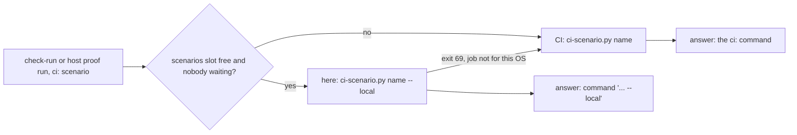

# Verification lanes: every failure per run, and the local lane or CI

Owner, 2026-11-16 (messages 4970-4977): "why all changes must go through external ci? we can utilize both and do what works". This replaces the 10-27 rule that `task` and `web` run only on GitHub Actions.

**Answer.** A round showed one failure, and each round waited for a macOS runner. Two changes, both built in #484:

1. A scenario part reports every failed section and goes on (`scripts/sections.py`).
2. A `ci:` scenario runs here when the `scenarios` slot is free, else on CI. The same scenario on the final head is the proof in either lane.

## 1. Measurements on this Mac

| Run | Where | Result | Source |
|---|---|---|---|
| `test-web-client.py --part chat` (no `--browser`) | inside a worker boundary | PASS, 276 s, load 10-12 | `.work/lanes/chat-nob.err` |
| `test-web-client.py --part chat --browser` | inside a worker boundary | 4 FAILED, 2 SKIPPED, 299 s: Chrome does not start | `.work/lanes/chat.err` |
| `test-web-client.py --part tasks` (no `--browser`) | inside a worker boundary | first section fails in 23 s (`#1 waiting timeout`: the task host's agent cannot start), the rest SKIPPED | `.work/lanes/tasks-nob.err` |
| `test-task.py --part core` | inside a worker boundary | section 1 fails: nested `sandbox-exec` exit 71 (`boundary.rs:391-415`), `ps` refused | `.work/lanes/core.err` |
| planted copy, 2 asserts in 2 chat sections | inside a worker boundary | both FAILED lines, 32 SKIPPED named, exit 1 | `.work/lanes/planted.err` |
| task scenario, whole, local slot (11-03/04) | host | p50 16.0 min, queue p50 41.5 min (n 13) | ledger `check_run` rows |
| task scenario, CI | GitHub | p50 21.6 min, p90 33.7 min (n 384); one part p50 15.6 min | ledger |
| web scenario, local slot / CI | host / GitHub | p50 14.0 min (queue p50 20.4) / p50 18.3 min | ledger |

So a worker can run only the web `chat` part without a browser in its own copy. The task scenario, the `tasks` part and `--browser` need the host (outside the boundary).

## 2. The lane rule

- `slot::take_free` takes the slot only when nobody holds it or waits for it, so a local run never queues and CI stays the overflow.
- The result keeps the command that ran. A run here never answers for a run on CI (`kept_checks` compares commands).
- CI keeps what only it gives: `weblinux` (Linux), a clean machine, and no load when the Mac is busy.

## 3. Every failure per run

`sectioned()` recompiles each part's function with one guard per section (test-task: at each `mark()`, web: after each `ok()`). A failed section prints `FAILED section ...` and the part goes on. A section that reads a name that a failed or skipped section assigns is `SKIPPED` and named. A later failure is marked `(after section X failed)`. The part ends with `SECTIONS: n failed, m skipped`, every line, and exit 1. Limit: a store through a subscript (`d['k'] = ...`) is not tracked; its later failure shows as "after".

| Design | Fixes | Does not fix |
|---|---|---|
| Section runner (this) | one failure per round: #472's 8 host rounds | a test that fails the same way each round |
| `expect()` (scenario-flakes.md) | false timing failures (26 of 223) | the report: still stops at the first |
| Option B (verification-bottleneck.md) | A plus `expect()` | churn and report unchanged |

They are independent; `expect()` can follow.

## 4. Replay on paper (estimates, from `check_run` rows)

| Task | Real | With both changes |
|---|---|---|
| #472 | 13 CI rounds, 11 h; task part 10 rounds (42-262 min), each on a new `part_host` line | task 2 rounds (all 8 lines in round 1), web 2; about 6 h. The lost answer (1 h 13 min) is #477's |
| #471 | task 10 rounds (44-229 min); web `tasks` 16 rounds, 11 on the same design-lint warning; landed at 12.5 h | task 2 rounds; web about 12 (the repeated warning is a product fix, not a report fix); about 9-10 h |

## 5. Build steps and order

1. Runner: `scripts/sections.py`, the runner lines of `scripts/test-task.py` and `scripts/test-web-client.py`, `wsx.config.yml` scenarioPaths. Proof: the planted run.
2. Lane: `crates/wsx/src/task/{host.rs,slot.rs,claude.rs}`, `scripts/ci-scenario.py --local`, `scripts/test-task.py` 32t3/32t8, `docs/tasks.md`, `wsx.config.yml`. Proof: 32t8 (one scenario here, one sent to CI with exit 69).
3. CI time: `.github/workflows/*.yml`, `scripts/ci-scenario.py` (measured first).

Order: #479 (ready) edits `scripts/test-task.py` and `docs/tasks.md`; #480 and #482 edit `scripts/test-web-client.py`; #481 (local main follows origin) is not checked against these files. #484 rebases after each of them lands. Their new sections need no change: the runner wraps any section.
