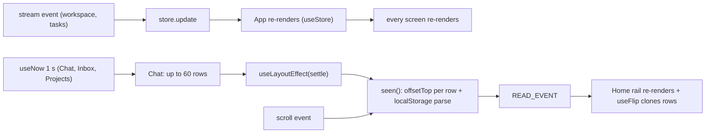

# Web client health audit: render cost, timers, stream, PWA

Status: read-only audit, 2026-11-05. Scope: `crates/wsx-web/web/*.js` and `app.css`. Paths are relative to `crates/wsx-web/`. Evidence comes from reading the source and from counts in the real state directory (read only). Nothing was profiled in a browser, so the costs below are counts of work per event, not timings.
Out of scope, already planned: [client-logic-audit.md](client-logic-audit.md) (#238, duplicated rules), #236 wording, #240 chat rows in core, #241 role unread and the Home and story timers, #243 scenario queue, #235 usage filters, #242 back and zoom.

**Answer.** The stream, the reconnect and the caches are sound. The cost is in rendering. One store update renders the whole page. The session chat renders all its rows every second while an agent works. Every scroll and every render of a chat does layout reads and parses localStorage for each row. The main stability gaps are push notifications that stop without a word, POST requests with no timeout and a shell that waits on a weak network.

Real state, for scale: 18 projects. The largest project has 248 tasks and a manager log of 8,734 entries (2.6 MB). There are 43 PNG captures (median 102 KB, max 1.2 MB) and MP4 captures of up to 11.7 MB.

## Findings, ranked by impact

| # | Place | Problem | What the user sees | Evidence | Proposed fix | Size | Risk |
|---|---|---|---|---|---|---|---|
| 1 | `web/chat.js:693`, `web/lib.js:353` | `useNow(Boolean(working))` sits in `Chat`, so the whole chat renders every second while an agent works. Each render then runs `useLayoutEffect(settle)` (no deps), which runs `mark` and `seen` over every row. | Typing and scrolling stutter on a phone in a long session while the agent works. The battery drains. | code read; `RECENT_ROWS` 60 rows and `TIMELINE_ITEMS` 400 (`chat.js:90,573`) | Move the elapsed time into a small `<Elapsed since>` component that owns the timer. Run `settle` only from the observers and from a changed row list. | S | L |
| 2 | `web/lib.js:233-254`, `:176-183` | `seen()` runs on each scroll event. It reads `offsetTop` and `offsetHeight` for every row and parses `wsx-read` (up to 200 entries). When the read time moves it also writes the map back and fires `READ_EVENT`. | Scrolling a long chat is slow on a phone. On a wide screen, the Home rail re-renders on each read step. | code read; `READ_KEPT` 200 (`lib.js:175`) | Keep the read map in memory and write it on `visibilitychange`, `pagehide` and close. Find the last visible row with a binary search over `offsetTop`. Fire `READ_EVENT` once per chat change. | M | M |
| 3 | `web/store.js:54-59`, `web/main.js:111`; `src/events.rs:225,238` | `App` calls `useStore`, so each `update` renders the whole tree. The `workspace` event carries each working session's `activity` line, so it changes while agents work. Each `tasks` event does the same. | Work for the whole page each time an agent writes, also on screens that show no session. | code read | Subscribe per field (`useStore(select)` that compares the selected value). `App` reads only `site`, `loaded` and the tab counts. | M | M |
| 4 | `web/sw.js` (no `pushsubscriptionchange`), `web/settings.js:47-50`; `src/push.rs:303` | A subscription is made only when the owner flips a switch. When the push service rotates or ends it, the server deletes the device on 404 or 410. The page never checks again and never subscribes again. | Notifications stop with no message. Settings can show the old switches until the page reads `api/push` again. | code read | In `sw.js`, handle `pushsubscriptionchange`: subscribe again and POST it. At boot, when this device has choices on, compare `getSubscription()` with the server's and send it again when they differ. | M | M |
| 5 | `web/main.js:243-254`, `web/api.js:75` | `back()` closes and opens the stream on every `visibilitychange` to visible and every `online` event, also when the stream is alive. Each `up` then runs `reread()`: every open chat, task and page, and `api/tasks` for all projects. | Each tab switch or phone unlock reads everything again. On a slow network the screen waits for that, and the server reads every manager log. | code read; 18 projects | Open again only when the stream was not heard within `SILENT_MS` (keep a `heardAt` time; timers stop during sleep, the clock does not). Otherwise do nothing. | S | L |
| 6 | `web/api.js:22` | The default timeout is 0 for every non-GET request. | A send, an approval or a land on a connection that went silent (a phone back from sleep) shows busy with no end. | code read | Give POST, PUT and DELETE a timeout (for example 30 s). Send a client message id, so that a send repeated after a timeout is taken once. | M | M |
| 7 | `web/sw.js:30-40` | The shell is network first with no timeout. The cache answers only when `fetch` rejects. | On a weak network (one bar, a captive Wi-Fi) the installed app shows a white screen for a long time before it loads. | code read | Race the network against a short timer (for example 3 s) and answer from the cache when the timer wins. Keep the network answer for the cache. | S | L |
| 8 | `web/tasks.js:882,895,925` | After Find, the manager chat keeps the whole log for the life of the screen ("it stays whole after the find closes"). `conversation()` classifies and sorts all entries on every render. | Once Find is used in a big project, each render goes over 8,734 entries. That includes each store update and each new message. | 8,734 entries in the largest log | When Find closes, cut `shown` back to the newest 400 and set `whole` to null. | S | L |
| 9 | `web/lib.js:434`, `web/home.js:173-176` | `useFlip` deep-clones every row on every render, to fade a removed row out later. Home renders every second (`useNow(true)`) and on each `READ_EVENT`. | Background work on Home and on the wide rail, which grows with the number of projects. | code read; 18 projects | Clone a row only when it leaves: keep the node itself and clone it in the layout effect, before Preact removes it. Or keep the copy only while the key set changes. | S | L |
| 10 | `web/chat.js:655` | A failed timeline read retries every 2 s (`READ_AGAIN_MS`), with no backoff, also while the page is hidden. | A phone with no network makes a request every 2 s until it is back. The error line flickers. | code read | Use `RETRY_MS` backoff from `api.js`. Skip while `document.hidden`; the stream's `up` reads again anyway. | S | L |
| 11 | `web/checks.js:96`, `web/chat.js:195` | Capture images and the composer's attachment previews have no `loading="lazy"` and load at full size. | A To check list with many captures loads all of them at once, up to 1.2 MB each, on a phone network. | 43 PNGs, max 1,216,833 B | Add `loading="lazy"` and `decoding="async"`. Later, a server-side thumbnail for captures. | S | L |
| 12 | `web/sw.js:73-75` | `matchAll({ includeUncontrolled: true })` can pick a window that this worker does not control. `navigate()` rejects for it, so the click does nothing. | A notification tap does not open the task, the first time after an update or a hard reload. | code read | Use `focus()` and then `postMessage(target)`, which the page turns into a hash change. Fall back to `openWindow`. | S | L |
| 13 | `web/routines.js:41`, `web/inbox.js:90`, `web/projects.js:59` | The routines poll every 60 s runs while the page is hidden. The Inbox and Projects lists render whole every second while any session works. | Small background cost. | code read | Skip the poll when hidden. Put the age in a small timer component (as in #1). | S | L |

## Fix tasks, in priority order

1. **Chat render cost (#1, #2, #13).** Add an `Elapsed` component with its own timer. Run `settle` from the observers and from a changed row list only. Cache the read map in memory and write it on hide and close.
   Files: `web/lib.js`, `web/chat.js`, `web/inbox.js`, `web/projects.js`, `web/home.js`. Proof: in `scripts/test-web-client.py --browser`, open a session with a long timeline while its agent works. Over 10 s, count the `Chat` renders (a `performance.mark` in a debug build, or the `longtask` entries) and the `localStorage.setItem` calls during a scripted scroll. Assert that no render happens without new data and that scrolling makes no write.
2. **Push that stays on (#4, #12).** Handle `pushsubscriptionchange` in `sw.js`. Check the subscription at boot. Open notifications through `postMessage`.
   Files: `web/sw.js`, `web/settings.js`, `web/store.js`. Proof: a browser scenario subscribes, removes the device on the server as a 410 would, and reloads. The page subscribes again, or Settings shows the switches off. Then a push opens the named task.
3. **Resume without a full re-read, and requests that end (#5, #6, #10).** Keep a live stream on return. Add a timeout to non-GET requests, with a client message id for a chat send. Back off failed timeline reads.
   Files: `web/api.js`, `web/main.js`, `web/chat.js`, the send handler in `src/chat.rs`. Proof: in the browser scenario, hide and show the page twice and count the `api/` requests (none when the stream is alive). Stop the server during a send: the composer shows a failure within the timeout, and a send after restart is taken once.
4. **Store updates by field, and a bounded manager chat (#3, #8, #9).** `useStore(select)` re-renders only the components whose field changed. Find drops the whole log when it closes. `useFlip` clones only leaving rows.
   Files: `web/store.js`, `web/main.js`, the views that call `useStore`, `web/tasks.js`, `web/lib.js`. Proof: `scripts/web-tasks-check.mjs` with a project of 5,000 entries: open Find, close it, and assert that the chat holds 400 entries. A `workspace` event with a new activity line does not render the open manager chat.
5. **Shell and images on a weak network (#7, #11).** Race the network against a timer in `sw.js`. Add lazy loading to the capture and attachment images.
   Files: `web/sw.js`, `web/checks.js`, `web/chat.js`. Proof: the browser scenario with network throttling (CDP `Network.emulateNetworkConditions`, high latency) loads the installed shell from the cache within 4 s. The To check list requests only the captures on screen.

## Not covered by the other tasks

- #241 stops the Home and story timers. It does not cover the `Chat`, Inbox, Projects and Panels timers (#1, #13) or the `useFlip` clone that each Home tick causes (#9).
- Backend, for the backend audit: `src/tasks.rs:670` reads the whole manager `log.jsonl` (2.6 MB) on each chat read, also for an `after` read. Finding #5 makes that happen on every page return.

## Checked and found fine

- Event stream: the 25 s silence watchdog, the backoff and the 5 s quiet window before "Connection lost" (`web/api.js:14-93`, `web/main.js:227-240`).
- Terminal: the backoff, the 12 s stale watchdog, the reconnect on wake or `online`, the 80 ms resize debounce and the cleanup on close (`web/terminal.js:204-211,478-530`).
- Incremental reads: the manager chat reads `after` its last id and keeps 400 entries, with row nodes reused (`web/tasks.js:876-900,977-985`). The session timeline reads from its last turn and keeps 400 (`web/chat.js:634-647`). `useCoalescedLoad` drops stale answers (`web/lib.js:120-157`).
- Bounded caches: diagrams (`MAX_KEPT`, object URLs revoked, `web/diagram.js:85-97`), task details (40, `web/task.js:113-118`), read places (200, `web/lib.js:175`) and seen states (pruned, `web/store.js:140-147`).
- Pausing: panels do not read while hidden (`web/panels.js:87`). The working-task rotation pauses while hidden (`web/tasks.js:404`).
- The service worker deletes old caches on activate (`web/sw.js:14-20`). Assets are immutable and cached for a year (`src/http.rs:316`).
- The server sends `workspace` only when its text changed (`src/events.rs:238`). Markdown and code highlighting are memoized (`web/markdown.js:42,185`).
- CSS: the looping animations change only `opacity` and `transform` (`app.css:484-486`). The `background-position` shimmer runs only on loading skeletons.

## Summary

1. **Chat render loop (#1, #2).** While an agent works, the session chat renders every second, and each render and scroll reads the layout of every row and parses localStorage. This is the largest cost in long chats on a phone.
2. **Notifications stop without a word (#4).** The page does not handle a rotated or ended push subscription, and the server deletes the device on 410.
3. **Whole-page renders and full re-reads (#3, #5).** Each store update renders the whole page, and each return to the page reads every open screen and all projects again, also when the stream is alive.
