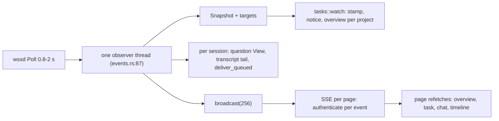

# Web server health audit: performance and stability

Status: read-only audit, 2026-11-05 (owner msg 2726). Scope: `crates/wsx-web/src/` and the `wsx-core` reads it calls. Paths below are relative to `crates/`. Each fix becomes its own task.
Measurements are read-only Python proxies over the real state in `~/.local/state/wsx` (file counts, sizes, stat and parse times). Rust is faster, so read them as orders of magnitude, not as server timings. The live server was not called: device auth needs the cookie, and `ps` is refused inside the task boundary.

Scale on 2026-11-05: the wsx project has 248 tasks (205 landed, 30 closed, 13 working) and 21.3 MiB of task logs. Its manager `log.jsonl` is 2.5 MiB with 8734 entries. Across all 13 projects, `store::stamp` watches 1715 paths, of which 1613 exist.

## Findings (ranked by impact)

| # | Place | Problem | User-visible effect | Evidence | Proposed fix | Size | Risk |
|---|---|---|---|---|---|---|---|
| 1 | `wsx-web/src/events.rs:251-258`, `site.rs:180-209`, `queue.rs:407-425` | A grant that reads as empty for one tick deletes the queue store. Two triggers: in Profile mode, `global_config()` returns `None` on any parse error or warning, so `Grant::Profile(_, None)` grants nothing; or a snapshot briefly lists no sessions. `queue.retain(&alive)` then rewrites `queue.json` without every session, and `retain_muted` drops every push mute. | Queued messages, chat notices and remembered conversations are lost for good, and mutes reset. A half-saved config file is enough. | Code path read; no fixture run yet | Treat "grant unknown" as unknown: skip `retain` and `retain_muted` when the config did not load or the snapshot came from a reconnect, and prune only sessions that wsxd reports as gone | S | Low |
| 2 | `wsx-web/src/events.rs:87-269` | One std thread does everything in series: `Poll`, `Snapshot`, `tasks::watch` over every project, one manager `Status` socket call per project (2 s timeout, `tasks.rs:265`), one `View` per blocked session (`question.rs:28`), transcript tails (`chat.rs:1148`), `deliver_queued` and push fan-out. `deliver_queued` holds `Chat::delivering` (`chat.rs:909`), which HTTP `send`, `retry` and `steer` also take. | When any step is slow (a hung manager socket, a slow PTY write, many projects), every page's events and every push wait for it, and so do sends from the chat. | Code read. The delivery stall is plausible, not proven: wsxd answers after the PTY write (`wsx-daemon/src/exchange.rs:600-680`), bounded by the exchange deadline (1 h, `chat.rs:32`) | Run delivery on its own worker per session, and run the project overviews in a bounded pool with a per-step time budget; the observer only collects and publishes | M | Medium |
| 3 | `wsx-web/src/events.rs:115-116`, `:163`, `:183` | Every failed poll sets `first = true`, which mutes state transitions and exchange events for the first tick after the reconnect. | An agent that became blocked or failed during a wsxd restart or live handoff never sends "An agent needs me". | Code read | Keep a separate `started` flag for server start; after a reconnect, compare against the remembered `states` | S | Low |
| 4 | `wsx-web/src/tasks.rs:127-330`, `:1563`, `:1466-1500` | `overview()` is rebuilt from disk on every `GET /api/tasks/{p}`, on every `GET /api/tasks` (all projects), and on each change that is not progress only (a manager log line counts). It reads every `task.json` and `result.json` for waiting, failed and ready tasks; parses whole the logs of open tasks (`view::task_agent`) and of up to 30 tasks changed in 7 days (`resolutions`); and reads `checks`, `approvals` and `deploys` whole. The observer already keeps the result text in `Watch::overviews` and does not serve it. | Slower home and task lists as projects grow. CPU on every manager turn. | wsx project: 248 `task.json` (490 KiB, 8.4 ms), 3.1 MiB `result.json`, 0.4 MiB open logs + 2.0 MiB recent logs, 209 KiB ledgers per build | Serve the observer's cached overview while the project stamp is unchanged. Have `resolutions` read log tails only | M | Low |
| 5 | `wsx-web/src/tasks.rs:670` | `chat` reads the whole manager log on every call, also with `after` set (`tasks.js:879` always sends `after`). Each `manager` event makes every open chat page refetch. | Each manager line parses about 2.5 MiB per open page. | 8734 entries, 2.5 MiB, 26 ms Python parse | With `after`, read the tail (`read_tail`, as `overview` does at `tasks.rs:219`) | S | Low |
| 6 | `wsx-web/src/http.rs:255`, `:660`; `devices.rs:112-137` | Each device-store read (`with_store`) opens `devices.lock`, takes `flock(LOCK_EX)` with no timeout, and parses `devices.json`. `authenticate` does this on a runtime worker (`block_in_place`) for every request, for every event on every open stream and every 20 s per terminal; the observer does it through `list` every 5 s and per push (`events.rs:437`). | Requests and streams queue behind each other. One CLI holding the lock stalls them all. | Code read | Keep the parsed store in memory keyed on the file's mtime and size; lock only for writes | S | Low |
| 7 | `wsx-web/src/tasks.rs:1038-1046`; `wsx-core/src/task/copy.rs:48` (called from `tasks.rs:426` `deployed`) | `run_wsx` (preview, hand, trial, check) and the git calls in `detail` run `Command::output()` with no timeout. | A hung git or wsx child keeps a worker, and for `detail` a runtime slot, until it exits. The task sheet never answers. | Code read | Kill the child after a deadline (git 10 s, `run_wsx` per action) and answer 504 | S | Low |
| 8 | `wsx-core/src/task/usage.rs:133`; `wsx-web/src/tasks.rs:1146`; `events.rs:60`; `chat.rs:264`, `:269`; `http.rs:208` | Several maps never drop entries: the usage cache (each entry is a full parse of one log), `Watch::replies`, `exchange_revisions`, `Chat::produced` (one key per file version), `Chat::resuming`, and the `Limiter` buckets. | Memory grows slowly over a long uptime. | 248 task logs (21.3 MiB) can all enter the usage cache | Prune each map against its live set, as `events.rs:259-267` already does | S | Low |
| 9 | `wsx-web/src/push.rs:298-305`; `events.rs:463-475` | No retry on 429, 5xx or a timeout. Other 4xx answers (401, 403) are logged and the dead subscription is sent to forever. Each batch starts a new thread, with no cap; each send may take 10 s. | Pushes are lost when the service hiccups. Threads pile up when the service hangs. | Code read | Send from one long-lived worker with a bounded channel, retry once with a backoff, and drop a subscription after N consecutive 4xx answers | S | Low |
| 10 | `wsx-web/src/tasks.rs:1115-1124`; `chat.rs:587-606` | The `approving` and `shells` keys are removed only after the work returns, with no drop guard. | After a panic inside an approval or a `!` line, that item answers "already running" or `shell_busy` until the server restarts. | Code read | Remove the key in a guard's `Drop` | S | Low |

## Proposed fix tasks (priority order)

1. **The queue survives a grant that cannot be read** (finding 1). Files: `wsx-web/src/events.rs`, `site.rs`, `queue.rs`.
   - Proof: a `scripts/test-web-client.py` journey on a Profile site. Queue a message while the agent works. Make the wsx config unparsable for two observer ticks, then restore it.
   - Pass: `queue.json` and the page still list the message, and a mute stays set.
2. **A reconnect does not mute news** (finding 3). File: `wsx-web/src/events.rs`.
   - Proof: a runtime scenario. A session blocks while wsxd hands off (`scripts/runtime-smoke.py` handoff step).
   - Pass: the test push receiver gets "needs your input", and the page gets an `exchange` event.
3. **The observer never waits on delivery or a slow project** (finding 2). Files: `wsx-web/src/events.rs`, `chat.rs`, `tasks.rs`.
   - Proof: a web journey with a manager socket that accepts and never answers, plus a queued message to a slow PTY.
   - Pass: a `workspace` event for a new session still arrives within 3 s, and a chat send answers.
4. **Overview and chat reads are cached and incremental** (findings 4, 5). Files: `wsx-web/src/tasks.rs`, `wsx-core/src/task/manager.rs` (tail read).
   - Proof: the web journey compares `GET /api/tasks/{p}` before and after a manager line; it returns the same JSON as a cold build.
   - Pass: a count of `read_log` calls (stderr trace in the scenario) drops to zero for an unchanged stamp.
5. **Timeouts, pruning and cached device auth** (findings 6-10). Files: `wsx-web/src/devices.rs`, `http.rs`, `push.rs`, `tasks.rs`, `chat.rs`, `wsx-core/src/task/usage.rs`.
   - Proof: a web journey with a git that hangs (a `PATH` shim) and a push receiver that answers 503.
   - Pass: `detail` answers 504 within the deadline, the push is retried once, and the server's RSS stays flat over 1000 events.

## Checked and found fine

- SSE: a closed page frees its slot at once (`http.rs:653`). The cap is 4 streams per device (`http.rs:47`), with a named `ping` every 10 s. Broadcast lag sends `resync` (`http.rs:675`). The first event replays the last `workspace`, or `daemon: false`.
- wsxd down or restarting: the observer publishes `daemon: available=false` once and retries every 1 s (`events.rs:106-118`). Handlers answer 503 `daemon_unavailable` (`chat.rs:79-83`). A refused handoff waits up to 5 s and retries a request only if it changed nothing (`wsx-core/src/runtime/client.rs:233-248`).
- Terminal: a client drop ends the pump within 200 ms (`terminal.rs:142-147`). A dead peer ends within 15 s. Revocation is checked every 20 s. The cap is 4 terminals per device.
- Bounded stores: media has a 7-day TTL and a 1 GiB quota, sweeps every 60 s and removes `.part` files (`media.rs:96-101`, `lib.rs:153`). Devices: at most 16, pairings expire after 10 min. The queue keeps 5 waiting and 3 delivered messages, 20 notices and 10 conversations per session.
- Panics: none reachable from external input. The `expect` calls are on internal invariants (`media.rs:208`, `terminal.rs:50`, `:181`). Poisoned locks are recovered (`lib.rs:39`).
- Hot-path costs that are small today: stamping all projects takes 3.0 ms per tick. A 1 MiB transcript tail parses in 3 ms and a 4 MiB tail in 8 ms (p90 transcript 2.5 MiB, Python). Shutdown waits a 2 s grace (`lib.rs:36`).
- Not repeated here: the client rules and constants (`client-logic-audit.md`), status wording (#236), chat rows (#240), role timers (#241), CI scenarios (#243), usage filters (#235), back and zoom (#242). None of them covers findings 1-10.

## Summary

1. **Data loss:** one tick with an unreadable Profile config, or an empty snapshot, deletes every queued message, notice and conversation, and every push mute (finding 1, S).
2. **Head-of-line blocking:** a single observer thread runs delivery, every project's overview and the socket probes in series. One slow step delays all events and pushes, and blocks chat sends (finding 2, M).
3. **Lost news and repeated work:** a wsxd reconnect mutes "needs you" pushes (finding 3, S). The overview and the manager chat re-read megabytes per request and per event that the observer already has (findings 4-5).
