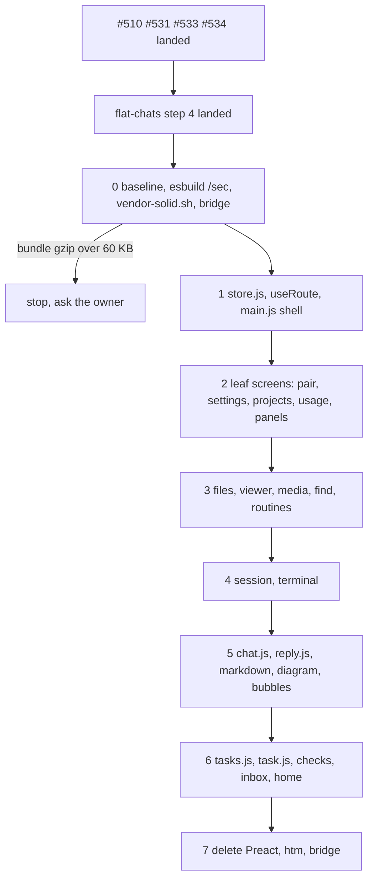

# Web client on Solid 2: plan (task 535)

Status: plan only, 2026-11-20, no product edit. Owner wsx 5554: move the whole web client from Preact to SolidJS 2 after the UI work. Facts below were read in this task: npm registry (`curl https://registry.npmjs.org/<pkg>`), the packed tarballs, and `rg` over `crates/wsx-web/web` at `a97e8302`.

## 1. For the owner: one screen

| | |
|---|---|
| What you see | Nothing, if the measures in §5 hold. Same pages, same behavior. The page serves more JS (see stop conditions). |
| Why do it | Updates touch only the DOM they change. Today a whole component runs again on each change, and the code carries guards and mirrors to cope (§3). |
| Solid 2 | Stable: `solid-js` 2.0.3, published 2026-11-19, MIT. |
| Cost | 14 to 20 turns [estimate: 8 steps (0 to 7), the chat and task screens take 3 to 5 turns, each check-run can add a fix turn]. Dollars: no measured source in the repo; price the turns at the host's per-turn cost [unverified]. |
| Order | After #510, #531, #533, #534 and after flat-chats step 4 (`docs/design/flat-chats.md` §4). The port counts and ports only the client left by step 4. It ports no `threads.js`, thread route or strip. |
| I stop and ask you if | (1) gzip JS served for the first chat paint grows by more than 60 KB; (2) the median of 5 runs of a 400-row chat render is slower than before; (3) a MutationObserver probe counts more remounts than before; (4) a check assert must change its meaning (not only a selector) to pass. |
| Not touched | The TUI, the daemon, the wire protocol. |

One choice is yours if step 0 fails: §4 names the fallback.

## 2. Solid 2 today

| Fact | Source |
|---|---|
| Stable. `latest` 2.0.3; `next` is rc.23 (2026-11-16). `@solidjs/web` 2.0.3, `@solidjs/html` 2.0.1, `@solidjs/signals` 2.0.3. All MIT. | npm registry dist-tags and `license` field, read 2026-11-20. A web search said "release candidate"; it was older than the registry. |
| `render` is in `@solidjs/web`, no longer in `solid-js`. | `@solidjs/html` README example. |
| No-build path: `@solidjs/html`, an AST-based tagged-template runtime. No `new Function` or `eval`, so `script-src 'self'` (`crates/wsx-web/src/http.rs:44`) is met. | README of the package; `rg 'new Function\|eval\('` over all four `dist/` found nothing. |
| Cost of that path: not tree-shakeable, and each reactive hole needs a function, `${() => count()}`. A bare `${count()}` is read once. | README of the package. |
| The dist files use bare imports (`solid-js`, `solid-js/internal`, `@solidjs/signals`, `@solidjs/web`). A browser cannot resolve them, and an import map needs an inline script (CSP blocks it). | `rg "from '"` over the four tarballs. |
| JSX with a compiler step would break "served as written". Rejected. | `crates/wsx-web/src/assets.rs` includes each file as written. |

## 3. Inventory (counts from `rg`, today; recounted after flat-chats step 4)

About 450 KB of JS in 36 files, 663 `html\`` templates, 121 `key=`, 36 `ref=`. Hook uses: `useState` 175, `useEffect` 99, `useRef` 97, `useLayoutEffect` 32, `useMemo` 5, `useCallback` 4. No context, reducer or error boundary. `tasks.js` 74 uses, `chat.js` 32, `lib.js` 31.

| Preact | Solid 2 | One to one? |
|---|---|---|
| `useState` | `createSignal`; the read is `x()` | Yes, but a write shows at the next flush, not at once. Code that reads after a write needs `flush()` or the value held. |
| `useRef` as a node | `let node;` and `ref=${(e) => node = e}` | Yes |
| `useRef` as a mutable box (latest-callback and generation guards) | a plain `let` in the component, which runs once | Yes, and the box goes. |
| `useEffect(fn, deps)` | `createEffect(() => deps, (v) => { ...; return cleanup })` | No. Dependencies are tracked, not listed. Effects with `[]` become `onSettled`. |
| `useLayoutEffect` | `createRenderEffect` | No. It runs before paint but a signal write inside it is deferred. 32 uses to check one by one (FLIP, scroll pin). |
| `useMemo`, `useCallback` | `createMemo`; a callback needs no wrapper | Yes |
| Props destructuring, early `return` | not allowed; `props.x`, `Show`, `Switch`/`Match` | No. Every component body is rewritten, not moved. `Screen()` in `main.js` is a `Switch`. |
| `key=${id}` remount (`main.js:115-121`) | `Show keyed when=${id}` or a one-item keyed `For` | No. Step 2 picks one and proves the remount count equals today's. |
| list `.map(...)` with `key=` | `For each=${list}` (item and index are accessors) | No. Items are accessors, `item()`. |
| `useStore` (`store.js:101`) | store as a signal or `createStore`; `useStore()` becomes a read | Simpler. The "update between render and subscribe" guard goes. |
| `useRoute` (`store.js:159`) | one signal set by `hashchange` | Simpler. Same guard goes. |
| `useEventLoad` (5 uses) | `createEffect` that adds and removes the listener | Yes |
| `useCoalescedLoad` (6) | plain function with its generation counter; `onCleanup` bumps it | Yes. `useRef` box and `latest` mirror go. |
| `useManagerLog`, `useSheetRead`, `useReply`, `useDraft`, `useRecent`, `useRoutines`, `useDuration`, `useNow`, `useExit` | functions that return accessors | Yes, one by one |
| `useFlip` (2), `useFollowEnd` (3), `useListKeys` (3) | `createRenderEffect` or a plain handler with a signal | Check each: they read layout (`offsetTop`, scroll). |
| mermaid, xterm, markdown-it, highlight.js | Plain DOM libraries wrapped in a `ref` and an effect. Unchanged inside. | Yes |
| `render(html\`<${App}/>\`, root)` (`main.js:292-307`) | `render(App, root)` from `@solidjs/web` | Yes |

Workarounds that die with the VDOM (each is named and deleted in the step that ports its file): the `useRef` latest-callback mirrors, the "update between render and subscribe" guards, `useCallback` wrappers, `rendered`-vs-current compares, and `key=` used only to force a reset.

## 4. Step 0: how Solid is served

| | A. Commit Solid's own files, rewrite the bare imports | B. Bundle once with esbuild |
|---|---|---|
| New tool | None. `vendor-preact.sh` already does one such rewrite; `curl`, `tar`, `sed`, `openssl` only. | esbuild, new; `/sec` first, pinned version and sha512. Dev-time only; not in CI or runtime. |
| Files served | `solid.js`, `internal.js`, `web.js`, `html.js` plus the 45 files of `@solidjs/signals/dist/prod`. About 49 `assets.rs` entries, and `find()` must take nested names. | One `vendor/solid.js`, one entry. |
| Bytes (measured, unpacked, gzip -9) | Signals prod: 731 KB, 220 KB gzip, not minified, not tree-shaken. Plus solid 12 KB, web 22 KB, html 4.5 KB. About 260 KB gzip against 7 KB for Preact, hooks and htm. | Not measured: the tool is not installed. Step 0 measures it. |
| First paint | A tree of about 50 modules fetched in a waterfall. | One request. |
| Precedent | `vendor-markdown.sh`, `vendor-xterm.sh`: take the tarball's own files. | `vendor-mermaid.sh` ships esbuild output, but does not run esbuild. |

Pick: **B**. A needs no new tool, but its measured cost is about 260 KB gzip and 50 requests, and that alone breaks stop condition (1). B is the only one that can pass it.

Step 0 therefore ends with one number, before any port: gzip of `vendor/solid.js` plus `@solidjs/html`, measured with `gzip -9`. If it adds more than 60 KB over Preact, htm and hooks (7 KB), step 0 stops and the question comes to you: accept the size, or stay on Preact. A is not the fallback, since it is larger.

## 5. Steps and order

A Preact root and a Solid root can share a page: `render()` is per DOM node and I expect the two runtimes to share no globals [unverified; step 0 proves it with both on one page]. Step 0 adds a bridge that mounts a Solid component inside a Preact node and the reverse; it lives only until step 7. The shell (`main.js`) goes first in step 1, so the two runtimes meet at screen boundaries (`Screen()`), not inside a screen. A screen is never half ported.

| Step | Files changed | Lands when |
|---|---|---|
| 0 | new `scripts/vendor-solid.sh`, `web/vendor/solid.js`, `solid.LICENSE`, `assets.rs` entry, `THIRD-PARTY-NOTICES.md`; a measure script `scripts/web-solid-measure.mjs` | The baseline table (below) is committed; bundle gzip is under the limit; `check-run web task smoke` unchanged. |
| 1 | `store.js`, `lib.js` (hooks to functions), `main.js` | Same checks; `useStore`, `useRoute` read as signals. |
| 2 | `pair.js`, `settings.js`, `projects.js`, `usage.js`, `panels.js`, `ui.js`, `trays.js` | Same checks; each screen has one owner. |
| 3 | `files.js`, `viewer.js`, `media.js`, `find.js`, `routines.js` | Same. |
| 4 | `session.js`, `terminal.js` | `web-terminal-check.mjs` unchanged. |
| 5 | `chat.js`, `reply.js`, `markdown.js`, `diagram.js`, `bubbles.js` | The 400-row and remount measures pass. |
| 6 | `tasks.js`, `task.js`, `checks.js`, `inbox.js`, `home.js`, `task-words.js` | Same. |
| 7 | delete (below), `assets.rs`, `scripts/web-browser-check.mjs:865` and `scripts/web-tasks-check.mjs:3145` (both import `preact.js` to read `options`; they move to a Solid probe) | `rg -wic 'preact\|htm' crates scripts docs` lists no use; only `CHANGELOG.md` keeps history. |

Each step: search `scripts/test-*.py` and `scripts/*-check.mjs` for the strings and selectors the step changes (CLAUDE rule); a check that fails because of a markup change is updated in the same step; one that fails for a behavior change is a stop (condition 4).

## 6. Verification

Same pages and fixture before step 0 (baseline), after each of steps 1, 4, 5, 6 and 7. Script: `scripts/web-solid-measure.mjs`, headless Chrome, 5 runs, median.

| Measure | How |
|---|---|
| JS bytes served | `gzip -9` size of every module the first chat paint fetches (CDP `Network.responseReceived`) |
| First chat paint | `performance.measure` from navigation start to the first chat row in the DOM |
| 400-row chat render | a fixture chat with 400 rows; time from route change to last row, plus a scroll to the top |
| Remounts and flicker | `MutationObserver` on the chat root counting removed and re-added nodes while: switching chats, opening a sheet, one new message arriving |

Passing means: the three timing measures are not slower than the baseline (noise margin: the baseline's own spread), the remount counts are not higher, `check-run web task smoke` pass with the same asserts. The stop conditions are in §1.

## 7. What gets deleted (step 7)

`web/vendor/preact.js`, `preact-hooks.js`, `htm.js`, `preact.LICENSE`, `htm.LICENSE`; `scripts/vendor-preact.sh`; their `assets.rs` entries; the bridge; the Preact notes in `THIRD-PARTY-NOTICES.md`; the workarounds in §3. One owner per concern: a screen's state lives in its signals, the store and route are signals. No compatibility layer stays.

## 8. Risks

| Risk | Why | Mitigation |
|---|---|---|
| A hole without `() =>` | The page shows a value and never updates; no error | Step 0 adds a lint over `html\`` holes in the measure script's check; each screen is checked in a browser. |
| Effect timing | Solid 2 flushes in a microtask; scroll pin and FLIP read layout | `createRenderEffect` plus `flush()`; the chat scroll and settle checks are the guard (`docs/web-client-chat.md`). |
| `key=` remount behavior | 121 uses; chat and tasks depend on the composer draft surviving a sheet | Step 2 probe: the remount counts equal today's. |
| mermaid, xterm, markdown-it | They own their DOM | Wrapped in a `ref`; Solid never sees inside; `web-terminal-check.mjs` and the diagram check stay as they are. |
| Bundle size | See §4 | Stop condition (1) at step 0. |
| `@solidjs/html` is 2.0.1, younger than core | Less field use | Pinned; the bridge lets a screen stay on Preact until its check passes. |
| Late flat-chats step 4 | The inventory above includes thread code | Recount before step 0; no thread code is ported. |
